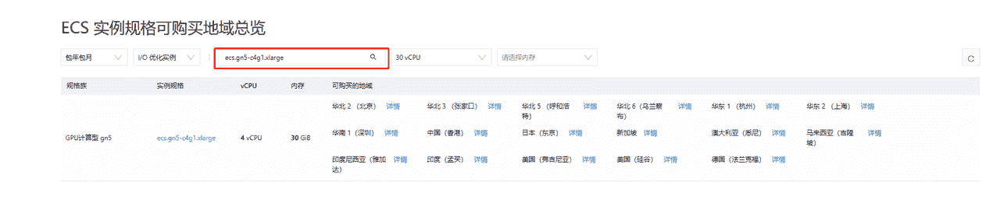
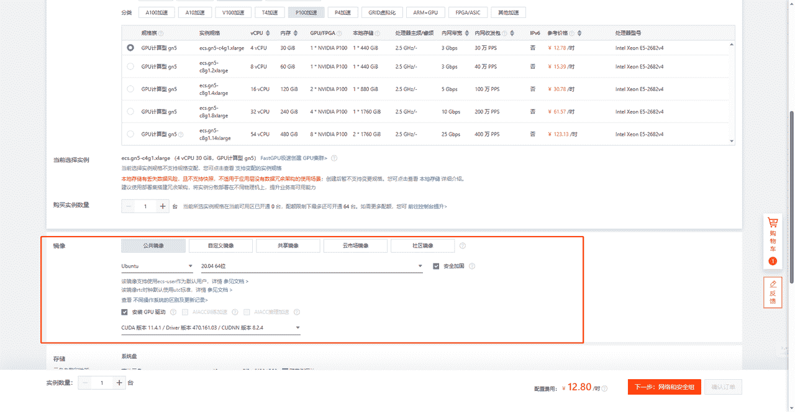
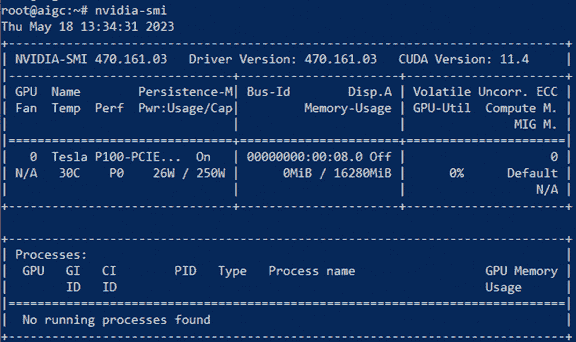
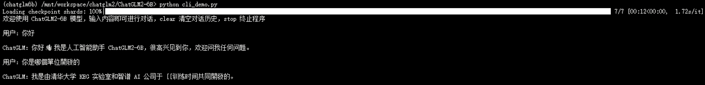
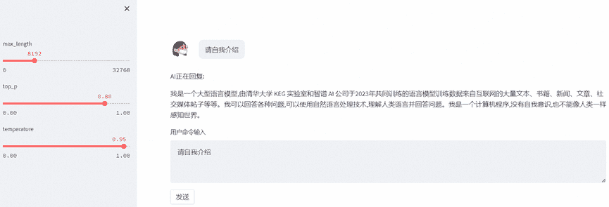

#  阿里云ECS服务器免费部署ChatGLM2-6B开源大模型

> 来源：[https://docs.feishu.cn/docx/La60diNlroDi1dxQmr3cGelpnYg](https://docs.feishu.cn/docx/La60diNlroDi1dxQmr3cGelpnYg)

创建ECS 实例



选择GPU实例



2、 设置安全组配置，配置出方向端口22，并在源IP中加入本机IP。

3、 Ssh到云ECS。系统会提示正在安装CUDA，待安装完毕，查看GPU**详情（若命令无法正常**运行，则说明CUDA没安装好）：nvidia-smi



4、 在ECS上安装相关软件包：

A、sudo apt-get update

B、安装gcc编译器(可选，系统中通常已有)：sudo apt install build-essential

C、安装Python，以3.9为例：sudo apt install python3.9

**2.2. ****conda****环境构建**

有的时候不同的github项目依赖的python env不同，通过conda的不同虚拟环境进行管理，使用的时候方便快捷。dsw镜像默认在路径：/home/pai/bin下存在一个conda环境，可以使用该环境，也可以通过如下的方式下载最新版或者miniconda使用

```
# 下载最新版本的miniconda
$wget https://repo.anaconda.com/miniconda/Miniconda3-latest-Linux-x86_64.sh
# 安装 一路回车即可
$sh Miniconda3-latest-Linux-x86_64.sh
# 初始化conda环境，会自动配置PATH保证不同环境激活的是专用的py环境
$conda init
# 重启kernel
$exit

# 查看虚拟环境列表
$conda env list
# 创建 glm6b专用的虚拟环境
$conda create -n chatglm6b python=3.9
# 激活 glm6b的环境
$conda activate chatglm6b
```

### **2.3. chatGLM体验**

#### **2.4.1. 项目地址**

资源受限，简单实践就采用相对较小的6B的模型：

github：https://github.com/THUDM/ChatGLM2-6B

土豪看这个：https://github.com/THUDM/GLM-130B

#### **2.4.2. 项目环境准备**

```
# 通过git下载项目代码和模型文件
# 更新apt-get库
sudo apt-get update
# 下载git 以及较大模型文件所依赖的 git-lfs
sudo apt-get install git
sudo apt-get install git-lfs
# 初始化
git init
git lfs install

mkdir chatglm2
# 下载项目代码
cd chatglm2
git clone https://github.com/THUDM/ChatGLM2-6B
# 安装项目依赖
cd ChatGLM2-6B
# 其中 transformers 库版本推荐为 4.30.2，torch 推荐使用 2.0 及以上的版本，以获得最佳的推理性能
pip install -r requirements.txt
```

7、将模型下载到本地，从本地加载：

```
# 创建待下载模型的文件夹路径 
$mkdir models
#切换到待下载模型的文件夹路径（确保有15G以上空间），然后执行：
$cd ./chatglm2/models
$git clone https://huggingface.co/THUDM/chatglm2-6b

# 模型文件比较大,20G,可以用下面这个看下下载速度
$sudo apt-get install bwm-ng
$bwm-ng

# 注意：模型有数个bin文件，共十几G大小。下载后需要切换到chatglm2-6b目录下检查模型文件大小。如果没有成功下载，可以使用如下命令来更新模型文件：
$cd /chatglm2/models &amp;&amp; git lfs pull
```

8、运行项目代码 cli_demo：将代码中tokenizer和model变量中的"THUDM/chatglm2-6b"更换成模型本地路径。此外，如果希望固定使用的模型实现以保证兼容性，可在tokenizer和model的 from_pretrained 调用中增加 revision="v1.0" 参数。v1.0 是当前最新的版本号。示例：/chatglm2/models/chatglm2-6b是本地模型路径。

```
model_path = &quot;/mnt/workspace/chatglm2/models/chatglm2-6b&quot;
tokenizer= AutoTokenizer.from_pretrained(model_path , revision=&quot;v1.0&quot;, trust_remote_code=True)
model = AutoModel.from_pretrained(model_path, revision=&quot;v1.0&quot;, trust_remote_code=True).cuda()
#运行脚本
python cli_demo.py
```



9、（可选）运行web_demo：除了需要修改模型存放路径外（见上），Web如需要公网访问，还需要将web_demo.py中修改：share=True

```
#A、安装gradio ：
pip install gradio
#B、在ECS上运行脚本：
python web_demo.py
#C、本地便携机上执行如下命令，将云ECS的7860端口映射到本地（IP及用户名填实际的）：
ssh -L7860:localhost:7860 root@120.79.15.98 
#D、在本地浏览器登录web界面：http://127.0.0.1:7860
```

10、运行基于Streamlit的网页版Demo（web_demo2.py）：web_demo.py有个缺陷，生成的公网链接是临时的，仅72小时有效。可使用Streamlit网页版。

```
#A、安装需要的模块：
pip install streamlit     
pip install streamlit-chat
#B、修正web_demo2.py中的模型路径&quot;THUDM/chatglm2-6b&quot;为本地路径，并指定revision=&quot;v1.0&quot;。
#C、添加安全组规则：在ECS实例安全组的入方向添加安全组规则，并放行8501端口（该端口是默认端口，也可以自定义）。
#D、运行DEMO：streamlit run web_demo2.py &amp;。如果要指定服务端口，则需要在安全组放行该端口，运行时带上端口参数，如：
streamlit run web_demo2.py --server.port 6006 &amp;
```

