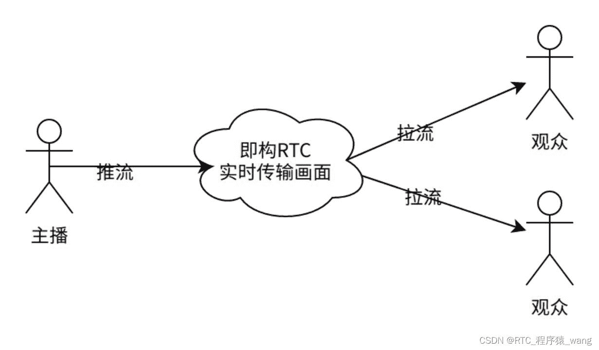
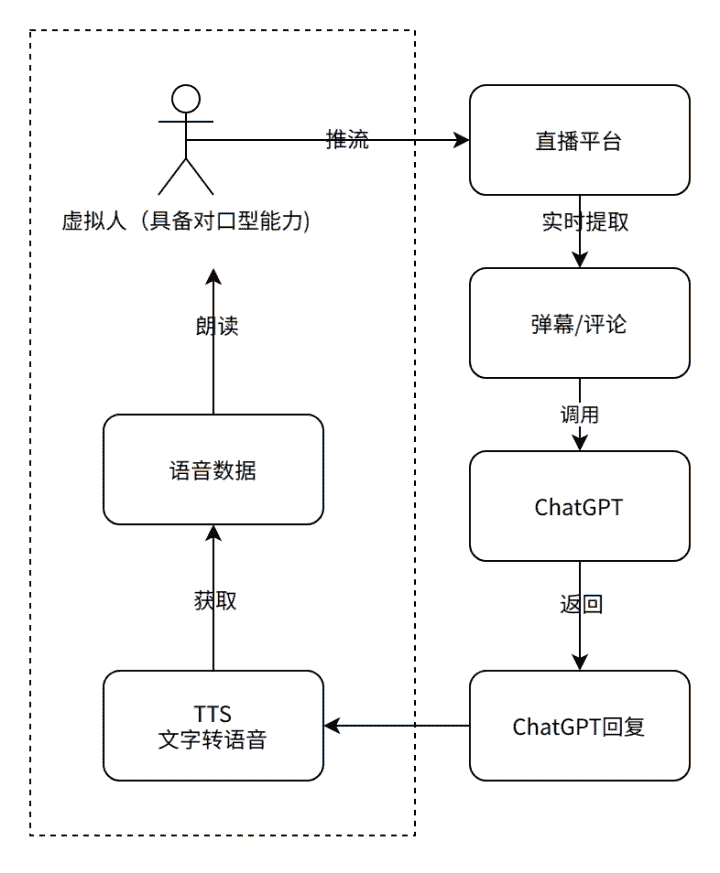
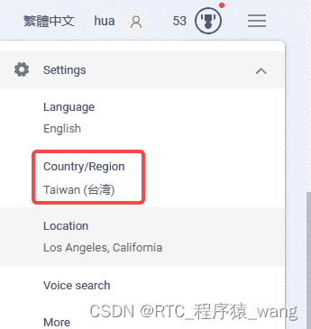
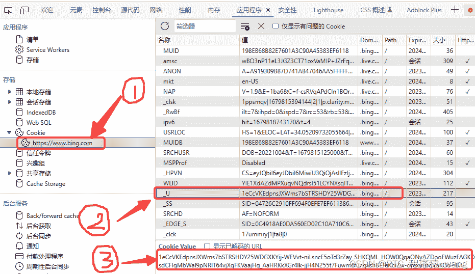
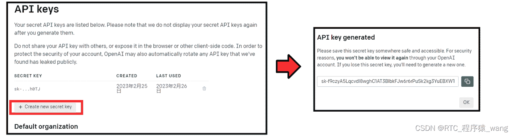
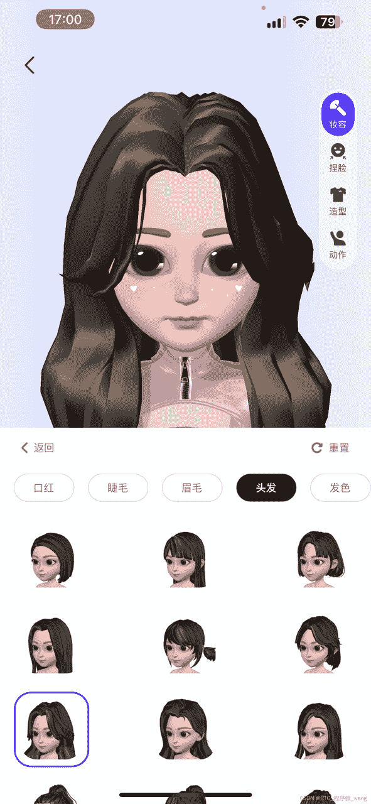
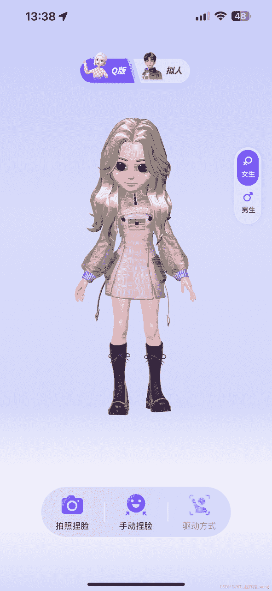
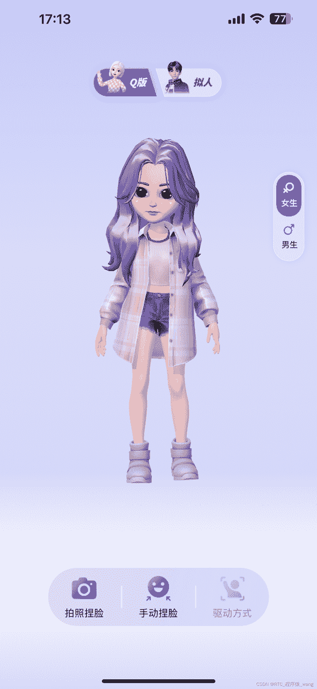
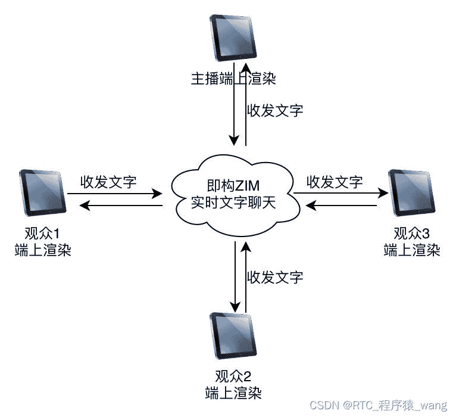
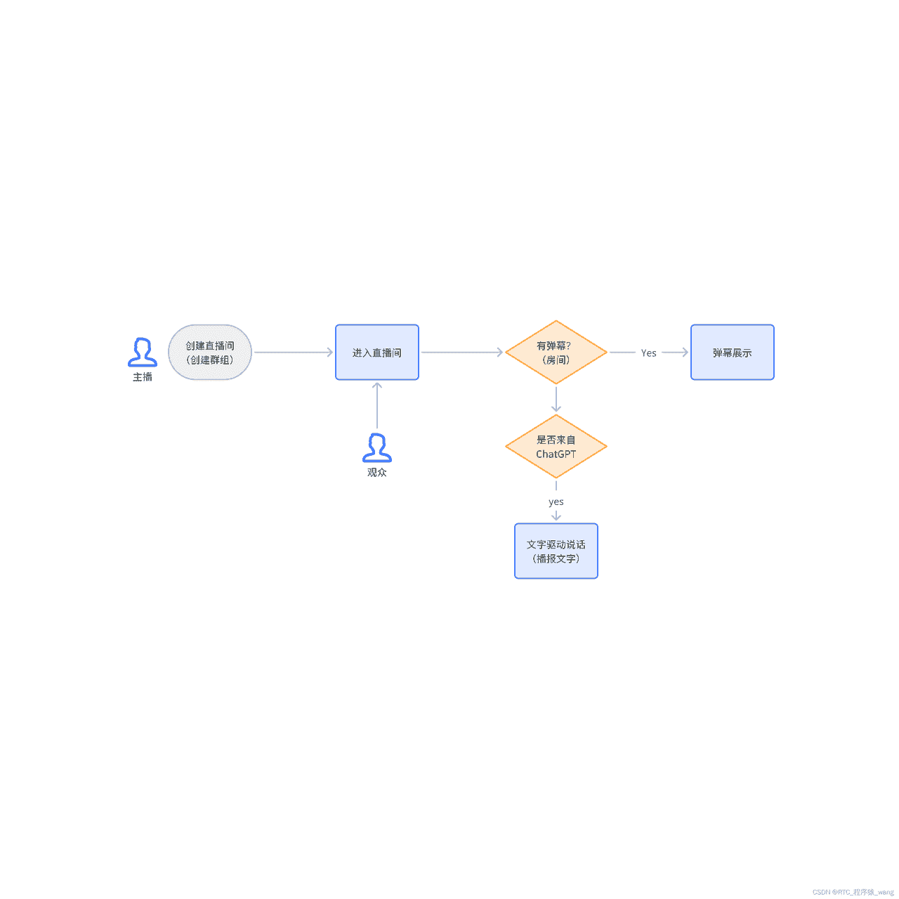

# 09 | 做Avatar虚拟人直播

> 来源：[https://docs.feishu.cn/docx/LdVbdjlcmoC4TtxmMr5c9irdnEf](https://docs.feishu.cn/docx/LdVbdjlcmoC4TtxmMr5c9irdnEf)



# 0 前言

[最近朋](https://so.csdn.net/so/search?q=GPT&spm=1001.2101.3001.7020)友圈以及身边很多朋友都在研究GPT开发，做了各种各样的小工具小Demo，AI工具用[起来](https://www.zego.im/product/InstantMessage?source=csdn&product2&login=from_csdn)是真的香！在他们的影响下，我也[继续捣](https://www.zego.im/product/metaworld?source=csdn&product3&login=from_csdn)鼓GPT Demo，希[望更多](https://www.zego.im/product/metaworld?source=csdn&product3&login=from_csdn)的开发者加入一起多多交流。

上一篇结合即时通 IM SDK捣鼓了一个Demo ChatGPT群聊机器人Demo ，也收到了一些还不错的反馈，有伙伴用于客服场景解放了一部分人工重复工作提升了效率。趁着周末我捣鼓了一个ChatGPT虚拟人直播，结合了同样热门的元宇宙技术。

本文将通过详细[开发流程](https://so.csdn.net/so/search?q=%E5%BC%80%E5%8F%91%E6%B5%81%E7%A8%8B&spm=1001.2101.3001.7020)来为大家举例如何快速实现一个[虚拟人](https://www.zego.im/product/metaworld?source=csdn&product3&login=from_csdn)[直播，](https://www.zego.im/product/metaworld?source=csdn&product3&login=from_csdn)可用于无人直播场景。ChatGPT虚拟人可抓取直播中粉丝弹幕和评论并回复来进行用户互动，提升直播间的活跃与用户体验。

最终实现效果如下所示：[

GP](https://live.csdn.net/v/289757?login=from_csdn)[T虚拟](https://www.zego.im/product/metaworld?source=csdn&product3&login=from_csdn)人直播

# 1 实现思路

ChatGPT4.0[虚拟人](https://www.zego.im/product/metaworld?source=csdn&product3&login=from_csdn)[直播，](https://www.zego.im/product/metaworld?source=csdn&product3&login=from_csdn)首先得要有2个最基本的能力：ChatGPT4.0接口和虚拟人交互能力，这两块我们后面具体讲。整个流程如下图所示：



1.需要有具备文字驱动能力的[虚拟人](https://www.zego.im/product/metaworld?source=csdn&product3&login=from_csdn)[。具体](https://www.zego.im/product/metaworld?source=csdn&product3&login=from_csdn)[来说，需要将](https://www.zego.im/product/metaworld?source=csdn&product3&login=from_csdn)文字转[为语音，然后](https://www.zego.im/product/metaworld?source=csdn&product3&login=from_csdn)虚拟人能根据语音对口型。这[里推荐](https://www.zego.im/product/metaworld?source=csdn&product3&login=from_csdn)使用即构Avatar，即构Avatar可以捏脸[定制，](https://www.zego.im/product/metaworld?source=csdn&product3&login=from_csdn)同时具备文字驱动口型能力。

2. 直播推流。抖音、快手可以用直播伴侣实时截屏推流。

3. 获取实时弹幕/评论。虚拟人根据观众发的弹幕或者评论文本数据发送给ChatGPT，可以去github找开源代码。这里提供一个最简单的思路：在网页版注入JS代码，js实时读取网页上的弹幕。

4. 调用ChatGPT。将实时弹幕/评论数据发送给ChatGPT并获取回复。

5. 虚拟人播报ChatGPT的回复。

# 2 ChatGPT接入

目前openAI提供的接口是ChatGPT3.5，可以直接调用。bing在最新版Edge浏览器提供ChatGPT4.0体验，有一些开源库对其做了二次封装，只需提供Cookie即可体验。这里我们把两种方式都讲解。

## 2.1 ChatGPT 4.0 接入

首先注册bing账号：

1.前往https://www.microsoft.com/zh-cn/edge/download?ch&form=MA13FJ 下载最新的Edge浏览器。

2. 开启VPN，注册用户或使用已有账号登录，点击右上角「设置」图标，将所在区域设置如下

3. 打开Edge，输入网址https://www.bing.com/search?form=MY0291&OCID=MY0291&q=Bing+AI&showconv=1



接下来在代码里面封装ChatGPT4.0接口，先安装第三方基于Edge浏览器的库：

```
npm i @waylaidwanderer/chatgpt-api
```

接下来二次封装

```
import { BingAIClient } from &#x27;@waylaidwanderer/chatgpt-api&#x27;;
export class BingGPT {
    /*
    * http_proxy, apiKey
    **/
    constructor(http_proxy, userCookie) {
        this.api = this.init(http_proxy, userCookie); 
    }
    init(http_proxy, userCookie) {
       console.log(http_proxy, userCookie)
        const options = {
            // Necessary for some people in different countries, e.g. China (https://cn.bing.com)
            host: &#x27;https://www.bing.com&#x27;,
            // &quot;_U&quot; cookie from bing.com
            userToken: userCookie,
            // If the above doesn&#x27;t work, provide all your cookies as a string instead
            cookies: &#x27;&#x27;,
            // A proxy string like &quot;http://&lt;ip&gt;:&lt;port&gt;&quot;
            proxy: http_proxy,
            // (Optional) Set to true to enable `console.debug()` logging
            debug: false,
        };

        return new BingAIClient(options);
    }
    //调用chatpgt 
    chat(text, cb) {
        var res=&quot;&quot;
        var that = this;
        console.log(&quot;正在向bing发送提问&quot;, text ) 
        this.api.sendMessage(text, { 
            toneStyle: &#x27;balanced&#x27;,
            onProgress: (token) =&gt; { 
                if(token.length==2 &amp;&amp; token.charCodeAt(0)==55357&amp;&amp;token.charCodeAt(1)==56842){
                    cb(true, res);
                } 
                res+=token;
            }
        });  
    }
} 
```

注意到，除了需要提供vpn地址以外，还需要提供cookie数据。cookie可以在Edge浏览器中按F12打开开发工具，点击应用程序Tab，从左侧Cookie中找到_U的value即为想要的cookie，如下图所示：



## 2.2 ChatGPT 3.5接入

因为ChatGPT4.0基于浏览器，非官方提供的API，整体会有些不太稳定。而OpenAI官方提供了ChatGPT3.5，相比之下更稳定。

首先要有OpenAI的ChatGPT账号，在这里我们不细讲，不了解的同学可以参考我另一篇文章，链接: 《当我把ChatGPT拉进群聊里，我的朋友都玩疯了》接下来只需安装ChatGPT库：

```
npm install chatgpt
```

注意要使用nodejs 18.0以上版本安装，因为国内的IP无法使用ChatGPT，因此必须要有VPN代理。再安装一个代理库：

```
npm install https-proxy-agent node-fetch
```

接下来，二次封装一下：

```
import { ChatGPTAPI } from &quot;chatgpt&quot;;
import proxy from &quot;https-proxy-agent&quot;;
import nodeFetch from &quot;node-fetch&quot;;
 
export class ChatGPT {
 
    constructor(http_proxy, apiKey) {
        this.api = this.init(http_proxy, apiKey);
        this.conversationId = null;
        this.ParentMessageId = null;
    }
    init(http_proxy, apiKey) {
        console.log(http_proxy, apiKey)
        return new ChatGPTAPI({
            apiKey: apiKey,
            fetch: (url, options = {}) =&gt; {
                const defaultOptions = {
                    agent: proxy(http_proxy),
                };
 
                const mergedOptions = {
                    ...defaultOptions,
                    ...options,
                };
 
                return nodeFetch(url, mergedOptions);
            },
        });
    }
    //调用chatpgt 
    chat(text, cb) {
        let that = this
        console.log(&quot;正在向ChatGPT发送提问:&quot;, text)
        that.api.sendMessage(text, {
            conversationId: that.ConversationId,
            parentMessageId: that.ParentMessageId
        }).then(
            function (res) {
                that.ConversationId = res.conversationId
                that.ParentMessageId = res.id
                cb &amp;&amp; cb(true, res.text)
            }
        ).catch(function (err) {
            console.log(err)
            cb &amp;&amp; cb(false, err);
        });
    }
} 
```

注意到除了需要提供VPN地址，还需要提供apiKey。登录OpenAI后，打开链接https://platform.openai.com/account/api-keys 即可获取apiKey，如下图所示



# 3 [虚拟人](https://www.zego.im/product/metaworld?source=csdn&product3&login=from_csdn)接入

[虚拟人](https://www.zego.im/product/metaworld?source=csdn&product3&login=from_csdn)提供商有很多，由[于目前](https://www.zego.im/product/metaworld?source=csdn&product3&login=from_csdn)我们不仅仅需要有虚拟形象[，还](https://doc-zh.zego.im/article/14875?source=CSDNarticle66&login=from_csdn)[需要虚拟人能](https://www.zego.im/product/metaworld?source=csdn&product3&login=from_csdn)够说话（ChatGPT提供逻辑思维能力）。因此，我们这里直接选用 即构Avatar，它内置了文本驱动能力，可以很方便将ChatGPT的回复文字内容直接读出来，并有口型匹配。非常适合我们这个场景。

官方提供了非常详细的教程：[官方教程地址](https://doc-zh.zego.im/article/14876?source=CSDNarticle66&login=from_csdn)，本文简单讲解一些关键实现，具体完整代码可以参考文末资源附件。

设置[虚拟人](https://www.zego.im/product/metaworld?source=csdn&product3&login=from_csdn)形象：

```
private void setCharacter(User user) {
    String sex = ZegoCharacterHelper.MODEL_ID_MALE;
    if (!user.isMan) sex = ZegoCharacterHelper.MODEL_ID_FEMALE;
 
    // 创建 helper 简化调用
    // base.bundle 是头模, human.bundle 是全身人模
    mCharacterHelper = new ZegoCharacterHelper(FileUtils.getPhonePath(mApp, &quot;human.bundle&quot;, &quot;assets&quot;));
    mCharacterHelper.setExtendPackagePath(FileUtils.getPhonePath(mApp, &quot;Packages&quot;, &quot;assets&quot;));
    // 设置形象配置
    mCharacterHelper.setDefaultAvatar(sex);
    // 角色上屏, 必须在 UI 线程, 必须设置过avatar形象后才可调用(用 setDefaultAvatar 或者 setAvatarJson 都可以)
    mCharacterHelper.setCharacterView(user.avatarView, () -&gt; {
    });
    mCharacterHelper.setViewport(ZegoAvatarViewState.half);
    //设置头发、衣服等
    mCharacterHelper.setPackage(&quot;ZEGO_Girl_Hair_0001&quot;);
    mCharacterHelper.setPackage(&quot;ZEGO_Girl_Tshirt_0001_0002&quot;);
    mCharacterHelper.setPackage(&quot;facepaint5&quot;);
    mCharacterHelper.setPackage(&quot;irises2&quot;); 
    
    initTextApi();
    updateUser(user); 
}
```

[可以看](https://www.zego.im/product/metaworld?source=csdn&product3&login=from_csdn)[到，只](https://www.zego.im/product/metaworld?source=csdn&product3&login=from_csdn)需简单几行代码即可定制虚拟人“皮肤”，使用非常友好。在文字驱动虚拟人说话方面就更简单：

```
public void playText(String text) {
    if (mTextApi == null) return;
    mTextApi.playTextExpression(text); 
}
```

当然了，这里展示的是最关键代码。要想使用即构avatar还需要做一些权鉴认证、引擎初始化等工作，直接复用本文文末提供的代码附件即可。

需要注意的是，官方提供的Demo源码中只有基础资源。换句话说，还有很多非常酷炫的“皮肤”可以使用。但是因为资源太大，不方便打包。如果读者有更多资源需求，可以直接去官网找客服索要。

下面列出一些官方能提供的虚拟形象“皮肤”示例：







[还有很多捏脸](https://doc-zh.zego.im/article/14973?source=CSDNarticle66&login=from_csdn)[能力，这里不](https://www.zego.im/product/metaworld?source=csdn&product3&login=from_csdn)一一描述，感兴趣的同学可以直接去官网 （点击这里）去下载体验app，直接感受一下即构Avatar的强大。

# 4 基于即构SDK实现虚拟直播

对于B站、抖音、快手等第三方平台，想要做虚拟直播得借助官方提供的推流工具，如直播伴侣等。但官方没有提供实时获取直播间评论（或弹幕）的接口，当然了，你可以用一些技术手段来获取，这里不过多讲解。接下来我们讲解不用第三方平台，自己简单几行代码实现搭建直播平台。

## 4.1 搭建[虚拟人](https://www.zego.im/product/metaworld?source=csdn&product3&login=from_csdn)直播平台思路

搭建虚拟直播平台有2个思路：

[1.主播实](https://www.zego.im/product/realtime-video?source=csdn&product1&login=from_csdn)时传输手机画面，观众[实时接](https://www.zego.im/product/realtime-video?source=CSDNarticle66&login=from_csdn)收主播发送[的内容（图像](https://www.zego.im/product/metaworld?source=csdn&product3&login=from_csdn)），[即构实](https://www.zego.im/solution/metalive?source=CSDNarticle66&login=from_csdn)时音视频RTC 该方案实[现 可](https://www.zego.im/product/metaworld?source=csdn&product3&login=from_csdn)查看，RTC+Avatar方案可查看。

我之前基于抖音平台做的虚拟人直播Demo， B站、快手等第三方直播平台的实现原理类似。


2.基于即构Z[IM](https://www.zego.im/product/InstantMessage?source=csdn&product2&login=from_csdn)，实时传输文字（文字）

[虚拟人](https://www.zego.im/product/metaworld?source=csdn&product3&login=from_csdn)直播与其他直播有一个差别是[虚拟人](https://www.zego.im/product/metaworld?source=csdn&product3&login=from_csdn)是在用户端上使用固定算法渲染出来的，而不是[主播实](https://www.zego.im/product/metaworld?source=csdn&product3&login=from_csdn)时拍摄的画面。因此我们完全不需要主播实时传输画面（图像），只需通过广播文字内容（相当于群组聊天），观众接收到文字内容后实时渲染虚拟人表情即可。这样可以大大节省带宽成本。

即构Z[IM](https://www.zego.im/product/InstantMessage?source=csdn&product2&login=from_csdn)提供全面的[IM](https://www.zego.im/product/InstantMessage?source=csdn&product2&login=from_csdn)[能力](https://www.zego.im/product/InstantMessage?source=csdn&product2&login=from_csdn)，支持单聊/群聊/房间聊天，可根据实际业务[自由组合](https://www.zego.im/product/InstantMessage?source=CSDNarticle66&login=from_csdn)IM能力。群聊消息稳定可靠、延迟低，全球任何一个地区都有接入服务的节点保障消息到达。 了解更多



## 4.2 具体实现

从上面两个方案可以看到，对于虚拟直播间来说[，使用](https://www.zego.im/product/metaworld?source=csdn&product3&login=from_csdn)文字实时传输到每个端上，[再本](https://www.zego.im/product/InstantMessage?source=csdn&product2&login=from_csdn)地渲染虚[拟人画](https://www.zego.im/product/metaworld?source=csdn&product3&login=from_csdn)面，可以做到最低成本。

具体来说，一个直播间可以通过一个房间(room)来管理，在即构IM的房间内，可以使用弹幕功能来实现收发文字。相比发送聊天消息，发送弹幕消息不会被存储，更适合直播间评论功能。用户创建直播间时，底层代码创建的是一个房间，并自动加入ChatGPT这个群成员。ChatGPT在群里接收到数据时，调用ChatGPT接口，得到文字回复后，再转发到群里。每个观众接收到ChatGPT回复的文字后，自动渲染虚拟人播报文字内容。



同样的，这里我们只展示关键代码。创建房间、加入房间、收到实时评论（弹幕）。

创建房间、加入房间：

```
//创建房间
public void createRoom(String masterId, String roomId, String roomName, CB cb) {
    
    ZIMRoomInfo groupInfo = new ZIMRoomInfo();
    groupInfo.roomID = roomId;
    groupInfo.roomName = roomName;
 
    zim.createRoom(groupInfo, new ZIMRoomCreatedCallback() {
        @Override
        public void onRoomCreated(ZIMRoomFullInfo roomInfo, ZIMError errorInfo) {
            if (errorInfo.code == ZIMErrorCode.SUCCESS) {
 
                inviteJoinRoom(masterId, roomId, CHATGPT_ID, cb);//这里把chagpt的用户id硬编码
            } else {
                cb.complete(false, &quot;房号已存在，请更换一个房间号！&quot;);
            }
        }
    });
}
 
//加入房间
public void joinRoom(String roomId, CB cb) {
    zim.joinRoom(roomId, new ZIMRoomJoinedCallback() {
        @Override
        public void onRoomJoined(ZIMRoomFullInfo roomInfo, ZIMError errorInfo) {
            Log.e(TAG, &quot;&gt;&gt;&quot; + errorInfo.code);
            if (errorInfo.code == ZIMErrorCode.ROOM_DOES_NOT_EXIST) {
                cb.complete(false, &quot;房间不存在！&quot;);
            } else if (errorInfo.code == ZIMErrorCode.SUCCESS || errorInfo.code == ZIMErrorCode.THE_ROOM_ALREADY_EXISTS) {
                cb.complete(true, roomInfo.baseInfo.roomName);
            }
        }
    });
}
```

接收到消息

//接收到文字消息

```
@Override
public void onRcvMsg(Msg msg) { 
    switch (msg.proto) {//判断消息类型
        case ChatGPT: {//来自ChatGPT的消息，语音播报文字
            mZegoMngr.getAvatarMngr().playText(msg.msg);
            sendDM(msg.msg.replace(&quot;\n&quot;, &quot;&quot;), 0);
            break;
        }
        case DanMu: {//收到弹幕消息，直接在屏幕上展示
            sendDM(msg.msg, msg.extInt);
            break;
        }
        case DismissRoom: {//收到解散房间消息，退出房间
            mZegoMngr.getZIMMngr().leaveRoom(msg.msg, new CB() {
                @Override
                public void complete(boolean succ, String msg) {
                    ShowUtils.alert(RoomActivity.this, &quot;提示&quot;, &quot;房间已解散！&quot;, new ShowUtils.OnClickOkListener() {
                        @Override
                        public void onOk() {
                            back();
                        }
                    });
                }
            });
            break;
        }
    }
}
```

# 5 Github源码

1.  ChatGPT调用代码（nodejs）

1.  直播客户端客户端（android）

# 6 ChatGPT[虚拟人](https://www.zego.im/product/metaworld?source=csdn&product3&login=from_csdn)直播Demo 使用工具

1.  直播产品：RTC SDK [Android Java](https://doc-zh.zego.im/article/7627?source=CSDNarticle66&login=from_csdn)[实时音视频](https://www.zego.im/product/realtime-video?source=csdn&product1&login=from_csdn)实现流程 - 开发者中心

1.  语聊房：Z[IM](https://www.zego.im/product/InstantMessage?source=csdn&product2&login=from_csdn) SDK [Android](https://doc-zh.zego.im/article/11568?source=CSDNarticle66&login=from_csdn)[即时通讯](https://www.zego.im/product/InstantMessage?source=csdn&product2&login=from_csdn)SDK实现基本消息收发功能 - 开发者中心

1.  GPT4.0:[New bing](https://www.bing.com/new?login=from_csdn)

1.  GPT3.5: [ChatGPT](https://chat.openai.com/?login=from_csdn)

**  **

**更多****AI****虚拟助手、****VR****元宇宙****、**汽车座舱等前沿科技相关知识可以关注我，定期推送精选内容，获取独家干货！

