# 【MJ应用系列课程 第一讲】初识超火的AI绘画神器Midjourney

> 来源：[https://docs.feishu.cn/docx/CxQrdPtDcoZHuzxUE92c4vCjnCb](https://docs.feishu.cn/docx/CxQrdPtDcoZHuzxUE92c4vCjnCb)

### 写在前面

官方文档是最好的入门课程。相较于市面上琳琅满目的课程，官方文档通常是学习新技能的首选途径。它直接来自于产品创造者，能够提供最真实、最全面、最实时的产品信息，也附有最佳实践和示例 DEMO。当然，也存在许多精心策划、具备良好口碑的课程，仔细辨别，谨慎消费，避免被新媒体平台爆人眼球的标题和产生的焦虑所俘获。

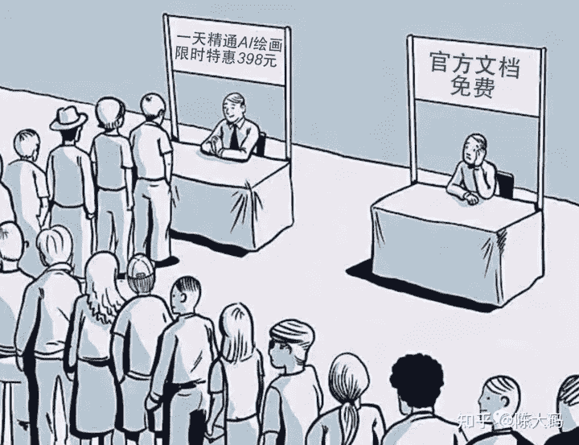

### 课程设计

课程目的：本课程旨在让大家了解 Midjourney 平台及其操作使用方法，并通过商业应用和一些绘图挑战，探索 Midjourney 的应用潜能。

课程性质：免费

课程形式：图文/订阅号

课程内容：

初步设定以下几个章节

1.  认识超火的 AI 绘画神器 Midjourney。

1.  Midjourney 的基本操作和高级技巧

1.  Midjourney AI 绘画的商业应用：桌面背景、书籍插画、海报、Logo、宣传广告、图标

1.  挑战：使用 Midjourney AI 绘制《三体 2》主角罗辑构思的完美女性 -- 庄颜

1.  挑战：待定

1.  其它比较优秀的智能 AI 图像工具+辅助神器

### Midjourney 是什么？

Midjourney 是一款在线 AI 图片生成工具，它能根据用户输入的文本描述（Prompt）生成相应的图片。Midjourney 内置了一个巨大的神经网络模型，这个模型通过学习海量的图片，获得了生成图片的能力。用户输入文字描述后，Midjourney 会解析描述，理解用户想要的图片元素和场景，然后利用其内置的神经网络模型生成匹配的新图片。

官网：https://www.midjourney.com/

使用：使用 Discord 机器人+指令来完成人机交互（第二章重点）

### Midjourney 火爆吗？

当然火爆，除了在各大社交、新媒体平台广泛传播，敏锐捕捉商机的课程销售也随处可见，甚至有针对儿童的 Midjourney 课程。

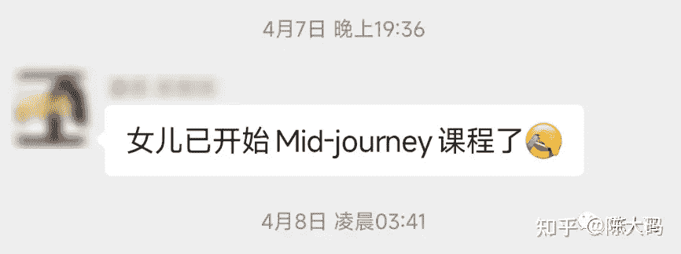

下面，我们利用谷歌趋势（Google Trends）、百度指数、微信指数和微热点四大平台的实时数据，直观呈现 Midjourney 当前的火爆程度。谷歌趋势，采用热度指数的方式，记录热度的变化。单一指标并不能显示其有多火热，我们添加两个关键词 ChatGPT（OpenAI 产品，当下最热） 和 NewBing（微软产品） 作为参照参数。如图所示，热度并不优秀，在全球范围，我们暂时定义为有热度。

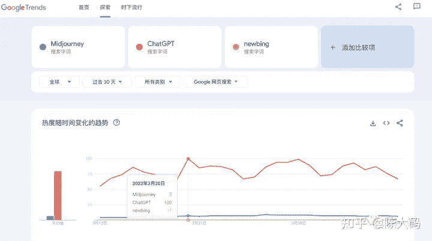

谷歌趋势（全球范围）

我们把范围缩小到中国范围，热度立马上升不少，相对于特别能打的 ChatGPT，作为单一图像领域的 AI 产品，Midjourney 也算是火爆的。

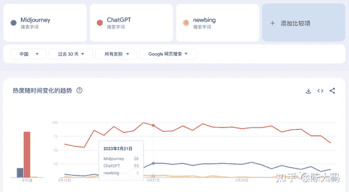

谷歌趋势（中国范围）

百度指数直接公开了关键词热度指数，数据也是可观的，而且其资讯指数正在暴增。

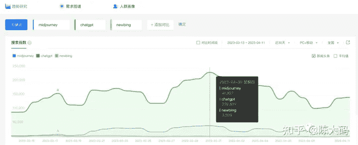

百度指数对比

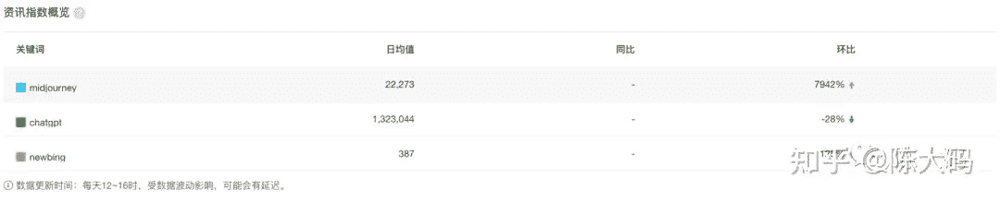

百度资讯指数在爆增

如今，新媒体平台蓬勃发展，用户获取信息的方式变得多样化、多平台化，不再仅限于百度搜索。这使得百度指数（关键词搜索与公开信息量）的说服力大打折扣。我们参考一下微热点（注）的指数趋势，发现Midjourney 与 ChatGPT 之间的差距明显缩小，越发火爆。这应该是因为在新媒体平台上，视觉元素更具吸引力，能更轻松地实现信息传播。

注：微热点数据来源，中文互联网大数据及新浪微博官方数据汇聚

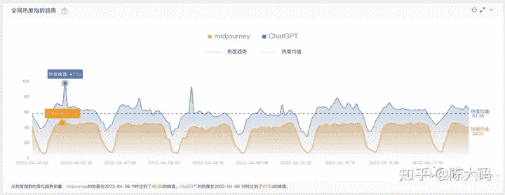

微热点近7天热度趋势

最后，我们再看一下微信指数的数据，微信指数的数据来源主要是搜一搜、视频号、公众号文章、网页及部分广告渠道热度，从下图的趋势中可以观察到，自三月下旬以来，数据一直在持续增长。在收集数据时，原本计划将ChatGPT纳入对比，然而，日千万级的指数让我惊呆了，ChatGPT 还是另开新篇吧。

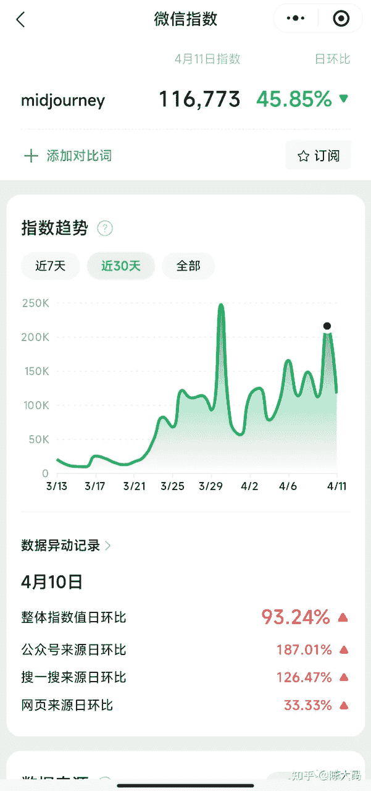

微信指数

除了这四个官方数据平台，国内还拥有诸多独立的数据分析平台，如巨量算数、蝉妈妈、点点和飞瓜数据等。这些平台也可以针对抖音、小红书等新媒体平台，进行热度趋势分析。感兴趣的朋友不妨一试。

### Midjourney 为什么会火？

我想把 Midjourney 创始人的产品理念，作为第一条原因，“AI 不是现实世界的复刻，而是人类想象力的延伸”。

Midjourney从诞生到崛起，再到自然而来的不菲的收益，整个过程令人叹为观止。这个仅由11人组成的创业团队，没有财务回报目标压力，也没有来自投资者融资的压力。然后，他们的产品成功吸引了1000万+的社区成员，并实现了超过1亿美元的订阅收入。这本身就像 AI 创作一样，过程充满想象力，结果令人惊奇。

二、内部驱动因素：出色的高品质内容

Midjourney 生成的图片细节丰富，色彩饱满，很接近真实照片或者插画师创作的效果。文末，附带了相关作品。

三、外部支持平台：依托于Discord社交网络

Discord是一个功能强大且面向社群的通讯平台，尤其适合游戏玩家和各种兴趣社群。依附于 Discord 强大的社区属性，Midjourney 很容易聚集众多相同爱好的粉丝，形成社群，使创作者的想象力得以放大，并进行分享和传播， 这是 Midjourney 快速成长的优质土壤。好风凭借力！

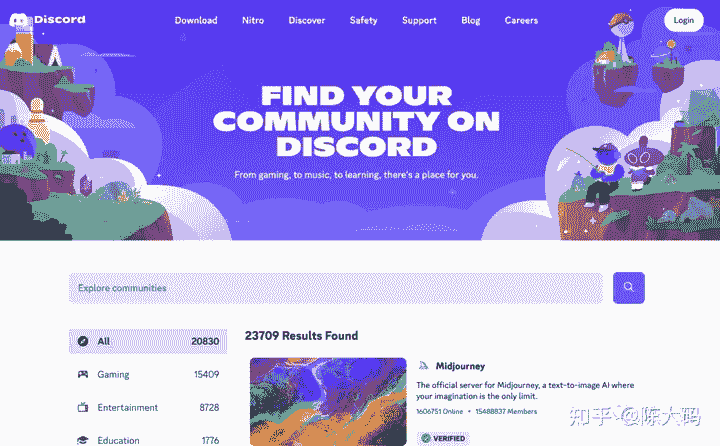

四、突发事件推动在2022年8月，美国科罗拉多州博览会举办的美术大赛中，一位名叫杰森·艾伦（Jason Allen）的艺术家获得了第一名。他的这幅作品，就是使用 Midjourney 生成的（下图）。

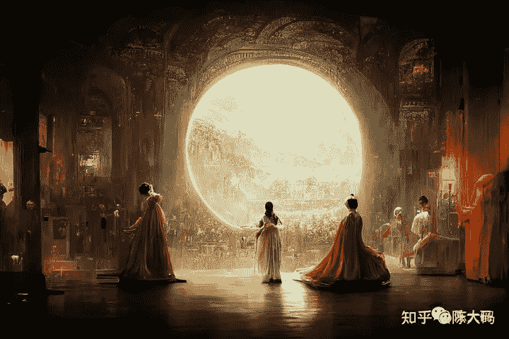

获奖作品《太空歌剧院》 Jason Allen via Midjourney

艾伦比较痴迷于“太空歌剧”系列作品，他花了 80 多个小时，对本次名为《太空歌剧院》的获奖作品，进行了 900 多次迭代，不断添加/调整一些词来来微调作品的基调和给人的感觉。而评委，并没有意识到这幅作品是由 AI 生成的。这个事件，让 Midjourney 的用户在一个月内由 30 万激增到了 150 万。

五、其它关键点

易于上手、低门槛的使用体验

加入 Discord 后，输入描述（prompt）即可生成图像，最简单的人机交互。

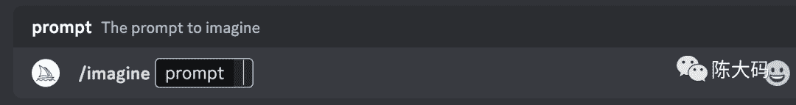

定价策略合理

现在 Midjourney 已经取消了免费试用额度。优秀的作品，总会有人为之付费。

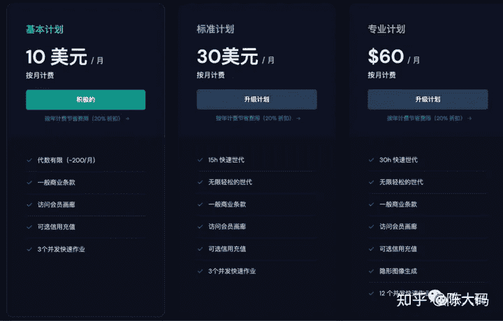

不断地学习和迭代，不断进化

自 2018 年 Midjourney Alpha 版本推出以来，已经经历了Alpha、 Beta、1.0、2.0、3.0、4.0 版本，5.0 版本也于 2023 年 3 月 15 日推出，手动设置或者使用Prompt参数即可开启，如下图，体验与众不同的产品形态。

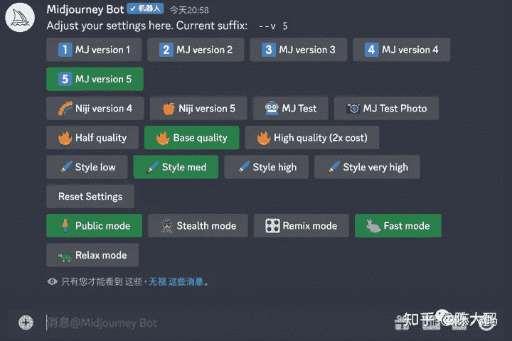

输入/setting 指令后，出现的设置消息界面，点击标签后即可完成设置

附：Midjourney 根据文字描述（prompt）生成的一些作品

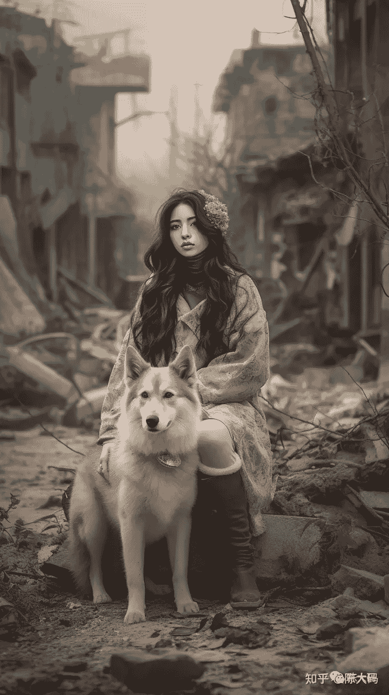

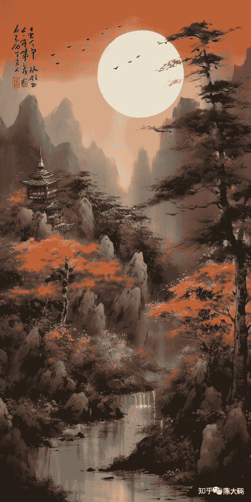

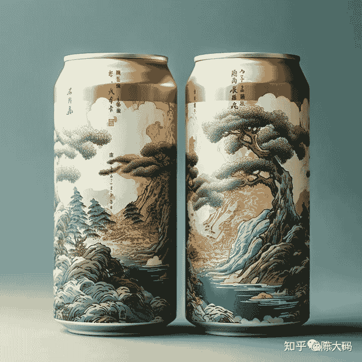

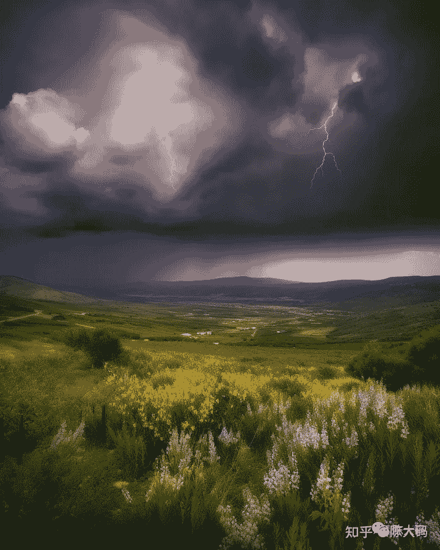

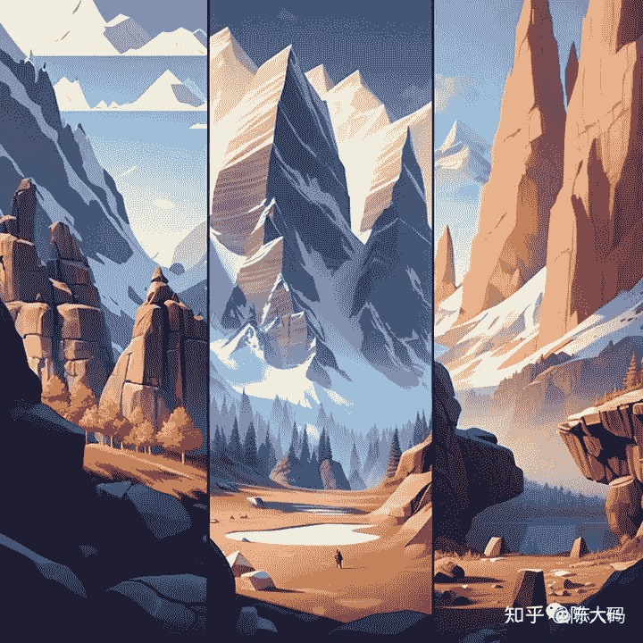

OK，下一章开始更新 Midjourney 的基本操作和高级技巧，敬请期待。

（完）

原文友情链接：https://zhuanlan.zhihu.com/p/624064840