# 【MJ应用系列课程 第二讲】 Midjourney注册及付费指南

> 来源：[https://docs.feishu.cn/docx/BXeud71VvoARzWx8Q0UcFrOInCf](https://docs.feishu.cn/docx/BXeud71VvoARzWx8Q0UcFrOInCf)

## 一、Midjourney 注册方法

### **1、准备魔法（🪜）**

如果你所在地区无法访问 Discord，需要具备魔法，这里有几个价格合适且安全性较高的魔法给大家推荐：

[点击这里查看](https://justmysocks2.com/)

[点击这里查看](https://apps.apple.com/us/app/feima-vpn/id1587839225)

[v2rayN-With-Core.zip](https://internal-api-drive-stream.feishu.cn/space/api/box/stream/download/all/WGyybGBOWoY96ixkP2YcFVNJnqb)

[点击这里查看](https://xn--4gq62f52gdss.com/#/subscribe)

### **2、注册 Discord**

Midjourney 目前是挂载在 Discord 平台中使用的，所以在使用 Midjourney 之前，你需要注册一个 Discord 账号。注册过程非常简单，只需要遵循以下步骤：

+   打开 Discord 官网：https://discord.com/

+   点击右上角的“登录”按钮。

+   点击下方的“注册”按钮。

+   输入你的账号信息，例如你的邮箱、用户名、密码等，并点击“继续”。

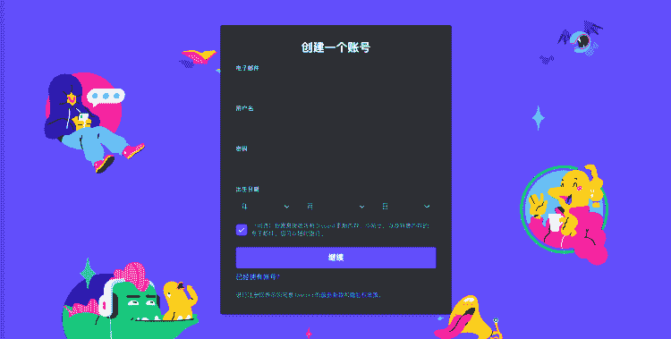

+   通过选择一些随机图片完成“I am human”验证过程。

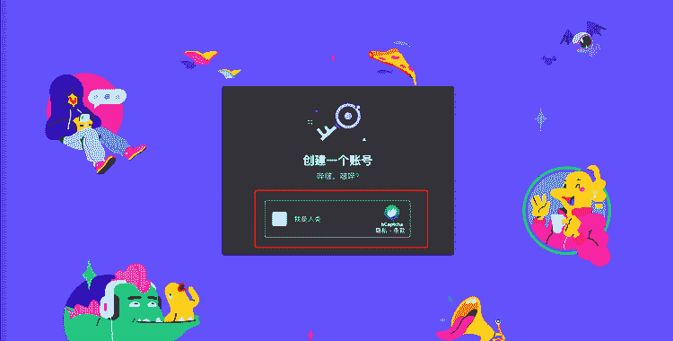

+   进入Discord界面后，你会看到一个提示，要求验证手机号码，不用担心，任何地区的号码都可以用于验证。

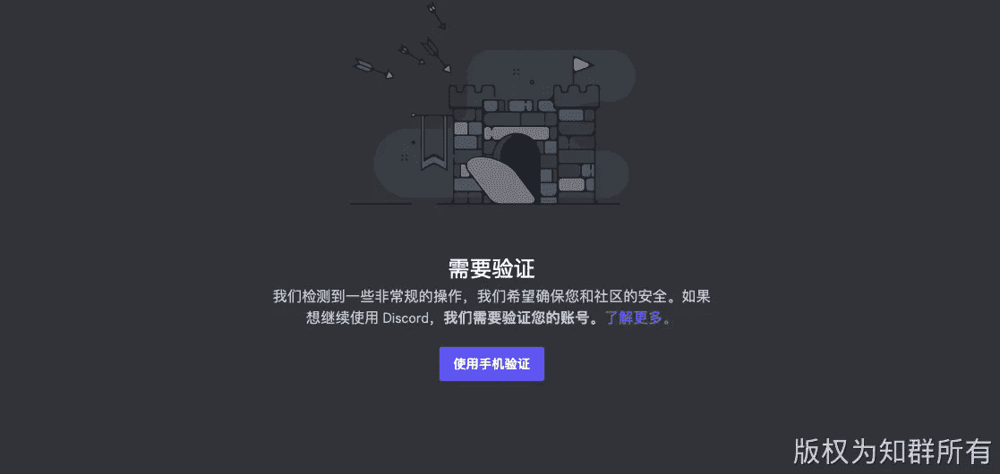

+   注意：先选择地区再输入手机号码。

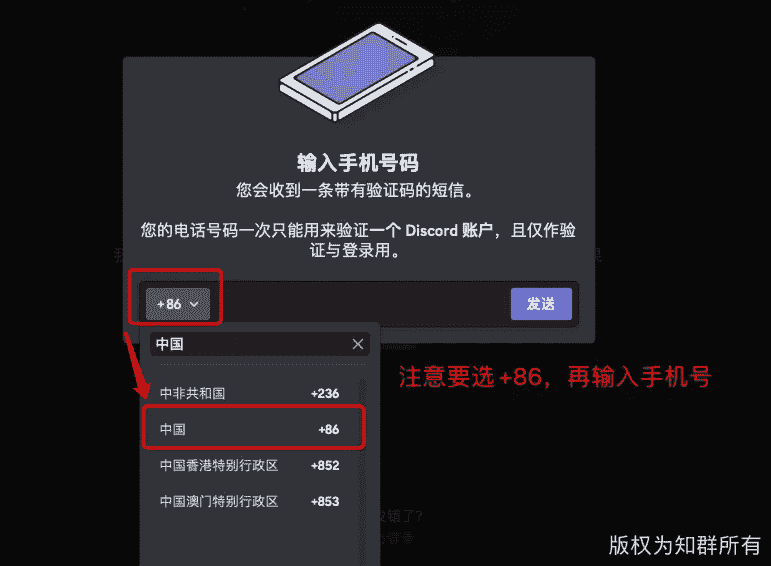

+   验证了手机号码之后，需要验证电子邮箱。

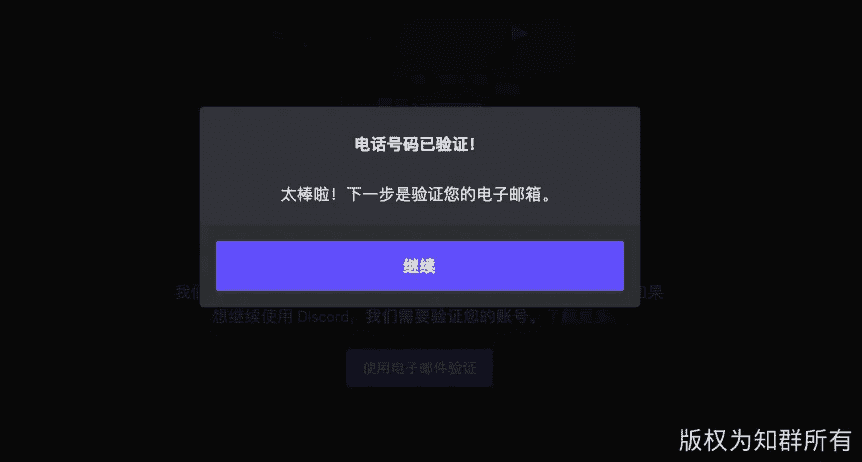

+   通过邮箱验证你的账户。

+   检查你的邮箱是否收到了来自 Discord 的验证消息。

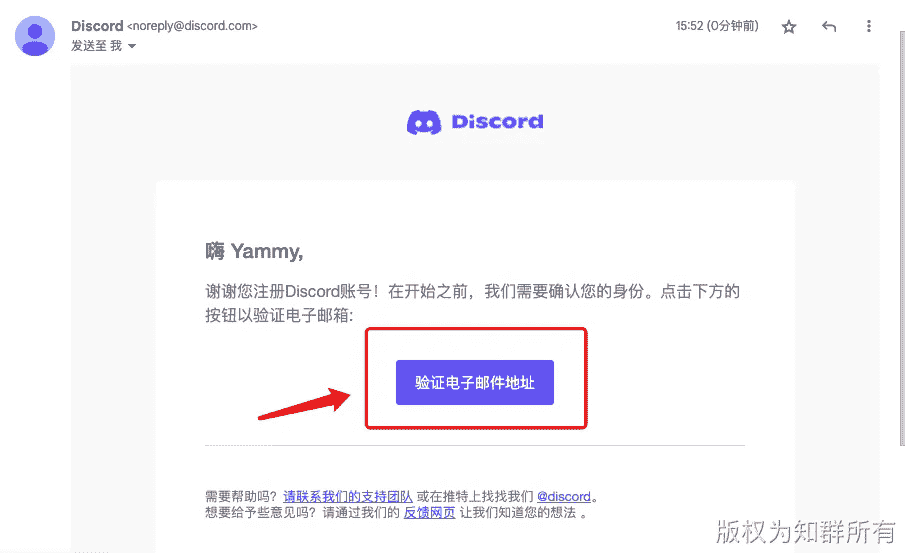

+   打开邮件并点击“验证电子邮箱地址”按钮。

+   再次验证你是人类

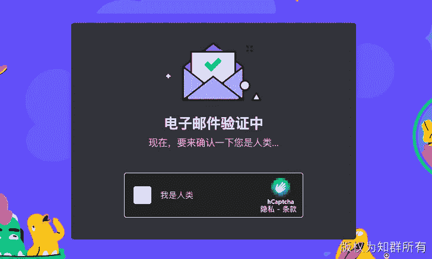

+   验证后，点击继续使用就可以进入discord界面了。

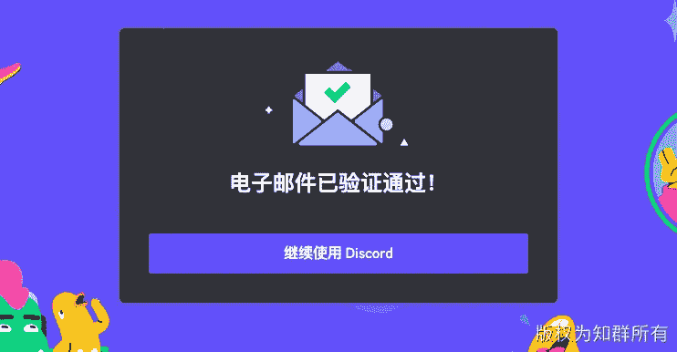

+   **可能会出现验证手机号码和电子邮件**的顺序不同，但按照以上步骤进行操作即可；

+   **可能会出现没有收到验证码的情况，可以更换魔法节点、更**换手机号、更换邮箱或刷新页面后重新验证。

+   **以上过程中可能会出现跳出如下界面，这个是创建D**iscord服务器步骤，出现后，可以按**《二、创建服务**器及添加Midjourney机器人（服务器内添加）》中的《2.点击【亲自创建】-3.点击【仅供我和我的朋友使用】》操作即可

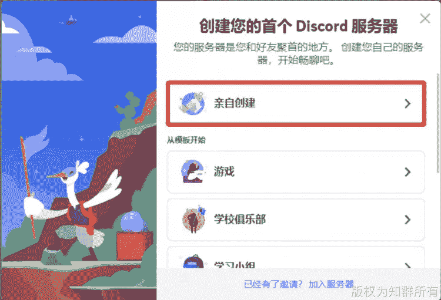

### **3、登录 Discord**

通过邮箱和手机验证后，就会自动登录 Discord 啦，但也有可能会存在一直重复登录的情况，那么你可以采用下面的方法：

+   检查是否已通过邮箱验证和手机验证

+   检查你的魔法连接是否正常

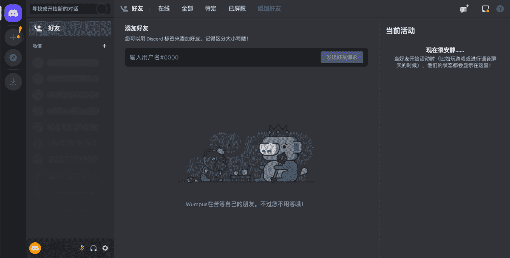

### 4、把 Midjourney 添加到 Discord

+   成功注册了 Discord 账号并登录了 Discord

+   打开 Midjourney 官网：https://www.midjourney.com/home/

+   点击[join the beta]按钮

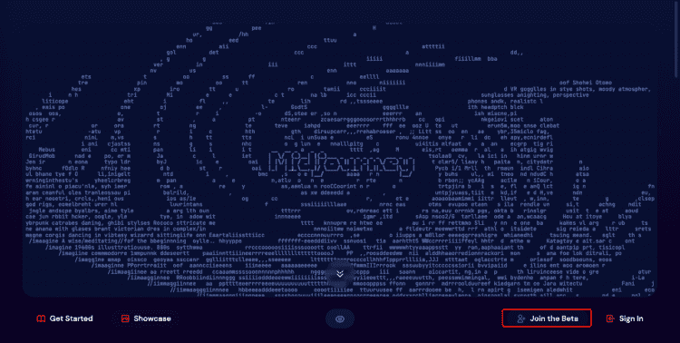

+   点击后，你会被邀请加入 Midjourney 了。这个过程可能会出现邀请链接失效的情况，只要刷新 Discord 后重新进入 Midjourney 就可以了。

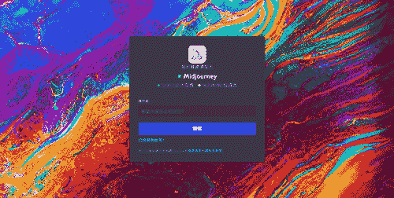

+   再次进行人机验证。

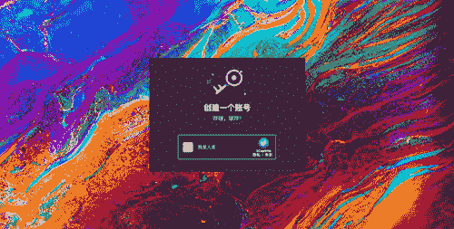

+   通过验证后，在 Discord 界面的左侧栏中会出现一个帆船图标，这就是 Midjourney 了。

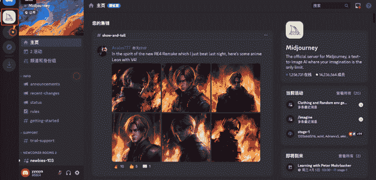

### **5、注意事项**

+   Discord 注册和登录过程可能会遇到各种错误提示，如果你完全是按照教程步骤来的，那么大概率网络的问题，请把你的魔法多换几个节点试试。

+   更换节点也无法继续进行时，可以清空浏览器数据，以下是 Google 浏览器的清空步骤

a.在计算机上打开 Chrome。

b.点击右上角的“更多”图标 。

c.依次点击更多工具 清除浏览数据。

d.在顶部，选择一个时间范围。 要删除所有内容，请选择时间不限。

e.选中“Cookie 及其他网站数据”及“缓存的图片和文件”旁边的复选框。

f. 点击清除数据。

g.刷新一下网络，并返回到 Discord 界面

## 二、Midjourney 使用方法

1.  点击左侧栏的**[+]**号创建服务器

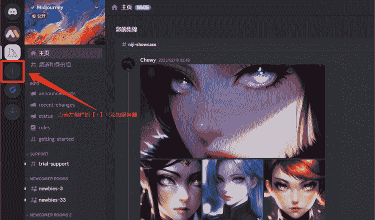

2.点击**【亲自创建】**

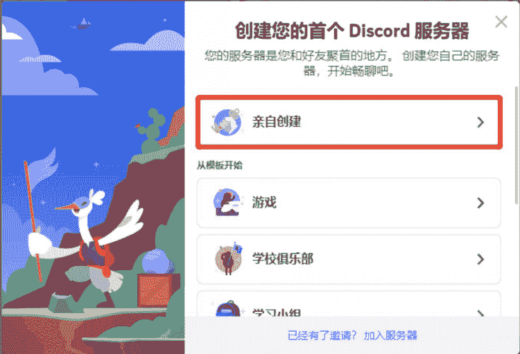

3.点击**【仅供我和我的朋友使用】**

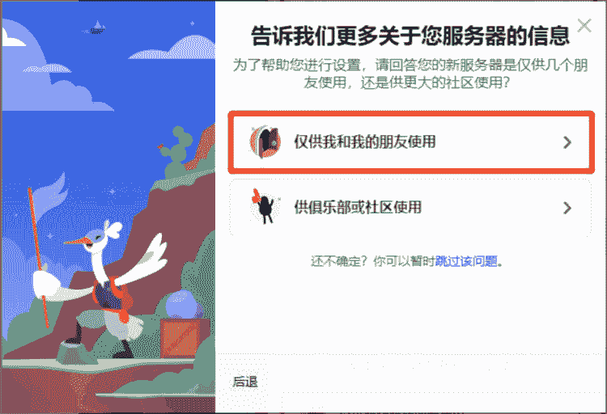

4.对【头像】、【服务器名称】和【话题】进行设置

5.添加 Midjourney bot 机器人到你的服务器

+   进入 Midjourney 的[newbies-xxx]新手生成频道，点开右上角的[显示成员名单]，点击[Midjourney bot 机器人]

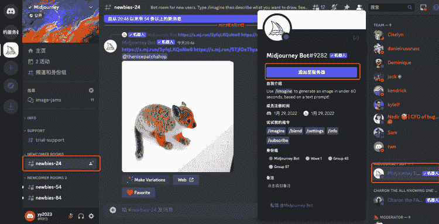

+   点击**【添加至服务器】**

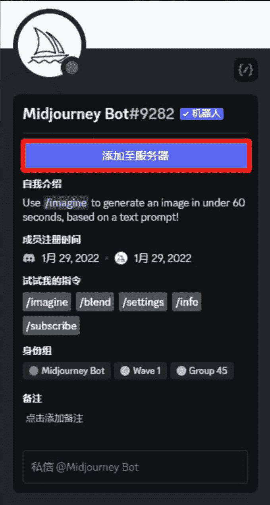

+   选择你自己的服务器，然后点**【继续】**

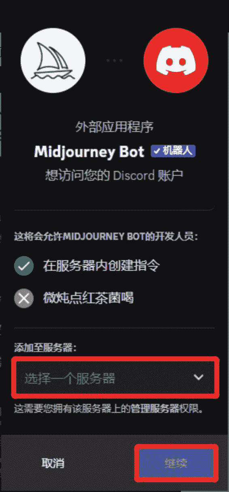

+   点击**【授权】**

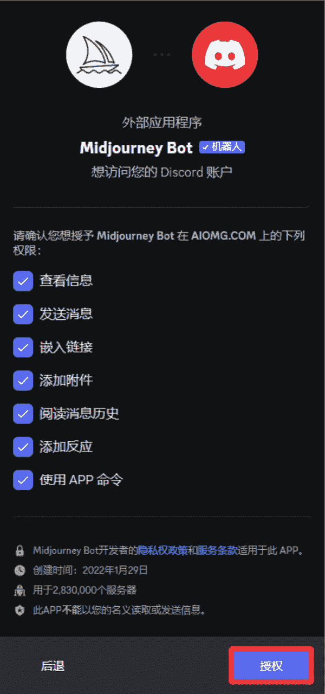

+   点击【我是人类】验证

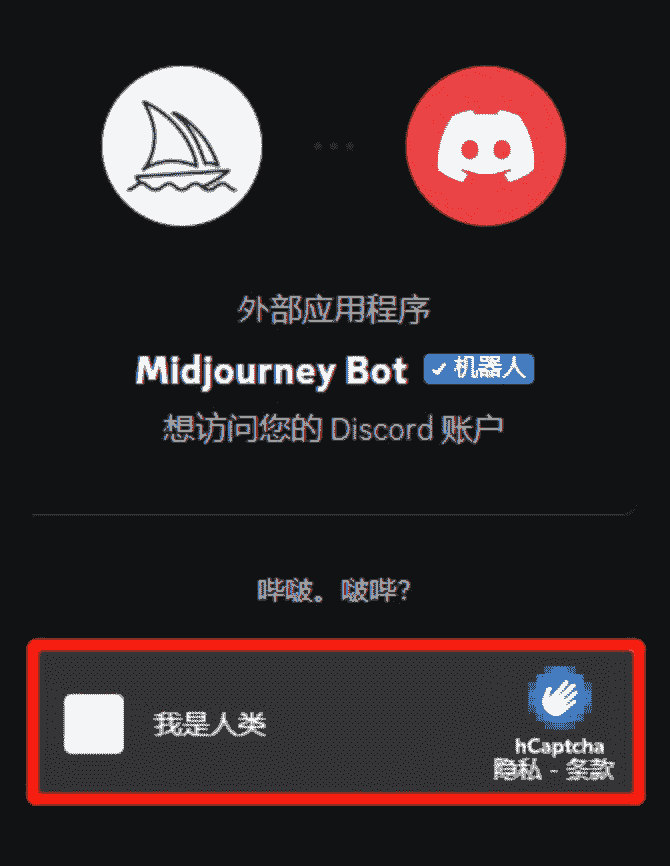

+   看到**【已授权】**就成功了

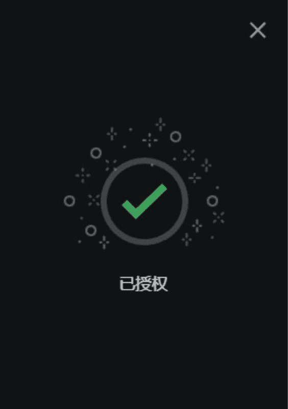

+   进入你的服务器，在右侧【**成员名单】**中就可以看到【midjourney bot 机器人】

## 三、Midjourney 付费方法

新注册用户可以在 Midjourney 上免费生成图像，免费时间为 25 分钟（以秒计算），如果想经常使用 Midjourney，建议订阅会员。

1、订阅会员需要准备：

+   有外币信用卡的用户可以自行订阅会员

+   没有的可以去某宝或某鱼代订阅会员或租共享账号

2、订阅方法：

1.  在输入框输入/subscribe 命令回车

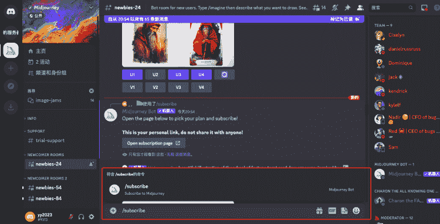

2.点击[open subscription page]打开订阅页面

1.  跳转到订阅界面，选择【订阅】

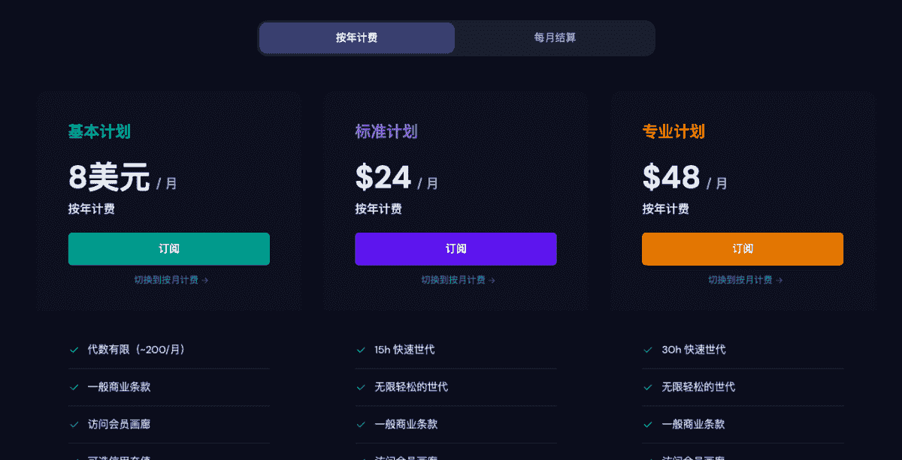

3.目前有两种支付方式，输入你的信用卡相关信息，点击【订阅】即可开通会员

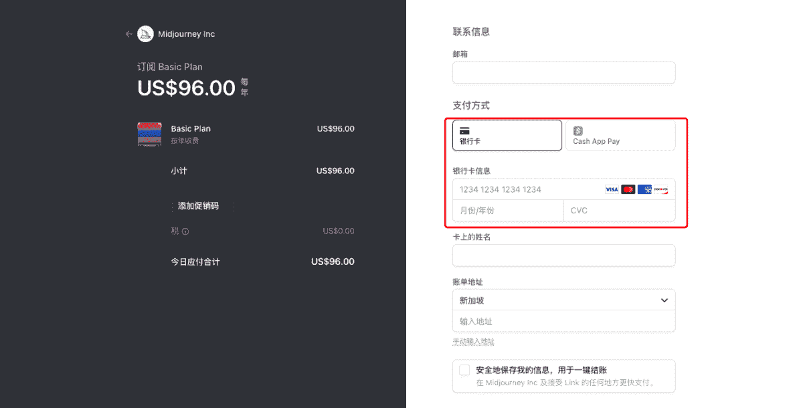

## 四、使用**Midjourney **

如何用 Midjourney 创作你的第一幅 AI 作品

+   关键词生成图片

回到我们的服务器，然后在下面的输入框输入“/”，它会弹出一系列的命令（如果没弹窗，退出重新登录即可），我们先点击“/imagine”（这个参数我后面再做详细解释），然后会出现如下画面：

输入一组关键词，切记：一组关键词的后面需要加上英文的逗号“,”然后按空格键，空一格就行，看我下面这组关键词：

An mascot robot, smiling, modern robot, round robot, cartoon, flying, fist up, crypto coins background

（吉祥物机器人，微笑，现代机器人，圆形机器人，卡通，飞行，拳头，加密币背景）

然后我们接着上一步，在对话框内输入这组关键词，我建议大家不要直接复制，先用键盘敲，体验下这个操作。

点击回车发送，然后它会让我们进行授权，我们点击“Accept tos”授权就行了。

然后等待机器人的出图，在发送的关键词后面可以看到图片生成的进度，等一会就会出来图片了：

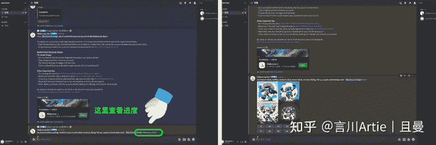

+   图片指令及导出图片

生成完成后，会出现两排按钮

U的意思放大图片，U1/U2/U3/U4分别指的是放大四张图片中的某一张

V的意思采用图片的构图形式，重新生成一组类似的图片，V1/V2/V3/V4的顺序与U的顺序一样，如图

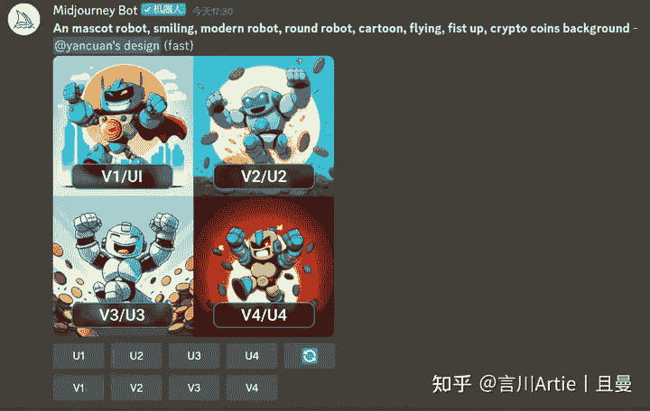

举个栗子，比如我想要导出第一张图片，那么我们点击U1就好了（等待机器出图）：

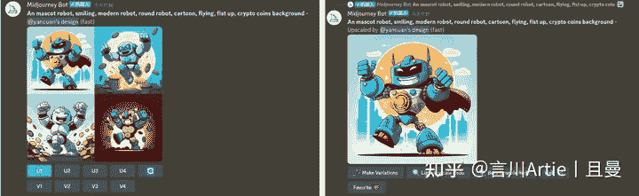

然后咱们点击图片，点击在浏览器中打开，然后保存图片，这张图片就被下载了（一定要用浏览器打开再保存图片，不然图片的尺寸会很小，会模糊的）

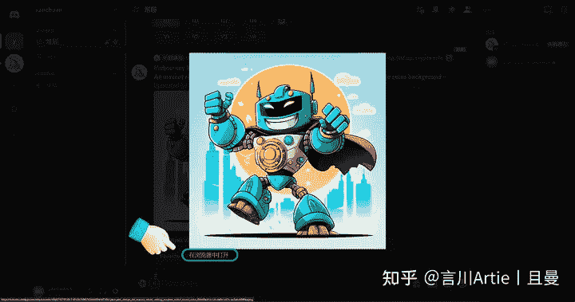

换个栗子，我觉得第一张图片还行，构图风格还不错，就是差点细节，想要再优化下，那我们就点击V1，接下来的操作就与上面一样啦，是不是很简单。

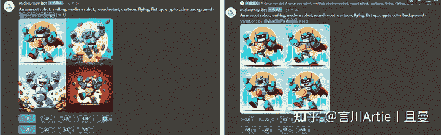

一般情况下，我们可以把同一组关键词多生成几组图片，这里可以点击“重复”按钮，然后你就会看见多条生成图片的消息，等待机器人作图，然后找到你喜欢的几张图片进行挑选即可。

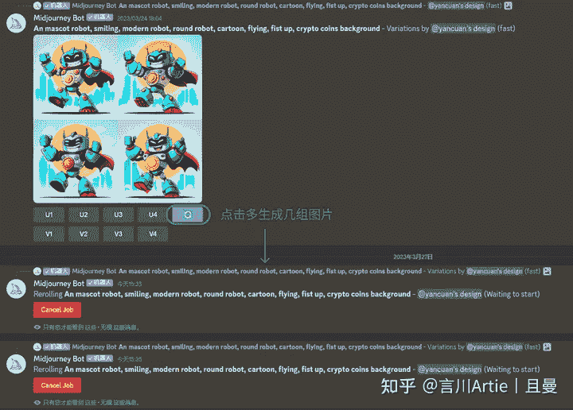

+   Midjourney的尺寸和分辨率

所有尺寸均为正方形1:1的长宽比。

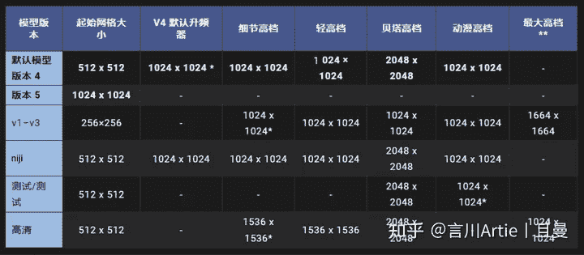

每个 Midjourney 版本模型的默认升频器。

+   使用高档重做按钮

升级图像（U1、U2、U3、U4）后，你会在图像下方看到一行按钮，可让您使用不同的升级器模型重新进行升级。

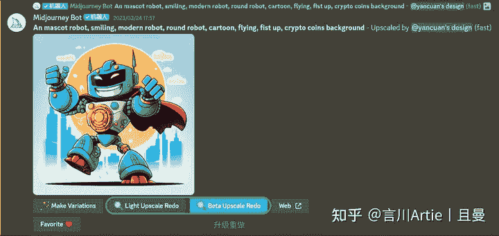

点击重做，Midjourney会在原图的基础上优化和调整细节，有些情况重做的效果不如原效果，根据情况调整。

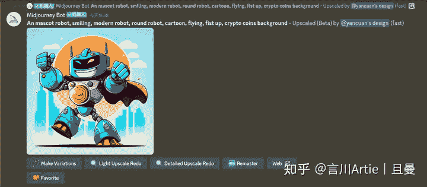

## 五、注册中可能遇到的问题经验分享

所有的问题均来源于网络分享以及部分实践沉淀，如果出现文档未提及的问题，大家可以踊跃交流或者搜索解答方法。

### **1.机器人验证勾选框一直处于波动**引导，点击无任何反应，等1分钟左右就报错

建议：可以先尝试更换你的魔法节点，或者按本文中的【一、Midjourney注册方法】-【5、注意事项】清理浏览器缓存。

### **2.手机验证时收不到验证码**

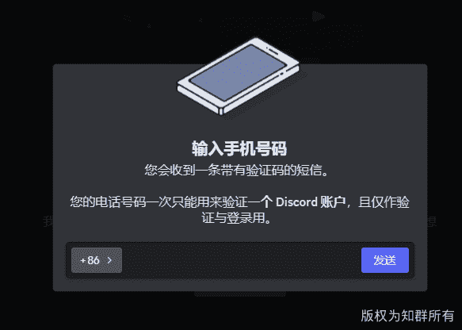

> 建议：

+   检查号码是否正确

+   确认一下自己的浏览是否是Chrome的浏览器，最好用Chrome的浏览器注册。

+   尝试更换你的魔法节点，多几个看看。

+   如果不行，试试下载discord的pc端注册看看（discord的官网可以直接下载客户端）

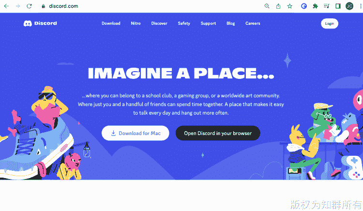

+   如果都不行，那么可以使用注册一个虚[拟号（可以使用虚拟号平台收验证码：https://sm](https://zhuanlan.zhihu.com/p/617620253?utm_id=0)s-activate.org/?ref=4457263——注意，需要付费，具体操作步骤见：https://zhuanlan.zhihu.com/p/617620253?utm_id=0）

### **3.添加Midjourney到 Discord时，如下图所**示步骤，出现一直重复需要验证【我是人类】

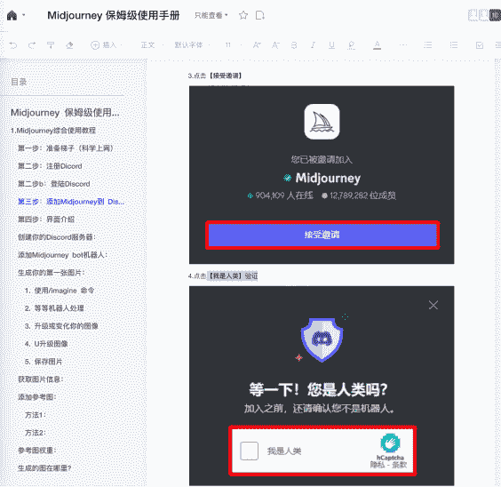

> 尝试解决方法：

> 1. 清空浏览器数据，以下是Google浏览器的清空步骤

+   a.在计算机上打开Chrome。

+   b.点击右上角的“更多”图标 。

+   c.依次点击更多工具 清除浏览数据。

+   d.在顶部，选择一个时间范围。 要删除所有内容，请选择时间不限。

+   e.选中“Cookie 及其他网站数据”及“缓存的图片和文件”旁边的复选框。

+   f. 点击清除数据。

> 2.刷新一下网络，并返回到discord界面

## 六、友情链接

友情链接1 - 知群：https://izhiqun.com/web/group/1736/course/6430

友情链接2 - 腾讯文档：https://docs.qq.com/doc/DV0xKeElIUlllUXVl

友情链接3 - 言川知乎：https://zhuanlan.zhihu.com/p/618532476

友情链接4 -虎网课： Midjourney-注册/订阅以及出图教程

友情链接4 -元峰AGA：https://mp.weixin.qq.com/s/6EBtlwM87CsN3egvp_u8KA