# AI制作绘本视频

> 来源：[https://docs.feishu.cn/docx/VEgLdhh02oyFAOxt937cU3jXnIb](https://docs.feishu.cn/docx/VEgLdhh02oyFAOxt937cU3jXnIb)

## ChatGPT+ Midjourney+RunwayML Gen-2+剪映

具体技术是：

文本到视频：RunwayML Gen-2

文本到图片：Midjourney

面部动画：D-ID https://docs.d-id.com/reference/get-started#-d-id-api-products

文本到语音：http://Genny.Lovo.ai

Soundtrack: http://Soundful.com

角色配音：ElevenLabs

工具：https://studio.d-id.com

https://twitter.com/IXITimmyIXI/status/1666861736991784989

https://twitter.com/i/status/1664828003845545986

## ChatGPT+ Midjourney + LeiaPix + 剪映

| 发布时间 | 一句概述 | 链接 | 作者 | 来源 |
| --- | --- | --- | --- | --- |
|  | 首先，使用ChatGPT创作一段小故事。接着，将该故事转化为视频脚本，并将其分割为各个镜头。通过镜头描述，运用Midjourney提示词来绘制每个画面的想象图，然后将每个画面输入LeiaPix,将2D图像转变为3D立体效果的视频。重复这个过程，直到得到所有3D画面的视频。最后，将所有视频片段连接在一起，并添加字幕进行朗读。同时，为视频添加背景音乐以增添氛围 | [LeiaPix Converter ：免费将图像 2D 转换为 3D](https://esouqpttmy.feishu.cn/docx/V3NWdI08Yo4R9lxcIdScEMwanWb) |  | ChatGPT&amp;AI破局俱乐部 |
|  |  |  |  |  |

### 实战：做一个小视频

> [LeiaPix Converter ：免费将图像 2D 转换为 3D](https://esouqpttmy.feishu.cn/docx/V3NWdI08Yo4R9lxcIdScEMwanWb)

步骤流程如下：

首先，使用ChatGPT创作一段小故事。接着，将该故事转化为视频脚本，并将其分割为各个镜头。通过镜头描述，运用Midjourney提示词来绘制每个画面的想象图，然后将每个画面输入LeiaPix,将2D图像转变为3D立体效果的视频。重复这个过程，直到得到所有3D画面的视频。最后，将所有视频片段连接在一起，并添加字幕进行朗读。同时，为视频添加背景音乐以增添氛围。完成这些步骤后，就大功告成了。

### 步骤一：创作小故事

使用ChatGPT编写一段小故事

> 你现在是一个故事撰写者，根据我的描述，为我写一个小故事，故事中有3位主人公：一个古老的星球中没有生命的，充满了废物。故事中角色们的目标是通过使用无人机、探测车、以及建造一些建筑物来清洁废物让星球恢复其从前的绿色和蓝色荣耀。

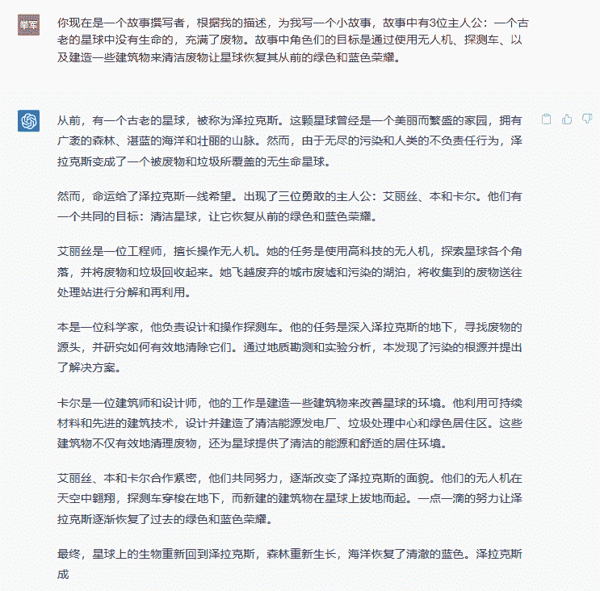

### 步骤二：编写视频脚本并切分镜头

将小故事转化为视频脚本，包括场景、音乐和镜头描述。每个镜头描述一个特定的画面。

> prompt: 将此故事写为视频脚本，并切片每一个镜头的描述

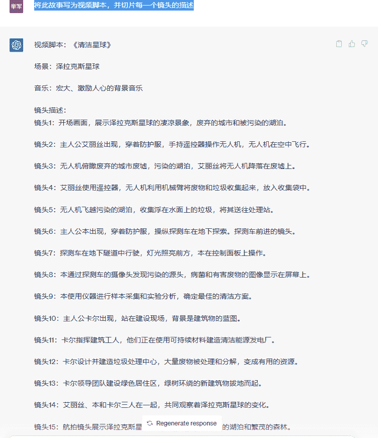

### 步骤三：绘制Midjourney提示词

使用Midjourney提示词为每个镜头绘制想象图，以便更好地理解和表达镜头的内容。

> prompt: 主人公艾丽丝出现，穿着防护服，手持遥控器操作无人机，无人机在空中飞行

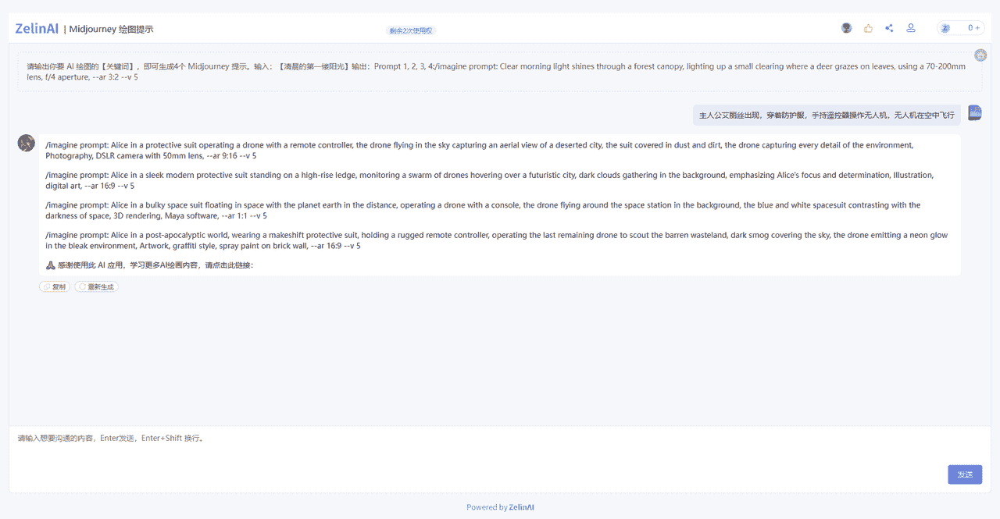

镜头1

```
/imagine prompt: Alice in a protective suit operating a drone with a remote controller, the drone flying in the sky capturing an aerial view of a deserted city, the suit covered in dust and dirt, the drone capturing every detail of the environment, Photography, DSLR camera with 50mm lens, --ar 9:16 --v 5

/imagine prompt: Alice in a sleek modern protective suit standing on a high-rise ledge, monitoring a swarm of drones hovering over a futuristic city, dark clouds gathering in the background, emphasizing Alice&#x27;s focus and determination, Illustration, digital art, --ar 16:9 --v 5

/imagine prompt: Alice in a bulky space suit floating in space with the planet earth in the distance, operating a drone with a console, the drone flying around the space station in the background, the blue and white spacesuit contrasting with the darkness of space, 3D rendering, Maya software, --ar 1:1 --v 5

/imagine prompt: Alice in a post-apocalyptic world, wearing a makeshift protective suit, holding a rugged remote controller, operating the last remaining drone to scout the barren wasteland, dark smog covering the sky, the drone emitting a neon glow in the bleak environment, Artwork, graffiti style, spray paint on brick wall, --ar 16:9 --v 5
```

镜头2

```
/imagine prompt: Alice controlling a drone with a remote, the drone equipped with a mechanical arm collecting waste and garbage in a densely populated urban area, emphasizing the drone&#x27;s advanced technology and Alice&#x27;s expertise in navigating the drone, Photography, using a telephoto lens to capture the details of the drone&#x27;s mechanical arm and the surrounding cityscape, --ar 16:9 --v 5

/imagine prompt: A busy park with Alice standing on a grassy patch, controlling a drone using a remote, the drone&#x27;s mechanical arm collecting scattered litter, rusty cans, cigarette butts, cigarillos and putting them neatly in garbage bags nearby, the environment indicating the need for sustainable waste management, Illustration, featuring a brilliant composition of the park&#x27;s environment, including details of the drone&#x27;s mechanical arm, --ar 16:9 --niji

/imagine prompt: In a harsh, dry desert, Alice controls a black matte low-flying drone, picking up scattered waste and debris in the arid wilderness, the scene accentuating the drone&#x27;s vital map for environmental protection and Alice&#x27;s ingenuity in operating it, 3D rendering, using realistic colors and alluring detail to highlight the unforgiving environment and the drone&#x27;s mechanical arm, --ar 16:9 --v 5

/imagine prompt: In a remote, rural area, Alice controls a high-powered drone, collecting excess trash and refuse in the verdant landscape, showcasing Alice&#x27;s proficiency in piloting the drone and the technology&#x27;s role in preserving the environment, Paperwork, utilizing dynamic brush strokes and vivid colors to capture the beauty of the rural landscape and the sophistication of the drone&#x27;s mechanical arm, --ar 16:9 --niji
```

> 上图中这个工具，是一个我写的用来输出Midjourney描述词的ChatGPT prompt,已经打包为了AI小应用(🛰️打开):https://zelinai.com/s/kavvHSjs2nZSiufjajw2vT

### 步骤四：Midjourney绘制想象图

使用Midjourney提示词为每个镜头绘制想象图，以便更好地理解和表达镜头的内容。

> https://www.midjourney.com/home

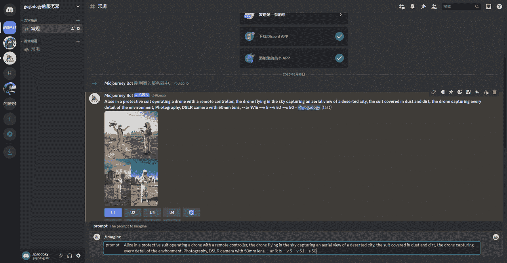

选择一张图U1，Midjourney Bot生成后通过Web进行浏览

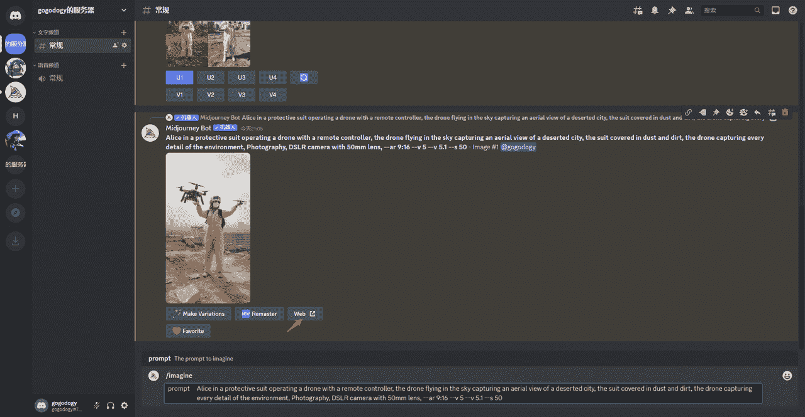

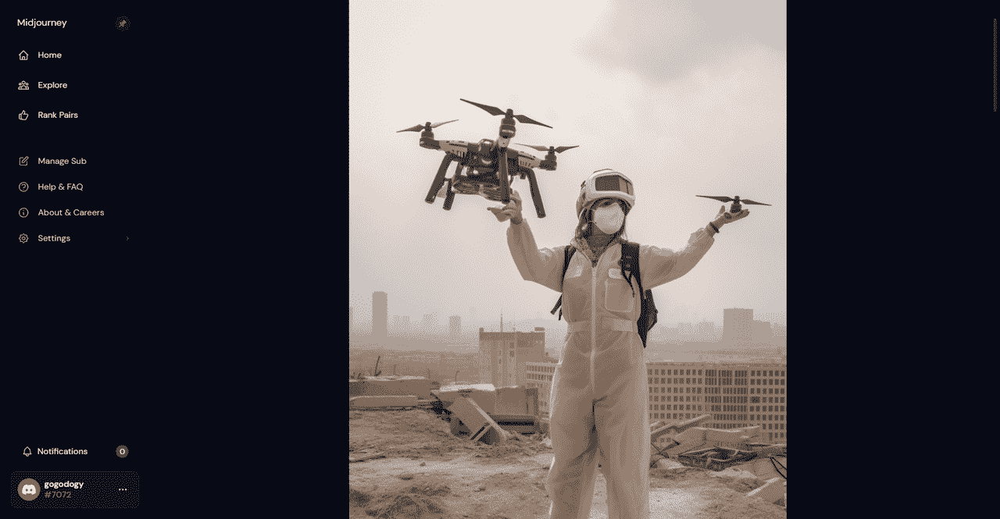

### 步骤五：将画面转为3D立体

利用LeiaPix将每个画面转换为3D立体效果的视频。

上传图片自动生成动画

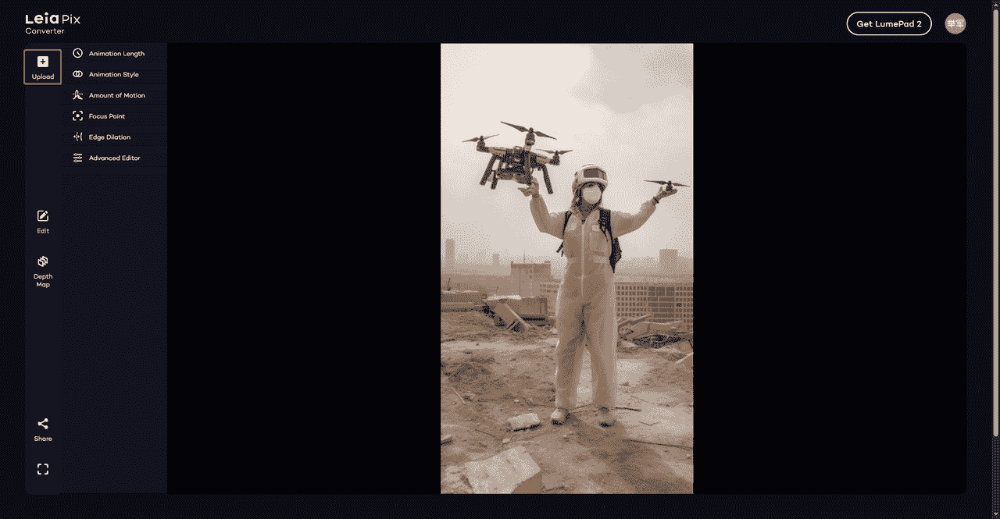

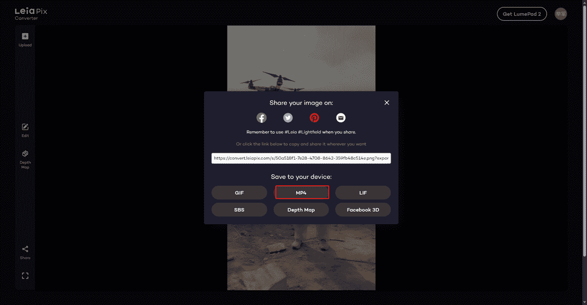

### 步骤六：重复步骤三、四、五

重复步骤四和步骤五，直到所有画面都被转换为3D立体视频。

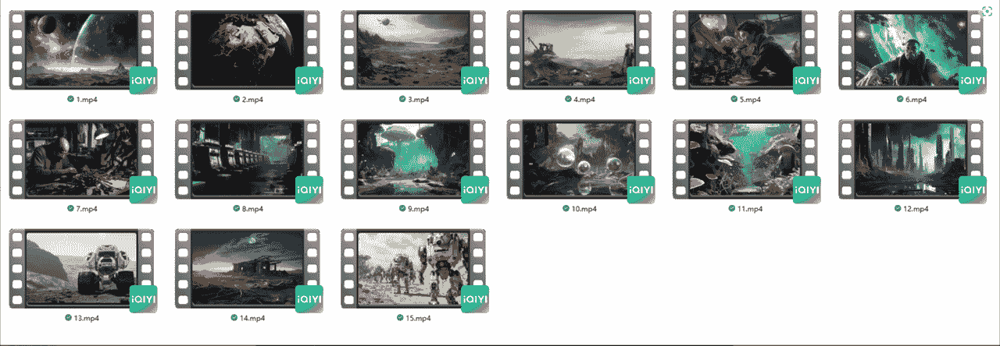

### 步骤七：连接所有视频片段

打开剪映，将所有3D画面的视频片段连接在一起，根据故事情节以及实际出图效果将它们排序。

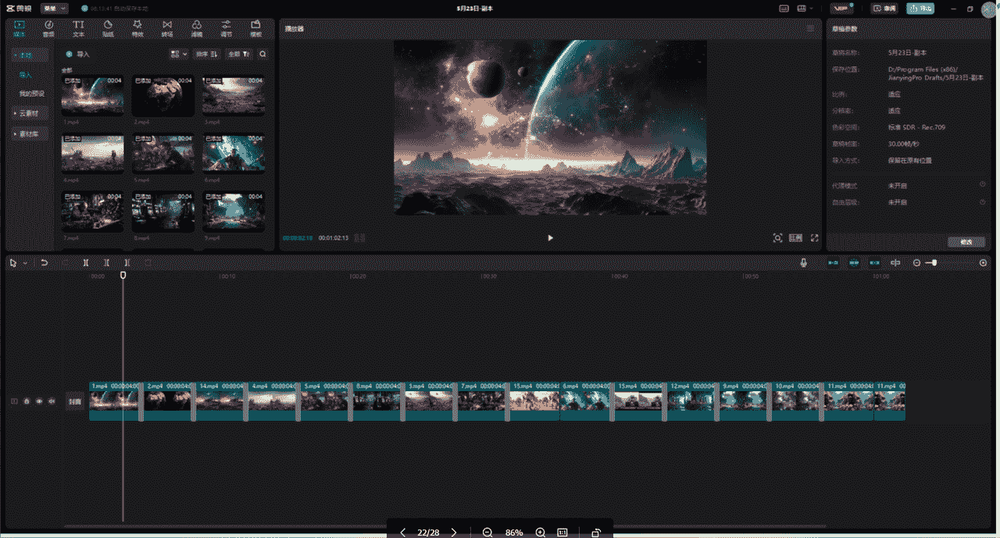

### 步骤八：添加字幕和朗读

为视频添加字幕，并进行朗读以便观众更好地理解故事内容。选择文本，智能字幕，文稿匹配

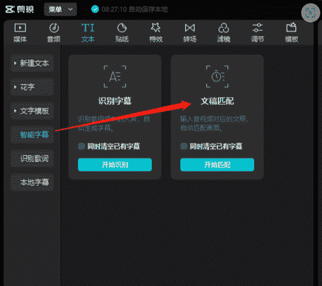

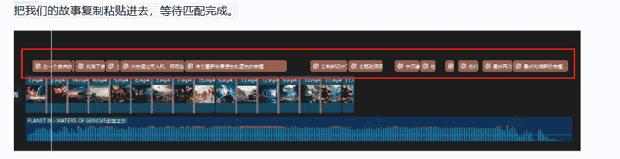

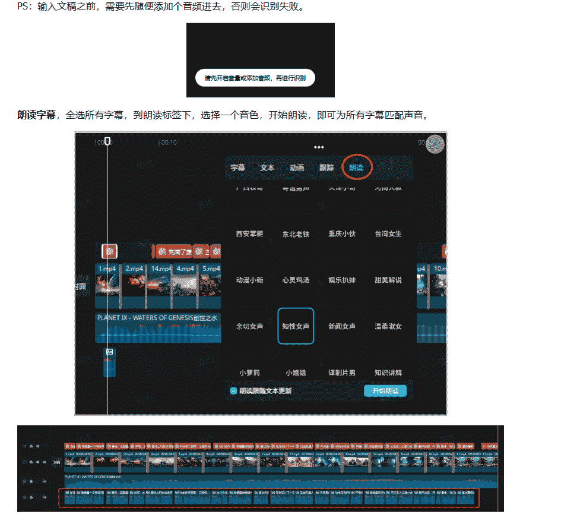

### 步骤九：添加背景音乐

为视频添加合适的背景音乐，以增强氛围和情感。

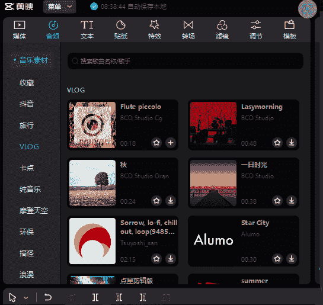

### 步骤十：完成最终视频

添加一些其他标题，转场，滤镜之类的内容。将所有步骤完成后导出视频。整个流程结束， Show time!

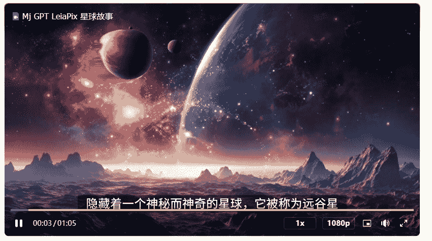

> 整个过程下来，思路都是比较清晰的，只不过Midjourney出图是随机性的，要想达到自己脑海中想要的风格，可能要花点心思。我是利用ChatGPT来帮我写提示词，这里面我认为就是大力出奇迹，要么就得自己提示词功底特别强，能准确描述自己想要的画面。

LeiaPix Converter快速易用，提高了工作效率和产出，并扩大了3D技术的应用范围。它的成功应用推动了人工智能技术的发展，为未来科技创新提供了更多可能性。通过使用ChatGPT、Midjourney和LeiaPix Converter,我们可以创作令人惊艳的3D视频作品，探索图像背后的立体世界。期待未来LeiaPix Converter和类似工具的创新，为我们带来更多视觉艺术的惊喜和创造力。

参考资料：

https://aitoolmall.com/image/leiapix-converter/