# 最新 AI 工具动态

> 来源：[https://docs.feishu.cn/docx/GFSNd2uWNoW6LnxdSp5c8HoPndg](https://docs.feishu.cn/docx/GFSNd2uWNoW6LnxdSp5c8HoPndg)

7月10日

| RobustL2S 是一个唇语合成模型，它可以将视频中的嘴唇动作转化为音频 |  |
| --- | --- |
|  |  |

## 7 月 7 日

| 免费版 Midjourney - http://fusionbrain.ai 真是太好用了 |  |
| --- | --- |
| 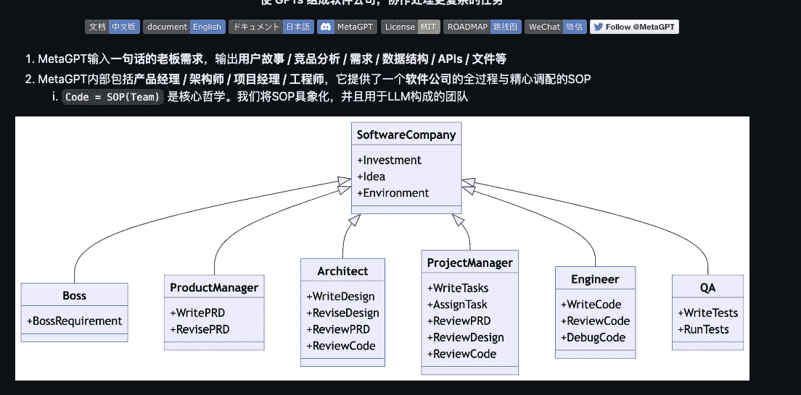 |  |
| https://github.com/0xpayne/gpt-migrate |  |
| Releasing 🚀 CodeGen2.5 🚀, a small but mighty LLM for code. |  |
| AI GIRL Generator ：打造属你自己的梦想女孩 |  |
|  |  |

## 7 月 6 日

| AI has revolutionized Excel. |  |
| --- | --- |
| 【 AI 開發的革命！? 】 |  |
| 利用 ChatGPT 改造 Hacker News  Hacker News 是一个面向全球的技术类新闻聚合社区。但这个网站整体 UI 很古朴，并且一页密密麻麻的 30 条新闻标题，让人看起来非常费劲。  有人做了一个增强版：Hacker News Summary，利用 ChatGPT 的总结能力，直接将每条新闻用一两句话总结出来，大大节约了每天看新闻的时间。 |  |
| 人工智能现在可以在几秒钟内编辑您的视频...  告别数小时的视频编辑。  隆重推出 Keyframes Studio，您唯一需要的 AI 编辑工具： |  |
|  |  |
| LongNet: Sc[aling Transformers ](https://t.co/xVT0MhZNN0)to 1,000,000,000 Tokens  Presents LONGNET, a Transformer variant that can scale sequence length to more than 1 billion tokens, without sacrificing the performance on shorter sequences  abs: https://arxiv.org/abs/2307.02486  repo: https://github.com/microsoft/torchscale |  |
| [mage-to-3D is getting goo](https://t.co/u6Ra0BWgpB)d.  Two examples.  One-2-3-45 is a method that is a able to generate full 360-degree 3D textured mesh in 45 seconds.  https://one-2-3-45.github.io/?ref=aiartweekly |  |
| OpenAI 正在引入“超级对齐”这个概念。我们需要科学和技术的突破来引导和控制那些比我们更聪明的 AI 系统。为了在四年内解决这个问题，正在组建一个新的团队，由⁦⁦ |  |
| 30 疯狂有用的 AI 工具： |  |
| Introducing the AI Web TV  A live stream of generative AI videos, all made using Zeroscope V2 576w  Looking great on the new compact design of Hugging Face Spaces |  |
| [ht](https://t.co/ScLXaoDmgW)[t](https://t.co/ScLXaoDmgW)ps://medium.com/art-interrupted/so-long-prompt-engineering-we-hardly-knew-ya-a77d871e00e9…  告别「提示工程」，我们几乎不了解你  由于人工智能（AI）系统能够自行开发提示、需要定制化提示以及问题表述的重要性，提示工程这一过程正逐渐过时。  为了在 AI 世界中保持领先地位，我们需要更好的问题表述，这可以通过诊断、分解、重构和约束设计来实现。  关于提示工程是否是一门合法的工程领域的争论仍在继续，一些人认为它只是输入文本，而其他人则认为它是将 AI 整合到更大系统中所必需的技能。  未来，AI 模型和架构的演变可能会改变提示工程的性质。 |  |
| 大型语言模型（LLM）在跨各个领域的单代理具体任务中表现出了令人印象深刻的规划能力。然而，它们在多智能体合作中的规划和通信能力仍不清楚，尽管这些是智能实体的关键技能。在本文中，我们提出了一种利用 LLM 进行多智能体合作的新颖框架，并在各种具体环境中对其进行了测试。我们的框架使实体代理能够与其他实体代理或人类进行计划、沟通和合作，以有效地完成长期任务。我们证明，最近的法学硕士（例如 GPT-4）可以超越强大的基于规划的方法，并使用我们的框架展示紧急有效的沟通，而无需微调或几次提示。我们还发现，以自然语言进行交流的基于法学硕士的代理可以赢得更多信任并与人类更有效地合作。我们的研究强调了法学硕士在具体人工智能方面的潜力，并为未来多智能体合作的研究奠定了基础。 |  |
|  |  |
| [我目前看到的 AI 绘画资料最全版本  一个 GitHub](https://t.co/iUIoi3aN6m) 仓库，8900 星  保存这一个，其他 AI 绘画都可不保存  https://github.com/hua1995116/awesome-ai-painting |  |
|  |  |
|  |  |
|  |  |
|  |  |

## 7 月 5 日

| https://openart.ai/apps/ai_qrcode |  |
| --- | --- |
| 另外一种 | 比较费劲，但是效果更好 |
|  |  |

## 7 月 4 日

| ChatGPT：很酷但有限。 |  |
| --- | --- |
| AI Game Creator：你只需要输入文字描述即可帮你开发出你需要的游戏 |  |
|  |  |
|  |  |
|  |  |
|  |  |
|  |  |
|  |  |
|  |  |

## 6 月 30 日

| imgly/backgr[ound-removal-js](https://t.co/PSskjrHivn)  back[ground-removal 是一个强大的 npm ](https://t.co/1GyyjvGc1t)[包](https://t.co/1GyyjvGc1t)，直接在浏[览](https://t.co/XFGhj25PMh)器就可以离线运行的抠图脚本。  背后的模型是 ONNX https://onnx.ai ，然后利用 WASM 运行在浏览器上。  项目地址：https://github.com/imgly/background-removal-js…  在线演示：https://img.ly/showcases/cesdk/web/background-removal/web |  |
| --- | --- |
| Webcam Motion Capture：通过你的电脑或智能手机的摄像头即可完全控制和制作你专属的 3D 虚拟形象。  只需要网络摄像头，无需购买 Leap Motion 或任何特殊设备。它就可对你进行头部追踪、眼球追踪、眨眼检测、唇形同步和上半身追踪，用来制作动态的虚拟形象！  还可以将捕捉到的运动数据保存为 FBX 文件。 |  |
| [We&#x27;ve updated the Zeroscope mo](https://t.co/jWG6OW2vZ1)del on Replicate to allow upscaling with an init_video.  - Generate a video at 576x320 with 576w model  - Upscale to 1024x576 with XL model  (Plus added potat1 model)  https://replicate.com/anotherjesse/zeroscope-v2-xl |  |
| Faster Segment Anything (MobileSAM) |  |
| [《Google 的免费课程》  谷歌良心，免费课程还发文凭：  1](https://t.co/2WohRYIvw2)[。](https://t.co/2WohRYIvw2)[数字营销的基础  http://learndigital.withgoogle.com](https://t.co/U1r5mxoHxa)[/](https://t.co/U1r5mxoHxa)[di](https://t.co/Ej9yH0yJn9)[g](https://t.co/Ej9yH0yJn9)[italgarage/course/digital-marke](https://t.co/liVIFjxeAb)[t](https://t.co/liVIFjxeAb)ing…  2.Python 的数据科学  http://learndigital.withgoogle.com/digitalunlocked/course/data-science-with-python…  3。使用 JavaScript 学习编程  http://learndigital.withgoogle.com/digitalgarage/course/learn-programming-with-javascript……  4。 Google 云计算基础  http://cloudskillsboost.google/course_templates/153…  5。 Google 的 Python 课程  http://developers.google.com/edu/python  6。机器学习速成课程  http://learndigital.withgoogle.com/digitalunlocked/course/machine-learning-crash-course…  7。介绍 Google Cloud Essentials  http://cloudskillsboost.google/quests/23  8。简介：数据，ML，AI  http://cloudskillsboost.google/quests/34 |  |
| Generative A[I for Programming Ed](https://t.co/w6xqvR6I6z)[u](https://t.co/w6xqvR6I6z)cation: Benchmarking ChatGPT, GPT-4, and Human Tutors  paper page: https://huggingface.co/papers/2306.17156…  Generative AI and large language models hold great promise in enhancing computing education by powering next-generation educational technologies for introductory programming. Recent works have studied these models for different scenarios relevant to programming education; however, these works are limited for several reasons, as they typically consider already outdated models or only specific scenario(s). Consequently, there is a lack of a systematic study that benchmarks state-of-the-art models for a comprehensive set of programming education scenarios. In our work, we systematically evaluate two models, ChatGPT (based on GPT-3.5) and GPT-4, and compare their performance with human tutors for a variety of scenarios. We evaluate using five introductory Python programming problems and real-world buggy programs from an online platform, and assess performance using expert-based annotations. Our results show that GPT-4 drastically outperforms ChatGPT (based on GPT-3.5) and comes close to human tutors&#x27; performance for several scenarios. These results also highlight settings where GPT-4 still struggles, providing exciting future directions on developing techniques to improve the performance of these models. |  |
| https://langtale.ai/playground |  |
| Wonder Studio 结束内测，向所有人开放了  Wonder Studio 可以自动化将现实场景中的人物转换替代成 CG 角色，还可以进行动画、灯光和合成。  使用该工具不需要复杂的 3D 软件和昂贵硬件，只需要一台相机拍摄视频，然后使用该工具即可将人物替换成 CG 角色。  传送门：http://wonderdynamics.com |  |
| [a](https://t.co/D7xphREB2Y)[i](https://t.co/D7xphREB2Y)roboros 65b 1.4 is finally ready:  https://huggingface.co/jondurbin/airoboros-65b-gpt4-1.4…  I haven&#x27;t done any benchmarks yet, just a few one-off tests. |  |
| 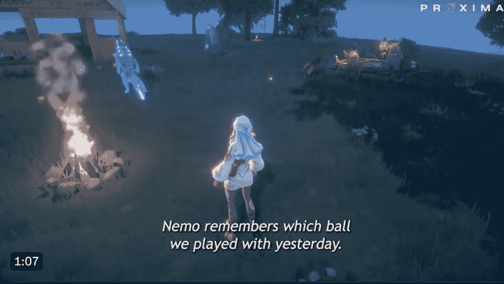 |  |
| 猫咪疼痛检测器的网址 |  |
| 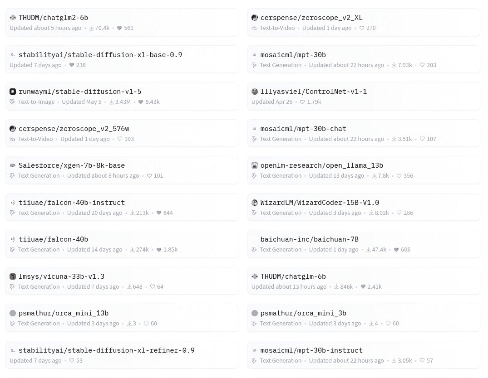 |  |
| 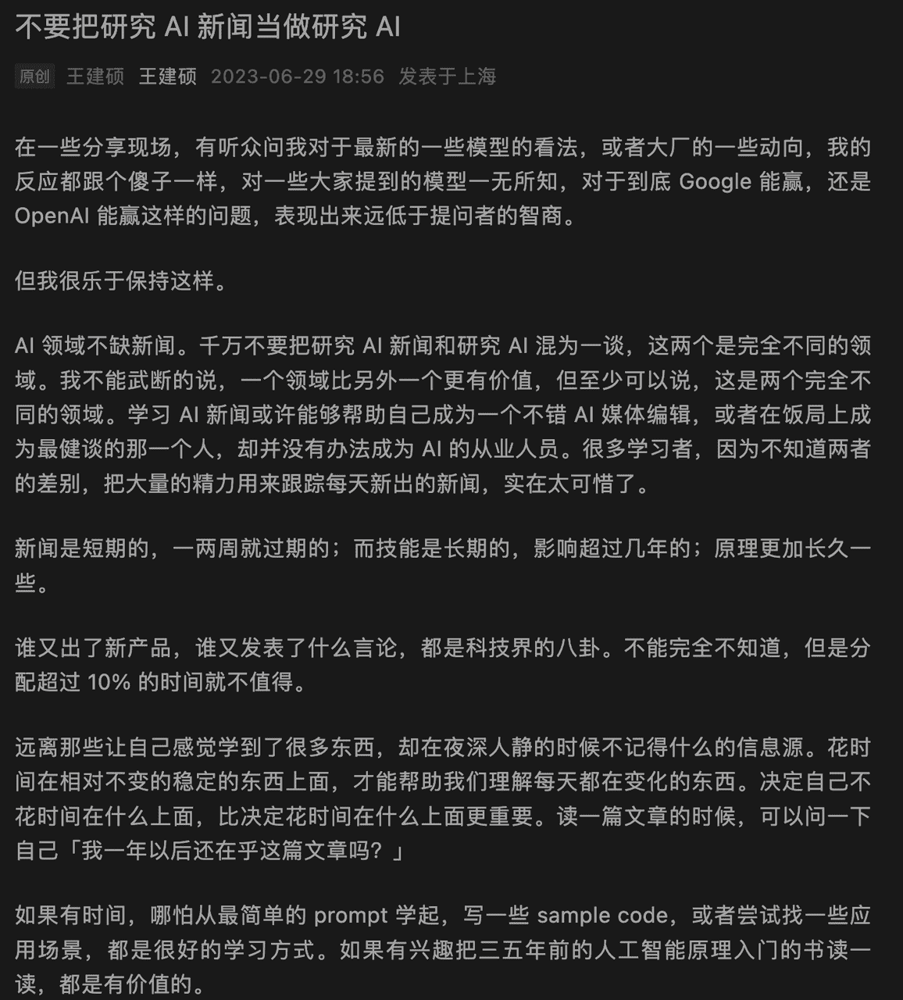 |  |
| 不再需要花费数小时进行视频编辑。 |  |
|  |  |
| Reimagining the iconic Mickey Mouse with different styles in 3D. |  |
| 最近跟不少一线做 AI 产品研发的朋友聊，都提到微软 Build2023 开发者大会 Andrej Karpathy 的分享启发最大。 |  |
|  |  |

原地址：https://twitter.com/Bitturing/status/1674631544089235456

## 6 月 29 日

| Introducing Playground with Mixed Image Editing. |  |
| --- | --- |
| 我宣布推出 OpenOrca - 一个受 Microsoft Orca 论文启发的数据集。我们正在为各种目标模型寻找计算赞助商（请参阅博客文章）。感谢赞助商 https://chirper.ai 和 https://preemo.io 和 https://latitude.sh 。 |  |
| 怎么在 Figma 里使用 AI 直接分析设计稿，得到虚拟热力图 |  |
| https://mp.weixin.qq.com/s/nhB7Hsjz_aLkSrUT0mqHWw |  |
| AI 智能视频换脸工具：Swapface |  |
| ntroducing XGen-7B, a new 7B LLM trained on 8K seq. length for 1.5T tokens. Better or comparable results with MPT, Falcon, LLaMA, OpenLLaMA in text &amp; code tasks. |  |
| MosaicML 发布了 MPT-308，一个开源模型，可免费用于商业用途，并且性能优于 GPT-3！ 🎉 |  |
| [AI coding assi](https://t.co/WU6qAcuNsf)stants that will save you 100+ hours:  1. Bito: Code Optimization  http://bito.ai  2.Safurai: Code Security  http://safurai.com  3. Codesquire: Code Search  http://codesquire.ai  4. Blackbox: Code Generation  http://useblackbox.io  5. Sourceai: Code Suggestions  http://sourceai.dev  6. AI-code-reviewer: Code Review  http://ai-code-reviewer.com  7. Supabase: Database Management  http://supabase.com  8.  Google Colab Copilot: Code Generation  http://copilot.naklecha.com  9. Programming-helper: Programming Assistance  http://programming-helper.com  Use AI to get more done with less effort! |  |
| The Midjourney Cheat Sheet （V5.2）  从提示到参数、设置和权重，全部集中在一处  。  可以打印出来放在工作区，帮助你更好地理解和使用 Midjourney 项目的各种功能和参数。  涵盖了所有的基本设置和提示参数，甚至还指出了一些高级概念。  作者： |  |
| 欺骗 AI 图片检测工具，到底有多简单？ |  |
| New sheriff in town! Our model UltraLM-13B, which is trained upon UltraChat, just ranks #1 |  |
| https://generalrobots.substack.com/p/dimension-hopper-part-1 |  |
| New open-source LLMs! 🔔 |  |
| New sheriff in town! Our model UltraLM-13B, which is trained upon UltraChat, just ranks #1🏆 among opensource models (ranks #4 among all models) on Stanford&#x27;s AlpacaEval Leaderboard. |  |
| https://technologyreview.com/2023/06/26/1075504/junk-websites-filled-with-ai-generated-text-are-pulling-in-money-from-programmatic-ads/ |  |
| https://www.reddit.com/r/StableDiffusion/comments/14ll30t/new_controlnet_qr_code_model_is_amazing/ |  |
|  |  |
|  |  |

存储库-

## 6 月 28 日

| NVIDIA[H](https://t.co/0AFzKcowql)100 GPUs Set Standard for Generative AI in Debut MLPerf Benchmark  blog: https://blogs.nvidia.com/blog/2023/06/27/generative-ai-debut-mlperf/…  a cluster of 3,584 H100 GPUs at cloud service provider CoreWeave completed a massive GPT-3-based benchmark in just 11 minutes. |  |
| --- | --- |
| Google 的&quot;Gene[rative AI learning path&quot;系列全部翻译完了  虽然有不少 ](https://t.co/zKqeOzmveq)[G](https://t.co/zKqeOzmveq)oogle 自家[产品的广告，但是质量还是相当可以的。  YouTube 播放列表：](https://t.co/cf3d1jPuIK)https://youtube.com/watch?v=tbLOQ533Up8&amp;list=PLiuLMb-dLdWJPpybrCYNhi6D9Vd4vz16i…  B 站播放列表：https://space.bilibili.com/589397373/channel/collectiondetail?sid=1468916 | 宝玉 |
| https://cobusgreyling.medium.com/openai-multi-functions-agent-4bf8c88c4b6e |  |
| https://lilianweng.github.io/posts/2023-06-23-agent/ |  |
| 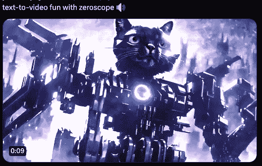 |  |
| FableForge |  |
|  |  |

## 6 月 27 日

| [ElevenLabs 新出声音库。  一键](https://t.co/LNCbQBZG1J)生成随机的真人感声音，遇到喜欢的就存下来，还可以在社区里分享，支持商业使用。  彻底解决了版权问题。  https://beta.elevenlabs.io/voice-library |  |
| --- | --- |
| CloneCleaner - a new extension for AUTO1111 to work around the &quot;same-face problem&quot; - high image quality without sacrificing variability |  |
| 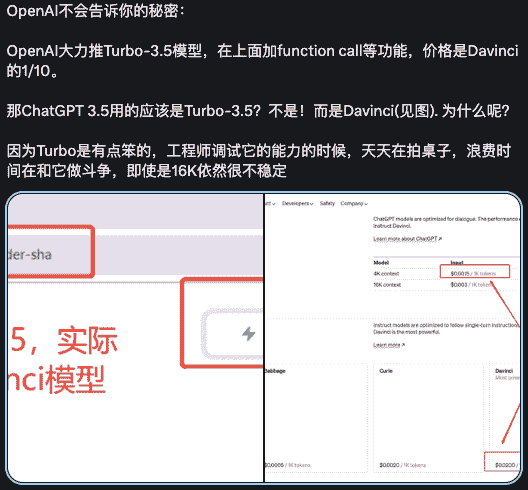 |  |
| DreamBox AI |  |
| RealityScan ：仅用手机或平板电脑拍摄照片即可创建高保真 3D 模型。 |  |
|  |  |

## 6 月 26 日

| https://github.com/THUDM/ChatGLM2-6B |  |
| --- | --- |
| The source code for DragGAN has been released! Huge thanks to community contributor LeoXing1996 for the | 之前发过，再次重发 |
| https://cevalbenchmark.com/static/leaderboard.html |  |
|  |  |

## 6 月 12 日～6 月 18 日

| **内容描述** | **内容来源** |
| --- | --- |
| 这是腾讯 AI Lab 发布的一个基于 CLIP、Whisper 和 LLaMA 构建的多模态项目。 |  |
| Releasing Hermes-Falcon-7b-8k, a Falcon model fine-tuned at 8k context length on the |  |
| https://huggingface.co/DionTimmer/controlnet_qrcode |  |
| Advanced Techniques for Prompt Engineering - VIDEO |  |
| SD 插件：stablesr，可以高质量放大图片，生成图片细节。 |  |
| New State of AI Edition is Out 🔥 |  |
| anandtech.com/show/18915/amd-expands-mi300-family-with-mi300x-gpu-only-192gb-memory |  |
| Introducing the AI Speech Classifier - our new authentication tool that enables users to upload audio samples and see if they were generated with ElevenLabs. |  |
| WizardCoder: a new open-source LLM for code generation |  |
| Stable Diffusion on iPhone is much faster now! |  |
| Are people trying to hack your LLM? |  |
| 据《纽约时报》报道，美国一些中小学正在测试由在线教育机构可汗学院打造的自动化导师。 Khanmigo 聊天机器人的用户包括新泽西州的公立学校和硅谷的可汗实验室学校（由可汗学院创始人 Sal Khan 创立）等私立学校。 |  |
| twitter.com/i/status/1669089526957084672 |  |
| Introducing the Vercel AI SDK |  |
| MusicGen finetuner! |  |
| StableSR 一个新的可以为模糊画面生成精致细节的超分辨率放大项目，现在已经来到 web-ui。官方演示的效果非常惊人，对模糊照片的修复效果几乎完美！插件对低显存进行了优化，可以在小于 12GB 显存的环境中进行 4K 图像放大。 |  |
| Baichuan-7B ：王小川团队弄的百川大规模预训练语言模型。  基于 Transformer 结构，在大约 1.2 万亿 tokens 上训练的 70 亿参数模型，支持中英双语，上下文窗口长度为 4096。  原始训练数据包括开源的中英文数据和自行抓取的中文互联网数据，以及部分高质量知识性数据，总量超过 10T。 | [@xiaohuggg](https://twitter.com/xiaohuggg) |
| Applications of Transformers  New survey paper highlighting major applications of Transformers for deep learning tasks. Includes a comprehensive list of Transformer models.  https://arxiv.org/abs/2306.07303 | [@omarsar0](https://twitter.com/omarsar0) |

| Seeing the W[orld through Your Ey](https://t.co/KdZdy64bFx)[e](https://t.co/KdZdy64bFx)s  paper page: https://huggingface.co/papers/2306.09348…  The reflective nature of the human eye is an underappreciated source of information about what the world around us looks like. By imaging the eyes of a moving person, we can collect multiple views of a scene outside the camera&#x27;s direct line of sight through the reflections in the eyes. In this paper, we reconstruct a 3D scene beyond the camera&#x27;s line of sight using portrait images containing eye reflections. This task is challenging due to 1) the difficulty of accurately estimating eye poses and 2) the entangled appearance of the eye iris and the scene reflections. Our method jointly refines the cornea poses, the radiance field depicting the scene, and the observer&#x27;s eye iris texture. We further propose a simple regularization prior on the iris texture pattern to improve reconstruction quality. Through various experiments on synthetic and real-world captures featuring people with varied eye colors, we demonstrate the feasibility of our approach to recover 3D scenes using eye reflections. | 通过眼睛反射拿到眼睛看到的图像 |
| --- | --- |
| 谷歌前两天发了一个 AI[ 试衣模型 TryOnDiffusion，想解决的是用户提供一张自](https://t.co/TfuuKBonjf)[己](https://t.co/TfuuKBonjf)的全身照，就可以获得自己穿上对应服装的样子。  需要一张用户的全身照和服装模特穿着的照片，效果看起来非常好。  以往一个关键的挑战是在保留服装细节的同时，将服装进行变形以适应不同主体之间的重要姿势和形状变化。以往的方法要么只注重保留服装细节而无法有效处理姿势和形状的变化，要么允许尝试不同的形状和姿势，但缺乏服装细节。  他们提出了一种基于扩散的架构，将两个 UNet（称为 Parallel-UNet）统一起来，这使得能够在单个网络中保留服装细节并对服装进行重要的姿势和身体变化。  他们主要解决了两个问题：1）通过交叉注意机制隐式地对服装进行变形，2）服装的变形和人物的融合作为一个统一的过程，而不是两个独立任务的序列。  从数据和参考图上来看服装在人物上的变形非常自然，服装的细节也还原的非常好，现在的主要问题就是，演示所有的服装都没有 LOGO 和文字，不知道他们解决了没有，如果不能有文字的话实用性就大打折扣了。目前没有开源。  Google 文章链接：https://blog.google/products/shopping/virtual-try-on-google-generative-ai…  模型介绍页面：https://tryondiffusion.github.io | [op7418](https://twitter.com/op7418) |
| [https://huggingface.](https://t.co/ccNk7ylrQ8)[c](https://t.co/ccNk7ylrQ8)o/papers/2306.08647…  大型语言模型 （LLM） 在通过上下文学习获得从逻辑推理到代码编写的各种新能力方面取得了令人振奋的进展。机器人研究人员还探索了使用 LLM 来提高机器人控制的能力。然而，由于低级机器人动作依赖于硬件并且在 LLM 训练语料库中代表性不足，因此将 LLM 应用于机器人技术的现有努力主要将 LLM 视为语义规划器或依赖人工设计的控制原语与机器人交互。另一方面，奖励函数被证明是灵活的表示，可以针对控制策略进行优化以实现不同的任务，而它们丰富的语义使它们适合由 LLM 指定。在这项工作中，我们引入了一种新范例，该范例通过利用 LLM 来定义可以优化的奖励参数并完成各种机器人任务，从而利用这种实现。使用奖励作为 LLM 生成的中间接口，我们可以有效地弥合高级语言指令或纠正低级机器人动作之间的差距。同时，将其与实时优化器 MuJoCo MPC 相结合，提供交互式行为创建体验，用户可以立即观察结果并向系统提供反馈。为了系统地评估我们提出的方法的性能，我们为一个模拟四足机器人和一个灵巧的机械手机器人设计了总共 17 个任务。我们证明，我们提出的方法可靠地解决了 90% 的设计任务，而使用原始技能作为与代码即策略的接口的基线实现了 50% 的任务。我们在真实的机器人手臂上进一步验证了我们的方法，在这个机器人手臂上，通过我们的交互系统出现了复杂的操作技能，例如非抓握式推动。 | AK |
| h2oGPT[: Democratizin](https://t.co/mrNi5Ywycm)g Large Language Models  Presents h2oGPT, a suite of open-source code repositories for the creation and use of LLMs based on GPTs.  proj: https://h2o.ai  abs: https://arxiv.org/abs/2306.08161 |  |
| LLM Agents Can Teach Weaker LLM Agents  -Teacher builds mental model of student  -Learning from explained data improves student on future unexplained data  -Misaligned teachers can lower student performance to random chance by intentionally misleading them  https://arxiv.org/abs/2306.09299 |  |
| The new OpenAI Function API simplifies agent development by A LOT. |  |
| AssistGPT: A General Multi-modal Assistant that can Plan, Execute, Inspect, and Learn |  |
| https://twitter.com/willgibs/status/1669402884750950400 |  |
| LocalRF：可以从输入的视频中学习 3D 场景的结构，然后将这个学习到的结构用于从新的视角生成 3D 场景。 |  |
| Generalist LLM Agents Completing New Tasks On The Web |  |
| https://huggingface.co/papers/2306.08543 |  |
| Introducing, Gen-2 Footage Packs. |  |
| LocalRF：可以从输入的视频中学习 3D 场景的结构，然后将这个学习到的结构用于从新的视角生成 3D 场景。 |  |
| LLM Agents Can Teach Weaker LLM Agents |  |
| https://github.com/go-skynet/LocalAI |  |
| 自带 ChatGPT 的汽车  梅赛德斯奔驰把 ChatGPT 整合到奔驰汽车里，据说这样可以提高语音控制的品质，帮你更好地跟自己的汽车说话 |  |
| [redd.it/149qpyf](https://t.co/VH8ReiBbl8)  一位不懂编程的 Reddit 用户使用 ChatGPT 和 Midjourney 制作了一款游戏，虽然不完美但已经实现了。  评论区有人祝贺作者，也有人询问制作细节和代码，还有人质疑 ChatGPT 的能力和作者的成就。  作者表示可以分享 ChatGPT 的记录和游戏链接。 |  |
|  |  |

## 6 月 19 日

| https://bezier.method.ac |  |
| --- | --- |
| #AI 建站 推荐个低成本制作个人网站的新工具 #Framer，只需输入网页需求，它就会为你生成一个美观的网站，也可根据自己喜好进行定制，免费使用，感兴趣的可以关注下。看了宣传视频很酷哦，我准备去好好学一下，弄个旅游网站 |  |
| 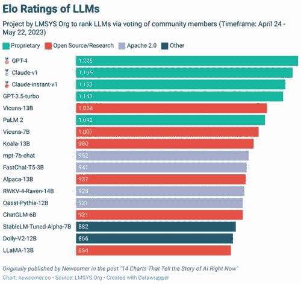 |  |
| 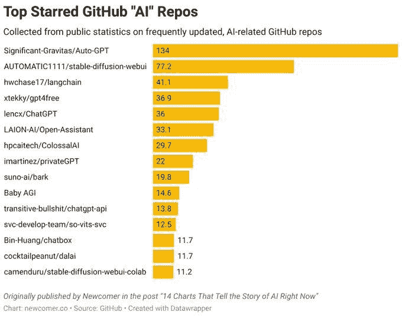 |  |
| GPT-Engineer just hit 12,000 stars on Github. |  |
| 1.  AI 语音 ➝ http://Lovo.ai |  |
| GAIA-1：一款先进的生成式 AI 模型，用于自主驾驶博客链接：https://wayve.ai/thinking/introducing-gaia1/ |  |
| Agents 🤖 built with the |  |
| I made a little 3D modeller called #picoCAD ! |  |
| 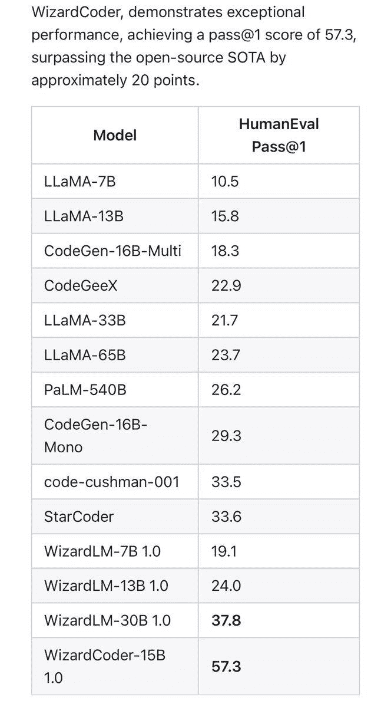 |  |
| Robin-7b-v2 is a model finetuned from LLaMA-7B and it scored 51.7 in the OpenLLM leaderboard. |  |
| You can run Stable Diffusion locally on your Macbook, iPad and iPhone, without cloud GPU. Thanks to Core ML and 6-bit palettization. Download the Diffuser app by |  |
| Prompt Share: Multi-Panel Art 🖼️🤯🖼️ |  |
| 10 倍提升工作效率？用好 ai 工具，10x 只是刚刚开始 |  |
| 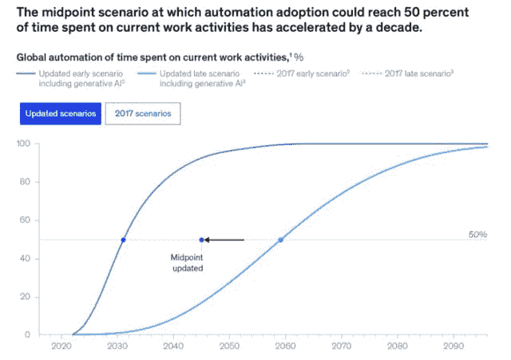 |  |
| https://twitter.com/i/status/1670219559511420929 |  |
| 卧槽，这玩意有点离谱的，将 Chat GPT 和 SD 的能力进行了整合，在一个界面里用自然语言编写游戏代码，并且生成游戏素材，然后整合成一个游戏。 |  |
| 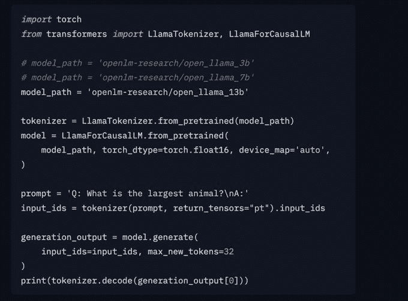 |  |
| 一个 AI 换发型的工具，感觉这玩意会很有市场，在想更换发型之前做一个预览看看是否符合自己的需求。 |  |
| Chat Cat 是一个基于 ChatGPT 的智能助手应用，里面充满了可爱的猫咪角色。不同的猫咪拥有预设的不同提示，以应对不同的需求。 |  |
| Autobet PRO 是一款利用人工智能技术进行即时体育博彩的强大工具。通过 Autobet PRO，您可以提高体育博彩的准确性和盈利潜力。 | https://chatbene.com/autobetpro |
| Carlos App 是一款免费的 AI 语言辅导应用，提供覆盖 50 多种第二语言的语言辅导服务。 |  |
| Qreative AI 是一个革命性的平台，利用 AI 技术创建引人注目、艺术化的 QR 码。它旨在为企业提供一个独特、吸引眼球的工具，增强其数字化存在和观众参与度。 |  |
| Txt/Img to 3D model, that allow you to generate 3D model from txt or image, basing on OpenAI Shap-E. |  |
| Chat2DB 是一款有开源免费的多数据库客户端工具，支持 windows、mac 本地安装，也支持服务器端部署，web 网页访问。和传统的数据库客户端软件 Navicat、DBeaver 相比 Chat2DB 集成了 AIGC 的能力，能够将自然语言转换为 SQL，也可以将 SQL 转换为自然语言，可以给出研发人员 SQL 的优化建议，极大的提升人员的效率，是 AI 时代数据库研发人员的利器，未来即使不懂 SQL 的运营业务也可以使用快速查询业务数据、生成报表能力。 |  |
| GitHub CEO：很快 AI 将能实现 80%的编程  昨天，GitHub CEO Thomas Dohmke 与 Freethink 进行一个对话，在这个对话访谈中，Thomas Dohmke 说 Copilot 很快将可以实现 80%的代码编程（Copilot will write 80% of code “sooner than later”），而现在这个数字大概在 50%左右。  同时，Thomas Dohmke 分享说，在今年 2 月份正式发布 GitHub Copilot for Business 版本后，现在已经有超过 1 万家企业客户在使用 Copilot 的企业版，比方说像可口可乐以及 Airbnb 等这样的企业，而微软本身也有 3 万多名员工在使用企业版的 Copilot，并在其帮助下进行编程。  由于这整个对话比较长，我简单分享了几个我觉得有价值的点：  从系统思维的角度来看，未来的开发者需要做的事情是：理解软件的复杂性，并能够将一个非常大的问题、挑战或新特性分解成小问题，这将发挥越来越重要的作用。作为开发人员，我们需要能够管理解决大型复杂问题的大型复杂系统。而且，你需要能够将它们分解为小的构建块。有了 Copilot 后，程序员的工作将变得更加专注，它可以让你在有限的编程时间更加有创造力，因为你不再需要在各种其它产品（编辑器、浏览器、搜索引擎）之间来回切换。对于创业公司来说，快速行动是其生存的唯一途径，即使只是提高 20-25%的生产力，也可能会决定他们的生存能力。GitHub 在 2020 年正式开始研究 Copilot，在正式推出 Copilot 前他们在内部和 Github 客户里都做了一些测试，得到的反馈非常好，之前没有任何一款产品（功能）能获得这么好的反馈，无论是留存率还是其它指标，都没有一款产品可以与 Copilot 相比。GitHub 通过跟踪其客户和社区用户的使用习惯，得出目前已经有接近 50%的编程是通过 Copilot 完成的，而且这个比例还在不断提高。同时，通过对使用 Copilot 和没有使用 Copilot 的开发者进行的测试表明，使用 Copilot 比没有使用的效率提升了 55%，并且成功率也要高 78%vs70%，即使只是提高 55%，这也会改变整个行业。对于 AI 给教育带来的变革，Thomas Dohmke 认为知识的重要性将会降低，而掌握推理、探索内容的能力——知道如何确定 AI 提供的内容是否真正是正确答案——将变得至关重要。老师将与孩子们一起学习如何做到这一点。学生们必须弄清楚，AI 给出的是否真正是我正在解决的问题的答案，还是模型在产生幻觉？GitHub 一直在为开源开发者的权利而战，因为我们相信开源是实现人类进步的基础。开源所带来的协作模式可能是存在的最无边界和最无障碍的协作模式：来自全球各个国家的开发者相互合作，他们不关心我们在这个星球上所面临的所有其他冲突。  除了通过传统的打字输入，GitHub 也开发了一款通过声音输入实现编程的产品 Copilot Voice，这将解放你的双手，同时也让那些残疾人可以直接用语音实现编程的梦想。 |  |
| MagicBrush：用于指令引导图像编辑的手动注释数据集 |  |
| [视频创作者必买](https://twitter.com/hashtag/heygen?src=hashtag_click)工具、跨境电商必备工具  #heygen 它功能很全也很强就是贵  1、虚拟数字人  2、生成自己的头像，类似 D-ID  3、真人主播，可以上传自己的照片换脸  4、模版多可以随便用  5、内嵌 ChatGPT 直接生成文案  6、亚马逊链接一键生成真人卖货视频  好用推荐，直达传送门 |  |
| CLIPSonic: T[ext-to-Audio Synthes](https://t.co/GHTQtYZwPH)[i](https://t.co/GHTQtYZwPH)s with Unlabeled Videos and Pretrained Language-Vision Models  paper page: https://huggingface.co/papers/2306.09635…  Recent work has studied text-to-audio synthesis using large amounts of paired text-audio data. However, audio recordings with high-quality text annotations can be difficult to acquire. In this work, we approach text-to-audio synthesis using unlabeled videos and pretrained language-vision models. We propose to learn the desired text-audio correspondence by leveraging the visual modality as a bridge. We train a conditional diffusion model to generate the audio track of a video, given a video frame encoded by a pretrained contrastive language-image pretraining (CLIP) model. At test time, we first explore performing a zero-shot modality transfer and condition the diffusion model with a CLIP-encoded text query. However, we observe a noticeable performance drop with respect to image queries. To close this gap, we further adopt a pretrained diffusion prior model to generate a CLIP image embedding given a CLIP text embedding. Our results show the effectiveness of the proposed method, and that the pretrained diffusion prior can reduce the modality transfer gap. While we focus on text-to-audio synthesis, the proposed model can also generate audio from image queries, and it shows competitive performance against a state-of-the-art image-to-audio synthesis model in a subjective listening test. This study offers a new direction of approaching text-to-audio synthesis that leverages the naturally-occurring audio-visual correspondence in videos and the power of pretrained language-vision models. |  |
|  |  |

https://github.com/nlpxucan/WizardLM

http://2short.ai - 快速创建短视频的工具

## 6 月 20 日

| 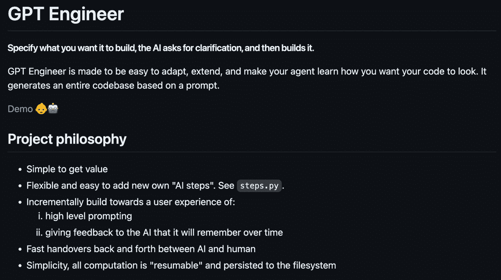 |  |
| --- | --- |
| In MyShell TTS, How to make AI mimic anyone&#x27;s speech, in a casual way? |  |
| [Sundar Picha](https://twitter.com/hashtag/healthcare?src=hashtag_click)i 推出了一项革[命性的#](https://twitter.com/hashtag/AI?src=hashtag_click)healthcare 技术，该技术采用#AI 和眼部扫描来预测心血管事件，并且非常准确。这一新发展可能会消除 CT 扫描、MRI 和 X 射线的必要性，使医生能够清楚、全面地了解患者的内部状况。皮查伊强调，这项突破性技术凸显了人工智能在彻底改变患者护理方面的变革潜力。 |  |
| 《又来 10 个 AI 新工具，让你效率倍增》  1。 AI 广告工具和数据大屏  http://Magicbrief.com  2。定制 AI 聊天机器人  http://Chatling.ai  3。 AI 版的 Excel  http://Rows.com/ai  4。 AI 室内设计  http://Roomgpt.io  5。总结科学论文  http://Scisummary.com/ai  6。升级您的学术写作  http://Trinka.ai  7。从文字中创建视频  http://Genmo.ai  8。 在线约会助理  http://Datingai.pro  9。生成 AI 表格网站  http://Feathery.io  10。业务助理  http://Meetcody.ai |  |
| **20+ AI PPT 演示工具****  1**[。 Tome  https://ai](https://t.co/UbJLDfvXro)[mart.app/products/tome  ](https://t.co/MBZcitMcY3)[2. Gamma  https:/](https://t.co/FPYMoYEiQ3)[/aimart.app/produ](https://t.co/4MCmkppmbo)[cts/gamma  3. Au](https://t.co/ejqvBSkoGt)daOS  https://aimart.app/products/audaos  4. AutoSlide  https://aimart.app/products/autoslide  5. Beautiful AI  https://aimart.app/products/beautiful-ai  6. ChatBA  https://aimart.app/products/chatba  7. Chronicle  https://aimart.app/products/chronicle  8. Decktopus  https://aimart.app/products/decktopus-ai  9. Glimmer  https://aimart.app/products/glimmer  10. MagicSlides  https://aimart.app/products/magicslides  11. Motionit AI  https://aimart.app/products/motionit-ai  12. Peach  https://aimart.app/products/peach  13. Pitch  https://aimart.app/products/pitch  14. Pitches AI  https://aimart.app/products/pitches-ai  15. Plus AI  https://aimart.app/products/plus-ai-for-google-slides  16. Powepresent AI  https://aimart.app/products/powepresent-ai  17. Premast  https://aimart.app/products/premast  18. Presentations AI  https://aimart.app/products/presentations-ai  19. Prezo  https://aimart.app/products/prezo  20. Sidebean  https://aimart.app/products/sidebean  21. Slides AI  https://aimart.app/products/slides-ai  22. Slidego  https://aimart.app/products/slidesgo  23. Storyd  https://aimart.app/products/storyd  24. Zillion Pitches  https://aimart.app/products/zillion-pitches |  |
| The Mathematical Playground（数学游乐场）一个有趣的地方  提供免费工具、课程和教具，使在线学习比以往任何时候都更具互动性和吸引力，发现数学的巨大力量和意想不到的美  https://mathigon.org |  |
| Farewell to Prompt -&gt;🔴AutoPrompt: revolutionary |  |
| Just built this - generate a fully illustrated picture book  using a single text prompt  Uses function calling with |  |
|  |  |
| 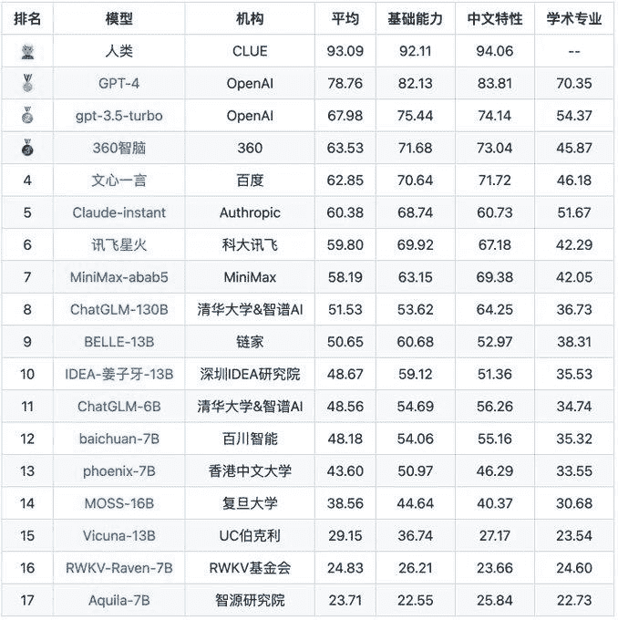 |  |
| OpenLLaMA 发布了！  这是 Meta AI 的 LLaMA 7B 和 13B 的开源再现（意味着可商用）。  这是一个在 RedPajama 数据集上训练的许可复制品。提供预训练的 OpenLLaMA 模型的 PyTorch 和 JAX 权重，以及评估结果和与原始 LLaMA 模型的比较 |  |
| 4 free AI[-powered resum](https://t.co/bYLgOFODN0)e builders:  1. http://Resumaker.ai  Auto-complete and fill in data for you.  2. http://Kickresume.com  Build a resume with ChatGPT.  3. http://Rezi.ai  Create a resume with AI in minutes.  4. http://ResumAI.com  AI resume writing assistant. |  |
| **You Can Create Custom AI Vi**deos In Just Seconds  Bo[okmark these 10](https://t.co/rGjFSBSLbB) AI Video Generator Tool[s to make you a](https://t.co/U8rTQ3xF9W) pro:  1) Pictory ➝ http://pictory.ai  2) Fliki ➝ http://fliki.ai  3) Hour One ➝ http://hourone.ai  4) D-ID ➝ http://d-id.com  5) Xpression Camera ➝ http://xpressioncamera.com  6) Colossyan ➝ http://colossyan.com  7) Rephrase .ai ➝ http://rephrase.ai  8) Deepbrain AI ➝ http://deepbrain.io  9) Vidyo .AI ➝ http://vidyo.ai  10) Synthesia ➝ http://synthesia.io |  |
| CLIP-based research is moving so fast that even authors cannot keep pace with arXiv |  |
| 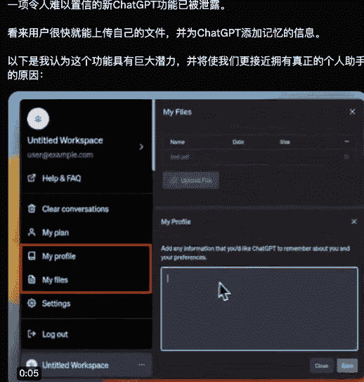 |  |
|  |  |
| 输入要修改的图片内容，一键完成 P 图。一般，胜在无需蒙板圈选 P 图区域。 |  |
| [fiverr.com](https://t.co/1ysRNlpH4b) 作为海外兼职平台，提供了各种 AI 相关的服务，包括 AI 写作、AI 绘画、ChatGPT 应用等，价格在几美元到几百美元不等  利用 ChatGPT，Midjourney 等 AI 工具，配合 Fiverr 这样的全球化交易平台，创造收益的途径变得越来越多元化 |  |
| Come say hi at [#CVPR23](https://twitter.com/hashtag/CVPR23?src=hashtag_click)  Will be presenting the project behind WhisperX |  |
| [h](https://t.co/JRXLr8pfM8)[t](https://t.co/JRXLr8pfM8)tps://theregister.com/2023/06/08/scientists_ai_recognition/…  科学家声称 ChatGPT 内容识别率超过 99%  科学家们声称已经开发出一种机器学习算法，可以以超过 99% 的准确率检测出由 ChatGPT 生成的科学论文。  该算法经过训练，可以将科学家和 ChatGPT 撰写的论文进行分类，并且能够 100% 地区分人类真实科学写作和 AI 生成的论文。  然而，该研究的范围有限，需要进行后续研究以确定该方法的适用性。  一些评论者对研究方法和结果的有用性表示怀疑，而其他人则讨论了 AI 生成内容的潜在影响以及检测抄袭的难度。 |  |
| FashionAI：一键换衣服的工具 |  |
| https://github.com/e-johnstonn/FableForge |  |
| Running SXM2/SXM3/SXM4 NVidia data center GPUs in consumer PCs |  |
|  |  |

[

https://app.mys](https://t.co/EnFMWENqtF)hell.ai/robot-workshop

## 6 月 21 日

| [Midjourney 的免费平替  Stable Diffu](https://t.co/pMas9L57HS)[s](https://t.co/pMas9L57HS)ion 保姆级入门手册  https://mp.weixin.qq.com/s/nhB7Hsjz_aLkSrUT0mqHWw…  一份由腾讯云开发者写的🛰️公众文章，给想玩 AI 的新手-Stable Diffusion 保姆级入门手册，从硬件要求、环境部署安装到参数配置、模型下载安装使用训练等等，手册手把手教大家入门 Stable Diffusion。 |  |
| --- | --- |
| 微软 2023 年 Build 大会演讲：如何训练和应用 GPT（中英文字幕） |  |
| 熟悉 Prompt 的同学们应该都知道，通常在写 Prompt 的时候要先设定角色：“你是 XX 方面的专家”，这并非玄学，而是有科学根据的。 |  |
| Infinite Pho[torealistic Worlds u](https://t.co/UxDjMsmCSr)[s](https://t.co/UxDjMsmCSr)ing Procedural Generation  paper page: https://huggingface.co/papers/2306.09310…  introduce Infinigen, a procedural generator of photorealistic 3D scenes of the natural world. Infinigen is entirely procedural: every asset, from shape to texture, is generated from scratch via randomized mathematical rules, using no external source and allowing infinite variation and composition. Infinigen offers broad coverage of objects and scenes in the natural world including plants, animals, terrains, and natural phenomena such as fire, cloud, rain, and snow. Infinigen can be used to generate unlimited, diverse training data for a wide range of computer vision tasks including object detection, semantic segmentation, optical flow, and 3D reconstruction. We expect Infinigen to be a useful resource for computer vision research and beyond. |  |
| OpenAI 将发布模型商店！  据 The Information 最新消息，OpenAI 正准备发布一个「模型商店」（marketplace），类似 App Store，企业可以在这个市场里将根据自己需求定制的 AI 模型卖给其他公司。  OpenAI 将会发布一个新的平台，针对定制化模型/软件的交易市场，类似 App Store。目前还不知道它会采取怎样的盈利模式，是否会走 App Store 等平台商店的抽成模式。在这个「模型商店」上，开发者是自己开发定制模型的公司，消费者是需要垂直、定制模型的企业。如果「模型商店」最终落地，OpenAI 将有机会在领先的模型能力之外，再建立起一道生态的壁垒。  TI 采访的知情人士称，OpenAI 希望这种类似 App Store 的交易市场能成为企业获取最新最前沿的 LLM 的途径。举例来看，在垂直应用中，企业可以在模型商店里找到「识别电商交易中的金融欺诈」，或者「用最新消息回答有关特定市场的问题」等能力的模型。  举例来看，在垂直应用中，企业可以在模型商店里找到「识别电商交易中的金融欺诈」，或者「用最新消息回答有关特定市场的问题」等能力的模型。  消息人士认为，OpenAI 创建这样的市场，是为了「对冲未来没有 AI 模型占据绝对领先地位的风险」。目前还不知道 OpenAI 是否会从模型商店的交易中收取抽成，或建立其他盈利模式。「模型商店」也会为 OpenAI 的技术提供更广泛的客户群体，让它能在与 Anthropic 和 Cohere 等企业端竞争对手的竞争中取得优势。OpenAI 的模型商店，将会与它的客户或技术合作伙伴（包括 Salesforce 和微软等）产生竞争。开发者使用 OpenAI 软件创建的 chatbot，可以在这些应用商店上出售访问权限。 |  |
| Just launched a step-by-step guide to Large Language Models.  Perfect for beginners &amp; experts seeking to deepen their knowledge - from basics of ML/NLP to instruction fine-tuning and weight quantization. Every step backed by curated resources. |  |
| Local LLMs just got 2x faster on M1/M2 Macs |  |
| 微软宣布允许企业在自己的数据上使用 Azure OpenAI 服务  该功能将激发世界各地的企业客户使用 Azure OpenAI 服务！  Azure OpenAI 服务可以直接在你的数据上运行，无需进行额外的训练或微调。这意味着你可以直接使用 OpenAI 的模型（如 ChatGPT 和 GPT-4）来处理你的数据，而无需对模型进行任何修改或调整。 |  |
| QR Code AI A[rt](https://t.co/N9Wwm5hOko)Genera[tor  discussion: https://huggingfac](https://t.co/ZBmZsbv0eX)[e](https://t.co/ZBmZsbv0eX).co/spaces/huggingface-projects/QR-code-AI-art-generator/discussions/4…  demo: https://huggingface.co/spaces/huggingface-projects/QR-code-AI-art-generator…  prompt: A grand city in the year 2100, atmospheric, hyper realistic, 8k, epic composition, cinematic, octane render, artstation landscape vista photography by Carr Clifton &amp; Galen Rowell, 16K resolution, Landscape veduta photo by Dustin Lefevre &amp; tdraw, 8k resolution, detailed landscape painting by Ivan Shishkin, DeviantArt, Flickr, rendered in Enscape, Miyazaki, Nausicaa Ghibli, Breath of The Wild, 4k detailed post processing, artstation, rendering by octane, unreal engine |  |
| [这是一个精心策划的多模态大型语言模型（MLLM）列表，包含了 260 个论文，Pdf 和 git](https://t.co/AFD8UNfHMw)hub 链接，整理的调理清晰，适合研究使用  包括两大部分：模型和数据集  模型论文  -基础模型，指令调整，情景学习，思维链条，视觉推理  数据集  -对齐预训练，指令调整，情景学习等数据集  https://github.com/BradyFU/Awesome-Multimodal-Large-Language-Models#awesome-multimodal-large-language-models |  |
| Thrilled to introduce vLLM with |  |
| Want to train your own Bark/MusicGen-like TTS/TTA models? |  |
| DecodingTrus[t: A Comprehensive A](https://t.co/ZsmneX4jmr)[s](https://t.co/ZsmneX4jmr)sessment of Trustworthiness in GPT Models  paper page: https://huggingface.co/papers/2306.11698…  Generative Pre-trained Transformer (GPT) models have exhibited exciting progress in capabilities, capturing the interest of practitioners and the public alike. Yet, while the literature on the trustworthiness of GPT models remains limited, practitioners have proposed employing capable GPT models for sensitive applications to healthcare and finance - where mistakes can be costly. To this end, this work proposes a comprehensive trustworthiness evaluation for large language models with a focus on GPT-4 and GPT-3.5, considering diverse perspectives - including toxicity, stereotype bias, adversarial robustness, out-of-distribution robustness, robustness on adversarial demonstrations, privacy, machine ethics, and fairness. Based on our evaluations, we discover previously unpublished vulnerabilities to trustworthiness threats. For instance, we find that GPT models can be easily misled to generate toxic and biased outputs and leak private information in both training data and conversation history. We also find that although GPT-4 is usually more trustworthy than GPT-3.5 on standard benchmarks, GPT-4 is more vulnerable given jailbreaking system or user prompts, potentially due to the reason that GPT-4 follows the (misleading) instructions more precisely. Our work illustrates a comprehensive trustworthiness evaluation of GPT models and sheds light on the trustworthiness gaps |  |
| [可将您的工作效率提高 10 ](https://t.co/H7Ncerym3p)[倍的 8 大 AI 工具。  ](https://t.co/ovF2aHsw2A)1. 人工智能语音发生器  http://lovo.ai  2。人工智能网站建设者  http://10web.io  3。图片魔术  http://magicstudio.com  4。文字转视频  http://heygen.com  5。 演讲  http://tome.app |  |
| [一篇论文公开了一种名为 Vid2Avat](https://t.co/14jzXbP8FD)a[r 的技术，可以将 2](https://twitter.com/hashtag/Vid2Avatar?src=hashtag_click)D[ 动画](https://twitter.com/hashtag/3D?src=hashtag_click)中的人物和背景分离，制作成 3D 人物模型。  https://modelinghappy.com/archives/50704 #Vid2Avatar #3D 人物模型 |  |
|  |  |
| https://twitter.com/i/status/1670853301062213634 |  |
| The top 8 AI tools to boost your productivity by 10x in 2023: |  |
| HomeRobot: Open Vocabulary Mobile Manipulation |  |
| https://github.com/s0md3v/sd-webui-roop |  |
| baichuan-7B |  |
| OpenAI functions |  |
| 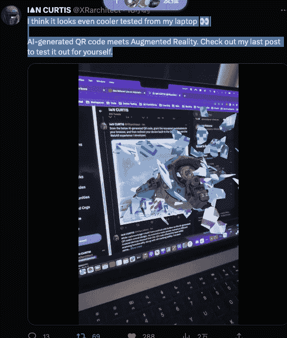 |  |
| Stable Dif[fusion generates beautif](https://t.co/buFTIY6183)[u](https://t.co/buFTIY6183)l im[ages, but](https://twitter.com/hashtag/CVPR2023?src=hashtag_click) can it be used for open-world recognition?  Try Demo! https://huggingface.co/spaces/xvjiarui/ODISE…  Our #CVPR2023 paper shows that the pre-trained diffusion model indeed is a good image parser,  allows for open-vocabulary segmentation and detection. | https://twitter.com/xiaolonw/status/1633929301073756161 |
| https://huggingface.co/papers/2306.10998 |  |
| Textbooks Ar[e All You Need  pape](https://t.co/E6D7tLK7mv)[r](https://t.co/E6D7tLK7mv) page: https://huggingface.co/papers/2306.11644…  introduce phi-1, a new large language model for code, with significantly smaller size than competing models: phi-1 is a Transformer-based model with 1.3B parameters, trained for 4 days on 8 A100s, using a selection of ``textbook quality&quot; data from the web (6B tokens) and synthetically generated textbooks and exercises with GPT-3.5 (1B tokens). Despite this small scale, phi-1 attains pass@1 accuracy 50.6% on HumanEval and 55.5% on MBPP. It also displays surprising emergent properties compared to phi-1-base, our model before our finetuning stage on a dataset of coding exercises, and phi-1-small, a smaller model with 350M parameters trained with the same pipeline as phi-1 that still achieves 45% on HumanEval. |  |
| 使用预训[练的文本到图像扩散模型完成点云  纸页：](https://t.co/AVwq8BQssZ)https://huggingface.co/papers/2306.10533…  在实际应用程序中收集的点云数据通常是不完整的。由于从部分视点观察对象，数据通常会丢失，这些视点仅捕获特定的视角或角度。此外，由于遮挡和低分辨率采样，数据可能不完整。现有的完成方法依赖于预定义对象的数据集来指导嘈杂和不完整的点云的完成。但是，这些方法在对分布外（OOD）对象进行测试时表现不佳，这些对象在训练数据集中表现不佳。在这里，我们利用了文本引导图像生成方面的最新进展，从而在文本引导形状生成方面取得了重大突破。我们描述了一种称为 SDS-Complete 的方法，它使用预训练的文本到图像扩散模型，并利用对象的给定不完整点云的文本语义，以获得完整的表面表示。 SDS-Complete 可以使用测试时间优化完成各种对象，而无需昂贵的 3D 信息收集。我们在不完整的扫描对象上评估 SDS Complete，这些对象由真实世界的深度传感器和 LiDAR 扫描仪捕获。我们发现它可以有效地重建常见数据集中不存在的对象，与当前方法相比，Chamfer 损失平均减少 50%。 |  |
|  |  |

by 宝玉

## 6 月 25 日

| 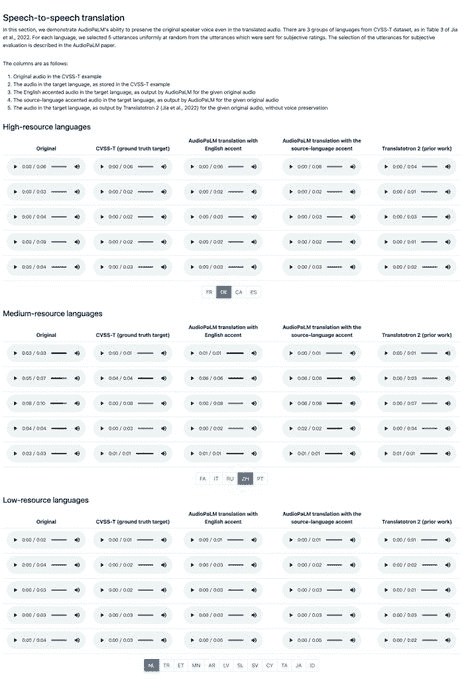 |  |
| --- | --- |
| 清华唐杰新作 WebGLM：参数 100 亿、主打联网搜索，性能超 OpenAI WebGPT  WebGLM，一个参数 100 亿的联网问答聊天机器人（论文入选 KDD2023）。  据介绍，WebGLM 的目标是通过 Web 搜索和检索功能，增强预训练大语言模型，同时可以进行高效的实际部署。作者基于三种策略进行开发。  首先是大模型增强检索器。  它主要是用于增强模型相关网络内容的检索能力，在给定查询的情况下查找相关引用，以便后面更好地准确回答问题。  它有两个阶段：粗粒度 web 搜索和细粒度 LLM 增强密集检索。  其次是自举生成器。  它利用 GLM（比如清华之前发布的双语开源预训练模型 GLM-130B）的能力为问题生成回复，提供详细的答案。  利用该生成器，作者得到 WebGLM-QA——一个 LLM 自举引用和长程的 QA 数据集。  它通过上下文学习等策略进行清洗和过滤，最终包括 45k 的高质量过滤样本和 83k 的噪声样本。  WebGLM 的 backbone 就是一个在该数据集上训练的 GLM 模型。  最后是基于人类偏好的打分器。  它通过优先考虑人类偏好而非昂贵的专家反馈来评估生成回复的质量，确保系统能够产生有用和吸引人的内容。  以上三大组件最终按顺序形成 WebGLM 的 pipeline |  |
| 打算深入一下 AGI，然后找到了一个非常适合初学者的课程 https://course.fast.ai。这个课程非常适合做上层应用开发的同学，原因是课程里面不会直接给你教授深度学习、神经网络的底层细节，而是教你如何使用开源模型，训练数据，微调参数。就像是编程，你可以把编译原理扔一边的感觉。 |  |
| https://reddit.com/r/StableDiffusion/comments/14hbv5k/miss_multiverse_2023/ |  |
| New open source[ text to video AI model  576x3](https://t.co/BYIUbFMDOp)[2](https://t.co/BYIUbFMDOp)0 model: h[ttps://huggingface.co/cerspe](https://t.co/aFbEO6p62U)[n](https://t.co/aFbEO6p62U)se/zeroscope_v2_576w…  1024x576: https://huggingface.co/cerspense/zeroscope_v2_XL…  zeroscope_v2_576w, A watermark-free Modelscope-based video model optimized for producing high-quality 16:9 compositions and a smooth video output. This model was trained using 9,923 clips and 29,769 tagged frames at 24 frames, 576x320 resolution.  zeroscope_v2_XL is specifically designed for upscaling content made with zeroscope_v2_576w using vid2vid in the 1111 text2video extension by kabachuha |  |
| 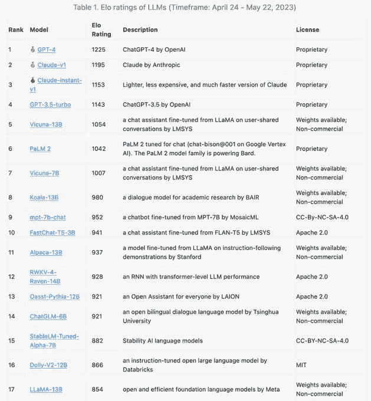 |  |
| Stable Diffusion 发布了新的图像模型 SDXL 0.9，这是文本到图像模型的一项突破性发展，相比前身在图像构成和细节上有显著的改进。  最主要的是 SDXL 0.9 可以在消费级 GPU 上运行，Windows 10 或 11，或 Linux 操作系统，16GB RAM，以及至少有 8GB VRAM 的 Nvidia GeForce RTX 20 显卡（或更高标准）即可运行。 |  |
| [h](https://t.co/eU7cm2WK99)[t](https://t.co/eU7cm2WK99)tps://struct.ai/blog/launching-struct-chat-platform… |  |
| ChatGPT and Bard cannot solve every problem for you.  1. YouTube Summaries → http://eightify.app  2. 3D Animations → http://moviebot.io  3. AI Assistant → http://zipzap.ai  4. Prompts → http://promptdrive.ai  5. How-to-videos → http://teachomatic.net |  |
| 昨天 Midjourney 发布了 zoom out 功能，这个功能及其强大，可以创造出一些神奇的图片出来，甚至可以做视频。 |  |
| AI 音乐（音乐生成等）  5 月流量一览  1 http://voicemod.net/text-to-song  2 http://musicfy.lol  3 http://soundraw.io  4 http://songtell.com 歌词分析  5 http://landr.com/en  6 http://my.brain.fm  7 http://voicify.ai 封面制作  8 http://boomy.com |  |
| https://openpm.ai |  |
| https://huggingface.co/psmathur/orca_mini_3b |  |
| @erhartford |  |
| [Midjourney V5.2 改进美学效果、连贯性、文本](https://t.co/SJ7iWpSK4D)[理](https://t.co/SJ7iWpSK4D)[解、更清晰的图像、更高的变异模式、缩小视角的外部绘画功能，](https://t.co/yTTcmKEcOm)[以](https://t.co/yTTcmKEcOm)及一个新的 /shorten 命令用于分析你的提示词。  https://mp.weixin.qq.com/s/D9xxP8QOLq5q7pNRhYCc3w…  MJ 发布了 V5.2，SD 也不甘示弱！  https://mp.weixin.qq.com/s/rDWr0pkYsWKo83FxaMo1pA… |  |
| 来看一下编程模型（CoderLLM）🚀 |  |
| Open-source #TextToVideo community 🦒 colab 🥳 |  |
| LLM As Chatbot update |  |
| https://inflection.ai/inflection-1 |  |
| 理论上最接近 ChatGPT 的模型，终于有人训练出来了， orca_mini_3b！ |  |
| 有人做了个 AI 川普和 AI 拜登 |  |
| 如何搭建情感陪伴 AI 机器人？ |  |
| AI 自主代理的列表，包括开源和闭源项目。总结的很全面！ |  |
| An early version of the amazing zeroscope_v2 XL text to video model is now available to use on Replicate: |  |
|  |  |