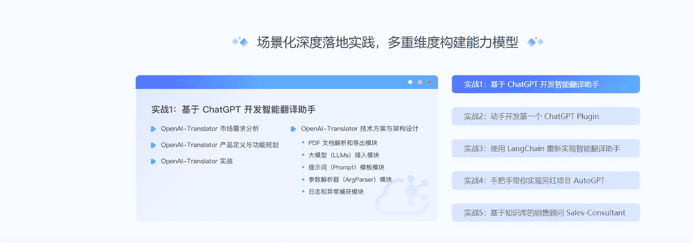

# 🛠️ 极客时间 - AI 大模型应用开发实战营

> 来源：[https://docs.feishu.cn/docx/NECpdpIfJoQEX6xwlMBcNxwCnSc](https://docs.feishu.cn/docx/NECpdpIfJoQEX6xwlMBcNxwCnSc)

# 基础篇

## ⼤模型理论基础

+   初探大模型：起源与发展

+   预热篇：解码注意力机制（Attention ）

+   变革里程碑：Transformer 的崛起

+   走向不同：GPT 与 Bert 的选择

+   GPT 模型家族:从始至今

+   GPT 模型家族：从始至今

+   从 GPT-1 到 GPT-3.5：一路的⻛云变幻

+   ChatGPT：赢在哪里

+   GPT-4：一个新的开始

+   大模型的未来：开源力量与生态繁荣

+   OpenAI 的宏图：追求无止境

+   开源战场：OpenAI 的挑战者们

+   LangChain：为开发者提供的舞台

+   提示学习（Prompt Learning）

+   思维链（Chain-of-Thought, CoT）：开山之作

+   思维树（Tree-of-Thoughts, ToT）：续写佳话

+   提示工程（Prompt Engineering）：全新的工作方式

## ⼤模型开发基础

+   Embedding 101

+   Embedding 起源、发展、应⽤与现状

+   Embedding 之于⼤模型的独特价值

+   ⾸个 Embeddings 开源数据集：Alexandria

+   实战 OpenAI Embeddings 模块

+   OpenAI ⼤模型选择指南

+   OpenAI ⼤模型⼆次开发指南

+   ⽂本内容补全初探（Text Completion）

+   聊天机器⼈初探（Chat Completion）

+   语⾳识别初探（Speech to Text）

+   图像⽣成初探（Image Generation）

## ⼤模型应⽤最佳实践

+   内容创作与⽣成（Content Generation）

+   ⽂本摘要与总结（Summarization）

+   语义与情感分析（Semantic and Sentiment Analysis）

+   多语⾔智能翻译（Translation）

## ⼤模型核⼼硬件选型指南

+   NVIDIA 概念解惑

+   GPU vs 显卡

+   架构（安培 Amper）vs 产品（数据中⼼）

+   专业级（A100）vs 消费级（4090）

+   CUDA Core vs Tensor Core

+   显卡选型推荐指南

+   显卡性能天梯榜

+   专业级显卡怎么选

+   消费级显卡怎么选

+   AMD 是⼀个选择么？

## 实战一：基于 ChatGPT 开发智能翻译助⼿

+   OpenAI-Translator 市场需求分析

+   OpenAI-Translator 产品定义与功能规划

+   OpenAI-Translator 技术⽅案与架构设计

+   PDF ⽂档解析和导出模块

+   ⼤模型（LLMs）接⼊模块

+   提示词（Prompt）模板模块

+   参数解析器（ArgParser）模块

+   ⽇志和异常捕获模块

+   OpenAI-Translator 实战

## 实战二：动⼿开发第⼀个 ChatGPT Plugin

+   ChatGPT Plugin 开发指南

+   ChatGPT Plugin 样例项⽬

+   ChatGPT Plugin 样例部署与开发模式

+   ChatGPT 多模态交互⼊⻔

+   将 OpenAI-Translator 改造成 ChatGPT Plugin

在 ChatGPT 聊天中实现 PDF ⽂件上传

+   OpenAI-Translator 服务化

+   ChatGPT Plugin 对接 OpenAI-Translator API

+   ChatGPT Plugin 应⽤申请

+   部署 ChatGPT Plugin 应⽤

# 进阶篇

## ⼤模型应⽤开发框架 LangChain

+   LangChain 101

+   LangChain 项目起源、发展与现状

+   LangChain 的独特价值

+   LangChain 基础概念

+   LangChain 架构设计

+   LangChain 图形化界面：LangFlow

+   LangChain 开发上手指南

+   LangChain 开发环境

+   基于 Miniconda 搭建虚拟环境

+   使用 Jupyter Lab 进行交互式开发

+   LangChain 核心模块

+   标准化的大模型抽象：Models

+   文本 I/O 的大语言模型：LLMs

+   更加结构化的聊天模型：Chat Models

+   更具想象力的嵌入模型：Text Embedding Models

+   大模型的输入抽象：Prompts

+   灵活构造提示词：Prompt Templates

+   巧妙植入最佳实践：Example Selectors

+   规范化大模型输出结果：Output Parsers

+   大模型应用的最佳实践：Chains

+   上手你的第一个链：LLM Chain

+   动态调用的路由链：Router Chains

+   处理超长文本的转换链：Transformation Chain

+   面向数据库的问答链：SQL Chain

+   实现复杂应用的代理系统：Agents

+   动态决策链的执行：Action Agents

+   复杂规划的执行链：Plan-and-Execute Agents

+   检索非结构化数据的利器：Indexes

+   文档加载器：Document Loaders

+   文本分割器：Text Splitters

+   向量持久化：VectorStores

+   向量检索器：Retrievers

+   赋予应用记忆的能力： Memory

+   大模型原生的回调系统：Callbacks

+   LangChain 典型应用剖析

+   支持复杂任务处理的自主代理

+   基于文档知识的问答助理

+   基于⻓短期记忆的聊天机器人

+   基于指定 GitHub Repo 的代码解析

## 实战三：使用 LangChain 重新实现智能翻译助手

+   接入 LangChain 后的架构设计

+   基于 LangChain 进行版本重构的方案调整

+   使用 LangChain LLMs 接入 OpenAI 模型

+   使用 LangChain Prompt Templates 生成翻译提示词

+   使用 LangChain Example Selectors 指导用户输入

+   使用 LangChain Callbacks 实现深度异常捕获

+   实战 LangChain 版 OpenAI-Translator

## 实战四：手把手带你实现网红项目 AutoGPT

+   AutoGPT 原始版本定位与功能解读

+   LangChain 版 AutoGPT 技术方案与架构设计

+   网络搜索（SerpAPIWrapper）模块

+   文件读写（FileTool）模块

+   持久化存储（VectorStores）模块

+   向量模型（Embeddings）模块

+   聊天模型（Chat Models）模块

+   实战 LangChain 版 AutoGPT

## 实战五：基于知识库的销售顾问 Sales-Consultant

+   Sales-Consultant 市场需求分析

+   Sales-Consultant 产品定义与功能规划

+   Sales-Consultant 技术方案与架构设计

+   解析与索引管理（Indexes）模块

+   知识库问答（QA Chain）模块

+   用户引导（Example Selectors）模块

+   实战 LangChain 版 Sales-Consultant

## 大模型应用落地与数据隐私

+   大模型时代的开源与数据协议

+   数据安全性和保护措施

+   数据加密与脱敏技术

+   安全传输与存储机制

+   模型的可解释性和可审计性

+   提高模型决策过程的透明度

+   大模型的审计机制与规则

+   伦理和道德考虑

+   大模型带来的伦理挑战

+   设计与使用大模型时的道德原则

+   法规合规性

+   数据保护法规对大模型的影响

+   大模型的合规性保证策略

+   数据隐私的量化评估

+   数据隐私影响的评价指标

+   数据隐私量化评估的方法与技术** **

# ⽣态篇

## ⼤模型开源⽣态

+   ⼤模型排⾏榜与基准测试

+   ⼤模型横向对⽐

+   OpenAI GPT-4

+   Facebook LLaMA

+   Stanford Alpaca

+   Tsinghua ChatGLM

+   ⼤模型时代的 GitHub：Hugging Face

+   使⽤ Hugging Face 托管你的 LLMs 应⽤

## 国产⼤模型 ChatGLM 应⽤开发

+   ChatGLM 与 VisualGLM 家族

+   ChatGLM-6B 介绍与快速⼊⻔

+   ChatGLM-6B fine-tuning

+   ChatGLM-6B 私有化部署

+   基于 ChatGLM 打造你的私有化 “ChatGPT”