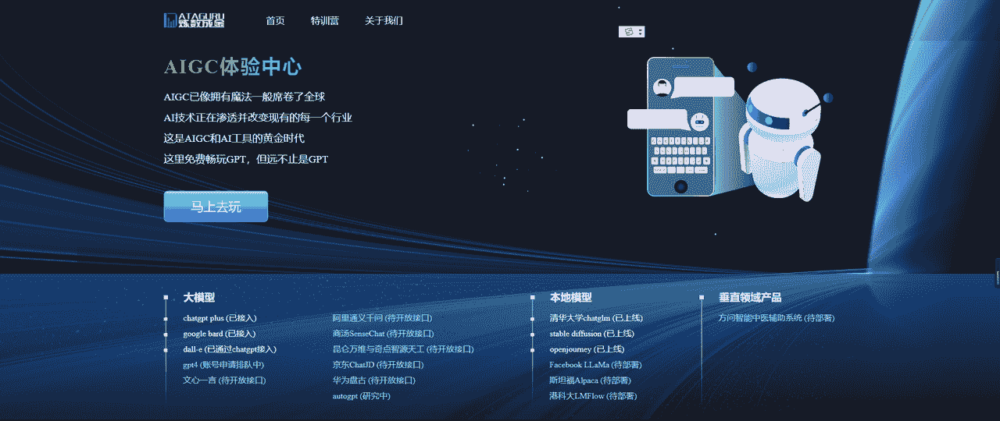

# 🛠️ 炼数成金 - AIGC知识库

> 来源：[https://docs.feishu.cn/docx/KflWdykhAoL6MdxPuT4cgrctnUg](https://docs.feishu.cn/docx/KflWdykhAoL6MdxPuT4cgrctnUg)

垂直领域专家机器人实战特训营：http://www.dataguru.cn/bootcamp-42.html

> **课程内容****

> Day1 【图深度学习****】

> 图基础****，图模型及****其应用，****图****嵌入，图神经网络与图****深度学习及其****实现，动手实际场景案例，实现多种图游走算法。

> 

> Day2【****知识图谱】

> 知识图谱原理****与应用，命名****实体识别****，关系抽取，实体消歧。知****识图**谱构建，存储，图数据库。从零开始，动手建立一个小型知识图谱及问答系统。

> 

> Day3 【大语言模型】

> 语言模型与图机器学习，各种流行的大语言模型原理，实现，微调。

> 动手建立自己专属垂直领域的大语言模型。用大语言模型简化知识图谱构建。

> 

> Day4 【问答机器人】

> 问答系统技术概述，大语言模型的问答机器人的优缺点。本地知识图谱与大语言模型的结合方法。动手实现复杂的企业级知识图谱，图深度学习应用于知识抽取，融合，推理。融合知识图谱与大语言模型实现企业专属的问答机器人