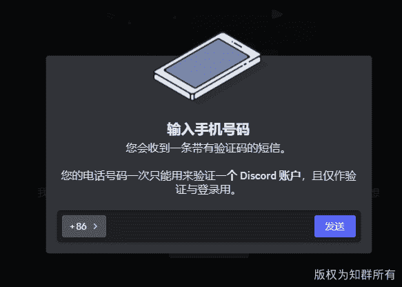
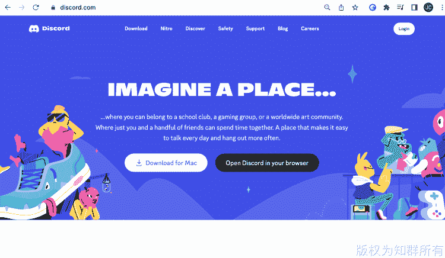

# AIGC 工具案例必修课问题集

> 来源：[https://docs.feishu.cn/docx/WjXndRIoVoDri2xCkiRcHLYTnuf](https://docs.feishu.cn/docx/WjXndRIoVoDri2xCkiRcHLYTnuf)

## **重要：****chatGPT**** & Midjourney注册前请务必先查看课程资料，注册文档是结合以往注册经验以及网络资料编写的，随着时**间以及网络环境、设备等影响，步骤有可能出现差异。如果出现问题，请注意主动网上寻找解决方案，或者参考其他网络注册教程注册。

**

**⚠️ 其中涉及[到的平台充值等问题，请同学谨慎付款，如因文中推荐的平](https://izhiqun.com/web/group/1736/course/6430)**台**充值出现问题，请同学与对应平台沟通解决，知群仅作方法推荐与建议。

ChatGPT账号注册及付费教程（文档）：https://izhiqun.com/web/group/1736/course/6422

Midjourney注册机付费指南（文档）：https://izhiqun.com/web/group/1736/course/6430

所有的问题均来源于网络分享以及部分实践沉淀，如果出现文档未提及的问题，大家可以踊跃交流或者搜索解答方法。

# **一、网络问题**

**1.有哪些魔法可以使用？**

-可以使用我们推荐的魔法工具，详见官网课程，有详细的讲解视频和教程

-也可以查看下面这篇🧱教程，推荐比较全面，内容也很详细，选择自己系统适配的工具即可

[https://github.com](https://github.com/bannedbook/fanqiang)/bannedbook/fanqiang（复制在浏览器中打开）

2.为什么购买了魔法以后不能使用？

一般购买了订阅套餐后，需要下载客户端并进行配置才能正常使用，不同的工具流程有所区别，具体流程可以参考购买平台的官方教程，或在下面这篇🧱教程中根据自己的系统和工具找到对应的教程参考配置

**3.魔法的节点怎么选择？**

一般订阅并且在本地配置好后，会出现带有国家名称的节点，这些基本是可用的，可以自主选择，并打开一个网站测试阶段是否可用

**4.配置好之后仍然无法连接**

-这种情况一般是配置过程中有遗漏或有错误的步骤，可以按照教程重新配置并检查过程中是否有疏漏，如果重新设置后仍然无法上网可以联系魔法的官方客服或在平台提交工单（相当于反馈问题给官方）

-也可以尝试切换不同国家的节点，并测试是否能够正常连接

# **二、****ChatGPT**

**

1.注册问****题

报**错类：

1.在注册或使用过程中页面提示报错怎么解决？

> 这种情况下不要紧张，一般都不是大问题，[先](https://blog.csdn.net/GPT20236688/article/details/130307429)查看页面报错原因（如英文不好可翻译），根据报错提示选择对应的解决方式，也可以通过网络搜索快速寻找解决方案。

> 附：ChatGPT常见报错及解决方案：https://blog.csdn.net/GPT20236688/article/details/130307429

2.注册时提示邮箱不能用怎么办？

> 目前openAI对于使用🐧邮箱和outlook邮箱注册限制比较严格，可以尝试优先使用谷歌邮箱账号进行注册。

> （首先要先有谷歌邮箱，注册谷歌邮箱需要验证手机号，国内手机号有可能验证失败，具体设置方法网上有很多教程可以参考，也可以用国外虚拟手机号验证。）

**3.提示当前****IP****无法注册怎么办？**

> 一般是由于使用的🪜IP注册过多或被官方标记了，这种情况下尝试多换IP节点注册，如果不行可以等待一段时间后再注册

>

**手机验证类：**

**1.国内手机号可以用于****ChatGPT****注册验证吗？**

> 目前ChatGPT验证需要使用国外手机号，不支持国内的手机号，如自己没有国外手机号，可以使用虚拟手机号

> （免费的成功率很低），可以使用课程教程里推荐的平台

2.使用国外虚拟号码还是无法注册怎么办？

> 目前由于官方限制，很多国家的手机号都会注册失败，遇到这种情况只有尝试更换不同国家，可以在群内和其他同学交流，看看近期哪个国家的手机号成功率较高

**2.使用问题**

# **三、Midjourney**

**

1.注册相关问****题

Q1.机器人验证勾选框一直处于**波动引导，点击无任何反应，等1分钟左右就报错

**

建议：可以先尝试更换你的魔**法节点，或者按本文中的【一、Midjourney注册方法】-【5、注意事项】清理浏览器缓存。

Q2.手机验证时收不到验证码

建议：

+   检查号码是否正确

+   确认一下自己的浏览是否是Chrome的浏览器，最好用Chrome的浏览器注册。

+   尝试更换你的魔法节点，多几个看看。

+   如果不行，试试下载discord的pc端注册看看（discord的官网可以直接下载客户端）

+   如果都不行，那么可以使用注册一个虚[拟](https://zhuanlan.zhihu.com/p/617620253?utm_id=0)[号（可以使用虚拟号平台收验证码：https://sm](https://zhuanlan.zhihu.com/p/617620253?utm_id=0)s-activate.org/?ref=4457263——注意，需要付费，具体操作步骤见：https://zhuanlan.zhihu.com/p/617620253?utm_id=0）

+   最后如果自己注册太麻烦了，可以通过某宝看看有无代注册或者购买共享账号体验试用

# **  四、课程知识点问**题：

**Q1. Midjourney的🐧内测版频道怎么申请，**[点击出现要填答案是什么意思？答案是什](https://zhuanlan.zhihu.com/p/629642499)么？

想申请的把这个链接里的二维码保存下来吧，每周一周五18：00开放申请，人满即止。人满了就会出现要你回答答案，那个时候就是申请不了了

https://zhuanlan.zhihu.com/p/629642499