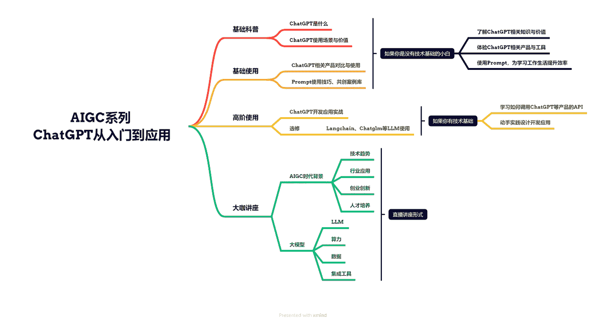
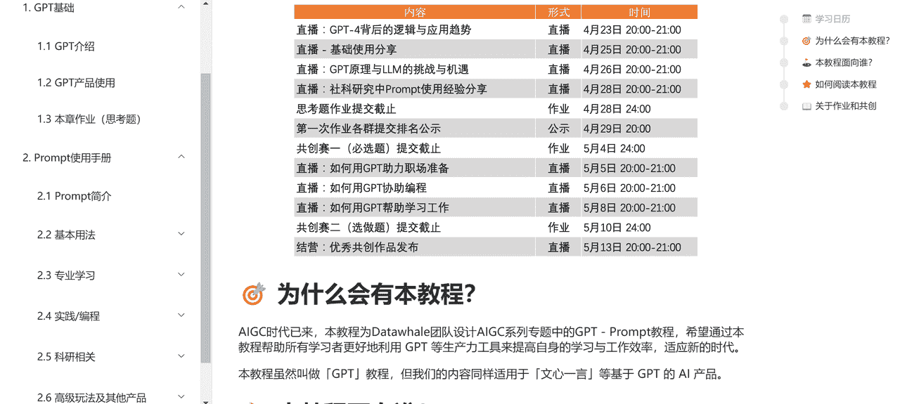
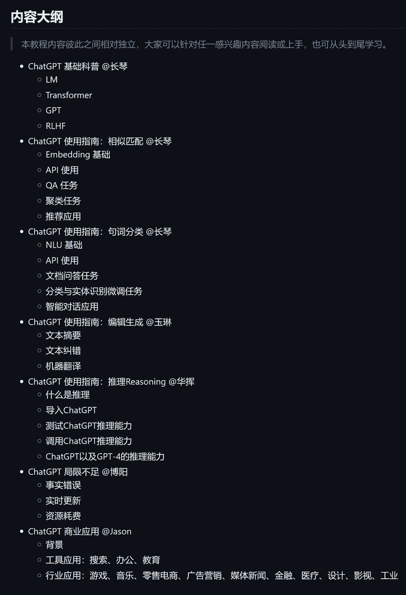
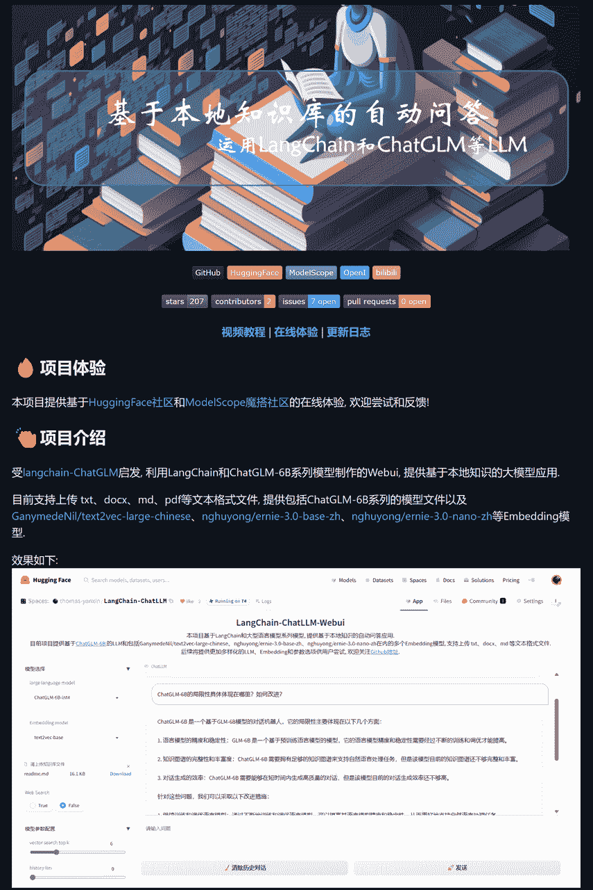
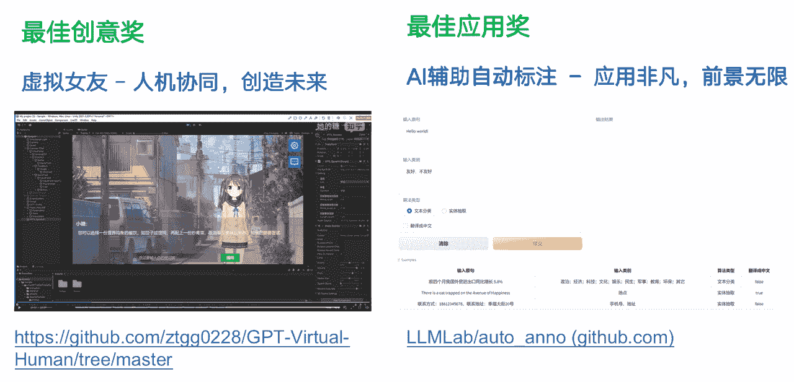
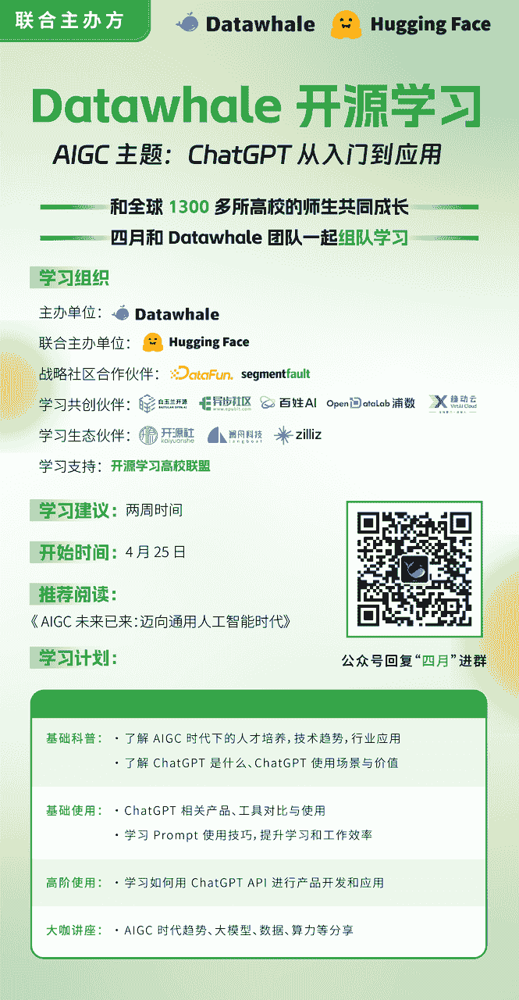

# 5月 | Prompt使用指南

> 来源：[https://docs.feishu.cn/docx/Xh1ldvrE1oWQxQxRH61cPn6XnDb](https://docs.feishu.cn/docx/Xh1ldvrE1oWQxQxRH61cPn6XnDb)

+   如果你是没有技术基础的小白

+   基础科普

+   了解AIGC时代下的人才培养，技术趋势，行业应用

+   了解GPT相关知识与价值

+   基础使用

+   体验GPT相关产品与工具

+   使用Prompt，为学习工作生活提升效率

+   拓展

+   GPT原理，LLM

+   大模型的数据

+   大模型的算力

+   langchain/gptindex等工具箱,插件库的使用

+   如果你有技术基础

+   基础科普

+   了解AIGC时代下的人才培养，技术趋势，行业应用

+   了解GPT相关知识与价值

+   高阶使用

+   学习如何调用GPT等产品的API、LangChain，动手实践设计开发应用

+   拓展

+   GPT原理，LLM

+   大模型的数据

+   大模型的算力

+   langchain/gptindex等工具箱,插件库的使用

# 课程内容（持续更新）

##  课程列表

## 基础使用

+   Prompt使用指南：https://linklearner.com/#/learn/detail/120

+   ChatGPT Prompt Engineering for Developers

+   吴恩达 x OpenAI官方课程的中文翻译，配套代码与笔记

+   中文字幕视频：https://www.bilibili.com/video/BV1Bo4y1A7FU

+   开源教程地址：https://github.com/datawhalechina/prompt-engineering-for-developers

**基础使用直播合集，记得三连**

多维表格（G4HWbujYmapLADsRXB1cmhYUnhf_tblEeAjYnM0AcPuY）

## 高阶使用

+   [Hugging LLM](https://github.com/datawhalechina/hugging-llm)

+   开源教程地址：https://github.com/datawhalechina/hugging-llm

+   ChatGPT Prompt Engineering for Developers

+   吴恩达 x OpenAI的官方课程

+   中文字幕视频：https://www.bilibili.com/video/BV1Bo4y1A7FU

+   开源教程地址：https://github.com/datawhalechina/prompt-engineering-for-developers

+   LangChain等LLM使用（内容持续开发中）

+   LangChain-ChatGLM-Webui：https://huggingface.co/spaces/thomas-yanxin/LangChain-ChatLLM

+   LangChain-Zilliz-Cloud

https://huggingface.co/spaces/SimFG/LangChain-Zilliz-Cloud

**高阶课直播合集，记得三连**

多维表格（G4HWbujYmapLADsRXB1cmhYUnhf_tblvMFiKClUTewYQ）

## 大咖讲座

**大咖直播**讲座合集，所有录播都会更新在这里，记得三连：https://space.bilibili.com/431850986/channel/collectiondetail?sid=1315092

| **分享主题** | **预计直播日期** | **学习时长** | **分享嘉宾** |  |
| --- | --- | --- | --- | --- |
| 引爆：ChatGPT/GPT-4背后的逻辑与应用趋势 | 4/23 | 70min | Darren | 副研究员、  《AIGC未来已来》作者 |
| [GPT原理与LLM的挑战与机遇](https://www.bilibili.com/video/BV12T411872w/) | 4/26 | 30min | 周明 | 澜舟科技创始人兼CEO、 |
| [大模型下的算力挑战与机遇](https://www.bilibili.com/video/BV1Rh411V7eP) | 5/5 | 60min | Johny | 趋动云总架构师 |
| [大模型时代的数据变革](https://www.bilibili.com/video/BV18m4y1h7zW) | 5/9 | 30min | 李薇 | 上海人工智能实验室OpenDataLab产品主管 |
| 大模型的前生今世，商业银行大模型的建设与应用 | 5/11 | 90min | 潘淳 | 微软技术俱乐部（苏州）执行主席， |
| [AIGC下的创业机遇与挑战](https://www.bilibili.com/video/BV1Qc411w7Tg) | 5/12 | 60min | 王建硕 | 百姓 AI 创始人&amp;CEO |
| [AIGC下的人才培养](https://www.bilibili.com/video/BV1ba4y1u72P) | 5/13 | 80min | 金耀辉 | 上海交通大学电信学院长聘教授、 |
| 大模型的伦理与关于Hugging Face的一切 | 5/15 | 60min | 王铁震 | HuggingFace 中国区负责人、  前 TensorFlow 团队成员 |

# 学习组织

