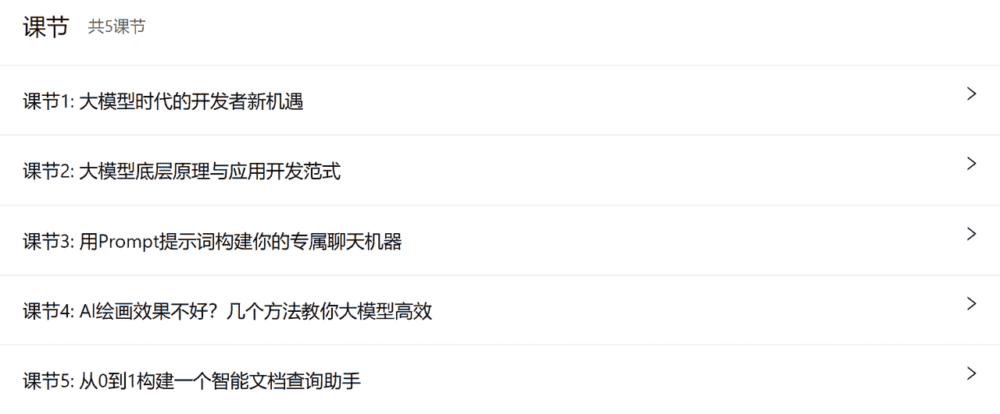
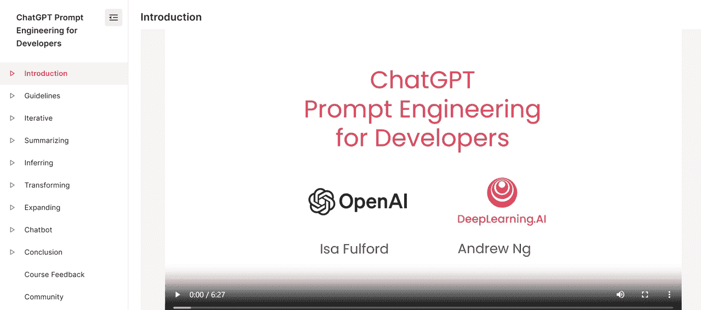
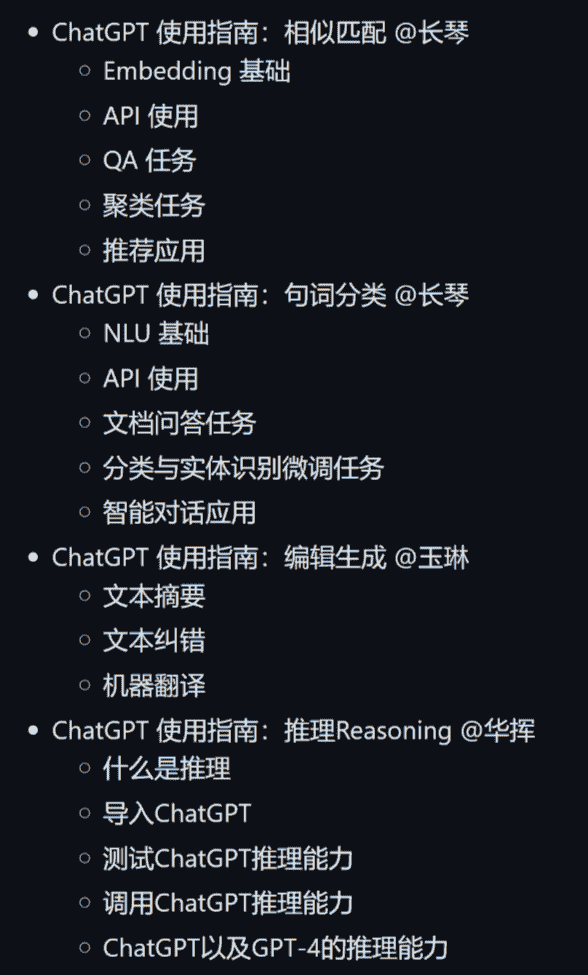
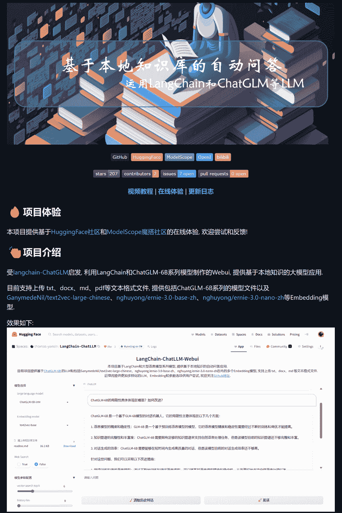
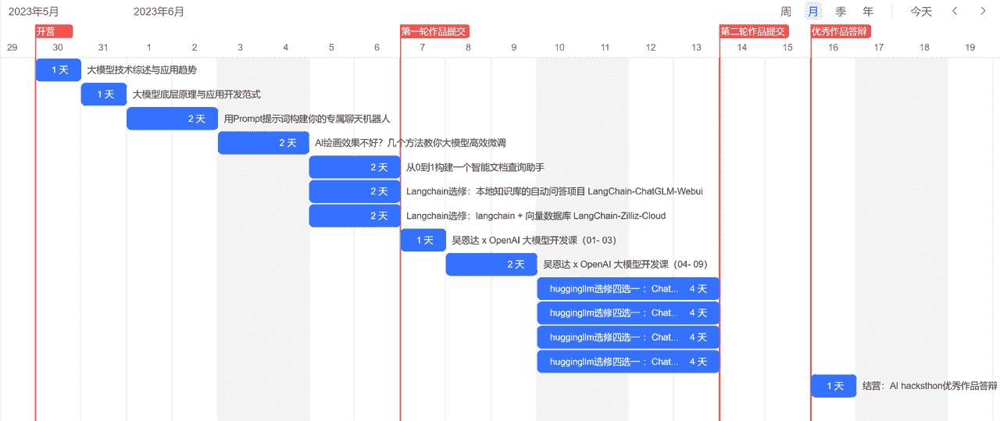

# 6月 |《大模型应用开发》学习手册

> 来源：[https://docs.feishu.cn/docx/THtjdcxdeoXuK4x3NYDcZ3scneg](https://docs.feishu.cn/docx/THtjdcxdeoXuK4x3NYDcZ3scneg)

> 原地址：[《大模型应用开发》学习手册](https://datawhaler.feishu.cn/docx/PYFCdwzroohRrWxje8rc37BNnub)

> Bilibili：

> 飞浆：https://aistudio.baidu.com/aistudio/education/group/info/28611

>

# 学习目标

+   掌握大模型应用开发核心技能

+   利用大模型的能力，当创意落地成应用

+   抓住AI时代新机遇让大模型为你所用

# 面向对象

+   适合谁来学？

+   具备一定的**技术基础**或**实际项目经历**（可以没有算法经验，但至少熟练使用Python等语言）

+   希望在实际中运用大模型技术，掌握**大模型应用开发**核心技能，构建创新应用

+   能**正常调用****大模型**，例如：gpt-3.5-turbo，chatglm-6b

+   希望参加**AI**** hackathon**，**用技术让创意落地成应用**

+   不适合谁来学？

+   希望从头到尾研发一个 ChatGPT（**不涉及****大模型****的底层研发**）

+   希望研究其底层算法细节，比如PPO怎么实现的，能**不能换****成NL****PO或ILQL**，效果如何等（不涉及大模型的底层算法设计）

# 学习亮点

+   学习内容：

+   国内外大模型应用开发的最佳实践，**OpenAI** 与 **百度**

+   大模型应用**开发工具和技巧梳理** 与 **开箱即用**的大模型应用**实战代码**

+   持续助力**打磨作品**，**直通**大模型创新**大赛**

+   学习支持：

+   往期[**优秀同学作品案例**](https://datawhaler.feishu.cn/docx/PYFCdwzroohRrWxje8rc37BNnub#WMAvdzKgjohGxPxLkr8cQi9AnEg)，看见不同的创意如何落地

+   **刻意练习**，磨炼大模型开发技能，提供**免费****算力**与**运行平台**

+   **组队学习**，遇见志同道合的伙伴，**让学习不再孤独**

# 学习什么

> **必修**

+   百度 - 大模型应用开发技巧与实战

+   课程链接（提供**算力**与**云环境**）：https://aistudio.baidu.com/aistudio/course/introduce/28611

+   吴恩达 x OpenAI官方课程

+   中文字幕视频（1.5H）：https://www.bilibili.com/video/BV1Bo4y1A7FU

+   开源教程地址（觉得不错，**star**一下）：https://github.com/datawhalechina/prompt-engineering-for-developers

> **选修**

+   Hugging LLM - ChatGPT开发应用指南

+   开源教程地址（觉得不错，**star**一下）：https://github.com/datawhalechina/hugging-llm

+   配套视频讲解（觉得不错，记得**三连**）：https://www.bilibili.com/video/BV1kk4y177AJ

+   Langchain、ChatGLM等LLM使用

+   LangChain-ChatGLM-Webui：https://huggingface.co/spaces/thomas-yanxin/LangChain-ChatLLM

+   LangChain-Zilliz-Cloud

https://huggingface.co/spaces/SimFG/LangChain-Zilliz-Cloud

多维表格（ZtItbWcbMa9PM4sHF2nccbFMn3g_tbl5Zfp5tGao2upp）

# 如何学习

+   整个学习期间**就一个任务，**学习完成后参加 **AI**** Hackathon****，结**合自己的热爱与兴趣，提交你的作品，要求如下：

+   **发挥你的兴趣与特长，任选方向**，例如结合**具体行业做应用****（医疗问****答，法律****问答，新**闻推荐等等），生活应用（虚拟女友，购物助手，英语练习），效率工具（chatpdf、chatdoc，chatmind等），技术软件

+   T**alk is chea**p，Show me the demo，作品重在完成而不是完美

+   鼓励组队，**找到志同道合的队友**一起开发大模型应用（组队模板）

+   提交一个**GitHub****链接**，需要有设计文档、代码和Demo演示截图/视频

+   过程中会穿插**N**场直播，邀请往期优秀同学分享作品案例 或 课程设计者带领讲解课程内容，实操代码等，记得定好闹钟，小助手群内也会提醒

# 学习时间安排

**第一轮作品提交**

**第二轮作品提交**

**优秀作品答辩 **

# 往期优秀同学的作品案例

多维表格（ZtItbWcbMa9PM4sHF2nccbFMn3g_tblmkQO848LRrO1R）

# 大咖讲座

+   讲座如果是直播形式，时间一般为北京时间晚20:00开始，1小时左右

+   [每场](https://space.bilibili.com/431850986/channel/collectiondetail?sid=1315092)讲座都有录播: Datawhale的B站和视频号都会同步

多维表格（ZtItbWcbMa9PM4sHF2nccbFMn3g_tblxYgCaod9m6cUP）

> 本手册由 编写，觉得不错在下方点个赞吧，更多建议与反馈，欢迎评论或联系玉鑫（🛰️：a1434088958）