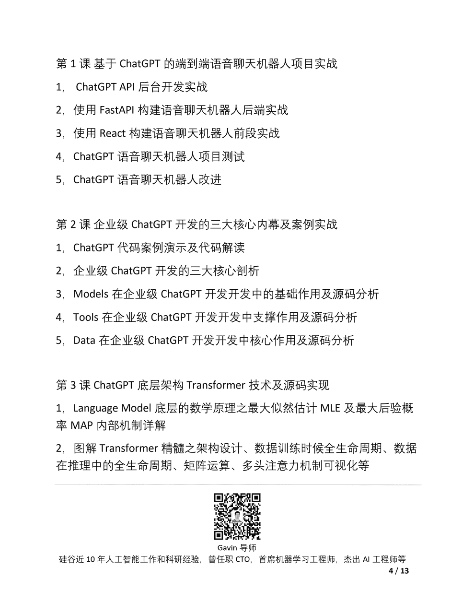
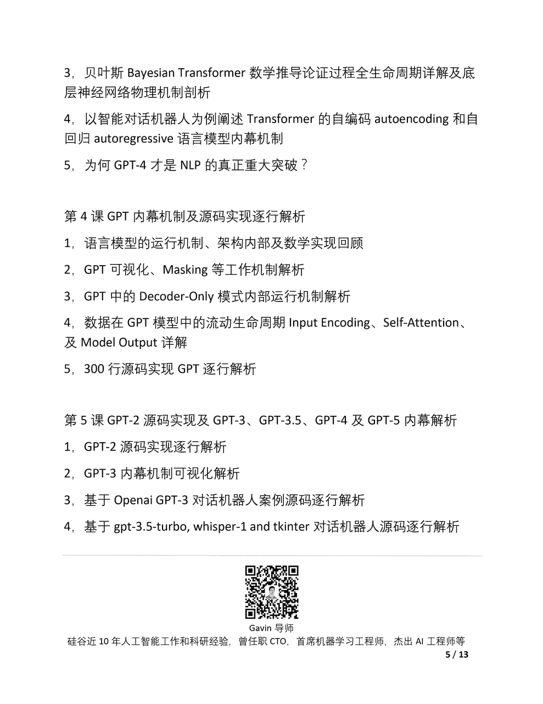

# 🛠️ 星空NLP对话机器人 - 企业级ChatGPT开发实战入门

> 来源：[https://docs.feishu.cn/docx/CP0fdCFhtocL8nxhg3Bckcbpnpf](https://docs.feishu.cn/docx/CP0fdCFhtocL8nxhg3Bckcbpnpf)

> 课程收获：

> 1，基于ChatGPT的端到端语音聊天机器人项目实战，包括ChatGPT API后台开发、FastAPI构建语音聊天机器人后端实战、React构建语音聊天机器人前端实战等。

> 2，企业级ChatGPT开发的三大核心内幕及案例实战，包括ChatGPT代码案例演示、企业级ChatGPT开发的核心剖析以及Models、Tools、Data在企业级ChatGPT开发中的作用及源码分析。

> 3，ChatGPT底层架构Transformer技术及源码实现，包括Language Model底层的数学原理、Transformer架构设计、贝叶斯Bayesian Transformer数学推导、智能对话机器人中的Transformer内幕等。

> 4，GPT内幕机制及源码实现逐行解析，包括语言模型的运行机制、GPT的可视化与Masking等工作机制、Decoder-Only模式内部运行机制以及数据在GPT模型中的流动生命周期等。

> 5，GPT-2源码实现及GPT-3、GPT-3.5、GPT-4及GPT-5内幕解析，对GPT-2源码进行解析，探讨GPT-3，GPT-3.5、GPT-4和GPT-5的内幕机制。

> 6，ChatGPT Plugins内幕、源码及案例实战，介绍ChatGPT Plugins的工作原理，并进行源码解析和实战演示。

> 7，ChatGPT Prompting开发实战，包括针对迭代过程、聊天机器人和客户服务的Prompting开发实战。

> 8，CoT及ReAct解密与实战，深入剖析Chain of Thought Reasoning、Chaining Prompts、ReAct技术原理及框架，并进行实战演示。

> 9，Prompt本质解密及Evaluation实战与源码解析，探索Prompt的本质解密、以客户服务案例为例进行Evaluation实战，并对Evaluation for Agents和Evaluation for QA的源码进行解析。

> 10，最火爆的大模型框架LangChain七大核心及案例剖析，包括Models、Prompts、Memory、Indexes、Callbacks等核心内容及案例剖析。

> 11，课程总共3万行NLP/ChatGPT/LLMs项目源码逐行视频讲解。