# 智设AIGC周刊 - Vol.09 20230718

> 来源：[https://docs.feishu.cn/docx/SgPmdN9oPo3HvPxkXtocwrThnoc](https://docs.feishu.cn/docx/SgPmdN9oPo3HvPxkXtocwrThnoc)

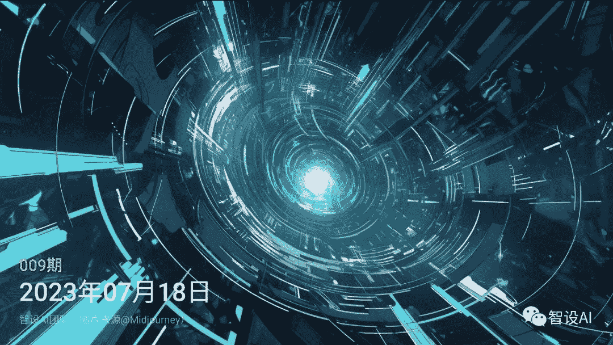

# **📰最新要闻**

---

Threads四天破亿，扎克伯格暴击马斯克

马斯克入主推特已经9个月，不管是这家公司的人员构成，还是这个产品的功能，都一直处在动荡当中。对于很多用户来说，10天前突如其来的“限流令”，成了“压倒”他们的最后一根稻草，推特的替代品频频登上推特的热榜。

链接直达:https://www.digitaling.com/articles/951880.html

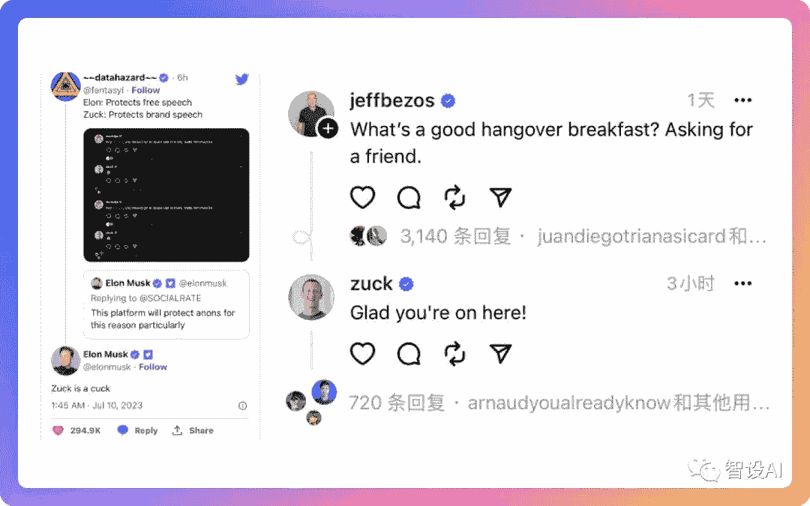

**Adobe 护充生成式 ****Al** Firefly：支持 100 多种语言 prompts 输入

Firefly 测试版网站现在接受 100 多种语言的提示。用您选择的语言输入提示，以使用文本到图像、生成填充、生成重新着色或文本效果生成您的创作。除了英语之外还提供 20 种语言版本，首先是德语、西班牙语、法语、巴西葡萄牙语和日语，在未来几周和几个月内将提供更多语言选项。

链接直达：https://blog.adobe.com/en/publish/2023/07/12/adobe-firefly-gluhwurmchen-luciernaga-luciole-vaga-lume-licurici

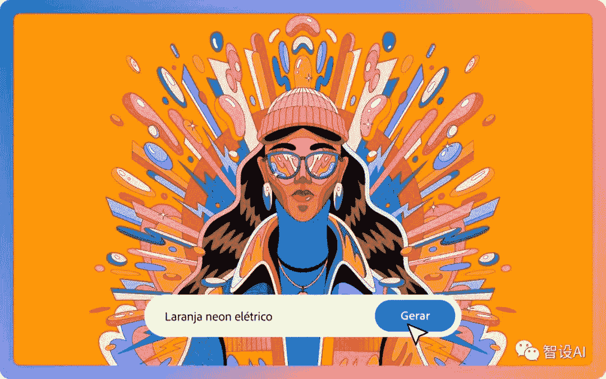

**GitHub****引入无密码身份验证**

GitHub宣布正在测试支持通行密钥，这是一种行业通用的「无密码」标准，通过用户设备上的生物识别系统来替代传统密码和两步认证，提供了更安全、隐私保护和易于使用的方式来保护账户。

链接直达：https://github.blog/2023-07-12-introducing-passwordless-authentication-on-github-com/

**特斯拉自研芯片不会被称为****GPU**

埃隆·马斯克在 XAI 会议上表示，特斯拉正在研究自己的芯片，但它永远不会被称为 GPU，也不会使用 100s、H100s 等来形容它。他还表示，特斯拉 Dojo2 将致力于开发更大的车型。马斯克表示特斯拉和 X.AI 将合作但保持一定距离。

**好莱坞大罢工反抗人工智能入侵**

大约 60,000 名电视和电影演员、特技演员和配音艺术家参加了罢工，加入了自 5 月份以来一直停工的大约 11,500 名编剧的行列。正如我们的阿里·布拉夫 (Ari Blaff) 所指出的，这是自 1960 年以来演员和作家第一次联合起来进行历史性的双重罢工。

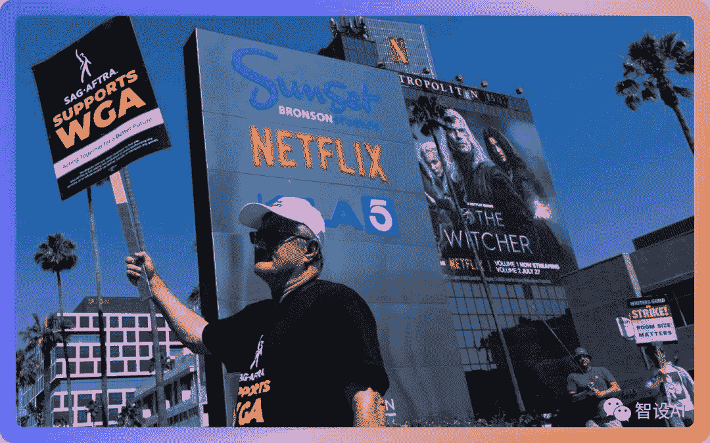

# **🔥文章推荐**

---

**AI****商业案**例教程丨Midjourney生成活动主视觉

3D人物类型的海报图在抖音、快手的运营设计上很常见。风格很潮流，国外也有超多这种设计。而这种类型的主视觉IP在Midjourney生成也很简单，但是需要垫图，这是个重点！

链接直达：https://mp.weixin.qq.com/s/GOKbm6PCNdGZCHmOO7RY2A

**二舅舅看懂的****AIGC****赋能****UI**设计教程丨中途教程丨商业绘画案例

大家好呀，最近一直在写“小文章”教程，因为篇幅问题，我第一时间就是把这些文章都更新在公众号上，这篇文章也是一篇UI设计篇的合集。以下是我近半的文章一个月期限写的一些教程，本篇文章主要是在图标设计上的一个应用，希望对大家有所帮助。后续我还是会先以小篇幅的文章优先更新在公众号上，然后等内容多重新整理成合集发布到此平台，废话少说，上干货了！

直达链接：https://mp.weixin.qq.com/s/sZr1_IHQa3CtxFBDUpfOuA

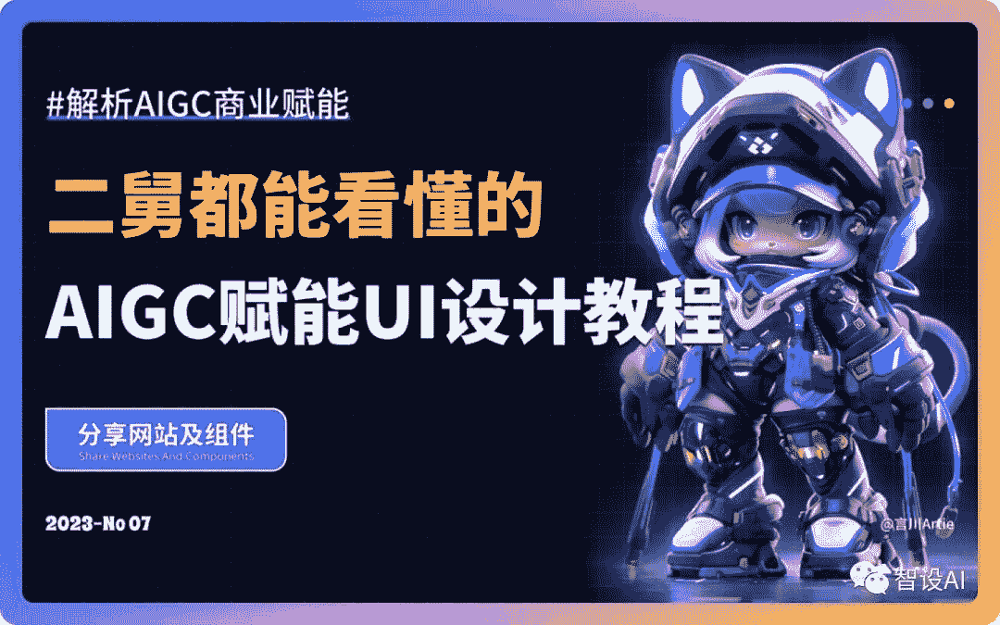

**营销人如何驾驭****AI****，才能不被淘汰？**

从ChatGPT爆火的近几个月，相信大部分营销从业者已经对AIGC有了一定的认识和了解，甚至有不少人已经开始借助AI工具来辅助工作的完成、提升工作的效率。

链接直达：https://www.digitaling.com/articles/951992.html

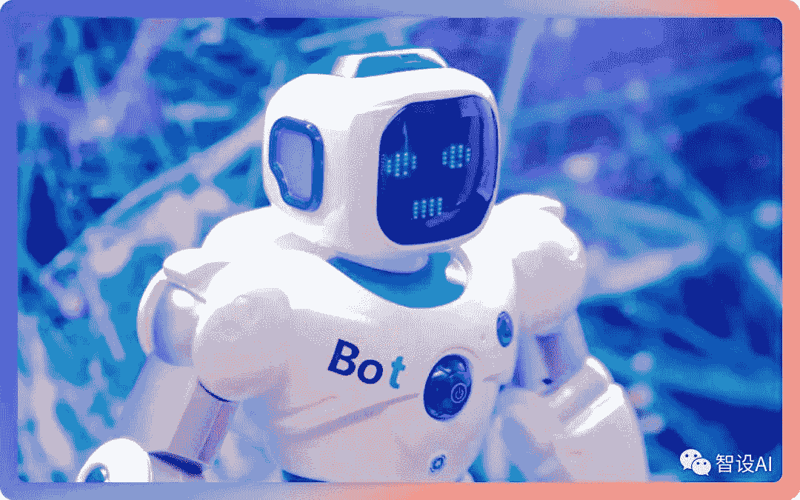

将文字或者符号融合生成图片，contorlnet又立大功

最近火遍全网的讲文字或者符号融合生成图片，这类图片用来跟品牌元素融合之后，用来做营销宣传和品牌传播还是挺有用的。

链接直达：https://mp.weixin.qq.com/s/rvpU4XhToldoec_bABeXJw

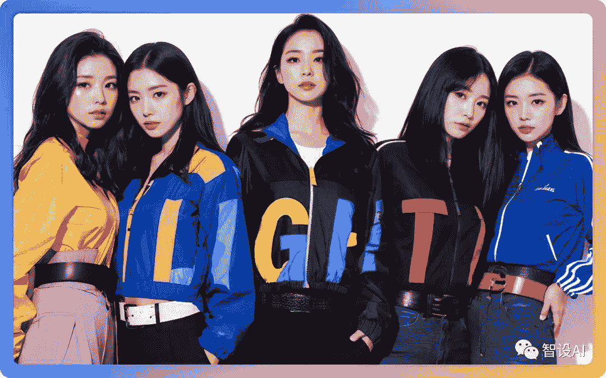

**京东618：用****AI****做了136只青蛙组成带货天团**

这是一只用Stable Diffusion + Midiourney生成的青蛙，准确地说是生成了136只颜值平分秋色、姿态各有干秋的青蛙，只为京东3C数码618。

链接直达：https://www.digitaling.com/projects/252853.html

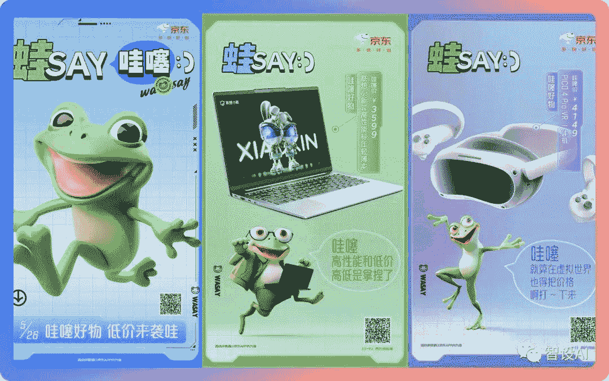

**天猫618：用****AI****为20个品牌定制海报**

去年ChatGPT、MJ刚火没多久，团队还一度沉浸在AI“生图速度快，效果很哇塞”的惊喜中。今年，在国内外品牌陆陆续续开卷AI后没多久，没想到时代的车轮就这么猝不及防地碾压到了我们身上，我们迎来了天猫618的AI作画brief。

链接直达：https://www.digitaling.com/projects/251446.html

**AI**** 新****范式**下，如何做好工具类产品体验设计：以 AI 标注工具集为例

技术的发展为社会提供了更好的产品体验，本篇文章以 LabelBee AI 标注工具集为例，示范如何做好工具类产品体验设计，作者从六个方面进行分析整理，希望能对你有所启发。

链接直达：https://www.woshipm.com/pd/5865629.html

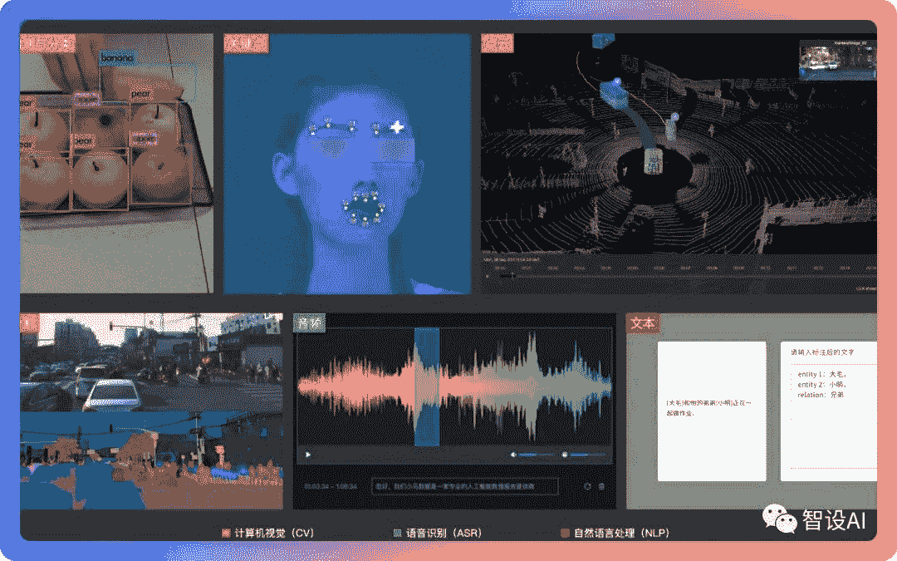

# **🎯产品推荐**

---

**Stability ****AI** 推出素描转图像工具 Stable Doodle，涂鸦转成稿

ClipDrop是Stability AI今年三月收购的一个平台，前身是由前谷歌员工创立的AI创业公司Init ML。Stable Doodle是Stability AI提供的一项面向专业人士和新手的工具，通过该工具，任何具备基本绘画技能和网络接入的人都能在几秒钟内生成高质量的原创图像。与市面上其他素描转图像的AI工具不同，Stable Doodle允许用户对图像生成过程进行更精确的控制。

官网链接：https://clipdrop.co/stable-doodle

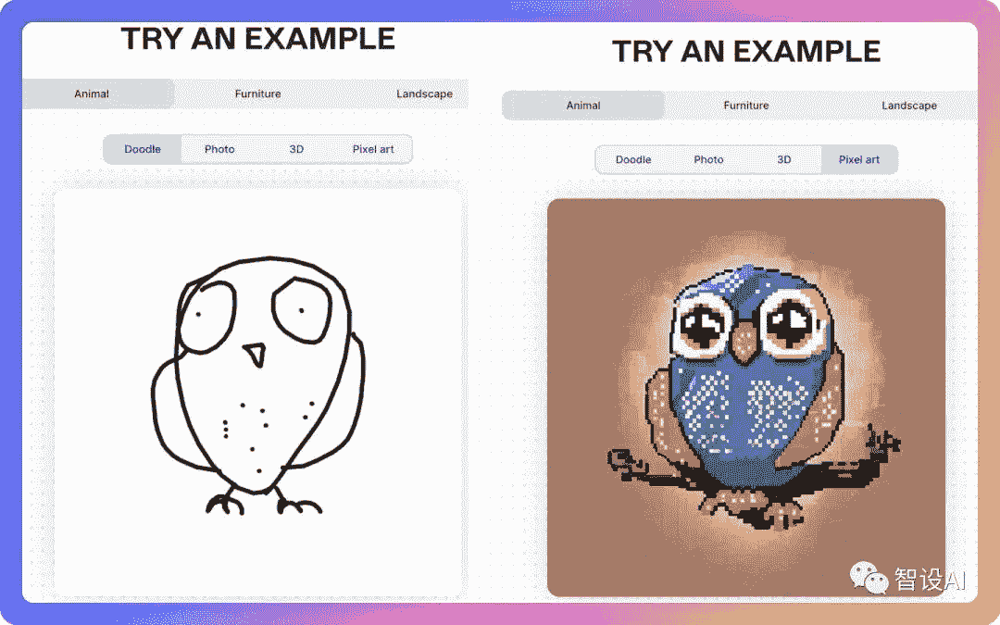

**AI****对话聊天助手Claude**

Claude具有更强的常识推理与记忆能力，可以真正地进行对话，而不仅仅是机械的问答。得益于Anthropic团队在数据集筛选及模型训练上的努力，Claude较少生成含错误或潜在有害信息的回复，这使Claude更适合进行知识探讨与获取，是一个非常不错的AI咨询助手。

链接直达：https://claude.ai/login

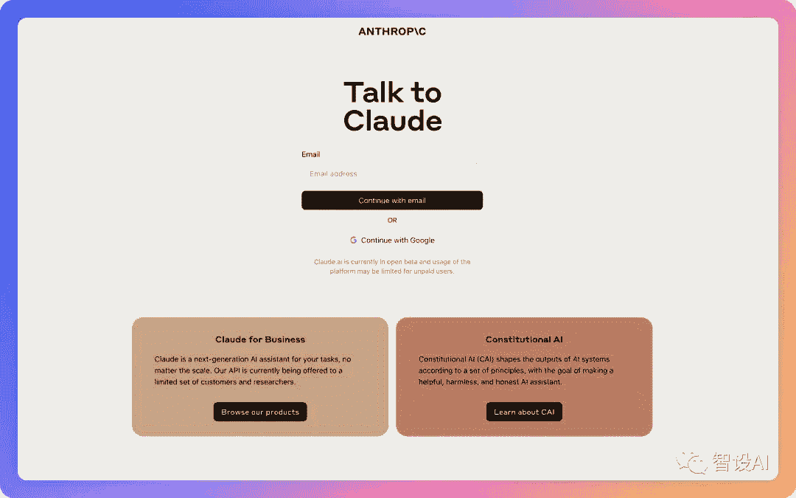

谷歌Bard支持中文了！十级过关，看懂梗图，直接上手免费体验

Bard是一款语言模型API，可以用于文本生成、问答等自然语言处理任务。它支持多种语言，并且可以上传图片作为输入进行问答。

Bard又强了！这次不仅支持中文等40种语言，还能上传图片做问答。本文对最新版本的Bard进行了评测，一起来看看它的表现如何吧。

链接直达：https://www.woshipm.com/ai/5866796.html

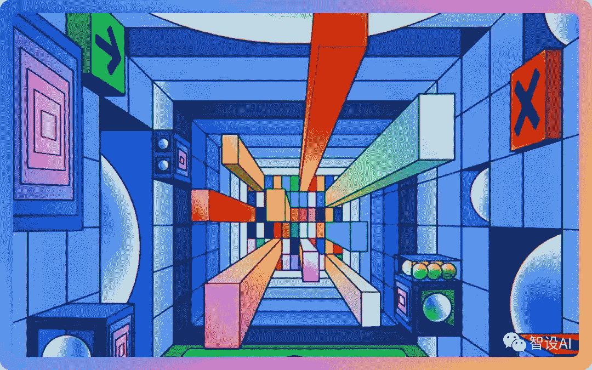

# **⭐设计师专供**

---

《长安三万里》票房破3亿，东方美学海报也值得一看！

最近这部动画电影《长安三万里》又唤醒了很多人的诗词DNA！画面也是非常优秀的，以细腻笔触、细节设置，还原唐代的美。

从开元盛世到安史之乱，从水草丰美的江夏到美轮美奂的长安，从歌舞翩跹的江南到金戈铁马的边塞，万里山河画卷都是唐代的模样。

链接直达：https://www.digitaling.com/articles/951936.html

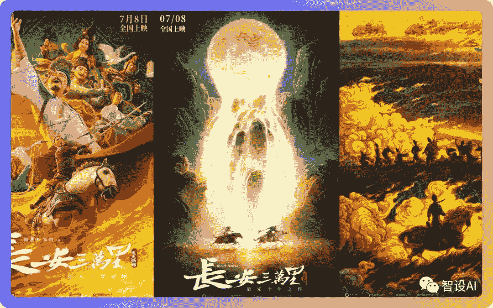

微软为 Office 更换默认字体为Aptos

微软在2021年启动了一项名为Office默认字体改革计划的举措，旨在取代过时的Calibri字体，并提出了5种备选字体。

经过过去两年来对用户反馈的持续收集和广泛的用户调查，微软发现Aptos字体备受用户喜爱，并最终决定将其选为Office的默认字体。

Aptos和20世纪中叶的Swiss排版有相似之处，都属于无衬线字体。无衬线字体通常具有简洁的字母形状，甚至可以说是由笔画组成，因此易于阅读。

Aptos由多个几何形状组成，具备大胆、明确和指导性的特点，并受到限制。它适用于表达各种语言和语气。字母轮廓中微妙的圆形方块使其即使在小尺寸屏幕上也具有很高的可读性。

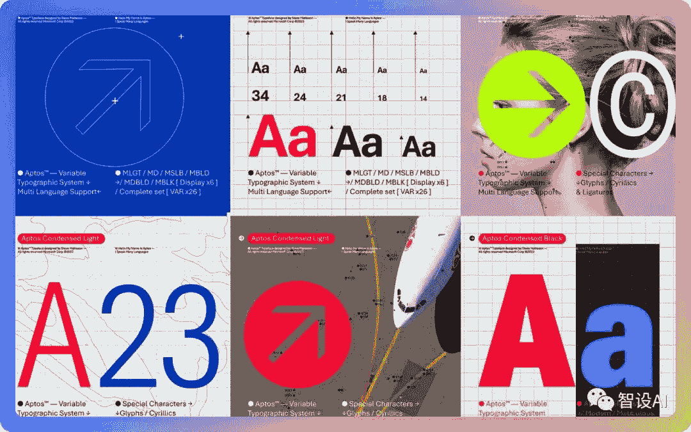

**设计体系的变迁与构建**

设计体系是指由设计原则、指南、组件库等多种元素组成的系统性方法，旨在确保设计在不同媒介和平台上保持一致性。本文介绍了设计体系的发展历程，构成要素和建立步骤，并列举了国内外常用的设计体系。

链接直达：https://www.woshipm.com/pd/5865228.html

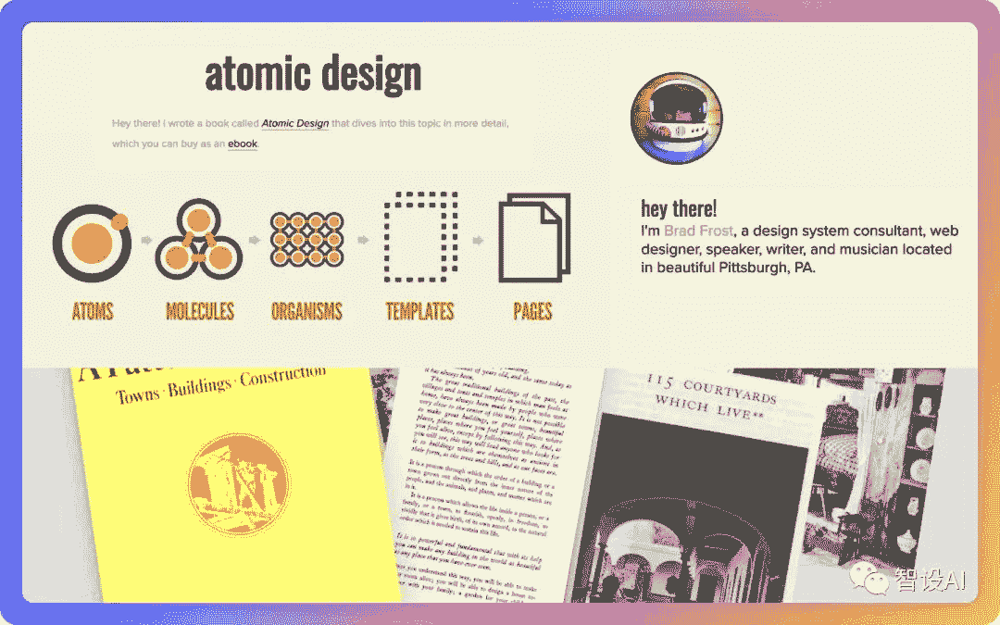

尊重字体版权，我整理了一个免费商用字体库

作者在四年前在上家公司上班时，看到公司收到几封字体侵权的律师函，意识到侵权可能离自己并不遥远。作者对字体版权、商用授权等问题不太了解，为了避免侵权，每次使用字体都需要查询确认，这很麻烦。作者新建了一个Excel表格记录字体信息，不使用网络上已整理好的免费商用字体库，因为不信任网络环境和复制文。作者认为网络上的免费字体库存在雷同文和错误信息的问题。

链接直达：https://sspai.com/post/80926

用设计升级推动业务转化！拆解主播成长体系升级过程

如何从设计视角出发，推动业务转化？在本篇文章里，作者结合主播成长体系升级这一实际案例，拆解团队是如何结合设计来推动业务转化的。一起来看看吧，或许会对你有所启发。

链接直达：https://www.woshipm.com/pd/5865738.html

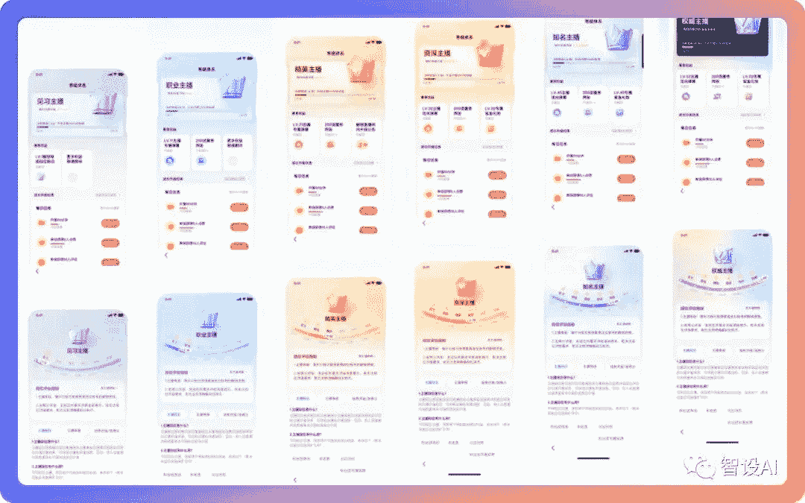

免责声明：本文转载仅供参考，不代表观点，不负责准确性、版权，尊重知识产权，如侵权请联系删除。感谢支持与理解。