# 智设AIGC周刊 - Vol.08 20230711

> 来源：[https://docs.feishu.cn/docx/ZZROd2DSJoXT0ex3uHrclycQnzc](https://docs.feishu.cn/docx/ZZROd2DSJoXT0ex3uHrclycQnzc)

# **📰最新要闻**

---

**重磅，****GPT-4**** ****API****全面开放使用**

遥想今年 3 月刚推出 GPT-4 的 OpenAI 仅邀请了部分提交申请的开发者参与测试。眼瞅 OpenAI 联合创始人 Greg Brockman 在当时现场演示“史上最为强大”的 GPT-4 模型，轻松通过一张手绘草图生成一个网站、60 秒就能搞定一个小游戏开发等这些功能，一众开发者却不能使用。

而就在今天，GPT-4 的适用性进一步被拓展。OpenAI 正式发布 GPT-4 API，现对所有付费 API 的开发者全面开放！

链接直达：https://www.36kr.com/p/2333702889326089

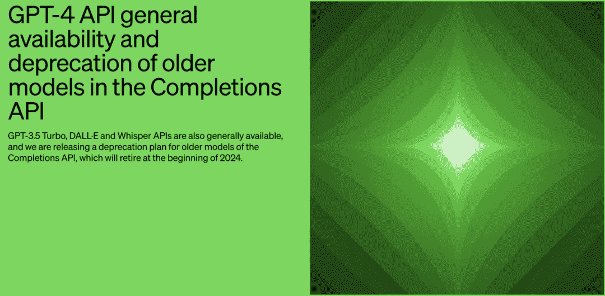

**OpenAI：将向所有****ChatGPT**** Plus****用**户开放这一超级功能，人人都能成为数据分析师！

7月8日凌晨，OpenAI在社交平台宣布，下周，将向所有ChatGPT Plus用户开放代码解析器功能。这是自OpenAI发布GPT-4以来，最强大的功能！

链接直达：https://new.qq.com/rain/a/20230708A02KSA00.html

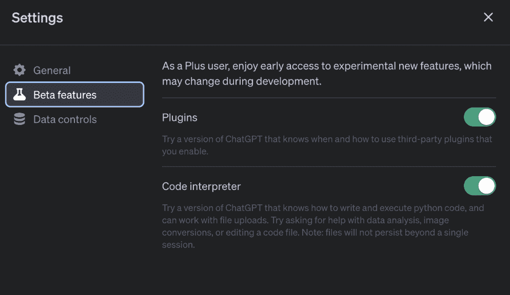

MidJourney 将迎来第6版！增加场景扩展功能

在 2023 世界人工智能大会产业发展论坛上，MidJourney 创始人大卫·霍尔茨通过视频在大会上发表演讲：MidJourney 将会在即将发布的第六版中实现场景扩展功能，让图片展现出更丰富的内容。此外新版本还将加入新模式，将带来 4-5 倍的制图速度提升。

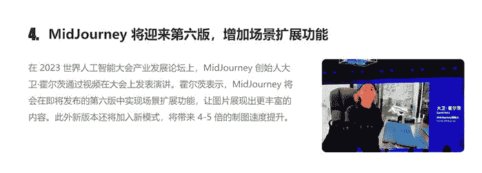

**无惧****Al**生成版权问题：Adobe宣布平台A图片遇纠纷可获全额补偿

近日，Adobe宣布，当用户使用其提供的AI图像生成工具Firefly for Enterprise时，如果因为AI图片造成了版权纠纷，Adobe将会为相关的法律费用提供全额赔偿。

链接直达：https://news.mydrivers.com/1/921/921421.html

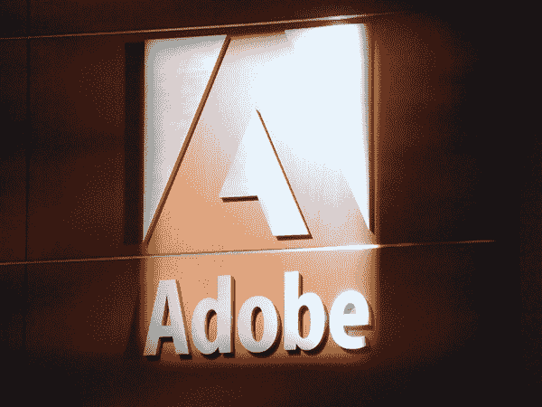

**AI**正在吞食一切！谷歌改变政策爬取所有公开内容用于训练AI

从今往后，你在网上公开说的每一句话，都可能被谷歌拿去训练AI！无论是技术博客、代码、论文，还是所有你在网上公开的帖子，都可能被扔进“谷歌大模型搅拌机”，即使有版权也是如此。

链接直达：https://news.mydrivers.com/1/921/921773.html

# **🔥文章推荐**

---

Google官方免费课程：生成式人工智能简介

这是一门入门级微学习课程，旨在解释生成式人工智能是什么、它如何使用以及它与传统机器学习方法有何不同。它还涵盖了 Google 工具，可帮助您开发自己的 Gen AI 应用程序。本课程预计需要大约 45 分钟才能完成。

链接直达：https://www.cloudskillsboost.google/course_templates/536

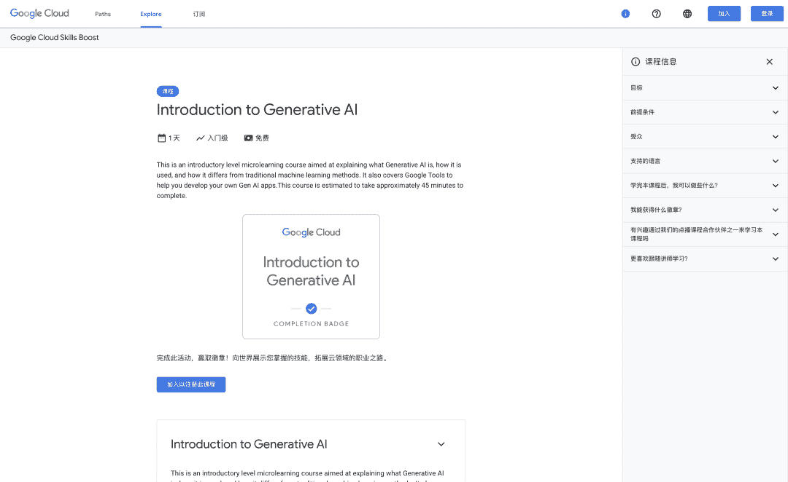

**设计师的****AIGC**面试题，阁下如何应对？-（上篇）

随着AIGC的发展，各类岗位都有所应用该技术。当我们去面试时，也或多或少会接触到相关的问题，本文总结设计师的一些AIGC面试题，希望对你有所帮助。

链接直达：https://www.woshipm.com/ai/5858859.html

**2023上半年****AI**广告项目TOP10，拉开创意变革的序幕

2023开年至今，全世界的目光几乎都聚焦在「AI」身上，AI与人类未来的讨论成为舆论焦点。善于接受新事物的广告行业也迈开了探索AI科技的步伐，在全球涌现了多种AI广告形态。

链接直达：https://www.digitaling.com/articles/947344.html

**普通人用****AI****创作爆款内容指南**

AIGC创作的风潮已经席卷内容领域的各个角落。

一边是ChatGPT、Midjourney等明星产品的走红、大量AI创业公司如雨后春笋般涌现，另一边，与AI有关的内容创作也呈现出爆发式增长。

链接直达：https://www.digitaling.com/articles/948415.html

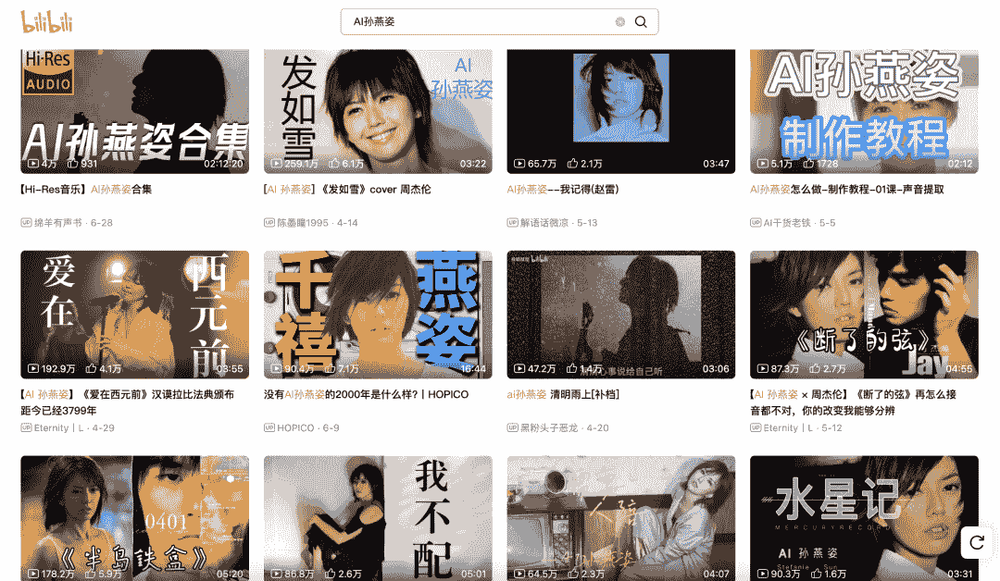

# **🎯产品推荐**

---

**AI****直接生成二维码产品**

链接直达：https://hovercode.com/ai-qr-code-generator/

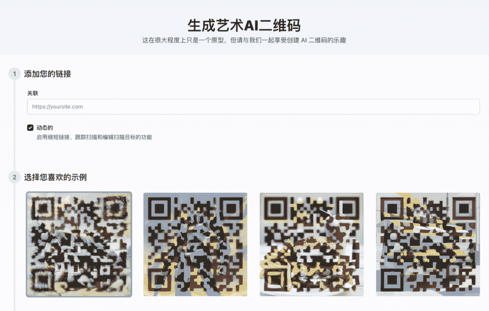

**阿里云推出 ****AI**** 绘画新品“通义万相”**

7 月 7 日，在 2023 世界人工智能大会上，阿里云宣布 AI 绘画创作大模型通义万相开启定向邀测，该模型可辅助人类进行图片创作，未来可应用于艺术设计、电商、游戏和文创等应用场景。

官网链接：https://wanxiang.aliyun.com/

**免费****AI****图库freeflo**

Freeflo 是一项免费服务，可激发您的 AI 图像创作灵感。您可以浏览我们不断更新的精选图像库，找到适合您下一个创意项目的内容。

链接直达：https://freeflo.ai/

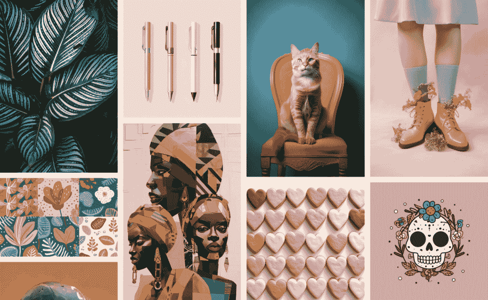

**LOGO灵感库：LOGGGOS**

按行业、主题、排版风格、品牌颜色等分类的落地LOGO库

链接直达：https://www.logggos.club/

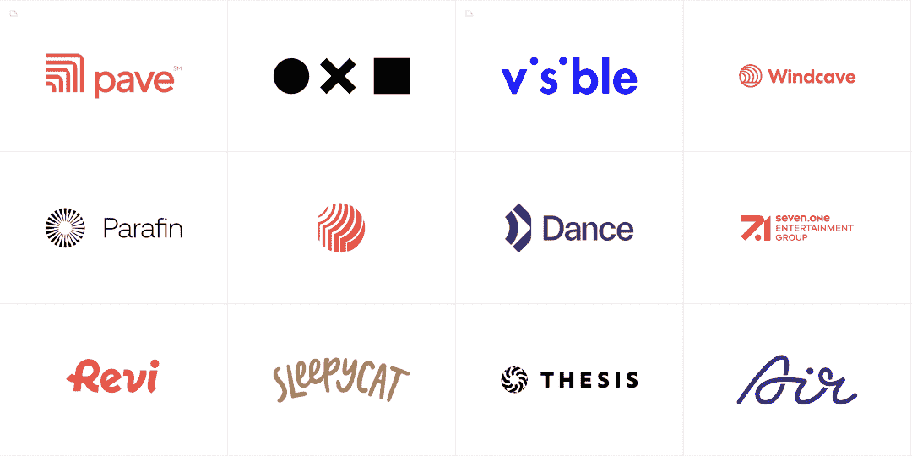

# **⭐设计师专供**

---

**AI****免费商业素材领取**

**3D元素图标素材-食物篇**

链接直达：https://mp.weixin.qq.com/s/_QJcrNq3ftuuBF5B2s7f_g

**福袋弹窗3D素材**

链接直达：https://mp.weixin.qq.com/s/guwYzslCDvA6_a-QuLS0Nw

**电商****KV****/产品背景图｜免费商用素材**

链接直达：https://mp.weixin.qq.com/s/zos_X9ZueF6D45uE5OwD8g

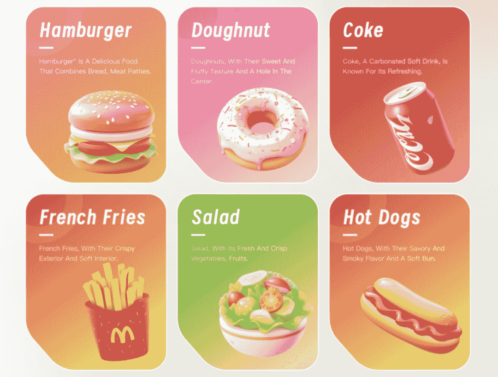

**AI****二维码制作教程**

软件环境：1. stable diffusion + controlnet2.二维码神器QR Toolkit插件3.修脸神器ADetailer插件4.二维码controlnet模型QR Code Monster

链接直达：https://twitter.com/datou/status/1676763811360157696?s=46&t=_iQoJGOKMPV1X3e6hnYqzA

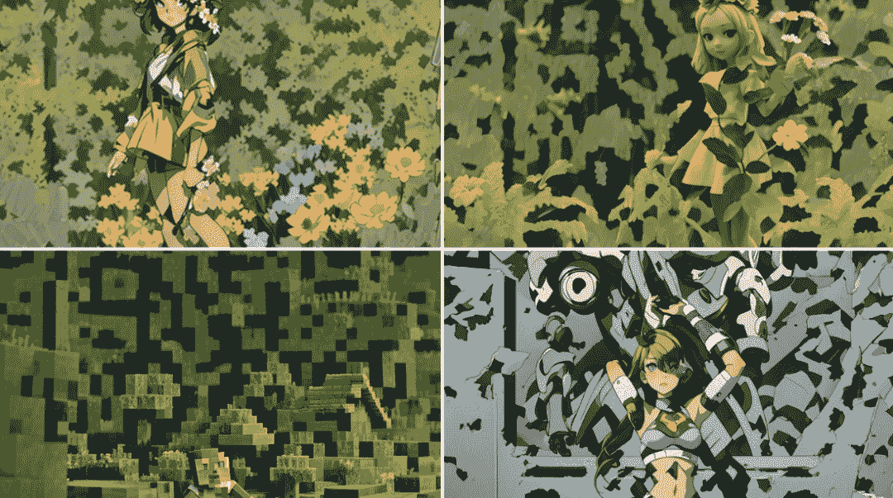

**多巴胺电影海报，热烈又震撼！**

其实多巴胺穿搭没流行的时候，多巴胺配色早就在电影海报中火起来了。在海报中每一种颜色都有着独特的意义和影响力，它们能够激发观众的情感共鸣，为电影营造出特定的氛围。

链接直达：https://www.digitaling.com/articles/948905.html

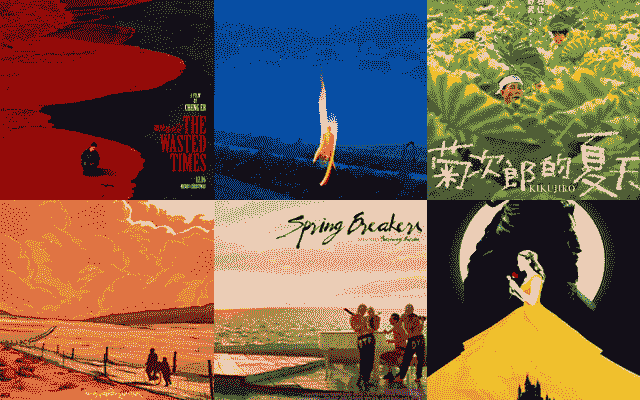

**小暑海报合集，熟悉的夏天味道**

你看，小暑的热，要用凉意来展现。品牌们也深谙此道——南孚电池用空调和遥控器定义小暑；金典用一道”西瓜牛奶冰“清凉一个夏天，而麦当劳直接向大家展示起了环保和凉爽并重的小鸡棚……希望这些散发丝丝凉意的作品，能给这燥热夏天降降温。

链接直达：https://www.digitaling.com/articles/949472.html

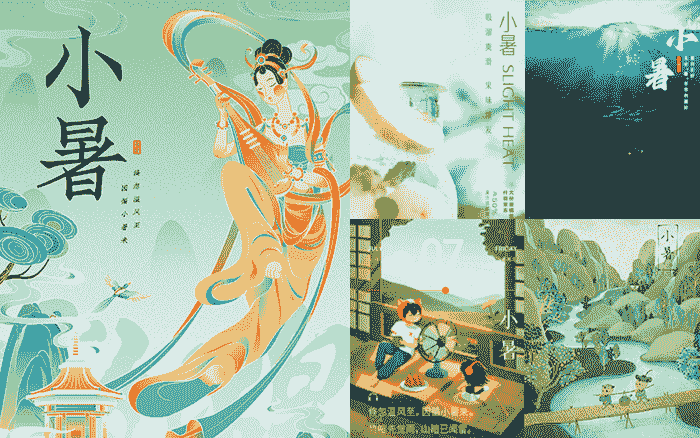

2023上半年精选平面TOP 20，为视觉注入灵魂！

一个好的平面作品，不仅能适应标准化的需求，还要善于发现、敢于突破，蕴藏流动的生命力。

链接直达：https://www.digitaling.com/articles/947155.html

