# 智设AIGC周刊 - Vol.07 20230704

> 来源：[https://docs.feishu.cn/docx/P3VWdb1k3oDOlvxlPgdcWo9fnut](https://docs.feishu.cn/docx/P3VWdb1k3oDOlvxlPgdcWo9fnut)

# **📰最新要闻**

---

**对战****微软谷歌**，亚马逊云砸1亿美元推出生成式Al创新中心

亚马逊云AWS的这个中心是一个项目，并非实体。它要让AWS的专家帮助企业客户推出生成式AI产品及服务，目前已有两家客户Highspot和Twilio合作。

链接直达：https://finance.sina.com.cn/roll/2023-06-23/doc-imyyffyz0622474.shtml

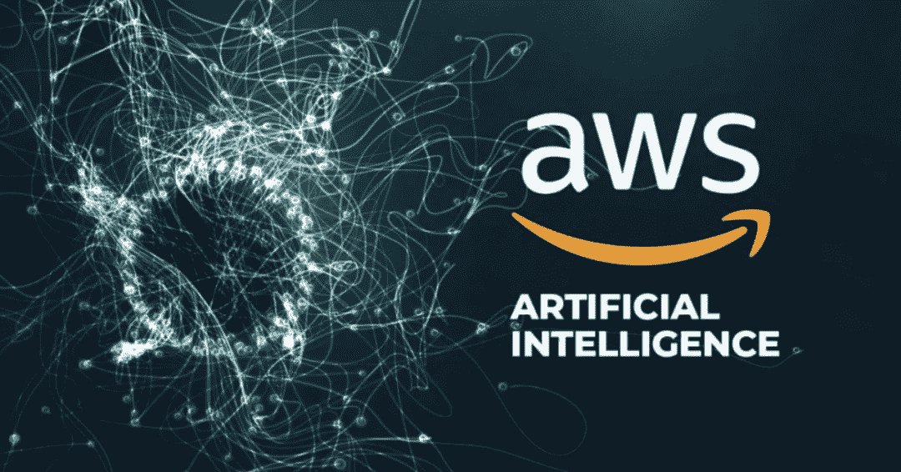

**美团收购****光年****之外，赚了吗？**

美团发布公告称以20.65亿人民币完成对光年之外境内100%股权的收购。

链接直达：https://www.36kr.com/p/2325294861721218

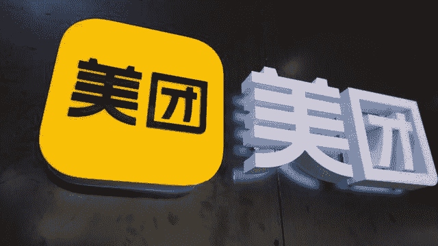

美媒称美或扩大对华芯片限制 英伟达：将令美产业永久丧失机会

美国被曝考虑对华人工智能(AI)芯片出口实施新限制。英伟达首席财务官科莱特·克雷斯表示，虽然限制对华出口人工智能芯片不会立即产生重大影响，但这“将导致美国产业永久丧失机会”。

链接直达：https://new.qq.com/rain/a/20230629A051E500?no-redirect=1

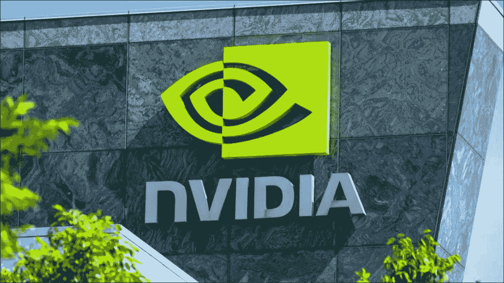

**大模型****冰火两重天？****GPT**访问增速大跌，国内产品热度也下滑，但一天N个发布

当下，大模型、AIGC到底是火还是不火了？让人摸不着头脑。一方面，有国内外的创业公司卖身、ChatGPT的访问量增速下滑、普通用户使用频次及关注度下滑；一方面，行业、大公司们动作频频，热火朝天。

链接直达：https://www.36kr.com/p/2328263191896962

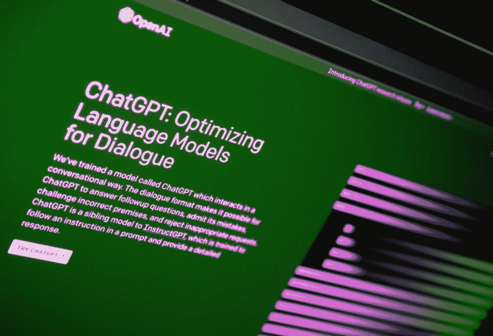

**大模型****落地，搜索先成卷王**

大模型重新诠释了「中国速度」。自从今年3月百度发布国内首个类GPT产品以来，短短3个月时间，国内已经跑出79个10亿参数规模以上的大模型。

链接直达：https://new.qq.com/rain/a/20230630A08PYR00?no-redirect=1

**突发！拜登政府考虑对华实施****AI芯片****制裁**

据路透社报道，美国《华尔街日报》6月27日援引所谓“知情人士”消息称，由于担心中国可能使用英伟达和其他公司的人工智能芯片“进行武器开发和黑客攻击”，拜登政府正考虑就对华出口人工智能芯片实施新制裁。

链接直达：https://www.ofweek.com/ai/2023-06/ART-201721-8120-30601581.html

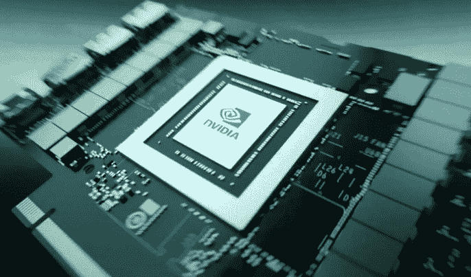

**文心一言上架APP Store**

下载链接：https://apps.apple.com/cn/app/%E6%96%87%E5%BF%83%E4%B8%80%E8%A8%80/id6446882473

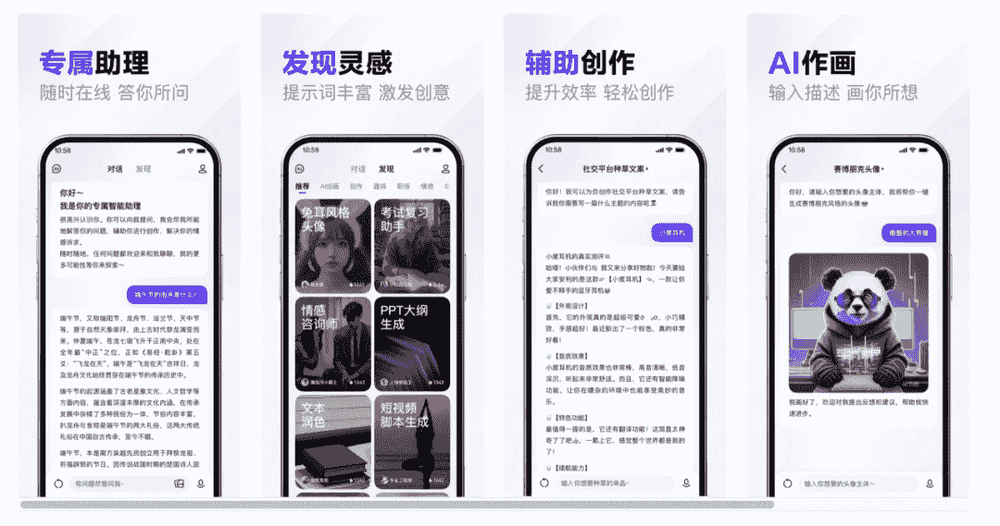

# **🔥文章推荐**

---

**AI**商业案例教程丨Midjourney生成B端运营海报

这期B端运营海报的思路跟上期3D活动弹窗的思路基本一致，因为都是用Midjourney生成icons...

链接直达：https://mp.weixin.qq.com/s/HjbW_aUnqGd9o4GMSC6daw

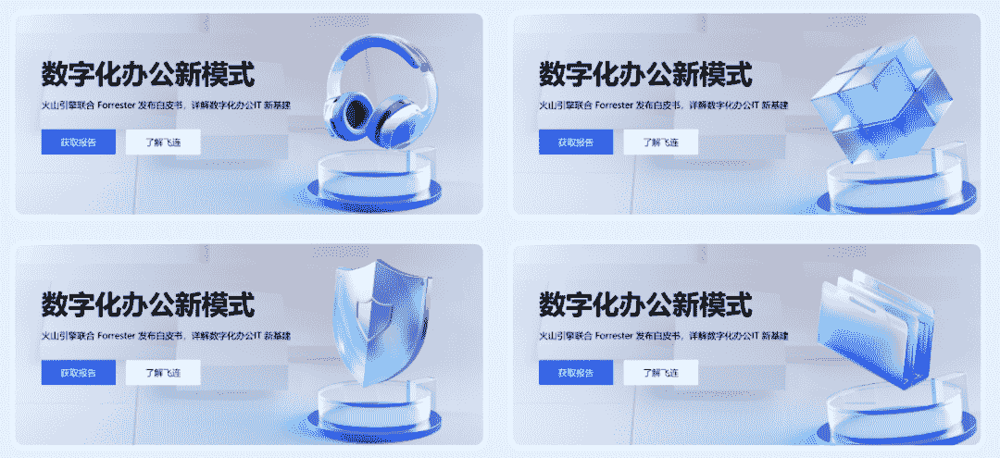

**AI**商业案例教程丨Midjourney生成3D运营活动弹窗

首先就是去找到与需求描述相符的参考图片，注意的是我们下面的操作不会用到“/describe”功能（咱也不能老是用垫图的方法是不，这多没技术含量，虽然很好用...）。

链接直达：https://mp.weixin.qq.com/s/4oYhnR2uVI5EZi9X2V6lVQ

**AI****商业落地案例-宝箱开启弹窗**

可以根据自己的设计需求，脑海里有一副你想要的图，根据设计风格写出关键词，不会写关键词的朋友，你也可以使用图生文/describe命令，这样更加方便快捷～

链接直达：https://mp.weixin.qq.com/s/oIKCKGEO0Z_HttIpf3G1Ig

**AI** 技术助力 B 端创作：运营类 3D Banner 设计新思路

这篇文章是腾讯云设计中心的教程，详细讲解如何在腾讯云上部署Stable Diffusion来生成Banner。

链接直达：https://mp.weixin.qq.com/s/XhVgmUJ0EDmx1asjNrZO3w

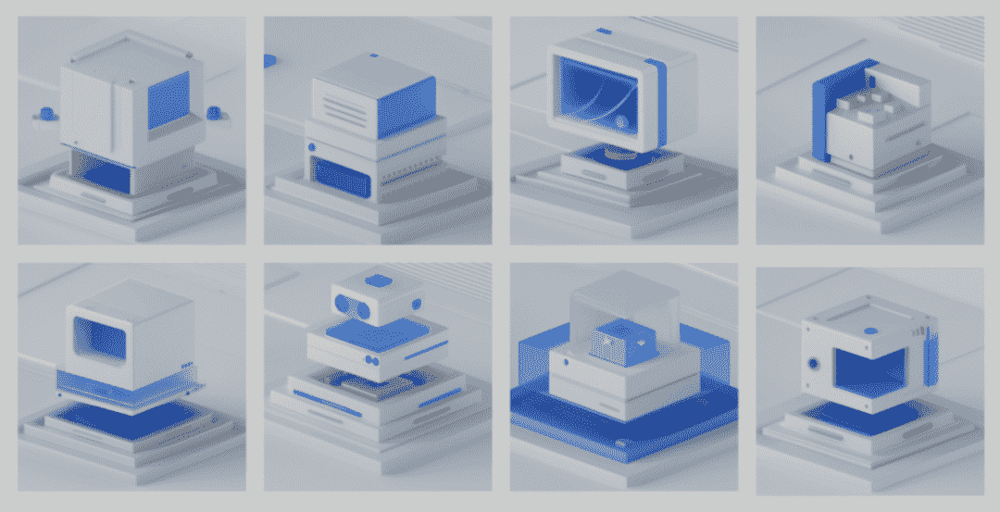

**AIGC**时代的新机遇：小而美的产品如何通过会员模式搞钱

今年持续霸屏的，无疑是AIGC，新趋势的到来势必会产生一些新机遇。本文将探究 AIGC 时代的新机遇，即小而美的产品如何通过会员模式搞钱，希望对你有所启发。

链接直达：https://www.woshipm.com/operate/5858903.html

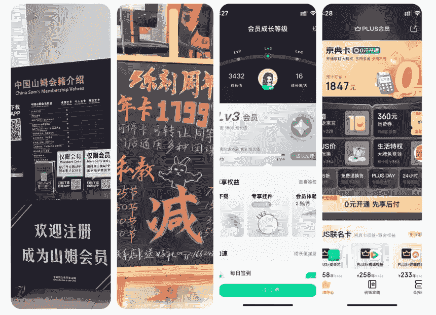

**专访北邦****：广告**圈和插画界的古早网红，如今是AIGC艺术家

在未来的天平上，人工智能生成内容AIGC（Artificial Intelligence Generative Content）像磁石一样，正在重新塑造内容创作的布局。想象一下，当机器能够认知我们的常识，当艺术被赋予新的定义，当创造力不再是人类的专利，广告营销行业定将迎来一场生产变革巨浪。

链接直达：https://www.digitaling.com/articles/945426.html

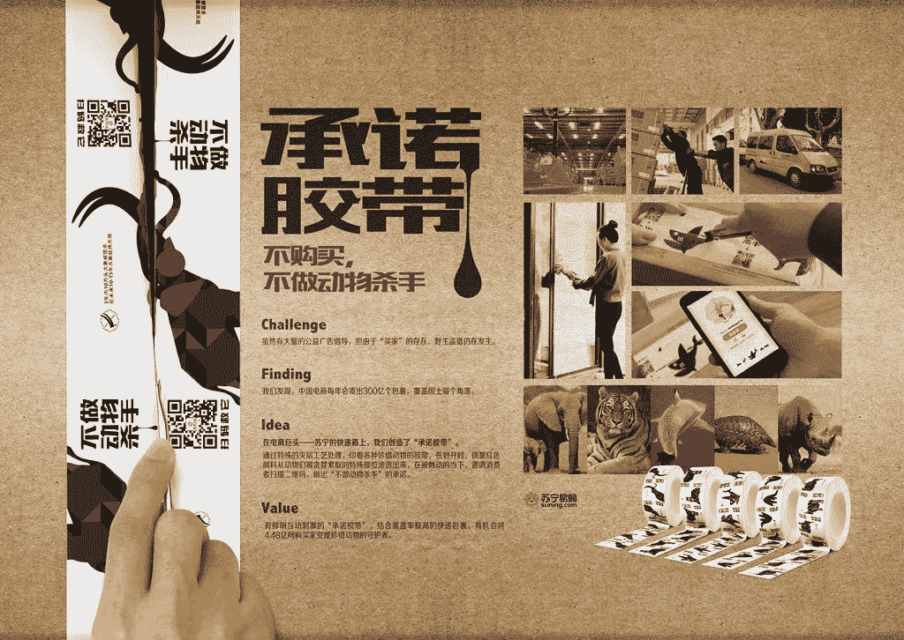

# **🎯产品推荐**

---

**Wonder Studio开放测试：****让您****的视频**更华丽，将真实人物替换为3D CG角色！

Wonder Studio是一个AI工具，让您的视频更加华丽！无需摄影动作捕捉、复杂的3D软件和昂贵的生产硬件，只需使用相机即可。该系统可以自动将CG角色动画化、照明和合成到真人场景中，自动检测剪辑并在整个镜头序列中跟踪演员。Wonder Studio可以自动检测演员的表演，并将其转移到用户选择的CG角色中，实现自动动画化、照明和合成。该系统可以与现有的工作流程无缝集成，自动化80%-90%的“客观”VFX工作，让艺术家留下“主观”工作。导出结果到您已经使用的软件中，让您的创作更加简单和高效！

链接直达：https://wonderdynamics.com/

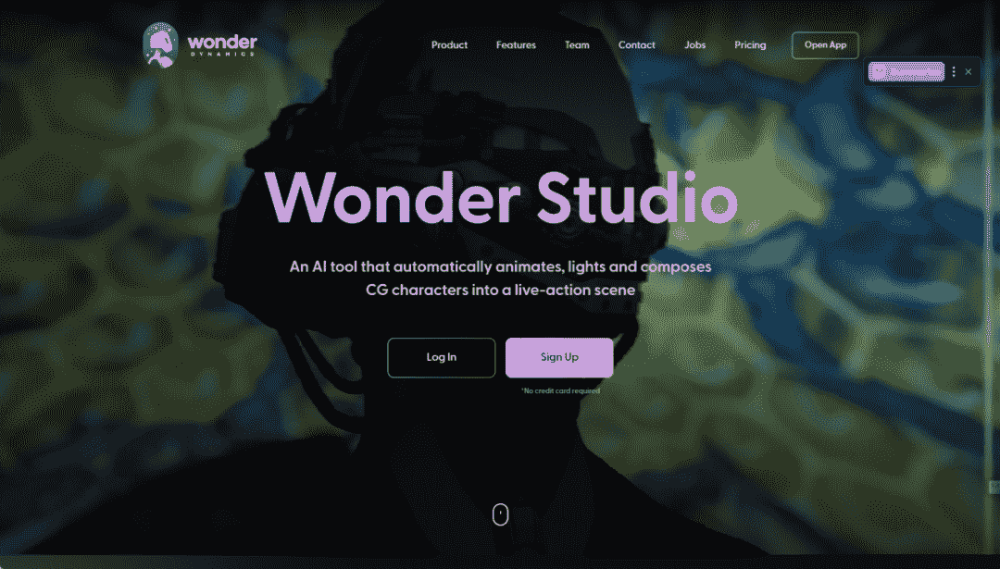

**AI** 帮个忙：即刻出的AI 文案润色和优化工具

这个工具提供了多种强大的写作助手功能，包括文章生成、模拟小红书风格、文章降重润色、工作总结生成、方案撰写、周报生成、标题生成、文本翻译、情书生成、文本校对等。这些功能可为用户提供快速生成各种文案和写作内容的便利和支持。

链接直达：https://aibang.run/

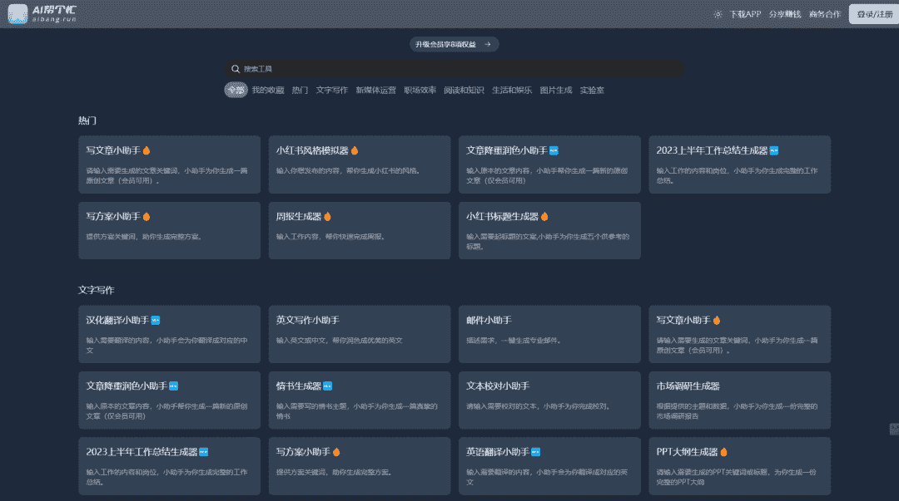

**Cue：****AI**** 驱动的主动回忆记忆工具**

多源支持，支持文本粘贴，即将支持Google Docs和Notion。强大的复习功能可保存AI生成的问题供以后复习。主动回想是一种学习技巧，涉及从记忆中主动检索信息，而不仅仅是复习笔记。这种技巧已被证明可以增加长期记忆和提高对材料的整体理解。

链接直达：https://cue.study/

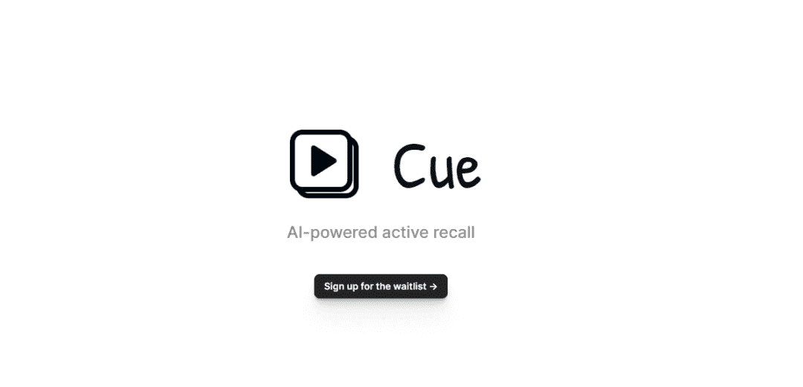

**Novel：带有 ****AI**** 能力的简洁记录工具**

NovelNovel是一款采用AI驱动的自动补全功能的Notion风格的所见即所得编辑器。它使用了Tiptap和Vercel AI SDK技术，为用户提供了斜杠菜单和气泡菜单等特色功能。其中最受欢迎的功能是AI自动补全，只需输入"++"激活或从斜杠菜单选择即可实现。此外，NovelNovel还支持图片上传，可通过拖放/复制粘贴或从斜杠菜单选择实现。用户可以在Vercel上部署自己的版本，以满足个性化需求。无论您是写作、笔记、或者协作方面的需求，NovelNovel都能够为您提供高效的工作体验。

链接直达：https://novel.sh/

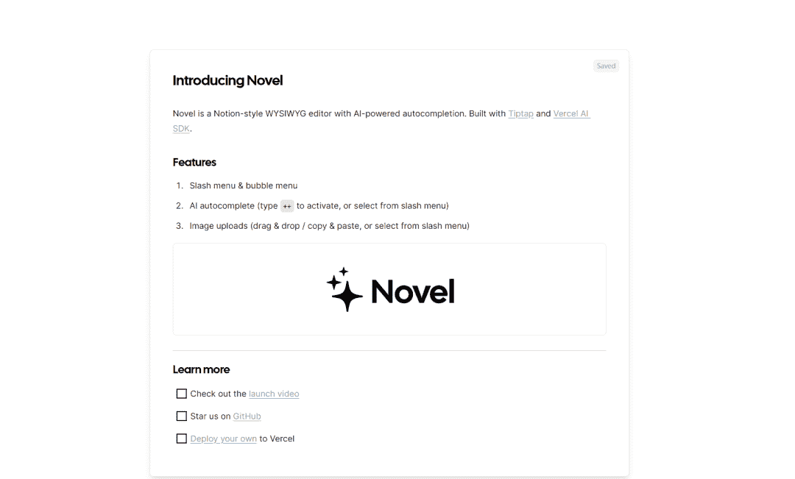

**Prime Voice ****AI**** 语音**

Prime Voice AI，它是一个文本转语音和语音克隆软件。它被 ElevenLabs 开发，旨在为寻求最终故事叙述工具的创作者和出版商提供最引人入胜、丰富和逼真的声音。还有一个语音社区，里面有很多优质的声音资源。

链接直达：https://beta.elevenlabs.io/

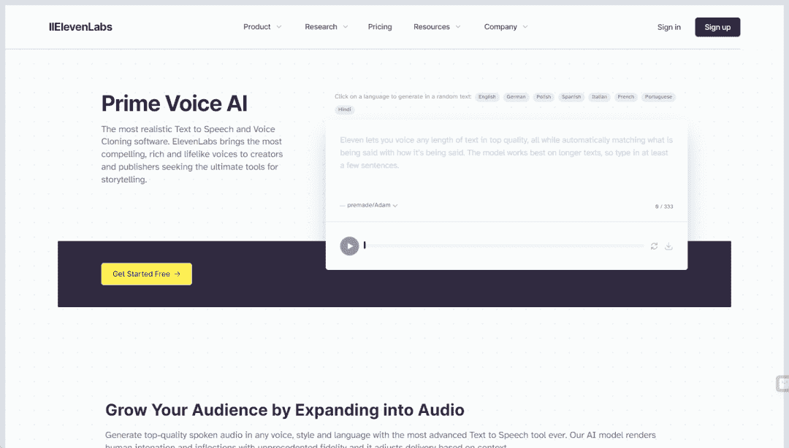

**We****bpilot** —— 免费的 AI 浏览器插件

可以用该插件的 AI 功能翻译网页的内容，或者让其总结网页摘要，每周可免费使用 50 次，够用了。

链接直达：https://chrome.google.com/webstore/detail/webpilot-copilot-for-all/biaggnjibplcfekllonekbonhfgchopo

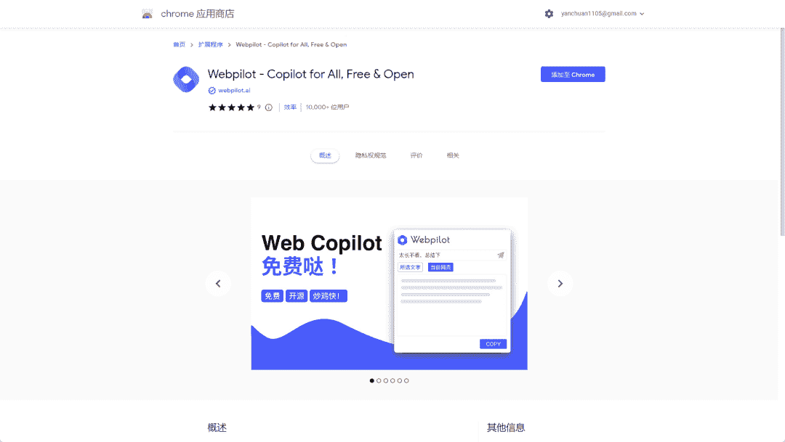

**Fac****ti****ve****rse **—— 能核查内容真实性的 AI 编辑器

现在 AI 生成的内容可能会瞎编说胡话，这款编辑器能用人工智能调用谷歌或必应搜索核查内容的真实性，挑出事实性错误。

链接直达：https://editor.factiverse.ai/

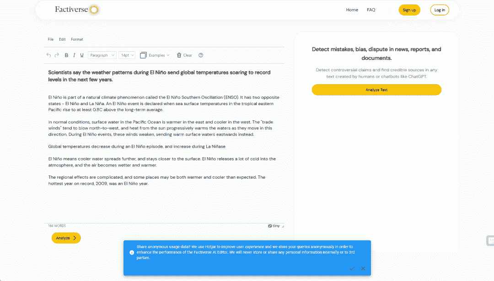

# **⭐设计师专供**

---

**Vision ****Pro****交互设计，苹果的阳谋**

距离苹果发布新品已过半月左右，但库克登场说出的那句话“正如iPhone带我们进入移动计算时代，Apple Vision Pro将带我们进入空间计算时代”，仍让人感到兴奋。

链接直达：https://www.ofweek.com/ai/2023-06/ART-201700-8440-30601495.html

京东PLUS会员A计划项目设计总结

随着京东在籍PLUS会员规模的持续扩大，PLUS会员的消费贡献度快速增长。在大盘GMV贡献占比已达到35%，最高可至40%。未来进一步维护高价值人群且忠诚用户的重要意义不言而喻。

链接直达：https://mp.weixin.qq.com/s/_5kuyaTS0sCOVhmO53CFrg

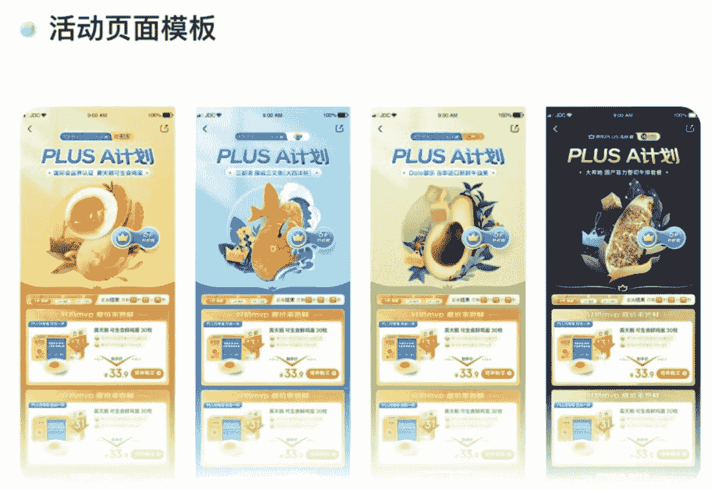

**好看城市-一场文化发现之旅**

好看城市是一场视频创作发起计划。以文化传承和非遗保护为主线，从探访名胜古迹、学习传统工艺出发，通过拍摄视频的方式传播分享，让古老技艺、民俗艺术焕发新的光彩。应用现代科技手段，搭载创新表达手法，年轻一代通过短视频的方式记录城市独特传统文化，传统艺术充分融入现代生活，增强了年轻用户的文化认同感和继承创新性。

链接直达：https://mp.weixin.qq.com/s/oEhDLc0VqGZwWKKZFw0BwQ

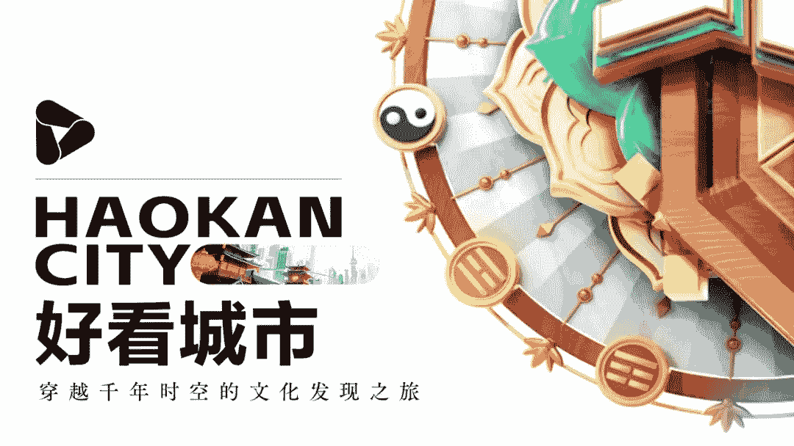

**PC端地图页面交互设计规范**

随着物流场景业务的不断变化，许多后台系统中都融入了地图的展示和操作，便于用户更可视化获取和操作信息。这意味着地图的设计形式越来越多样化，地图交互规范的1.0版本已经无法覆盖大部分用户场景，因此需要结合新衍生出的物流业务场景对地图交互规范进行升级。

链接直达：https://mp.weixin.qq.com/s/swNDDFm2_UC7gYEuqdyPBw

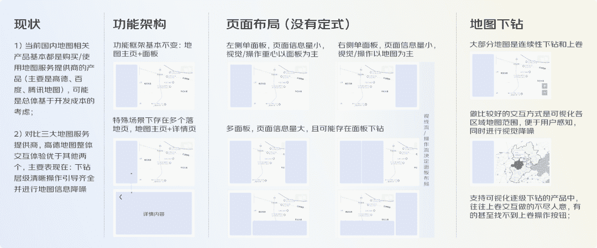

2023最佳包装奖名单公布，这些包装设计中暗藏新趋势！

今年的Dieline Awards出现了这些新趋势：Dieline Awards是世界上最大的包装设计竞赛之一，旨在表彰世界各地具有创造力的产品包装，评选出最优秀的设计师和设计机构，提高人们对品牌包装设计价值认识。

链接直达：https://www.digitaling.com/articles/947414.html

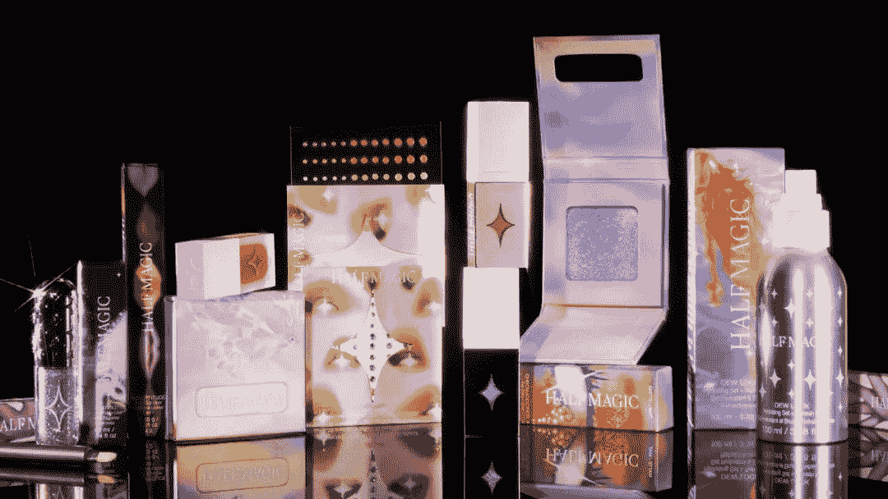

这个日本家居品牌的文创，简直要把我可爱晕了！

中国文创正在迅速发展，而日本文创已经发展到了一定规模，有很多值得我们借鉴学习的。今天为大家介绍的YOU+MORE！是一家以家居杂货为主的文创品牌。

链接直达：https://www.digitaling.com/articles/944775.html

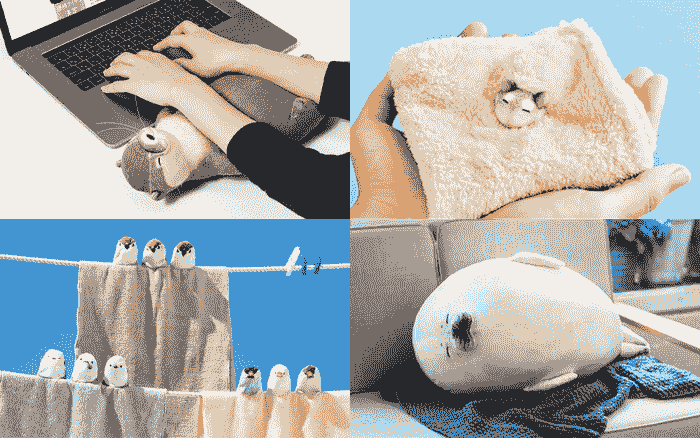