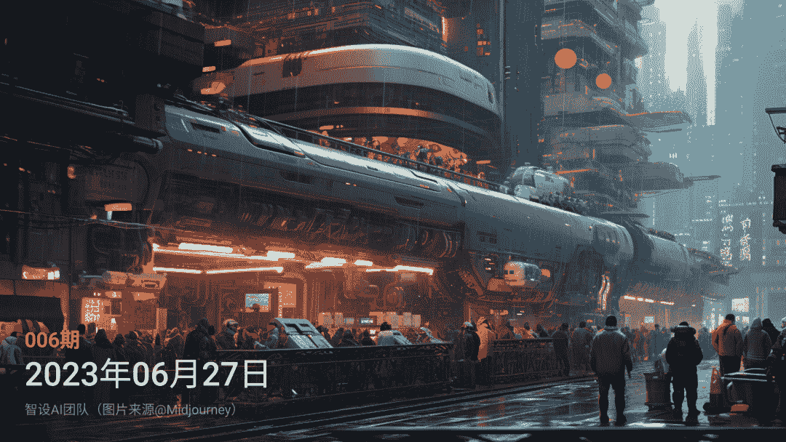
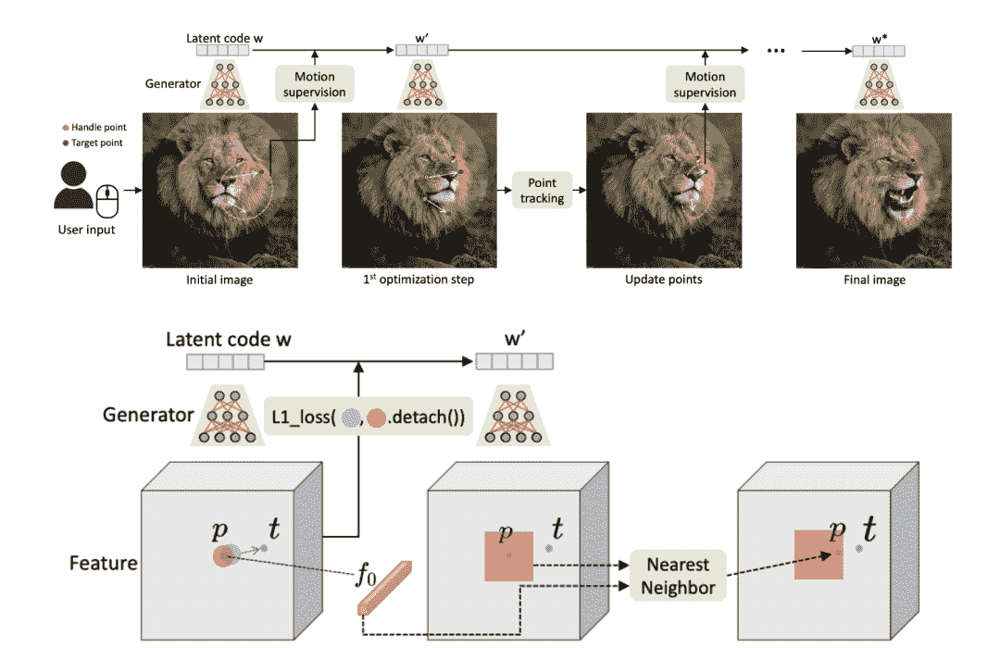
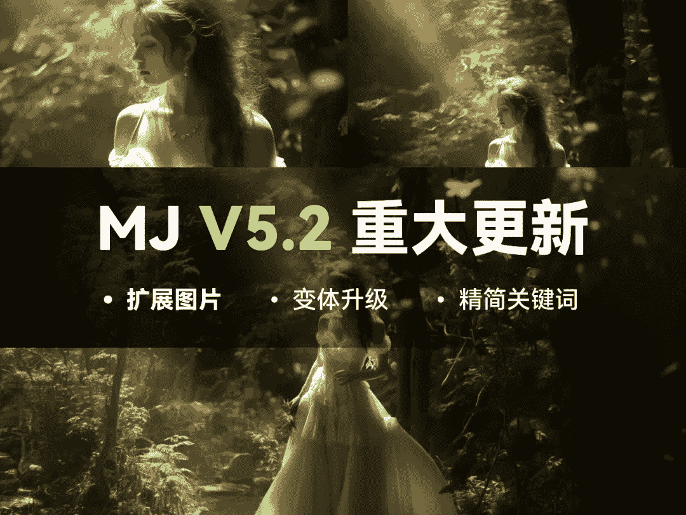
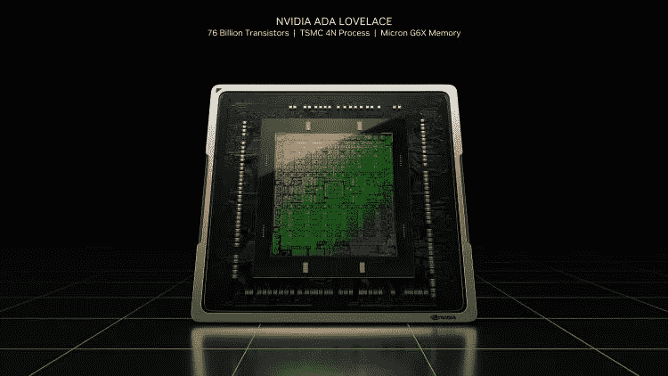
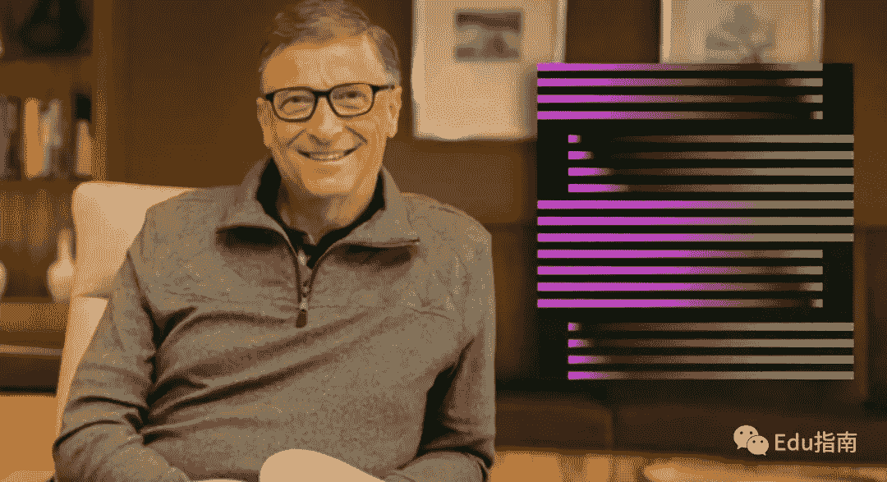
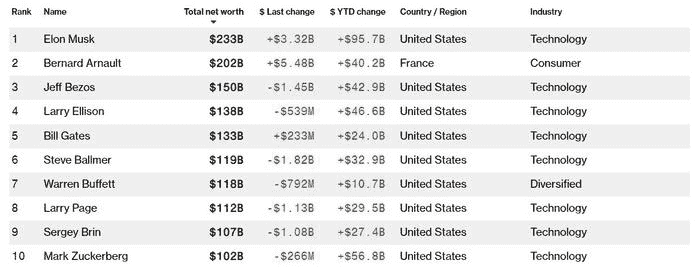
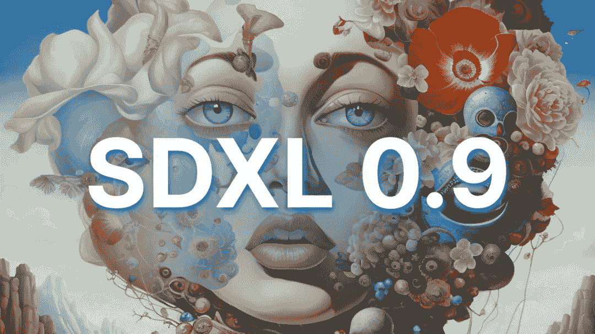
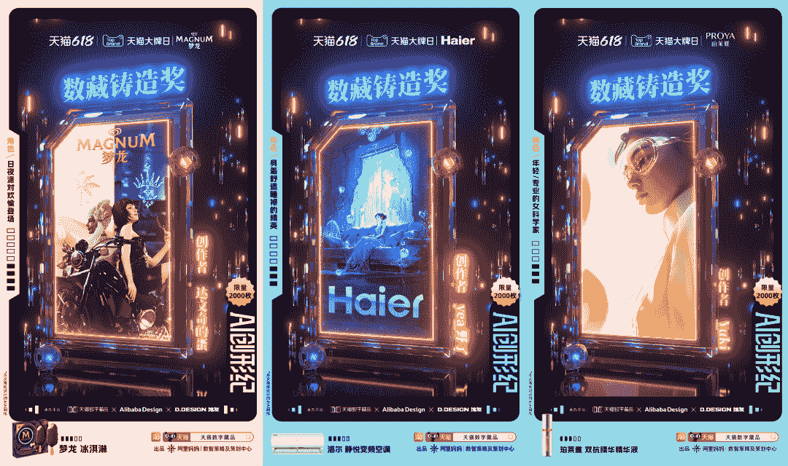
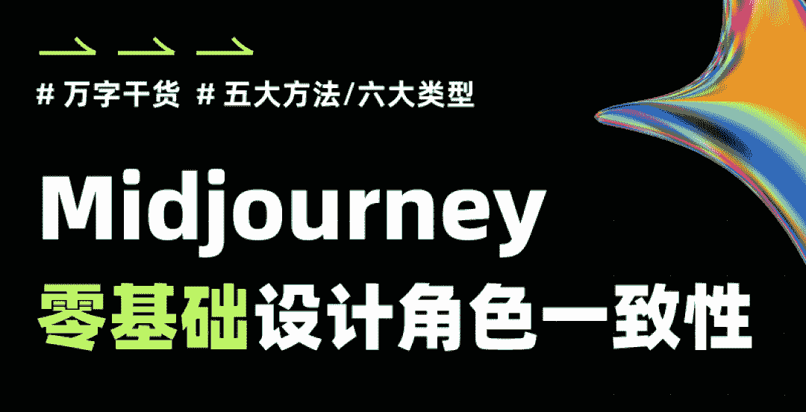

# 智设AIGC周刊 - Vol.06 20230627

> 来源：[https://docs.feishu.cn/docx/ETRwdCoUCoGBYKxOtY4cw6c4noa](https://docs.feishu.cn/docx/ETRwdCoUCoGBYKxOtY4cw6c4noa)

---

# **📰最新要闻**

---

**Dr****agGAN **正式开源，大象也能 P 转身，开启 AI 绘图新篇章

在AI绘图领域，DragGAN无疑是一颗璀璨的新星。这款由MPII、MIT、宾大、谷歌等机构的学者联合研发的工具，已经在SIGGRAPH 2023上获得了认可。DragGAN的出现，让我们可以通过简单的拖拽，实现精准的图像编辑。

**链接直达：**https://www.haoshuo.com/article/64992d158de864422ba64563

**试玩链接：**https://huggingface.co/spaces/radames/DragGan

Midjourney V5.2 更新详解

Mdijourney更新总是在节假日悄摸摸就更新了，让我们来看看V5.2到底更新了哪些功能～

**链接直达：**[https://mp.weixin.qq.com/s/rP](https://mp.weixin.qq.com/s?__biz=Mzg2NTkxNDM2NA==&mid=2247486531&idx=1&sn=d3a8b746a500f8b4bbfc3ba652cd842f&scene=21#wechat_redirect)7HVPEku1woimjizC8BnQ

**各大公司竞逐 ****AI****，消息**称字节跳动今年向英伟达订购超 10 亿美元 GPU

今年春节后，拥有云计算业务的中国各互联网大公司都向英伟达下了大单，其中字节今年向英伟达订购了超过 10 亿美元的 GPU，还有另一家大公司的订单也至少超过 10 亿元人民币。

**链接直达：**https://www.ithome.com/0/699/572.htm

**比尔盖茨：****AI****聊天机器人**将在18个月内成为学生阅读和写作的助手

很快，人工智能就可以帮助教孩子们并提高他们的成绩。这是微软联合创始人比尔盖茨的说法，他说人工智能聊天机器人有望在 18 个月内帮助孩子们学习阅读和磨练他们的写作技能。

**链接直达：**https://tech.ifeng.com/c/8PFV1E9zeT7

**AI**成富豪们吸金利器! 全球前十大富豪财富激增超4000亿美元

人工智能（AI）一直是2023年全球股市的决定性投资主题之一，与此同时，全球围绕AI的投资狂潮也在帮助那些最富有的群体变得更加富裕。

**链接直达：**https://finance.sina.cn/hkstock/ggyw/2023-06-20/detail-imyxxsim8415239.d.html?vt=4&cid=76556&node_id=76556

**Stability ****Al**推出新Al文生图模型SDXL 0.9

知名生成式AI独角兽企业Stability AI宣布推出SDXL 0.9，称其是Stable Diffusion文生图模型套件中最先进的开发。继4月份的Stable Diffusion XL beta版成功发布之后，SDXL 0.9在图像和构图细节上都大大改进，可在消费级GPU上运行。该模型现在可以通过ClipDrop访问，API很快就会发布，SDXL 1.0预计将于7月中旬开源。

**链接直达：**https://zhidx.com/news/38084.html

**AI**还能这么玩？创意狂欢里藏着阿里妈妈的爆款生意经

有人用AI复原了兵马俑真人的样貌，沉默了两千多年的他们变成会眨眼和微笑的鲜活存在，跨越时空的对话照进现实；有人用AI修复合成了原本已经断裂的三星堆文物，让古蜀文明再焕生机。AI正在打破人类想象力的边界，也逐渐与我们的生活紧密相融。

**链接直达：**https://www.digitaling.com/articles/942654.html

# **🔥文章推荐**

---

Midjourney零基础设计角色一致性

全文6815个字，零基础可查看前半部分理论知识，希望对大家有帮助！关注我，学习更多AI知识！～

**链接直达：**https://www.zcool.com.cn/work/ZNjU2MzQyMjg=.html

**AI****助力****UI****五步指南丨Midjourney**

虽然AI的爆火，越来越多的行业都在尝试着接入AI到工作流中。利用ChatGPT写文档产品、接入GPT的API智能回答的客服、利用Tome做ppt的商务·.· UI/UX也不例外。

**链接直达：**https://www.zcool.com.cn/work/ZNjQ4MDgzMjA=.html

CustomGPT Plugins：快速创建 ChatGPT 的插件

CustomGPT是一种无需编码的新方法，可以在几分钟内构建ChatGPT插件。它是一个无代码工具，可以在云平台上安全地托管端点。使用CustomGPT Plugins，可以快速创建面向客户的ChatGPT插件，无需IT支持，大大减少了构建ChatGPT插件所需的时间和费用。该平台具有多源数据集成功能，可以从各种来源摄取数据，创建定制化的ChatGPT插件。此外，该平台还具有高级向量数据库和语义搜索功能，确保插件能够准确理解和回答查询，提高查询相关性。CustomGPT Plugins是一个业务级平台，可以支持企业的快速增长。

**链接直达：**https://customgpt.ai/customgpt-plugins/

**Stability ****AI** 发布了 SDXL 0.9，图片素质大幅提升

Stability AI发布了SDXL 0.9，是一个强大的开源图像模型，成像质量和细节高于Beta版本。SDXL 0.9参数数量很多，是所有开源图像模型中参数数量最多的之一，使用现代消费类GPU即可运行。现在可以通过ClipDrop访问该模型，SDXL 1.0将于7月中旬发布。

**链接直达：**https://stability.ai/blog/sdxl-09-stable-diffusion

# **🎯产品推荐**

---

**Ado****be Fi**refly 上线「矢量图重新着色」

Adobe Firefly是一款强大的图形设计工具，可在线使用文字效果，并新增生成填充和矢量图重新着色功能。上传SVG格式文件即可获得不同配色效果。该功能将很快上线到Illustrator，方便用户使用。无论您是初学者还是专业设计师，Adobe Firefly都能满足您的设计需求。

**链接直达：**https://firefly.adobe.com/denied.html

**人工智能生成 Logo**

现在可以使用AI技术免费生成矢量SVG logo了！只需要在Discord中输入提示词，就可以轻松生成属于你的logo了。这是一个完全免费的服务，欢迎大家来试试。无论你是需要一个个人logo还是商业logo，这个工具都可以满足你的需求。

**链接直达：**https://logolivery.ai/

**ailcoustics：****AI**** 音频处理工具**

这个工具可以提高录音、社交媒体内容、语音笔记、播客、讲座、历史内容等语音的质量。只需上传或拖放.mp3、.wav、.m4a格式的文件，大小不超过30MB，时长不超过10分钟即可。快来试试吧！

**链接直达：**https://ai-coustics.com/playground/

**KickResume：****AI**** 帮你改写简历**

这个平台提供了AI简历重写服务，借助OpenAI的GPT-4语言模型，可以在几秒钟内修复简历中的错误、使其更加专业，并使用行业术语和关键词优化简历，帮助用户通过ATS筛选。另外，平台还提供求职信生成服务，生成的求职信与求职职位匹配，帮助用户更加成功地求职。快来试试吧！

**链接直达：**https://www.kickresume.com/en/ai-resume-rewrite/

**Upword：****AI**** 内容分析工具**

Upword是一个全能平台，可以帮助用户完成整个研究工作流程，包括提取关键思想、添加评论、附加链接和图片、捕捉信息等。此外，文章还介绍了Generative Tech的概念，即使用AI模型和深度学习引擎来生成新内容和想法，创造新的工作机会和提高生产力。最后，文章还介绍了如何使用Building a Second Brain方法来保存和系统地提醒我们通过经验获得的想法、灵感、见解和联系。快来试试吧！

**链接直达：**https://www.upword.ai/

**Gamma：****AI** 生成 PPT 工具支持导出 pptx 格式

Gamma团队发布了一个他们原本不打算构建的功能：PowerPoint导出。他们意识到，创业公司的目标是解决客户问题，引入新技术通常是最好的方式。然而，他们花费了一些时间才明白，关键是专注于解决实际问题，而不是仅仅关注技术本身。PowerPoint导出是为了更好地满足用户需求，让用户更容易地将Gamma作为他们日常工作流程的自然延伸。

**链接直达：**https://gamma.app/

**Syne：****AI** 生成现实环境可交互 3D 模型

XR是一款应用程序，可以直接从Google Drive导入3D模型到增强或虚拟现实中。AI可以自动生成纹理和环境，并支持语音交互，用户可以探索不同的材料和环境。此外，还可以探索多个设计版本，包括重力和不同的光照效果。用户可以保存快照并与团队分享。快来试试吧！

**链接直达：**https://synexr.com/

# **⭐设计师专供**

---

**AI**商业案例教程丨Midjourney生成APP活动弹窗

解决UI设计苦恼，利用Midjourney和PS轻松制作活动运营弹窗，简单易上手～

**链接直达：**[https://mp.weixin.qq.com/s/Jx](https://mp.weixin.qq.com/s?__biz=Mzg2NTkxNDM2NA==&mid=2247486549&idx=1&sn=252d1ad9691fa6ab738011d084587f85&scene=21#wechat_redirect)9tZc3O1viAxWw1bV9XAA

看完这篇万字文章，你也能绘制用户体验地图

当我们打开一款电商软件时，我们认为一定是付款后送货到家。而不是付款后需要自己上门取货。(此处仅指传统电商流程，不包含O20模式。)当我们打开一款陌生社交软件时，我们认为一定是匹配成功就可以聊天/或互相关注。而不是需要先充值vip才能打招呼。

**链接直达：**https://www.zcool.com.cn/work/ZNjU2MTI3NDg=.html

夏至海报合集，送你一个热烈的盛夏

夏至，是二十四节气的第10个节气，也是北半球一年当中白昼最长、夜晚最短的一天。即将迎来一年中最热的三伏天，除了冰镇西瓜和冒着泡的橘子汽水，品牌们也带来了消暑海报

**链接直达：**https://www.digitaling.com/articles/943109.html

**端午节****海报合集，粽叶飘香送祝福**

在粽叶飘香的时节，品牌们也送来了满满祝福：五芳斋的粽子可甜可盐，不论咸甜，只“粽”意你；旺旺是谐音梗大王，带来各“粽”贴心祝福；必胜客发起端午版猜成语，看看你能猜中几个；宜家的“花粽”可可爱爱；徐工集团则在“端午忆斯人，上下而求索”......除了各色粽子，品牌们还有在龙舟上大作文章的。百舸争流，祝大家乘风破浪！快来一起看看吧！

**链接直达：**https://www.digitaling.com/articles/943753.html

50张脑洞插画，看透这个时代的真相！

来自意大利的Davide Bonazzi，曾被“Creative Quarterly”杂志评选为最优秀的一百位艺术家之一。

**链接直达：**https://www.digitaling.com/articles/942927.html

电影《消失的她》火了，海报设计细思极恐！

作为商业片，不仅入围了北影节“天坛奖”（往届天坛奖入围作品更青睐于文艺片），并拿下首张场刊最高分。展映后，获得了“商业性与艺术性”的高度赞许。海报的设计也别出心裁，充满了故事性和艺术性，具有很高的鉴赏性。

**链接直达：**digitaling.com/articles/943767.html

