# 智设AIGC周刊 - Vol.05 20230620

> 来源：[https://docs.feishu.cn/docx/RM2SdI7x1opAn9xlyQWcwfnenxc](https://docs.feishu.cn/docx/RM2SdI7x1opAn9xlyQWcwfnenxc)

# **📰最新要闻**

---

**Mistral ****AI****在欧洲有史以来最大的****种子轮****融资中获得105.<>亿****欧元**

Mistral AI仅在四周前由三位AI研究人员创立。该公司首席执行官亚瑟·门施（Arthur Mensch）曾受雇于谷歌的DeepMind。他的联合创始人Timothée Lacroix（首席技术官）和Guillaume Langple（首席科学官）之前曾在Meta工作。

链接直达：https://thenextweb.com/news/mistral-ai-secures-105m-europes-largest-ever-seed-round

**比尔盖茨：****AI** 时代开启，人生的第二次革命性时刻来了

比尔·盖茨的中国行还在继续，这是他的第 18 次来华之旅。他创办的微软给 OpenAI 投资了一百多亿美元，在全球范围内掀起了 AIGC 狂潮，中国的大模型也在遍地开花。

链接直达：https://www.ifanr.com/1552785

**Open ****AI** 大动作，模型更新、函数调用、费用降低

上周三，OpenAI发布了一系列与模型相关的更新。其中包括了GPT-4和3.5的新版本模型，这些模型都支持函数调用，并且进行了关于模型费用的调整。

链接直达：https://openai.com/blog/function-calling-and-other-api-updates

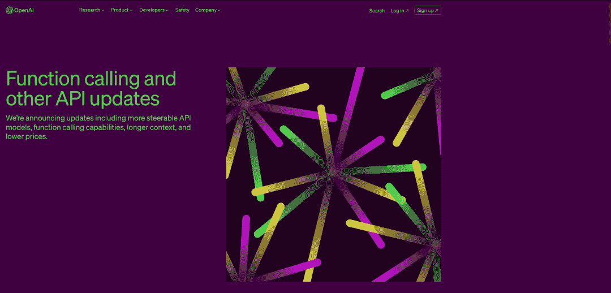

**Meta**** 推出 **Voicebox，一个全能语音生成模型

Meta 推出了 Voicebox，一个全能语音生成模型，支持六种语言和多种语音处理功能，包括语音合成、语音转换和语音增强。该模型非常强大，可以应用于语音助手、虚拟主持人、智能客服等领域。

链接直达：https://research.facebook.com/publications/voicebox-text-guided-multilingual-universal-speech-generation-at-scale/

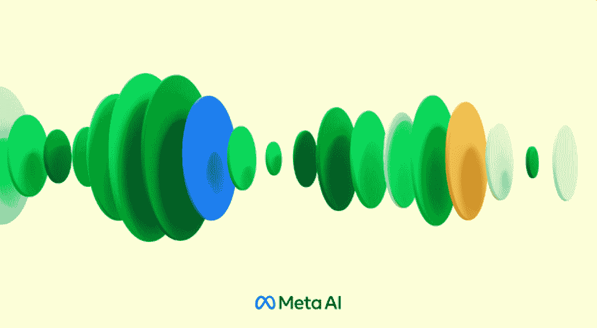

**谷歌的****AI****试衣模型**

谷歌发布了一个名为TryOnDiffusion的AI试衣模型，使用扩散过程技术可以让用户提供一张自己的全身照，然后生成虚拟试衣效果，帮助消费者更好地选择适合自己的服装，为服装零售商提供新的销售工具。

链接直达：https://blog.google/products/shopping/virtual-try-on-google-generative-ai/

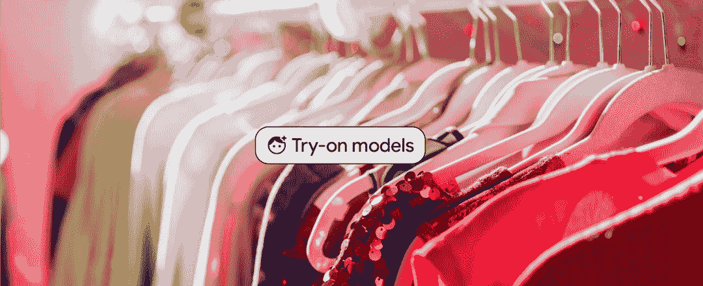

Stable Diffusion稳定生成视频的突破

可以利用边缘信息和光流来解决SD生成视频的稳定性和闪烁问题，生成更加稳定和清晰的视频。该技术可应用于视频修复、增强等领域。

链接直达：https://anonymous-31415926.github.io/

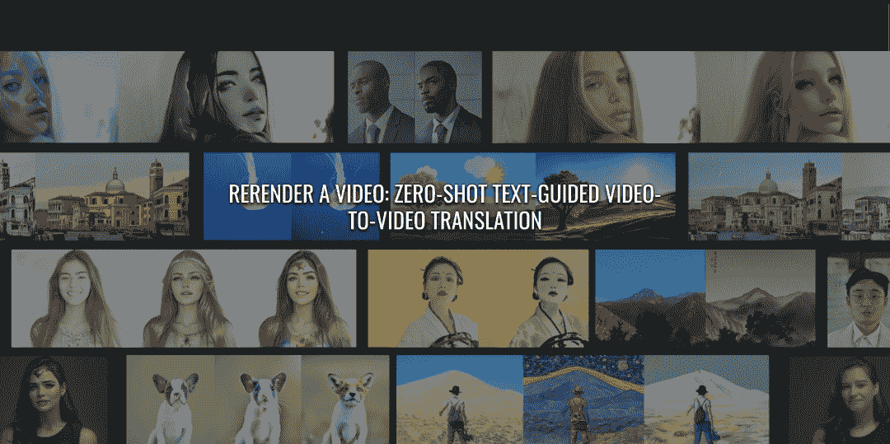

# **🔥文章推荐**

---

**Stable Diffusion插件丨脸部修复及一键生**成表情包插件After Detailer

使用最多的用法就是修复脸部以及更换脸部表情，这个插件很好玩，操作也很简单，强烈推荐大家试试。

链接直达：https://mp.weixin.qq.com/s/tdV5d0ODotQZrfeC71EEPQ

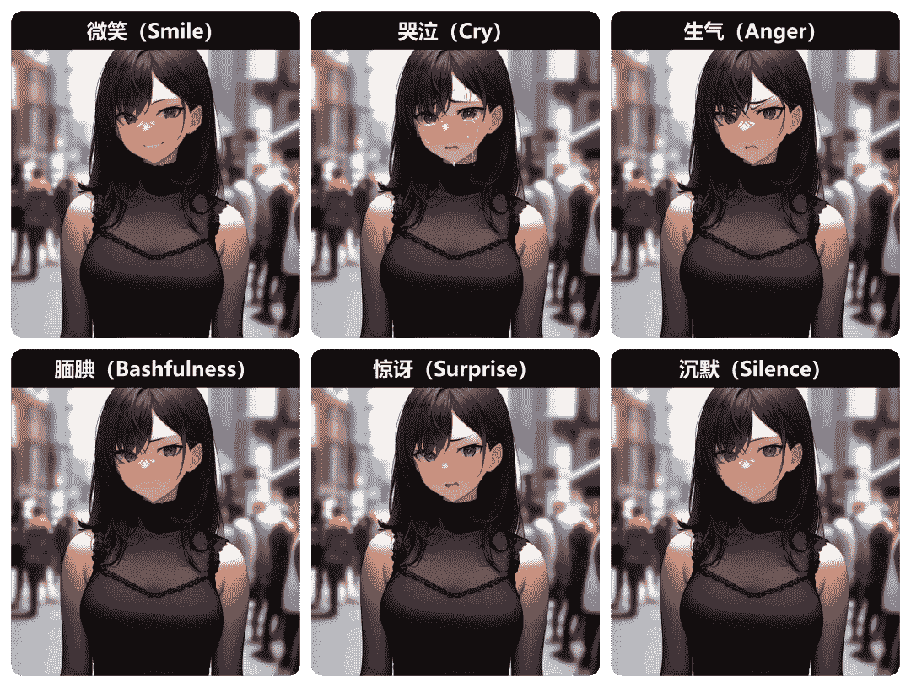

**有效学习英语新方式—****AI**** bot组合**

“语言学习”，指通过正式的教学方式，例如上课或使用语言学习应用程序等方式，学习一门语言的过程。这个过程通常涉及语法规则、词汇和发音等方面的显式知识。

链接直达：https://sspai.com/post/80264

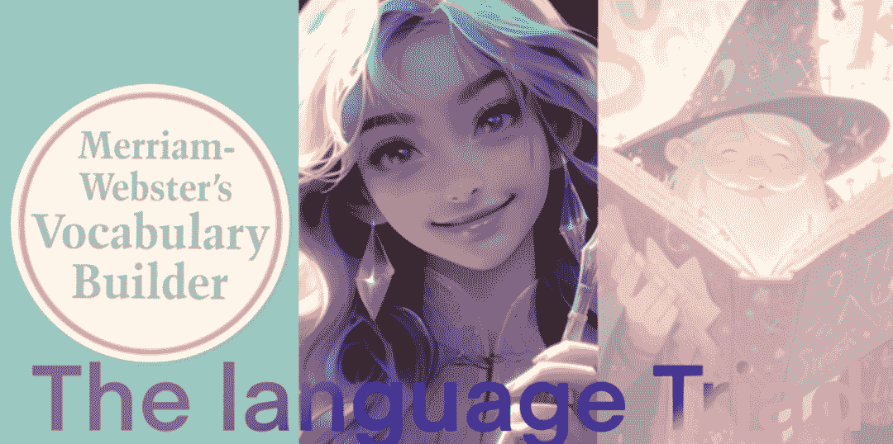

**AI**头像看这一篇就够了！100%像！

是不是每个女生都想成为百变女王？每个男生都有个英雄梦？看到很多人做的卡通头像自己也想拥有？自从AI绘图工具出现，定制属于自己的形象就更加便捷了。

链接直达：https://mp.weixin.qq.com/s/R6_yR5TBUhnUaojauIRfBg

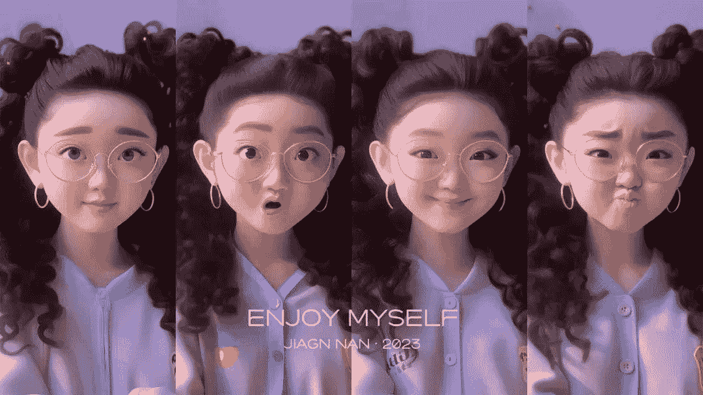

**【M****idjour**ney&SD进阶宝典III】如何用AI精准制作人像

为了探究Midjourney、StableDiffusion等AI工具在设计上的无限可能，我们举办了面向全58UXD设计师的「AI创作海报设计大赛」。不仅让AI和设计师灵感产生奇妙的火花碰撞，同时也探索了AI在设计领域的更多可能。

链接直达：https://mp.weixin.qq.com/s/Ifsk-K8xCD6TBlcZTJUZrg

# **🎯产品推荐**

**免费 ****macOS**** 剪贴板 + ****AI** 新玩法：效率启动器 HapiGo 更新

剪贴板管理工具可以说是历史悠久的效率工具，多年前 Paste 以其精美的设计，让大家眼前一亮。但之后其他的剪贴板应用似乎再无新的设计风格以及新的剪贴板功能。

链接直达：https://sspai.com/post/80118

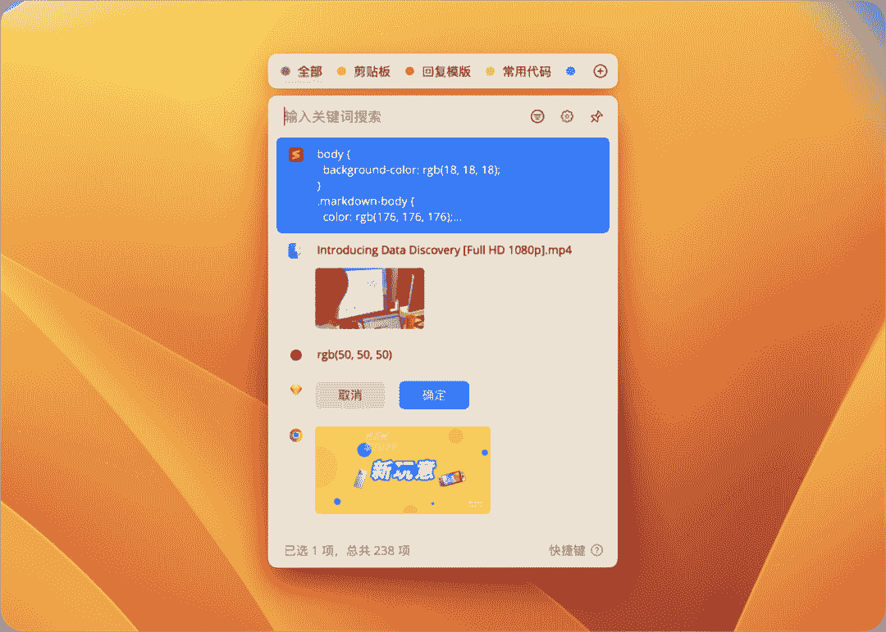

**Ch****ato**：基于您的知识库轻松定制AI机器人

只需上传学习素材或添加提示语， 即可获得独特个性和超强能力的专属助理机器人。

Chato 帮助企业先人一步运用 AI 理念， 释放难以想象的产出与价值。

链接直达：https://chato.cn/

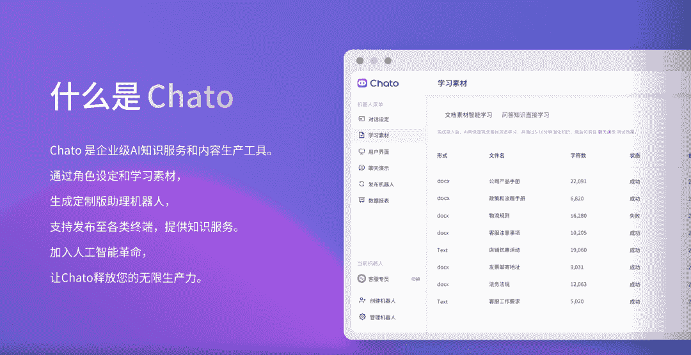

**LogoliveryAl：生成****SVG****格式的logo**

也是在discord使用，目前还是测试阶段，试用了一下，效果一般，大家可以尝试一下～

链接直达：https://logolivery.ai/

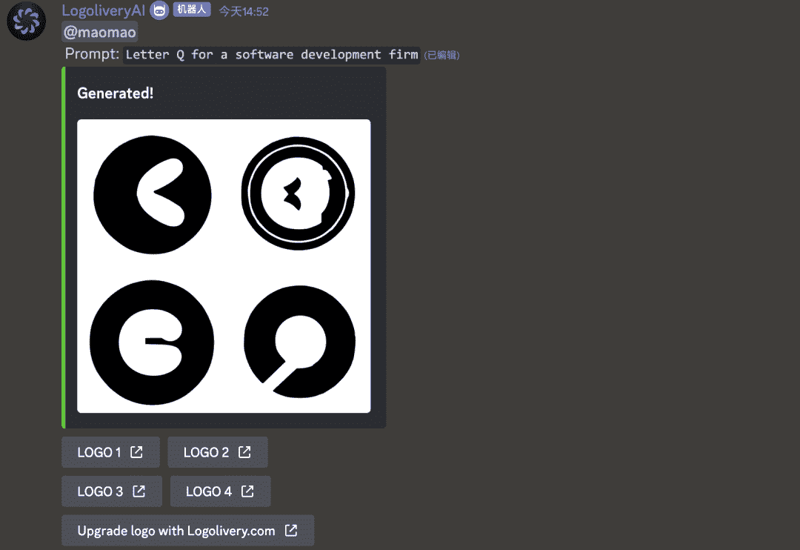

BarberGPT：我想看看光头的你

AI产品真的是越来越丰富了，不用去理发店找tony，就能轻松get不同发型，毫无ps痕迹～

链接直达：https://www.barbergpt.ai/

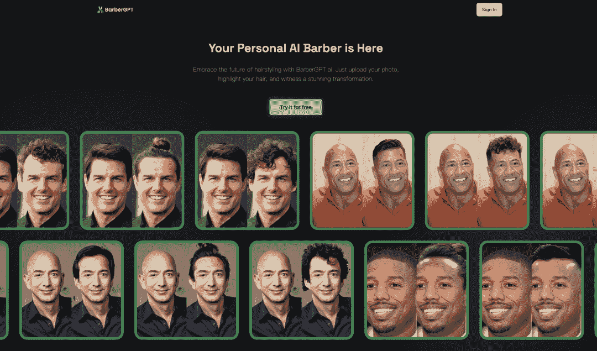

18个有用有趣的小众宝藏网站，让你的灵感创意源源不断！

这期的小众网站很多都是平常四处搜刮并且珍藏了很久，有用又有趣，比如能给我们想创意带来灵感的「非物质文化遗产网」、民俗网站等，而且还紧跟时事分享了一些AI相关的网站，AI合集类、AI音乐、AI写作等，就等这个机会一并分享给大家，赶紧来看看有没有你需要的吧！

链接直达：https://www.digitaling.com/articles/896013.html

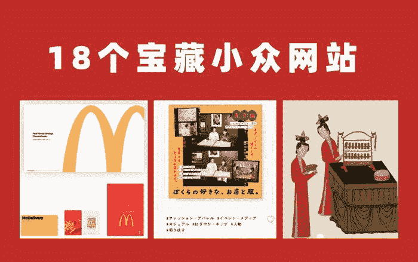

**腾讯智影：腾讯推出的 ****AI**** 画图应用**

腾讯最近推出了一个AI绘画生成器，可以生成多种主题和风格的画面，包括人物、风景、灯光等。用户可以根据自己的选择和设置生成不同的画面，也可以通过金币购买更多次数。虽然这个生成器使用了SD技术，但是目前调教效果还不够好。

链接直达：https://zenvideo.qq.com/image/create

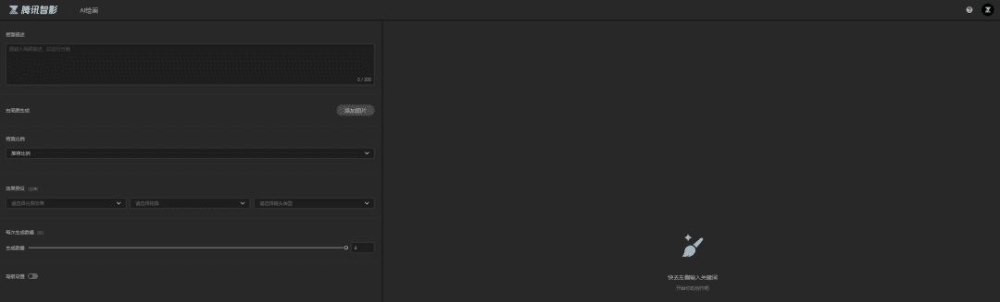

**⭐设计师专供**

---

看完这篇万字文章，你也能绘制用户体验地图

UI设计师升职加薪必看文章，强烈推荐！

链接直达：https://www.zcool.com.cn/work/ZNjU2MTI3NDg=.html

流体炫彩3D背景 4K 图片素材免费商用

分享流体炫彩3D背景图，4K高清，科技感十足，电商背景、KV设计、免费商用素材，公众号回复：“流体炫彩背景”即可获得～

公众号二维码：

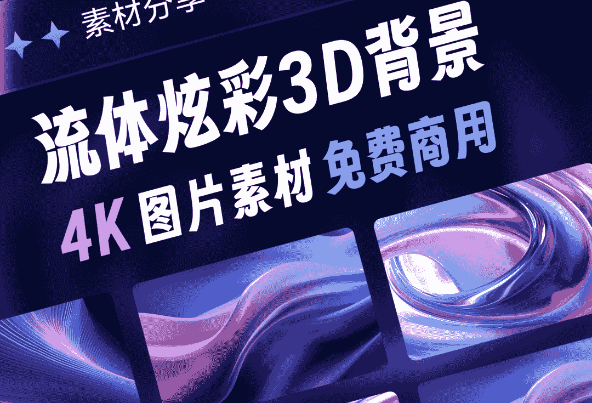

40+张海报，这家精酿啤酒太懂设计，太懂打工了

在上周举办的首届外滩精酿啤酒节，是我最近的快乐源泉，不仅一次性喝到近30家国内顶尖的精酿啤酒厂牌的各类产品，还惊喜地发现了一家能与打工人共情的啤酒厂牌——京A精酿啤酒

链接直达：https://www.digitaling.com/articles/941065.html

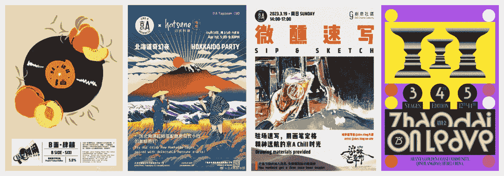

矢量图标模板文件：Raycast App Icon Template

有些人一直在要求将我们的应用程序图标作为模板来创建自己的图标，所以在这里你可以开始了!玩得开心点!

链接直达：https://www.figma.com/community/file/1250056962645833804

**免费3D线性形状素材**

螺旋形、之字形、环形、随机等。通过20种独特的方块字，为您的项目添加一丝魅力。

链接直达：https://squiggel.wannathis.one/

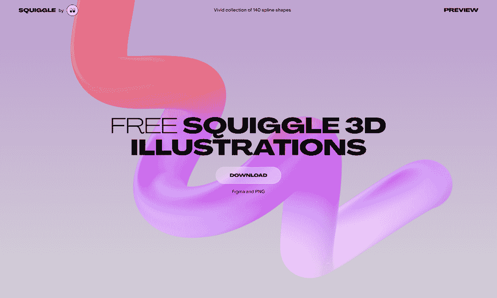

18个有用有趣的小众宝藏网站，让你的灵感创意源源不断！

这期的小众网站很多都是平常四处搜刮并且珍藏了很久，有用又有趣，比如能给我们想创意带来灵感的「非物质文化遗产网」、民俗网站等，而且还紧跟时事分享了一些AI相关的网站，AI合集类、AI音乐、AI写作等，就等这个机会一并分享给大家，赶紧来看看有没有你需要的吧！

链接直达：https://www.digitaling.com/articles/896013.html

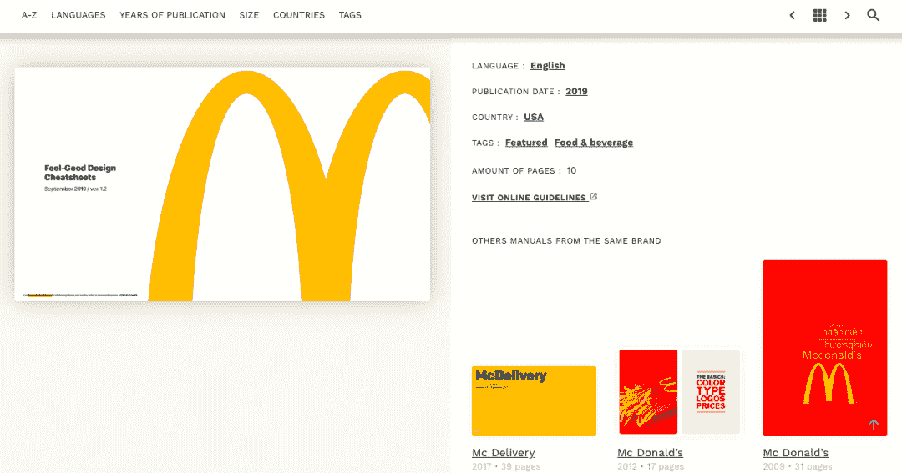

火山引擎｜从0到1打造B端现象级大会

火山引擎是字节跳动旗下的云服务平台，将字节跳动快速发展过程中积累的增长方法、技术能力和工具开放给外部企业，帮助企业在数字化升级中实现持续增长

链接直达：https://mp.weixin.qq.com/s/0rsxxVC_AlGG6CA58IPKnw

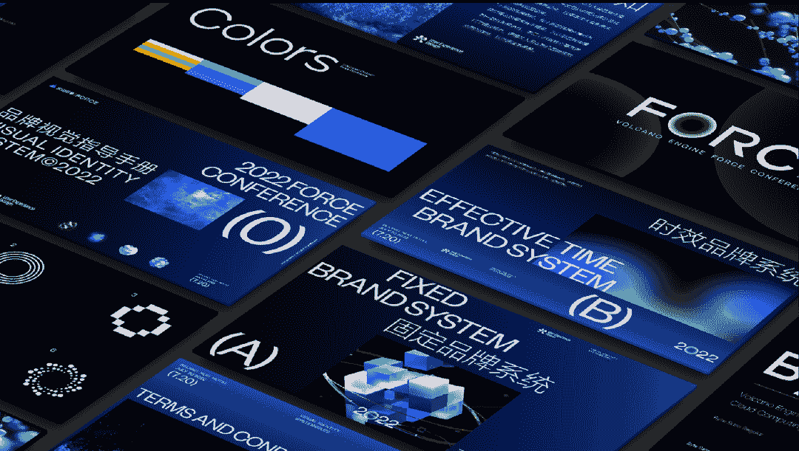

被总监批评了多次后，我总结了一些做G端可视化大屏的思路！

最近在负责一个G端项目，这个项目不同于我之前做的矿山、水利行业监测平台，以往的行业因发展了多年，有政策指引、行业标准，也有竞品可参考分析，需求相对明确。

链接直达：https://www.woshipm.com/pd/5847851.html

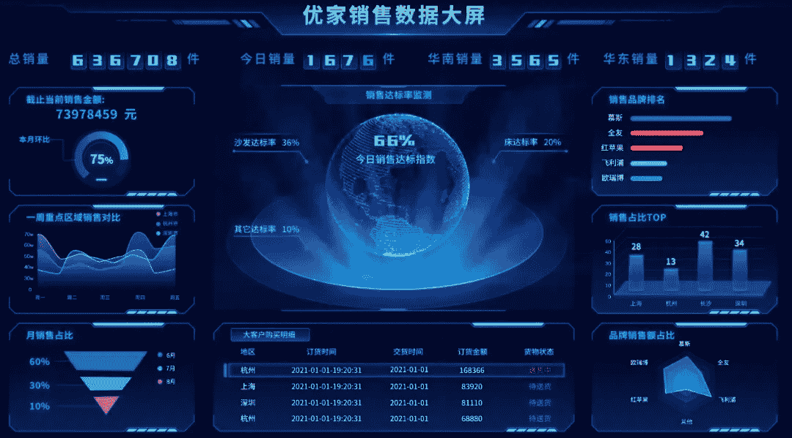

大厂方法论+案例：从0到1轻松拆解产品需求，对程序员的质疑说不

面临新业务线拓展或者产品升级的时候，在收集到一大堆乱七八糟的需求后，你可能会想，我要怎么着手呢？答案是，搭框架找思路。

链接直达：https://www.woshipm.com/pd/5848828.html

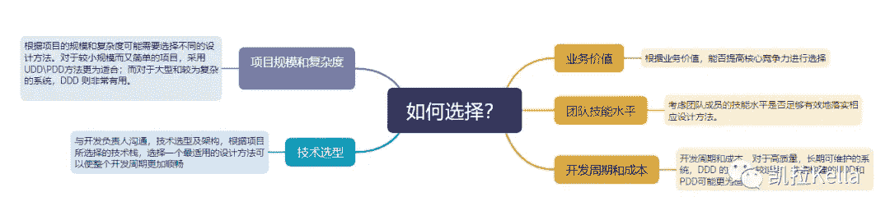