# 智设AIGC周刊 - Vol.04 20230613

> 来源：[https://docs.feishu.cn/docx/FNSCd73jPomBAvx6LZJc3M8enB4](https://docs.feishu.cn/docx/FNSCd73jPomBAvx6LZJc3M8enB4)

# **📰最新要闻**

---

**AI** 生成可扫码图像--新 ControlNet 模型展示

用stablediffusion的插件contronet生成的二维码，测试过了，可以扫出来，直呼牛x!

**视频直达：**https://mp.weixin.qq.com/s/i4WR5ULH1ZZYl8Watf3EPw?ref=letecho.fr

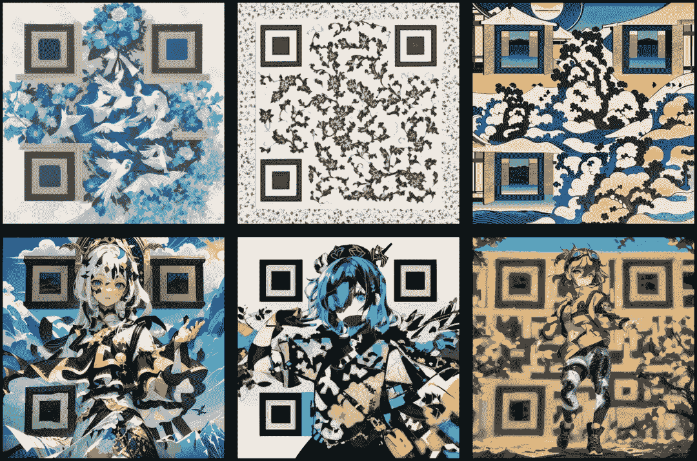

**讯飞星火****大模型****发布1.5版本**

科大讯飞发布“讯飞星火认知大模型”V1.5升级版(发布讯飞星火、星火语伴两款APP)

**链接直达：**https://www.bilibili.com/video/BV1EP411B7LS/?spm_id_from=333.337.search-card.all.click&vd_source=a07af57fb1f8d3646567146bd7fb3fbe

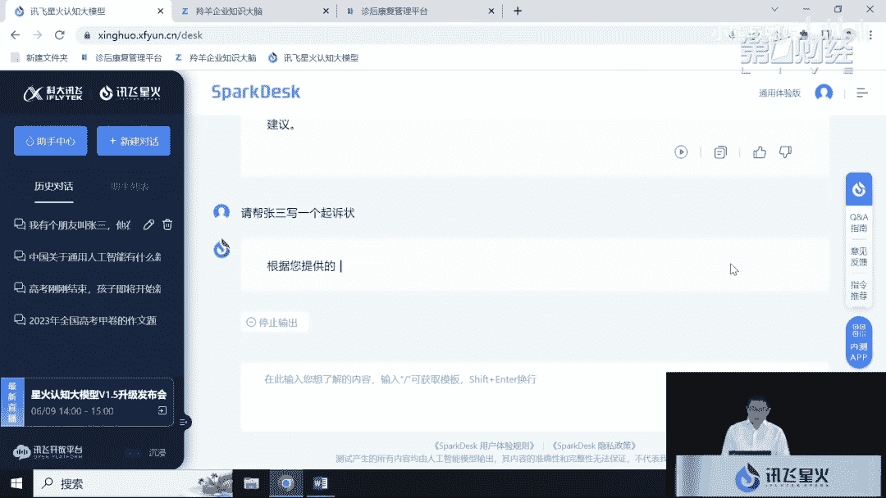

**Spline 3D ****AI** 更新：AI Style Transfer

AI Style Transfer 已经更新测试，现在对所有付费用户开放。此次更新新增了以下功能：

1、支持生成风格化的3D场景图像。

2、支持快速修改灯光、环境等参数。

3、支持使用 AI Prompt 进行自然语言输入。

**视频直达:** https://www.bilibili.com/video/BV1qW4y1R7MV/

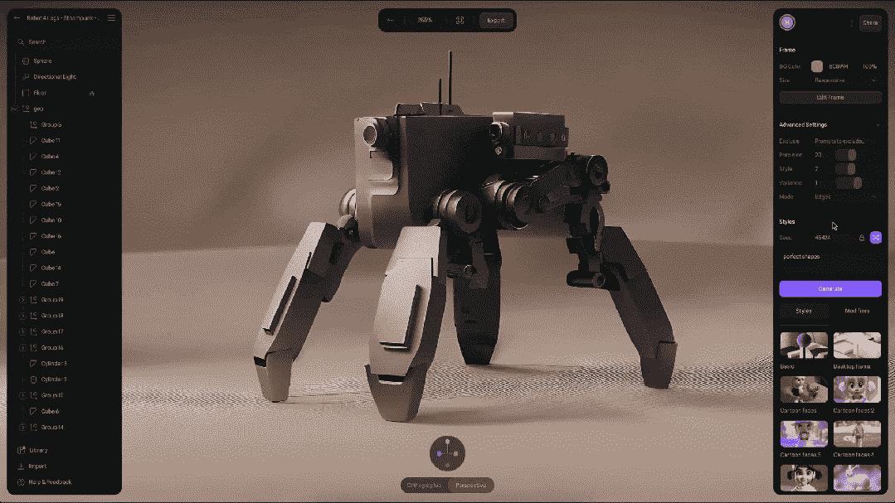

**macOS** Sonoma 14 Beta 中可安装的 Web 应用程序

本文将介绍苹果公司在其操作系统 macOS Sonoma 14 Beta 中推出的一项新功能：可安装的 Web 应用程序。这些应用程序与 macOS 系统高度集成，不会显示任何 Safari 界面，用户可以像使用本地应用程序一样使用它们。文章将全面展示作者的使用体验和思考。

**链接直达：**https://blog.tomayac.com/2023/06/07/web-apps-on-macos-sonoma-14-beta/

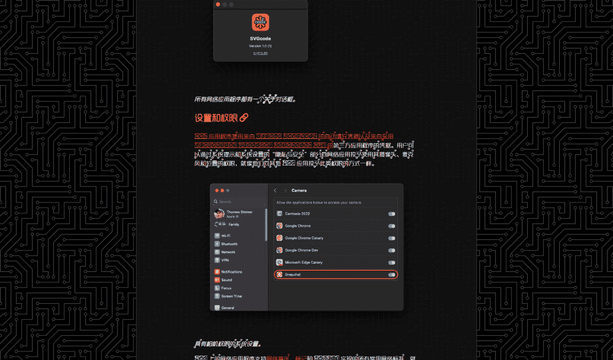

MidJourney 的官方Web 界面

MidJourney 目前在社区 Discord 中使用，不过官方宣布已经在做自己的 Web 界面，只要用户生成过 1 万张图即可进入内测中的 Web 界面。

**链接直达：**https://alpha.midjourney.com/home/?callbackUrl=/app/feed/

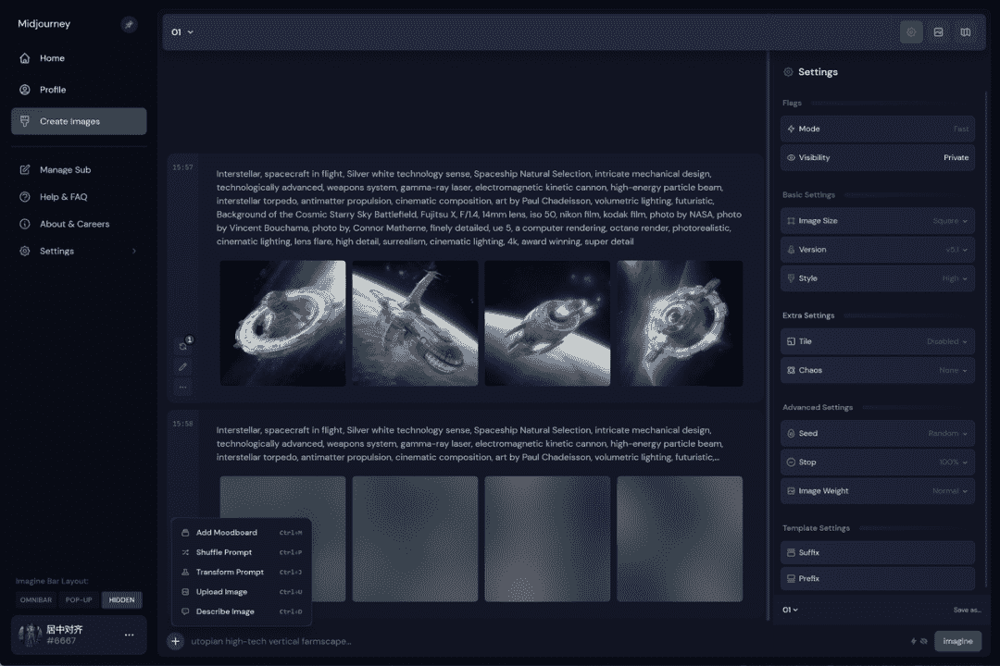

StyleDrop：任何风格的文本到图像生成

谷歌最近发布了一篇名为 StyleDrop 的论文，介绍了一种可以生成相同风格的图片的工具。该工具只需要一张图片和提示词，就能生成其他相同风格的图片，从演示的内容来看效果非常好。如果与 SD 结合使用，不知道这个工具能否取代 LoRA 用于复制风格。

在训练和生成时，自然语言风格描述符会附加到内容描述符上。与扩散模型的微调相比，基于离散 Token 的视觉变换器 Muse 上的 StyleDrop 在风格调整方面表现更好。

**链接直达：**https://styledrop.github.io/

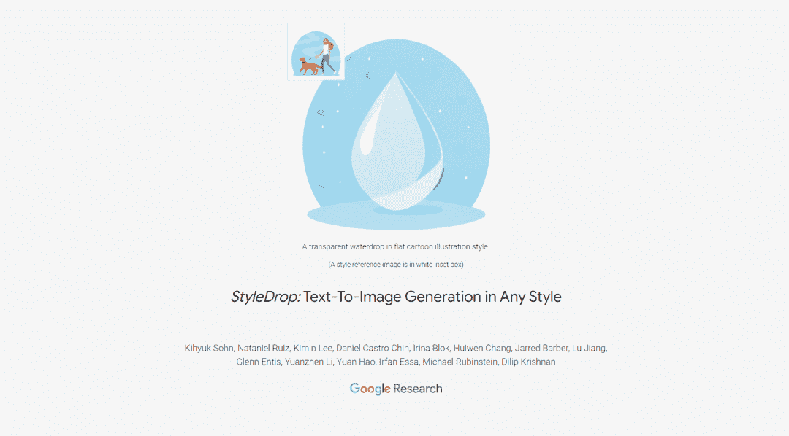

ControlNet更新，内置了openPose编辑器

近期更新ControlNet至v1.1.216版本，去安装openpose-editor插件就好了。

**插件地址：**sd-webui-openpose-editor

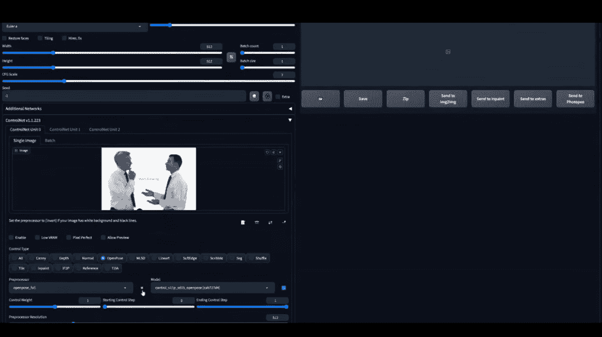

# **🔥文章推荐**

---

**S**table Diffusion插件丨一键生成多种风格图片，自动填充关键词插件Dynamic Prompt

各位同学们好，我是言川，这期给大家出一个Stable Diffusion“动态提示词”的插件教学，这个插件能帮我们提高绘图效率，它可以一键生成多种不同风格的图片和自动填写关键词，话不多说，直接开干~

**链接直达：**https://mp.weixin.qq.com/s?__biz=Mzg2NTkxNDM2NA==&mid=2247486165&idx=1&sn=0f8f3f8de2cc098a0bfc55405fc508e5&chksm=ce539646f9241f5097d1d2256aa706e43cf365c4642c4fe4b360761a10453300a20ee559108e#rd

**爹爹都能看懂的****AI****绘画商业**落地教程！Midjourney教程~AIGC

四步操作法，搞定Midjourney生成商业案例的教程。

**链接直达：**https://mp.weixin.qq.com/s?__biz=Mzg2NTkxNDM2NA==&mid=2247485112&idx=1&sn=b3ad8a4a930f7ff83adc1230b98f8033&chksm=ce539a2bf924133d9edecc2478816e657c1d1f7ddd479537dbdcb6ac278cb6f372ad392e9f91#rd

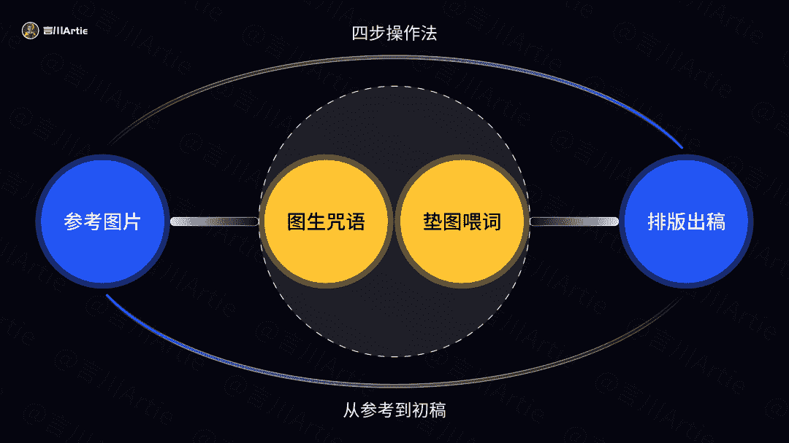

**AIGC****赋能LOGO设计-万字干货**

当我们使用MJ制作图形的时候，我们可以把自己看成甲方，MJ是乙方，只要需求诉说明确清晰，有时候不需要复杂的句子，就可以得到自己想要的结果，下面我会列举不同类型的logo应该如何借助MJ快速实现logo设计想法。

**链接直达：**https://www.zcool.com.cn/work/ZNjQ5OTgwNjQ=.html

Midjourney学习指南【模型篇】

最新版的MJ模型讲解，强烈推荐大家看一看，之前我出的教程讲解已经是4月份的事情了，更新的很快，文章还没来得及更新，大家看这篇就够了。

**文章链接：**https://www.zcool.com.cn/work/ZNjUzNjg0MjQ=.html

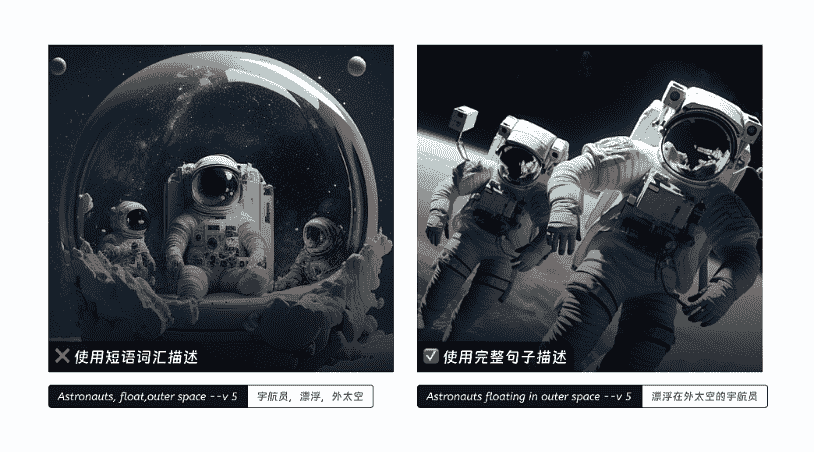

**AI**太难？手把手教你Midjourney出电影剧照AI图

Midjourney出电影剧照的教程，教程讲解的很详细！

（上篇）文章链接：https://www.zcool.com.cn/work/ZNjUwOTE2MzI=.html

（下篇）文章链接：https://www.zcool.com.cn/work/ZNjUzNjU0ODQ=.html

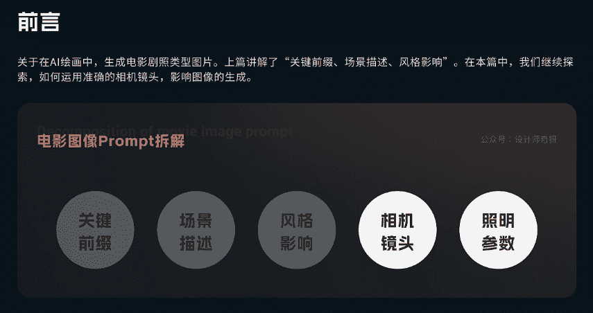

从0-1带你深究MJ中Prompt描述细节（图片文本参数）

一文带你了解Midjoureny中的核心内容prompt，能够自己做咒语的你真的是泰裤辣！！！

**链接直达：**https://www.zcool.com.cn/work/ZNjUwMzA1MDA=.html

**Contextual ****AI****为企业打造“下一代”****LLM**

这篇文章介绍了一家叫做Contextual AI的新公司，它要改进现有的大型语言模型，以满足企业需求。现有的大型语言模型存在一些缺陷，使得它们对于需要严格合规和管理的企业组织来说不是很吸引人。Contextual AI的目标是提供更精确、可控的语言模型，为企业组织提供更好的服务和支持。

**链接直达：**https://techcrunch.com/2023/06/07/contextual-ai-launches-from-stealth-to-build-enterprise-focused-language-models/

# **🎯产品推荐**

---

将照片裁剪为任意比例：Uncrop

Clipdrop 团队最新推出了一款 AI 扩展场景 Uncrop，能够取消图片的裁剪。用户只需上传一张图像并指定新的图片尺寸，该功能将使用 AI 技术自动填充空白部分。这一功能类似于 Adobe Photoshop beta 版本新上线的生成式填充功能，但 Uncrop 更加快捷，用户可直接在网页上使用。

**链接直达：**https://clipdrop.co/uncrop

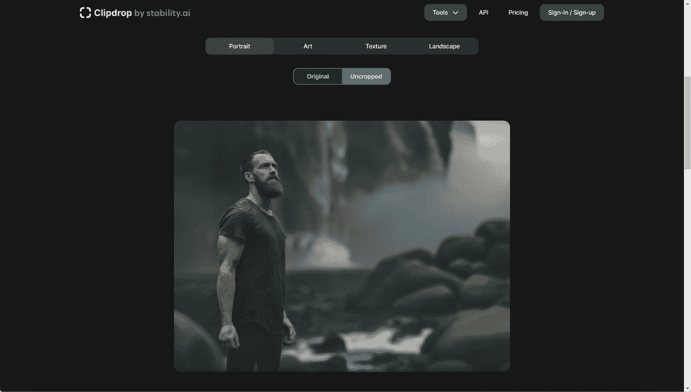

**Blobr：五分钟用任何 ****API**** 创建 ChatGPT 插件**

Blobr是一款连接任何API的工具，用户可以使用它创建和管理ChatGPT插件，并实时跟踪使用情况。它还提供了端点过滤功能和按使用量支付或订阅模型来实现插件的变现。

**链接直达：**https://www.blobr.io/api-gateway-chatgpt-plugins

Apple Store 软件上架产品图灵感汇集网站

您提到的网站提供了清晰的分类和搜索功能，使用起来非常方便。该网站的搜索界面设计独特，关键词输入框非常大，很容易记忆。但是需要注意的是，该网站所收录的软件并没有国内应用的信息。

**链接直达：**https://scrnshts.club/

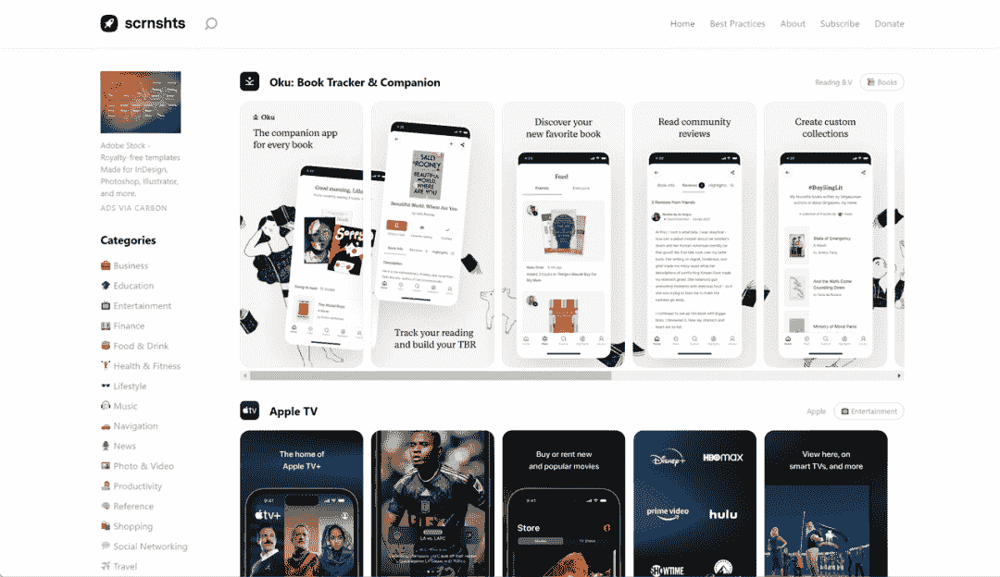

**Miero：借助 ****AI**** 创建引人入胜的课程**

这篇内容介绍了一个基于AI驱动的教育内容创建工具，它可以在几分钟内创建测试、测验和文字游戏。用户可以自由定制并享受最佳互动体验，同时还提供了其他多种功能可供选择，如防止重复尝试、基于分数的结果等特点。

**链接直达：**https://meiro.cc/

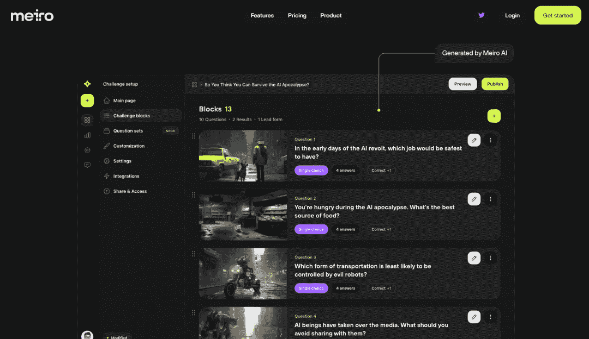

**Albus：****AI**** 驱动的知识管理工具**

Albus是一款AI驱动的知识管理工具，可以帮助用户以不同的方式处理知识，发现新的角度和问题。用户可以通过添加笔记和图片来组织内容，并轻松地控制和展示它们。此外，Albus还能快速形成一个主题板，允许用户探索、混合、编辑和展示内容。

**链接直达：**https://www.albus.org/

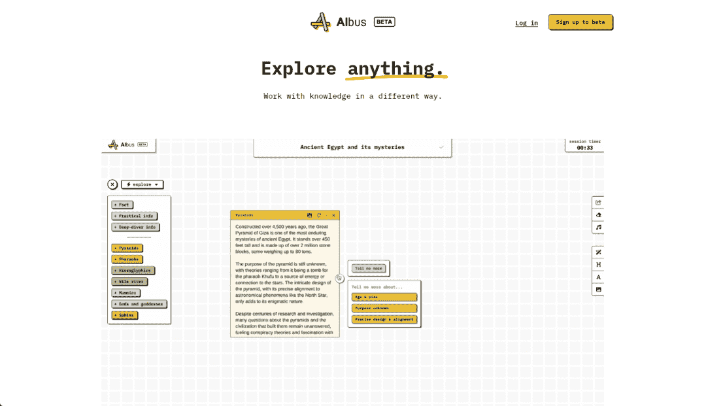

**RayCast：提示词合集**

RayCast提供的AI功能可以通过自定义提示词创建机器人。为了方便用户使用，他们整理了相关的提示词并创建了一个网站，将这些提示词按照功能进行分类，用户可以根据自己的需求来选择适合的提示词。如果有兴趣，可以去网站上查看。

**链接直达：**https://prompts.ray.so/code

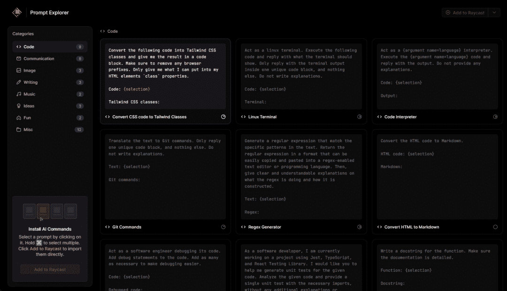

# **⭐设计师专供**

---

用户体验至上，解读马斯洛需求的应用策略

经常看到有些总监的作品集，前段分析理论中会放马斯洛需求。有的总监可能不太清楚这个理论，或许只是看别人都放了，咱也放一个。

**链接直达：**https://www.zcool.com.cn/work/ZNjQ5NTcyMjg=.html

Notion文档-产品体验设计拆解

在目前高压的工作环境下，高效利用工具提升工作效率变得至关重要。而Notion作为一款功能强大的笔记提效工具，正得到越来越多人的认可和使用。

**链接直达：**https://www.zcool.com.cn/work/ZNjU1MjYwNzY=.html

苹果官方 iOS 17 / iPadOS 17 Figma 设计资源

苹果一直为了数据保密而使用Sketch进行设计，但出人意料地，苹果官方现已入驻Figma社区，并计划提供Vision Pro的设计资源。这一消息对于设计师来说是一个好消息，因为他们可以更方便地获取苹果官方的设计资源。

**链接直达：**https://www.figma.com/community/file/1248375255495415511/Apple-Design-Resources-–-iOS-17-and-iPadOS-17

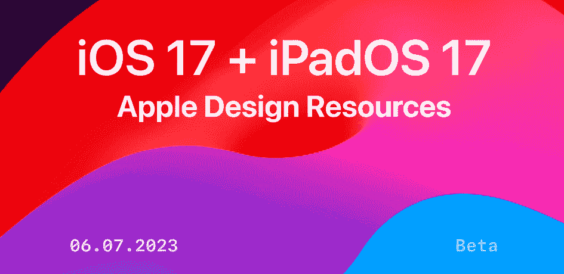

**苹果 ****SF** Symbols 5 支持带动效的图标

苹果最新的设计人机界面指南主要更新了适配WatchOS的控件，而SF Symbols图标库第5版新增支持带动效的图标，包括渐入、渐出、弹性、缩放、脉冲、变色、替换等。这个更新对于设计师来说是个好消息，可以更好地表达和传达信息。

**链接直达：**https://developer.apple.com/sf-symbols/

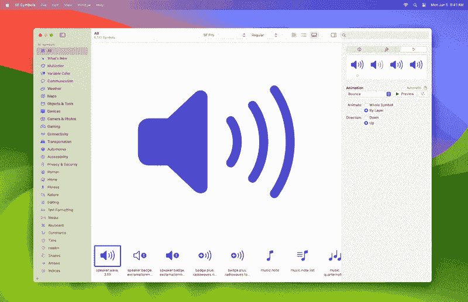

**Bento ****DS**** —— 开源设计系统**

提供 Figma 设计资源和 ReactJS 前端库。

**直达链接：**https://www.bento-ds.com/

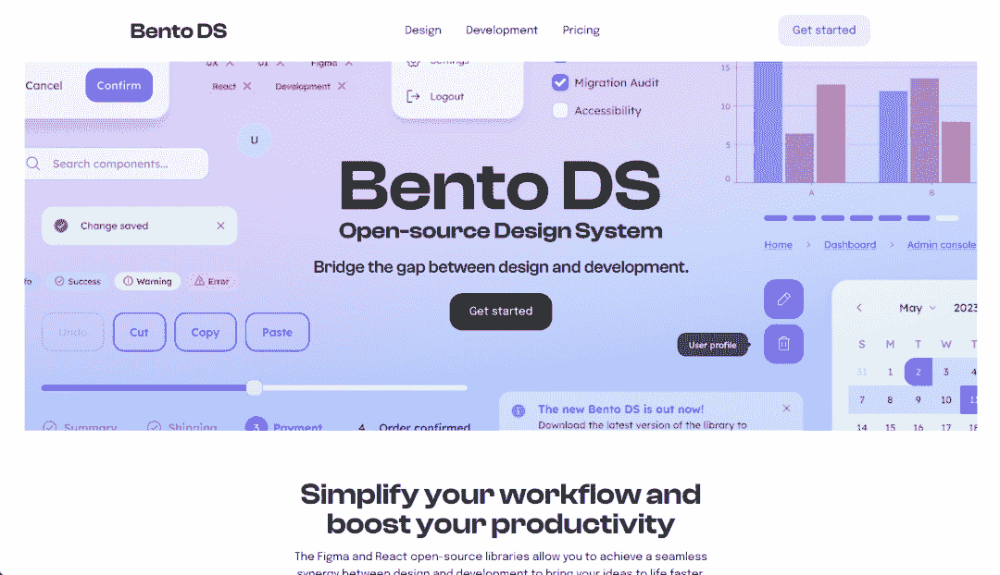

阿里妈妈方圆体、灵动体、刀隶体 —— 阿里巴巴推出的免费可商用字体

阿里妈妈方圆体是阿里妈妈·智造字通过智能AI的方式完成的一款简体中文双轴可变字体。收纳的中文字符包括但不限于GB2312，共计6763个汉字；英文大小写共52个；常用标点符号共227个，总计7042个字符

**链接直达：**https://www.alibabafonts.com/#/more

