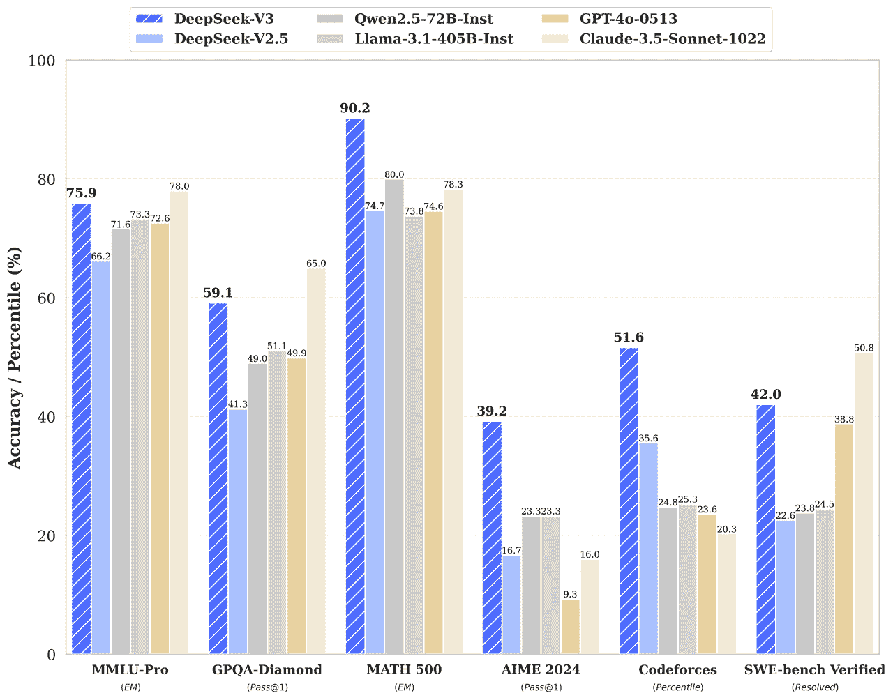
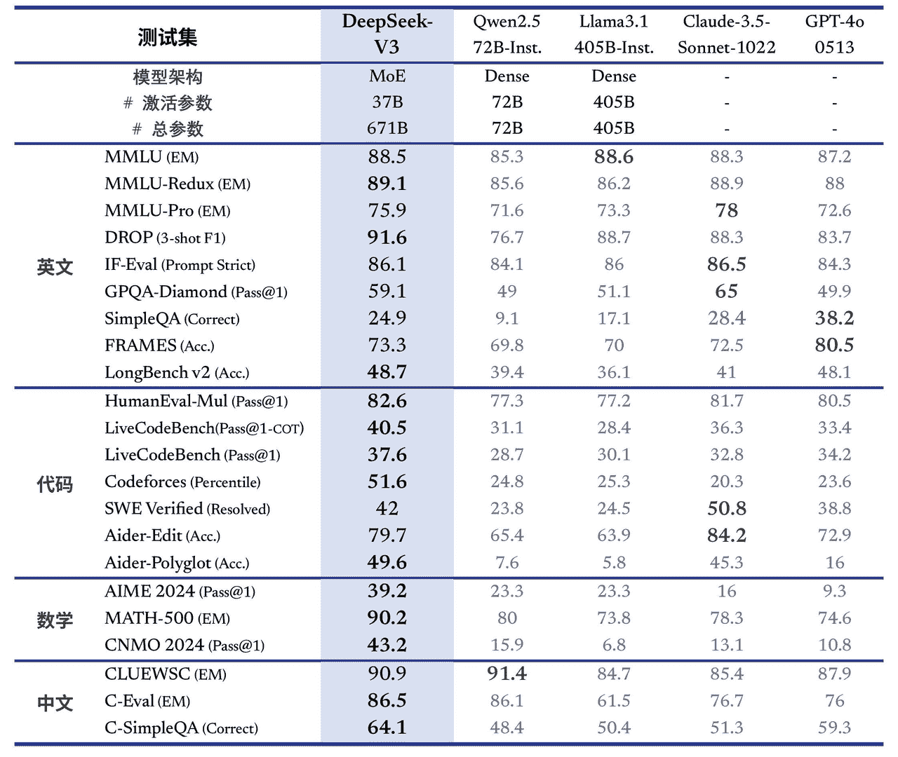
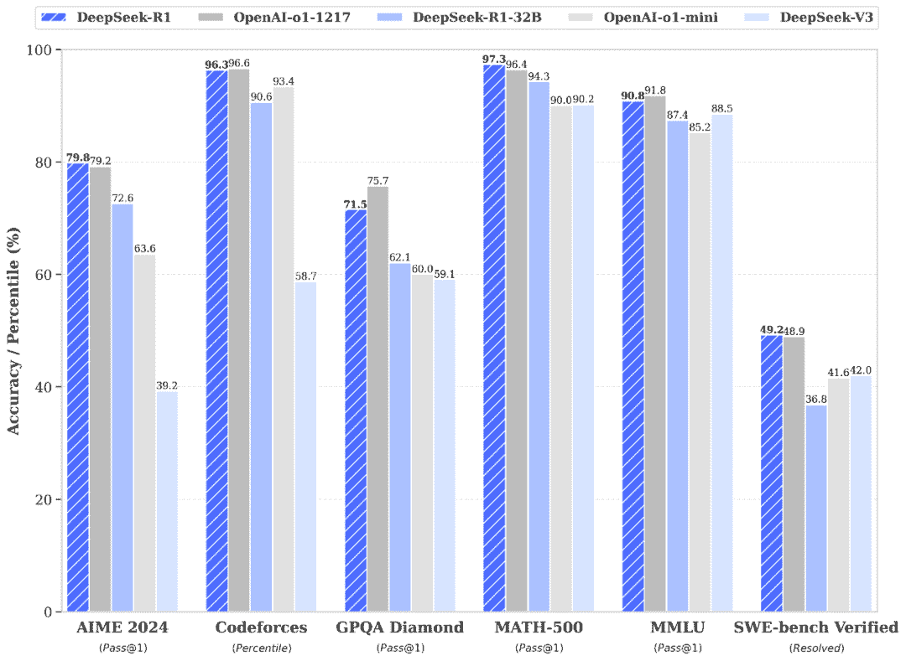
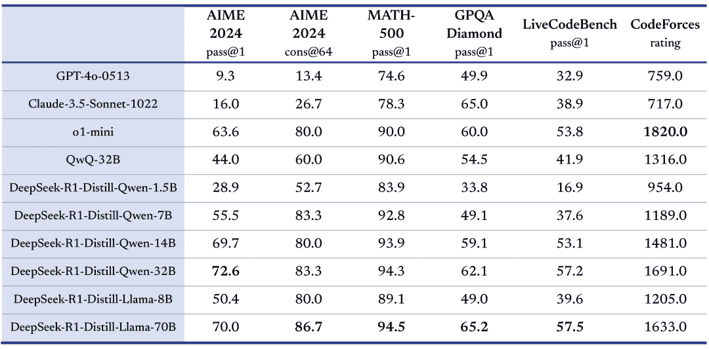
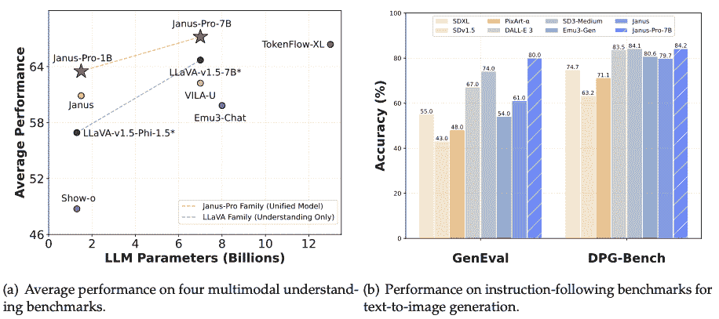
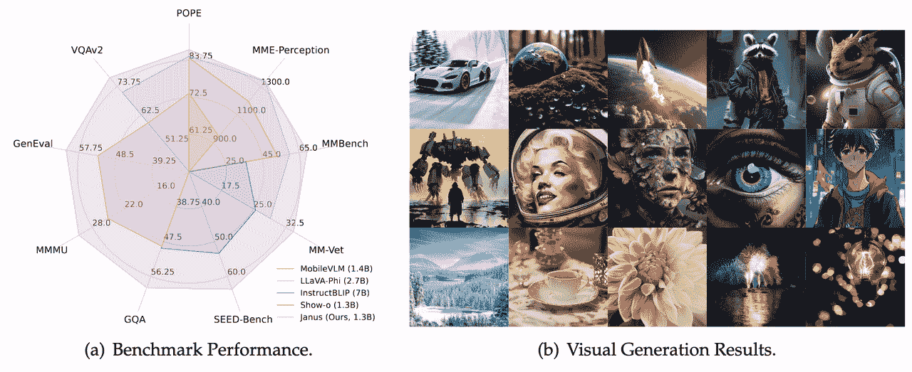
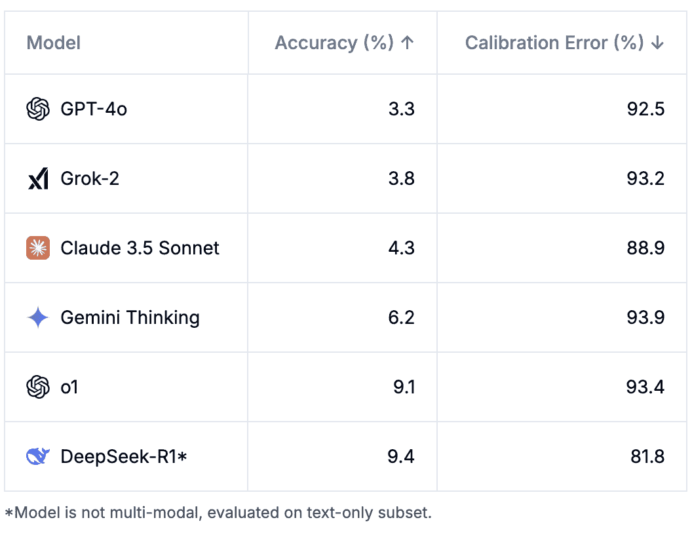
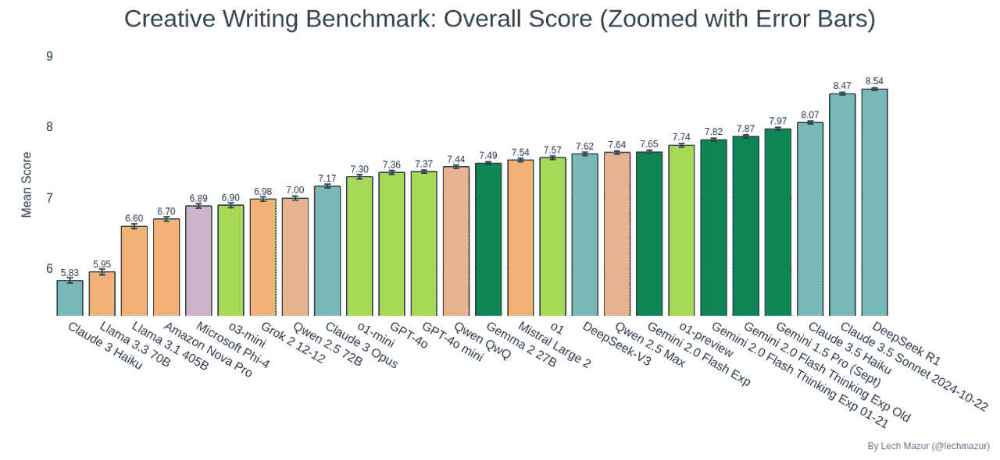

# 测评成绩

> 来源：[https://xcn2d971vuw4.feishu.cn/docx/K95XdQLkcoJlXQxiCpoclVbXnih](https://xcn2d971vuw4.feishu.cn/docx/K95XdQLkcoJlXQxiCpoclVbXnih)

# 官方成绩

## DeepSeek V3

## DeepSeek R1

## DeepSeek Janus-Pro

# HLE

https://agi.safe.ai/

# ChatBot Arena

https://lmarena.ai/

# Artificial Analysis

https://artificialanalysis.ai/

# 创意写作测评

https://github.com/lechmazur/writing/tree/main

DeepSeek R1 位居第一：

