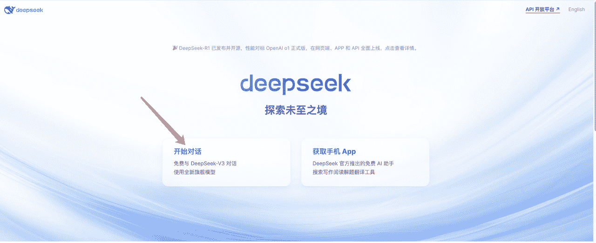
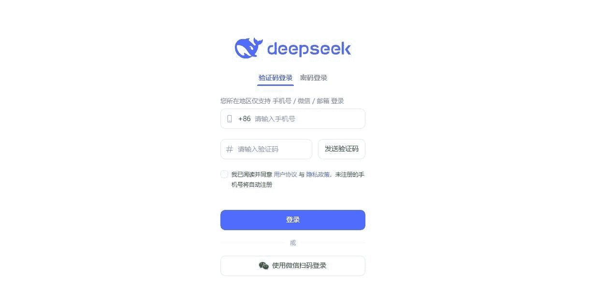
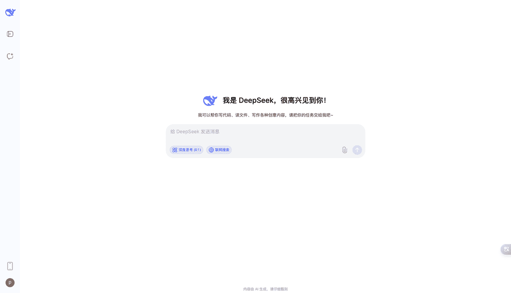
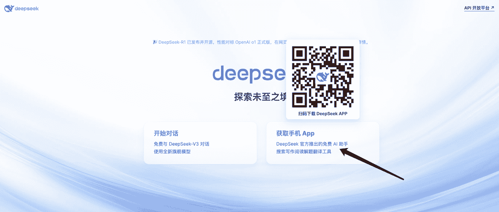
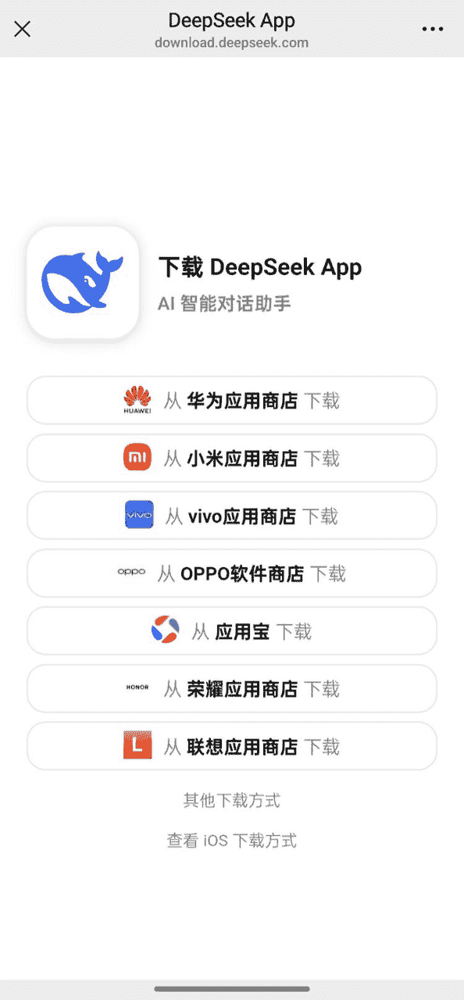

# 共创资料中转站

> 来源：[https://xcn2d971vuw4.feishu.cn/docx/Wdd0dwtstoTqthxSAnMcoVu3nid](https://xcn2d971vuw4.feishu.cn/docx/Wdd0dwtstoTqthxSAnMcoVu3nid)

> 这个文档开放了编辑权限，欢迎大家分享高质量内容，我们会视情况整理到其他文档中。

> 如果您希望获取其他文档的编辑权限，可以在讨论组中加群申请。

这个文档总结了DeepSeek的相关文档以及使用方法，资料还在不断更新中，

雪球上的DeepSeek相关公司研究：一文了解DeepSeek，附重点企业，你一定要看!

# 官方地址

DeepSeek官网：https://www.deepseek.com/

DeepSeek Github主页：https://github.com/deepseek-ai

DeepSeek HuggingFace主页：https://huggingface.co/deepseek-ai

DeepSeek X主页https://x.com/deepseek_ai

幻方技术博客：https://www.high-flyer.cn/blog/

幻方量化首页：https://www.high-flyer.cn/

# DeepSeek使用方法

## 电脑端

官网地址：[点击进入](https://www.deepseek.com/)

进入官网后，点击“开始对话”

之前从未登录过的用户需要进行登陆，使用手机号、微信或者邮箱登陆即可。

登陆成功后就可以开始使用DeepSeek了。

## 手机端

进入DeepSeek官网后，将鼠标移动至获取手机APP处，扫描弹出的APP下载二维码

然后选选择对应的下载渠道即可。

# 官方提示词案例库

入口：https://api-docs.deepseek.com/prompt-library/

案例1: 结构化输出

案例2:中英翻译专家

## DeepSeek越狱提示词

# 成果及发布时间

DeepSeek V1

DeepSeek V2

DeepSeek V3

https://huggingface.co/deepseek-ai

https://github.com/deepseek-ai/DeepSeek-V3

https://github.com/deepseek-ai/DeepSeek-V3/blob/main/DeepSeek_V3.pdf

DeepSeek R1（2025年1月20日）：

https://huggingface.co/deepseek-ai/DeepSeek-R1

https://github.com/deepseek-ai/DeepSeek-R1/blob/main/DeepSeek_R1.pdf

DeepSeek Janus-Pro

https://github.com/deepseek-ai/Janus?tab=readme-ov-file

# 国外评价

Jim Fan. https://x.com/DrJimFan/status/1882799254957388010

LeCun, Y. (2025, January 25). To people who see the performance of DeepSeek and think. LinkedIn.  https://www.linkedin.com/business-manager-api/bzmEnterpriseAccessCookie/posts/yann-lecun_to-people-who-see-the-performance-of-deepseek-activity-7288591087751884800-I3sN

Marcus, G. (2025, January 27). The race for "AI Supremacy" is over — at least for now. Substack.  https://garymarcus.substack.com/p/the-race-for-ai-supremacy-is-over

Meta员工匿名爆料. Blind https://www.teamblind.com/post/Meta-genai-org-in-panic-mode-KccnF41n/

# 用户案例

推分享的几个应用：https://x.com/0xCheshire/status/1883706730179449009

API 开放平台 https://platform.deepseek.com/

API 价格 https://api-docs.deepseek.com/zh-cn/quick_start/pricing/

# 参考资料

暗涌Waves. (2023年05月24日). 疯狂的幻方：一家隐形AI巨头的大模型之路.  https://mp.weixin.qq.com/s/Cajwfve7f-z2Blk9lnD0hA

暗涌Waves. (2024年07月17日). 揭秘DeepSeek:一个更极致的中国技术理想主义故事.  https://mp.weixin.qq.com/s/r9zZaEgqAa_lml_fOEZmjg

腾讯科技 郝博阳. (2024年12月31日). 省钱也是技术活：解密DeepSeek的极致压榨术. .https://mp.weixin.qq.com/s/_1Zbfi2evLE7-Dn4NLVHOw