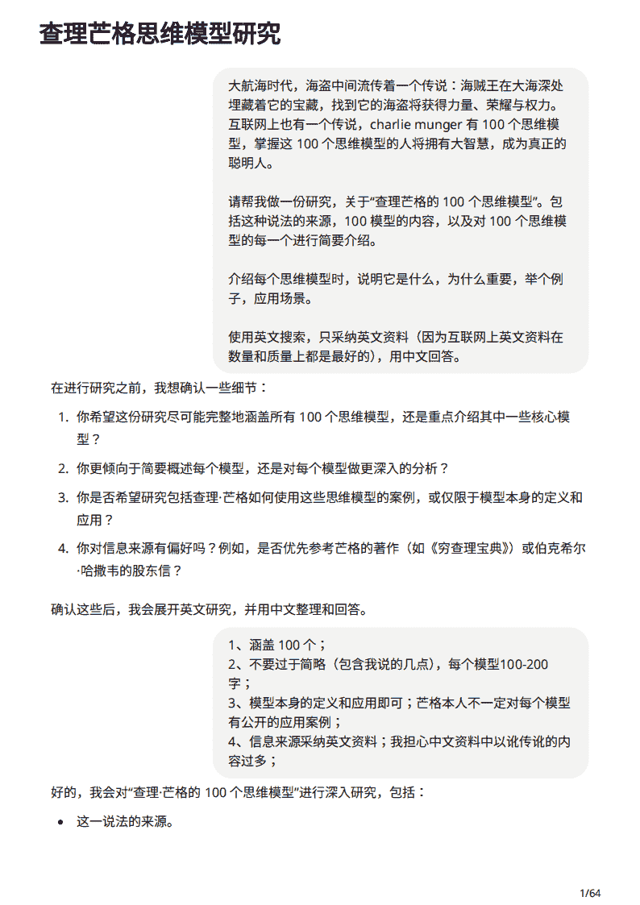
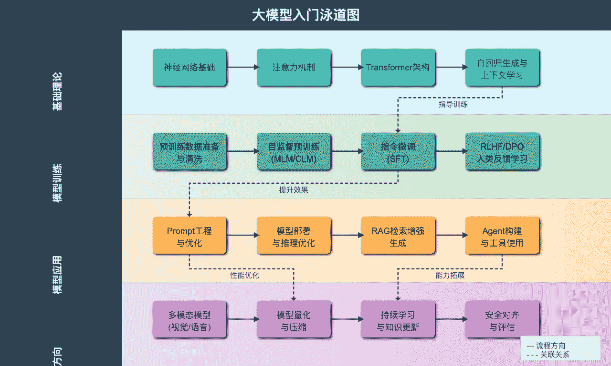
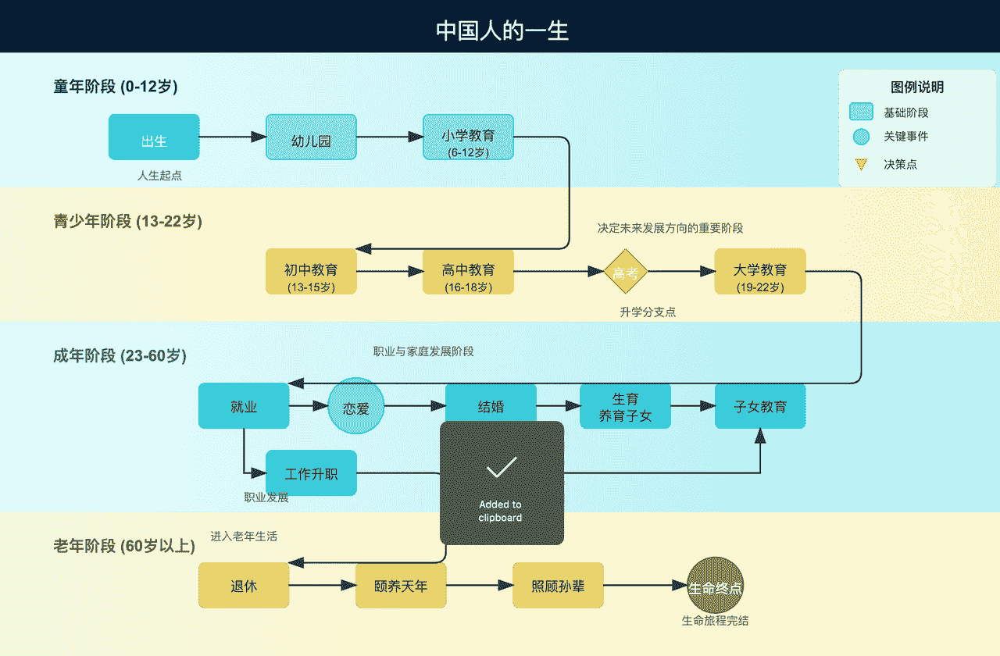

# 延伸阅读资料

> 来源：[https://xcn2d971vuw4.feishu.cn/docx/GA9ed4kRTobSn2xJZsucEntJnXb](https://xcn2d971vuw4.feishu.cn/docx/GA9ed4kRTobSn2xJZsucEntJnXb)

# OpenAI发布DeepResearch使用案例

背景介绍：这是一个可以做深度研究报告撰写的AI智能体，由大模型+网页读取+代码功能组合而来。

下面是一个用户分享的案例。

**访问途径1**:适合可以访问ChatGPT的用户

https://chatgpt.com/share/67a17492-d304-8007-aef0-20a2ac406d88

**访问途径2**:已下载为pdf版本，可以直接访问



[查理芒格思维模型研究.pdf](https://internal-api-drive-stream.feishu.cn/space/api/box/stream/download/all/FTkjbe3M8ovEMjxLV5FcAGJYnlg)

# Claude Sonnet 3.7

这是推特一个大佬分享的Claude Prompt，它可以直接在Claude进行SVG格式的在线渲染，非常强大，只需要修改最后面的特定需求即可。

DeepSeek也可以做类似的事情，只不过格式只支持HTML。

```
```
请创建一个SVG格式的泳道图(Swimlane Diagram)，需要满足以下规范：
1. 基础布局规范：
a) 尺寸设置：
- 根据泳道数量和复杂度确定合适的viewBox尺寸
- 泳道宽度根据内容量动态调整，但保持成比例
- 预留适当的顶部标题区域（建议占总高度的5-10%）
- 确保足够的图形间距和留白
b) 视觉分层：
- 使用渐变或纯色背景区分泳道
- 标题区域使用深色背景突出
- 泳道之间使用明确的分割线(建议0.5-1px)
- 图形元素层级要高于背景
2. 连接点位置规范：
a) 不同形状的标准连接点：
矩形连接点：
- 水平：左右边的中点 (x ± width, y + height/2)
- 垂直：上下边的中点 (x + width/2, y ± height)
圆形连接点：
- 四个主要位置：0°, 90°, 180°, 270°
- 计算公式：
  * 右：(cx + r, cy)
  * 左：(cx - r, cy)
  * 上：(cx, cy - r)
  * 下：(cx, cy + r)
菱形连接点：
- 四个顶点
- 或各边中点
b) 连接点注释格式：
&lt;!-- connection-points
    top: x,y
    right: x,y
    bottom: x,y
    left: x,y
--&gt;
3. 连接线设计规范：
a) 基本原则：
- 优先使用直线连接
- 避免线条交叉
- 保持45°或90°的转角
- 遵循从左到右、从上到下的流向
b) 连接策略：
- 同泳道：优先垂直连接
- 跨泳道：水平或折线连接
- 复杂路径：使用正交连接线
c) 特殊情况处理：
- 不同大小图形：保持中点对齐
- 避让其他元素：使用折线或贝塞尔曲线
- 多条交叉线：调整路径或使用桥接
4. 图形布局规范：
- 保持适当的垂直和水平间距
- 图形大小要协调统一
- 确保视觉平衡和对称
- 预留足够的连接线空间
5. 文字样式规范：
- 图形内文字居中对齐
- 标题文字要醒目
- 字体大小要适中
- 确保良好的可读性
6. 可视化增强：
a) 颜色规范：
- 背景色使用低饱和度色彩
- 重要节点使用高对比度色彩
- 相关元素使用相近色系
- 确保颜色具有足够对比度(建议&gt;4.5:1)
b) 视觉层次：
- 主要流程突出显示
- 次要信息适当弱化
- 使用阴影或高光突出重点
- 区分前景和背景层次
7. 注释和标识：
a) 必要注释：
- 关系类型标注
- 重要节点说明
- 流程方向指示
- 特殊情况说明
b) 图例说明：
- 提供图形类型说明
- 说明线条样式含义
- 标注颜色代表含义
- 补充必要的业务说明
8. 最佳实践：
a) 代码组织：
- SVG元素合理排序
- 使用注释标识各部分
- 保持代码整洁有序
- 图形ID命名规范
b) 交互考虑：
- 预留悬浮效果空间
- 为可能的动画留出余地
- 考虑响应式适配
c) 性能优化：
- 复用共同的样式
- 适当使用组合（g元素）
- 避免不必要的复杂路径
请根据以上规范生成SVG代码，注意整体的美观性、专业性和清晰度。具体的样式（如颜色、尺寸、字体等）可以根据实际需求灵活调整，但要遵循上述核心原则。  请按照我的要求画一个公司底层打工狗艰难报销之路

```
```

这是我用这个Prompt做的Demo。



