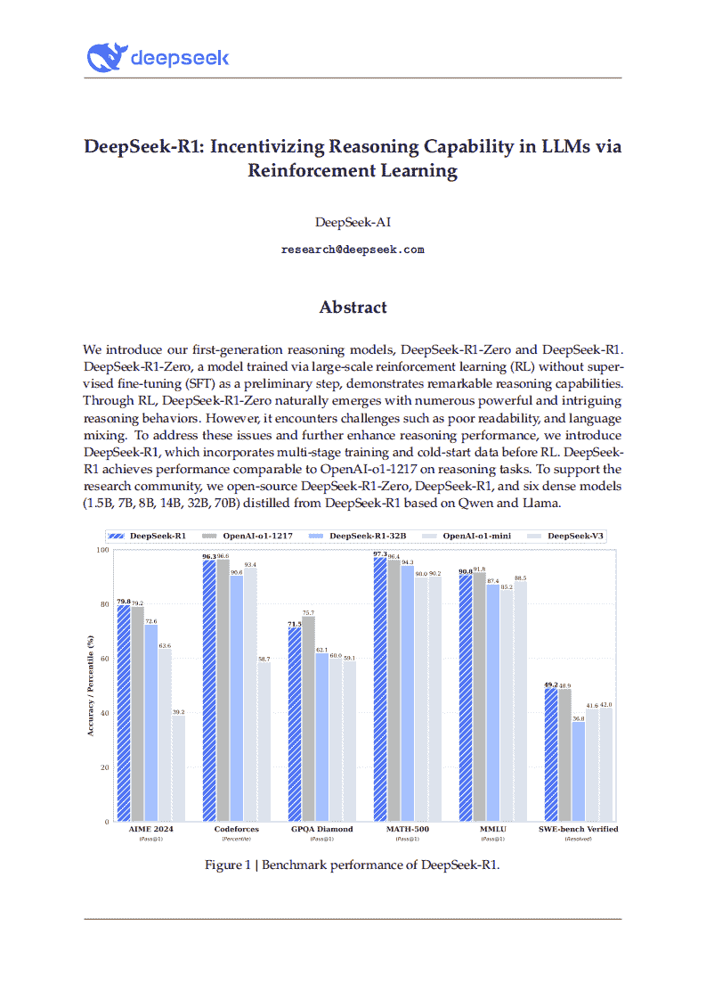
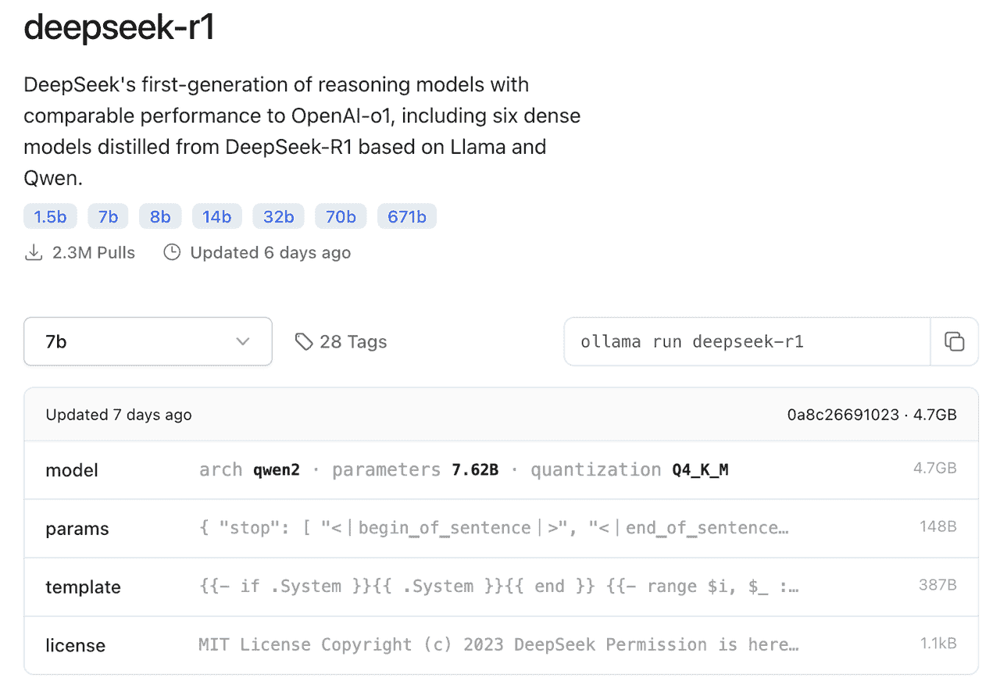

# DeepSeek 百宝箱

# DeepSeek 简介

> 来源：[https://xcn2d971vuw4.feishu.cn/docx/MQkTdrDQUoaDPXxgZuWcPKClnLd](https://xcn2d971vuw4.feishu.cn/docx/MQkTdrDQUoaDPXxgZuWcPKClnLd)

> 这里汇集了关于 DeepSeek 的全面资料，涵盖技术文档、应用指南、案例研究以及最新动态。不论您是刚接触 DeepSeek 的新手，还是深度探索的技术专家，您都能在这里找到所需的信息。

> 我们致力于打造一个开放、共享的知识平台，助力每位用户更高效地学习与应用 DeepSeek 技术。

> 知识库正在抓紧建设中，**如**果您希望贡献内容，可以通过「讨论组」或「共创资料中转站」提供内容，已开编辑权限，志愿报名编辑请联系

> 创作团队：[平凡](https://www.zhihu.com/people/jzwa)，[段小草](https://www.zhihu.com/people/loveQt)

> 简评&资讯：[🧣](https://weibo.com/u/7621278794)

> **新手上手必看**

> [最全的DeepSeek访问以及使用方法【更新到2.2号】](https://xcn2d971vuw4.feishu.cn/wiki/TDVTwON36i8obBkwBiocbxWonCd)

> 目前接入DeepSeek R1的平台

## 公司背景与成立历史

[DeepSeek](https://www.deepseek.com/)（深度求索）由梁文锋于2023年7月创立，隶属于杭州深度求索人工智[能基础技](https://www.high-flyer.cn/fund/)术研究有限公司，是幻方量化在通用人工智能（AGI）领域的战略延伸。其前身幻方量化成立于2015年，专注于量化投资，依托数学与人工智能技术，逐步成长为国内量化私募领域的“四大天王”之一，2021年管理规模突破千亿元。

2023年，[梁文锋](https://baike.baidu.com/item/%E6%A2%81%E6%96%87%E9%94%8B/65336579)宣布进军AGI领域，成立DeepSeek，致力于开发高性能、低成本的大语言模型。公司初期资金主要依赖幻方量化的支持，且未引入外部风险投资，专注于长期技术突破而非短期商业化。

# 官方地址

DeepSeek官网：https://www.deepseek.com/

DeepSeek Github主页：https://github.com/deepseek-ai

DeepSeek HuggingFace主页：https://huggingface.co/deepseek-ai

DeepSeek X主页https://x.com/deepseek_ai

幻方技术博客：https://www.high-flyer.cn/blog/

幻方量化首页：https://www.high-flyer.cn/

# 成果及发布时间

## DeepSeek V系列

HuggingFace链接：https://huggingface.co/deepseek-ai

Github链接：https://github.com/deepseek-ai/DeepSeek-V3

技术报告链接：https://github.com/deepseek-ai/DeepSeek-V3/blob/main/DeepSeek_V3.pdf

[DeepSeek_V3.pdf](https://internal-api-drive-stream.feishu.cn/space/api/box/stream/download/all/QE2obffVkoNs5Uxnl8ncWpeZn9e)

## DeepSeek R1（2025年1月20日）：

Github主页：https://huggingface.co/deepseek-ai/DeepSeek-R1

技术报告链接：https://github.com/deepseek-ai/DeepSeek-R1/blob/main/DeepSeek_R1.pdf

[DeepSeek_R1.pdf](https://internal-api-drive-stream.feishu.cn/space/api/box/stream/download/all/M2CZbjcSBofKMexTGTQcqE9Gn1c)

关键技术解读：[DeepSeek R1关键技术解读（转自Archerman Capital）](https://xcn2d971vuw4.feishu.cn/wiki/ARWzwaCyoiIRNZkZ9lKcZhabneb)

## DeepSeek Janus-Pro （2025年1月28日）

https://github.com/deepseek-ai/Janus?tab=readme-ov-file

# DeepSeek R1 阅读清单

来源：https://github.com/ninehills/blog/issues/121

+   论文

+   [DeepSeek R1](https://github.com/deepseek-ai/DeepSeek-R1/blob/main/DeepSeek_R1.pdf)：DeepSeek R1 本体论文，写的引人入胜。

+   [Kimi K1.5](https://arxiv.org/pdf/2501.12599v1)：Kimi K1.5 推理模型的思路和 R1 类似，在数据和奖励函数上有更多的细节。

+   [DeepSeek Math](https://arxiv.org/pdf/2402.03300)：GRPO 算法的提出，GRPO 相比于 PPO 节约了 Value Model，从而降低了训练的显存要求。

+   GRPO 开源实现：主要是要支持 reward function。

+   trl grpo trainer：TRL 的 GRPOTrainer 实现，目前尚未发版，需要安装 trl 的 main 分支。

+   [veRL](https://github.com/volcengine/verl)：字节开源的 RL 实现，也支持 GRPO reward function。

+   R1 复刻项目、数据集

+   [open-r1](https://github.com/huggingface/open-r1/)：**【重点】**包括数据合成、SFT、GRPO RL 的代码。

+   [TinyZero](https://github.com/Jiayi-Pan/TinyZero)：在简单的类24点问题上复刻 R1 RL 范式。

+   [SkyT1](https://github.com/NovaSky-AI/SkyThought)：蒸馏的 QwQ 的数据实现的 o1-like 模型。

+   [HuatuoGPT-o1](https://github.com/FreedomIntelligence/HuatuoGPT-o1)：医学领域复刻 o1（开放代码、数据、论文和模型），但是用的还是 reward model，效果提升很少。可以用 R1 RL 范式看看能否有明显提升。

+   [simpleRL-reason](https://github.com/hkust-nlp/simpleRL-reason)：**【重点】** 在 8k MATH 数据集上复刻 R1-Zero 的范式

+   open-r1-multimodal：R1 多模态的复刻项目

+   [open-thoughts](https://github.com/open-thoughts/open-thoughts)：**【重点】** 最成熟的 R1 复刻项目，已经发布了 Bespoke-Stratos-17k dataset 和 OpenThoughts-114k dataset 项目，仅经过 SFT 即可以逼近 R1-distill 模型

+   [R1-Distill-SFT](https://huggingface.co/datasets/ServiceNow-AI/R1-Distill-SFT)：1.68M 条 R1 蒸馏数据集

+   [grpo_demo.py](https://gist.github.com/willccbb/4676755236bb08cab5f4e54a0475d6fb)：**【重点】** 基于 0.5B 模型的 RL demo，可以用来学习怎么训练。

# 国外评价

Jim Fan. https://x.com/DrJimFan/status/1882799254957388010

LeCun, Y. (2025, January 25). To people who see the performance of DeepSeek and think. LinkedIn.  https://www.linkedin.com/business-manager-api/bzmEnterpriseAccessCookie/posts/yann-lecun_to-people-who-see-the-performance-of-deepseek-activity-7288591087751884800-I3sN

Marcus, G. (2025, January 27). The race for "AI Supremacy" is over — at least for now. Substack.  https://garymarcus.substack.com/p/the-race-for-ai-supremacy-is-over

Meta员工匿名爆料. Blind https://www.teamblind.com/post/Meta-genai-org-in-panic-mode-KccnF41n/

Stratechery 的这篇万字长文全面汇总了所有与 DeepSeek 相关的问题，包括 V3 和 R1 的意义、对英伟达的影响，以及是否应当进行监管等关键议题。https://stratechery.com/2025/deepseek-faq/

# 用户案例

风格化撰写（模仿过秦论撰写）

推分享的几个应用：https://x.com/0xCheshire/status/1883706730179449009

API 开放平台 https://platform.deepseek.com/

API 价格 https://api-docs.deepseek.com/zh-cn/quick_start/pricing/

## 推荐阅读资料

暗涌Waves. (2023年05月24日). 疯狂的幻方：一家隐形AI巨头的大模型之路.  https://mp.weixin.qq.com/s/Cajwfve7f-z2Blk9lnD0hA

暗涌Waves. (2024年07月17日). 揭秘DeepSeek:一个更极致的中国技术理想主义故事.  https://mp.weixin.qq.com/s/r9zZaEgqAa_lml_fOEZmjg

腾讯科技 郝博阳. (2024年12月31日). 省钱也是技术活：解密DeepSeek的极致压榨术. .https://mp.weixin.qq.com/s/_1Zbfi2evLE7-Dn4NLVHOw

张[小珺. (2025年01月27日). 一场关于DeepSe](https://mp.weixin.qq.com/s/a7C5NjHbMGh2CLYk1bhfYw)ek的高质量闭门会：比技术更重要的是愿景. 腾讯科技. https://mp.weixin.qq.com/s/a7C5NjHbMGh2CLYk1bhfYw

## 本地部署

Ollama：https://ollama.com/library/deepseek-r1

可以自主选择从1.5B到671B的大模型。

## 集成应用

LobeChat

在沉浸式翻译中使用 DeepSeek

# DeepSeek招聘更新

boss直聘：[「深度求索招聘」-BOSS直聘](https://www.zhipin.com/gongsi/ffd531b0cbd4133f1XN92Nm0EFU~.html)

[简要](https://www.zhihu.com/question/11311350952/answer/93567844610)评价其非技术岗位「数据百晓生」：知乎