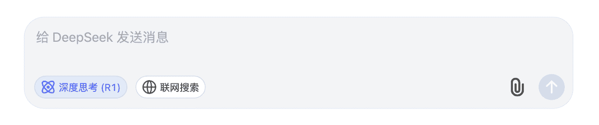
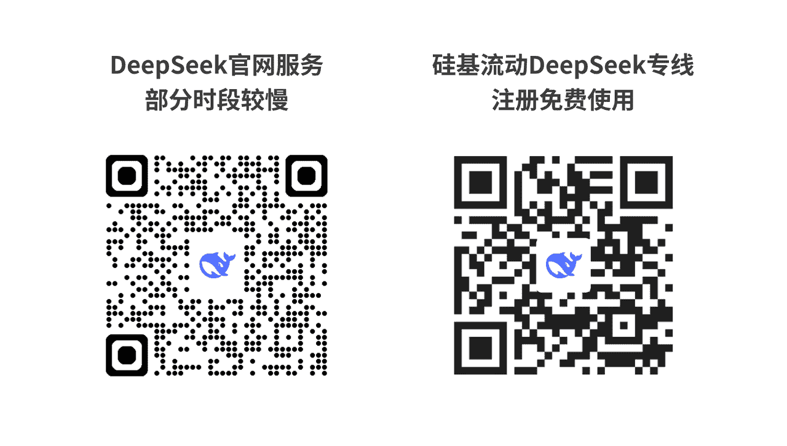

# 非技术人员300秒快速理解DeepSeek R1

> 来源：[https://yigather.feishu.cn/docx/PWwYdFAROoipOZxZfY1cL5fxn6W](https://yigather.feishu.cn/docx/PWwYdFAROoipOZxZfY1cL5fxn6W)

# Part1：认识这位"AI 优等生"

**核心特征**：会像人类一样"先想后答"

+   遇到问题时先自我提问（"用户到底想问什么？"）

+   自动回忆相关知识（"需要生物进化论知识吗？"）

+   调整回答策略（"应该用科普口吻还是学术表达？"）

**日常表现**：

✔️ 能处理"先有鸡还是先有蛋"这类哲学难题

✔️ 自动识别用户身份（学生/上班族/老人）调整回答

✔️ 解释复杂概念时会自创易懂的比喻

---

# Part2：传统 AI 的"填鸭式教育"缺陷

**

现行教育体**系：

1**️⃣ **填知识：**给 A**I 喂3000 亿字数据（相当于读完整套大英百科全书 2万次）

2️⃣ 教规矩：用标注数据训练回答格式（类似教小学生写作文模板）

**三大硬伤**：

⚠️ 只会"接龙式回答"：像背课文般机械续写

⚠️ 理解力缺失：回答"鹅是什么"可能背出"曲项向天歌"

⚠️ 创造力天花板：最高水平不超过人类标注员

---

# Part3：DeepSeek 的"自主学习方法论"

**

革命性突**破：

**🔑 双奖励**机制：

+   答案正确+1 分

+   格式规范+1 分
（类似游戏积分系统驱动 AI 自我进化）

**训练三阶段**：

1.  **学前班**：用 5000 条优质示范建立基础认知

1.  **实战营**：通过 20 万轮自我对话不断试错

1.  **毕业考**：在 100+类推理任务中验证能力

**案例对比**：

---

# Part4：RL 技术带来的质变飞跃

**

关键技术突**破：**

⚡ 纯强**化学**习：不依赖**人类**标注数据

**⚡ 思维链涌现：自动生成推理步骤

⚡ 跨领域迁移：数学推理能力可用于解决法律问题

**实测表现**：

+   在 GSM8K 数学测试中准确率提升 37%

+   处理复杂逻辑问题时思考步骤增加 5-8 步

+   可自动修正前期推理错误（类似人类的"啊，刚才想错了！"）

---

# Part5：普通人如何用好这位"AI 天才"

**实用指南**：

🔍** 提问技**巧：

+   先说背景："我要给中学生解释量子力学"

+   明确需求："请用快递小哥送餐的例子说明"

+   限定格式："用三步法总结关键点"

⚠️ **避坑提醒**：

+   避免模糊问题："说说科技发展" → 改为"分析 5G 对直播行业的影响"

+   及时纠偏："这个方向不对，请从经济角度重新分析"

+   善用追问："为什么第二步得出这个结论？"

---

# 终极未来：R1-zero 实验版 (待发布)

**

黑科技亮**点：

🌀 完全零人类指导的"野生智能体"

🌀 自发形成中英混杂的思考语言

🌀 出现"灵光乍现"式解题路径

**安全考量**：

🔒 未开放原因：可能产生不符合伦理的推论

🔒 当前方案：在开放版本中保留其推理能力，但加装"安全护栏"

---

# 🕒 300秒小结：

你已经掌握了 DeepSeek R1 的核心机密！下次遇到七大姑八大姨时，可以这样解释："它就像个会自学的天才，不需要老师填鸭教学，通过不断自我对弈就能越变越聪明！"

---

## 扫码体验 DeepSeek R1 实战演示：

