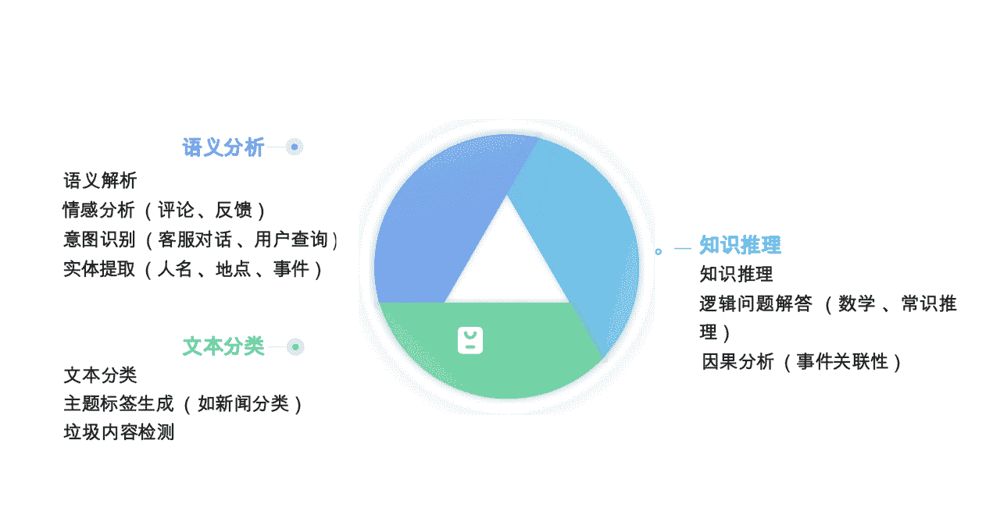

# 自然语言理解与分析

> 来源：[https://yigather.feishu.cn/docx/FUv6dRl7moG8eAxEd6vcW2ENnog](https://yigather.feishu.cn/docx/FUv6dRl7moG8eAxEd6vcW2ENnog)



### **案例 1：智能客服对话处理**

**目标**：通过对话式交互解决用户问题，需处理意图识别、上下文关联、信息检索。

---

#### **功能 1：意图识别**

**简介**：通过提问让模型自主判断用户需求类别（如退货、咨询、投诉）。

**步骤**：

1.  **输入设计**：

```
[用户问题] “我要退货，但包装拆了还能退吗？”  
[系统指令] 请分析用户需求类型：  
- 选项：售后政策咨询、物流问题、产品使用指导、其他  
- 输出格式：类型: 理由  
```

1.  **调用 API**：设置 temperature=0（确保稳定性），max_tokens=50。

1.  **解析结果**：

```
售后政策咨询: 用户询问拆封后能否退货  
```

**技巧**：

+   **提示词模板**：明确分类选项和输出格式，强制模型结构化输出。

+   **追问策略**：若结果模糊，追加提问：“请问您想了解退货条件还是退款流程？”

---

#### **功能 2：多轮对话管理**

**简介**：让模型记住上下文，避免重复提问。

**步骤**：

1.  **输入设计**（携带历史记录）：

```
[历史对话]  
用户：运费多少钱？  
客服：江浙沪地区6元，其他省份12元。  
用户：那退货呢？  
[系统指令] 请结合上下文回答用户关于退货运费的问题。  
```

1.  **调用 API**：设置 temperature=0.3（适度灵活性）。

1.  **输出结果**：

```
退货运费由买家承担，若商品存在质量问题则免运费。  
```

**技巧**：

+   **标记角色**：用 用户: 和 客服: 区分对话主体。

+   **长度控制**：限制历史对话长度（如保留最近3轮），避免 token 超限。

---

#### **功能 3：实时信息检索与整合**

**简介**：联网查询最新政策并生成回复。

**步骤**：

1.  **输入设计**：

```
[用户问题] “2024年最新的七天无理由退货规定是什么？”  
[系统指令] 按以下步骤操作：  
1. 联网搜索“2024 消费者权益保护法 七天无理由退货”  
2. 提取关键条款（如商品状态、时间限制）  
3. 用口语化语言总结  
```

1.  **调用 API**：启用 联网搜索 功能（部分平台支持插件）。

1.  **输出示例**：

```
根据最新规定，商品需保持完好且不影响二次销售，退货时间为签收后7天内，电子商品拆封后可能不适用。  
```

**技巧**：

+   **分步指令**：强制模型先检索再总结，避免编造。

+   **信源标注**：要求模型在回答中注明信息来源（如“根据**市场监管局官网**...”）。

---

### **案例 2：社交媒体舆情分析**

**目标**：分析评论情感、提取关键词、总结群体观点。

---

#### **功能 1：细粒度情感分析**

**简介**：识别文本中针对不同对象的情感（如产品好评但物流差评）。

**步骤**：

1.  **输入设计**：

```
[评论] “手机性能很强，但客服态度太差了！”  
[系统指令] 按以下格式分析：  
- 对象1: 情感倾向（积极/消极）  
- 对象2: 情感倾向（积极/消极）  
```

1.  **调用 API**：设置 temperature=0。

1.  **输出结果**：

```
- 手机性能: 积极  
- 客服态度: 消极  
```

**技巧**：

+   **分句处理**：对长文本先拆分句子再分析（如用标点分割）。

+   **情感词典**：在指令中添加关键词示例（如“差评→消极，点赞→积极”）。

---

#### **功能 2：冲突观点检测**

**简介**：发现同一文本中的矛盾表述。

**步骤**：

1.  **输入设计**：

```
[评论] “这款软件功能强大，但实在太难上手了。”  
[系统指令] 是否存在观点冲突？若有，说明矛盾点。  
```

1.  **调用 API**：设置 temperature=0.2。

1.  **输出结果**：

```
冲突存在：功能强大（正面） vs 难上手（负面）  
```

**技巧**：

+   **矛盾词库**：在指令中列举常见矛盾词（如“但是/然而/可惜”）。

+   **量化评分**：要求输出冲突强度评分（如1-5分）。

---

#### **功能 3：观点总结报告**

**简介**：从1000条评论中生成分主题总结。

**步骤**：

1.  **输入设计**：

```
[数据] 1000条评论（截取前10条示例）  
[系统指令] 执行以下任务：  
1. 归纳3-5个主要讨论主题  
2. 统计各主题出现频率  
3. 每主题用一句话总结典型观点  
```

1.  **调用 API**：设置 max_tokens=500 确保完整输出。

1.  **输出示例**：

```
1. 性价比（35%）：多数用户认为价格高于同类产品  
2. 续航能力（28%）：电池耐用性获一致好评  
3. 售后服务（20%）：投诉响应速度慢  
```

**技巧**：

+   **分块处理**：若数据过大，先按100条/组分批分析再合并。

+   **频率估算**：要求模型用“高频/中频/低频”替代具体数字，避免误差。

---

### **案例 3：长文本摘要与解析**

**目标**：压缩长文本并提取结构化信息。

---

#### **功能 1：会议纪要生成**

**简介**：从2小时录音转写的文本中提取关键结论。

**步骤**：

1.  **输入设计**：

```
[文本] 会议记录（约5000字）  
[系统指令] 按以下格式输出：  
- 议题1: 决策内容 + 负责人  
- 议题2: 决策内容 + 负责人  
```

1.  **调用 API**：设置 temperature=0.1（高准确性）。

1.  **输出示例**：

```
- 预算分配: 增加研发部投入至200万（负责人: 张某）  
- 项目排期: 推迟A项目至Q2（负责人: 李某）  
```

**技巧**：

+   **角色标注**：提前在会议记录中用【主持人】、【财务部】等标记发言者。

+   **术语表**：提供专业词汇解释（如“Q2=第二季度”）。

---

#### **功能 2：合同风险点排查**

**简介**：识别法律文书中的潜在风险条款。

**步骤**：

1.  **输入设计**：

```
[合同文本] 甲乙双方协议内容...  
[系统指令] 按以下维度分析风险：  
1. 责任归属是否模糊  
2. 违约条款是否合理  
3. 知识产权声明是否完备  
```

1.  **调用 API**：启用 深度思考 模式（如多次推理）。

1.  **输出示例**：

```
风险点1: 未明确数据泄露时的责任方（第5条）  
风险点2: 违约金比例超出行业标准（第8条）  
```

**技巧**：

+   **法条关联**：要求模型对比《民法典》相关条款。

+   **红线标记**：用 ⚠️ 符号突出高风险内容。

---

### **通用核心技巧**

1.  **提示词设计三段式**：

```
[背景] + [任务] + [输出要求]  
（例：“你是一名经验丰富的客服（背景），请回答用户问题（任务），用不超过50字且分点说明（要求）”）  
```

1.  **参数设置参考**：

+   稳定性场景：temperature=0~0.3

+   创意场景：temperature=0.7~1.0

+   长文本：max_tokens=800 + 分段处理

1.  **错误处理**：

+   若输出混乱，追加指令：“请重新思考，确保符合格式要求”

+   对关键任务（如法律分析），人工复核必选