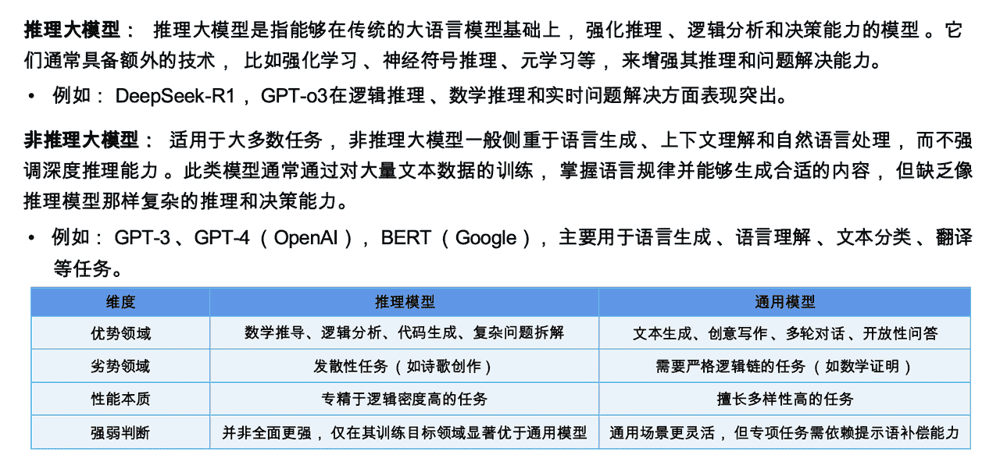

# 推理模型

> 来源：[https://yigather.feishu.cn/docx/Ap3kdqWwBoSaW1xZzudckGYUndd](https://yigather.feishu.cn/docx/Ap3kdqWwBoSaW1xZzudckGYUndd)

Co**T链式思维**的**出现将大模型**分**为了两类**：**  “概率**预**测 （快速反**应**） ”模**型和** “链式推理 （慢**速**思考） ”模型**。**  前者适合快速反馈， **处理即时任**务； 后者**通**过推理解决复杂**问题 。了解它们的差异有助于根据任务需求选择合    适的模型， 实现最佳效果。