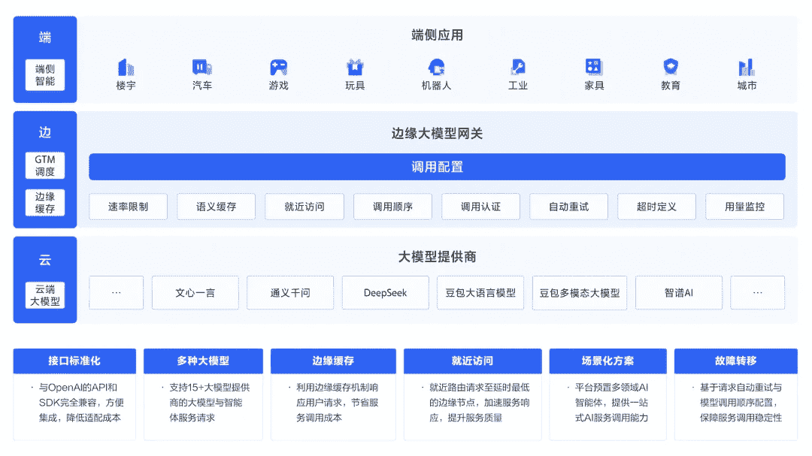
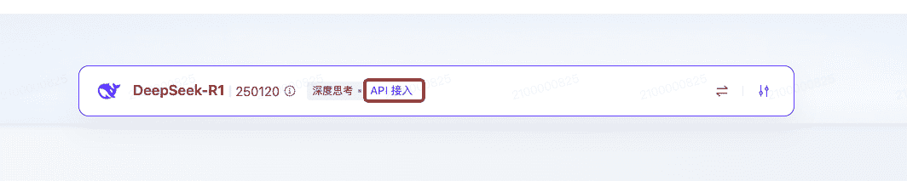
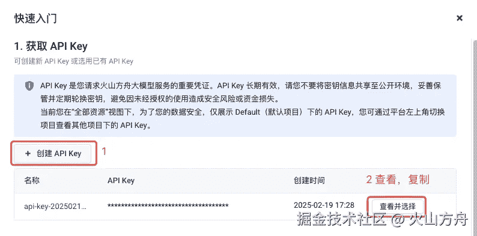
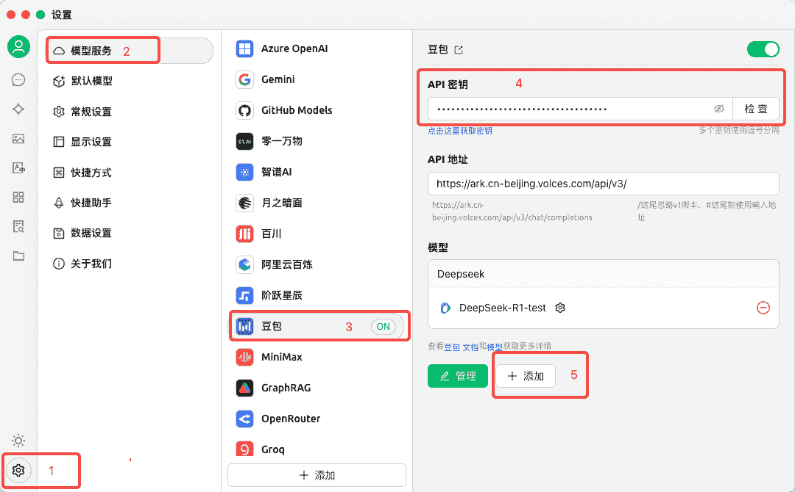
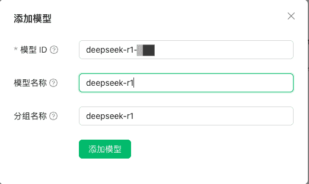
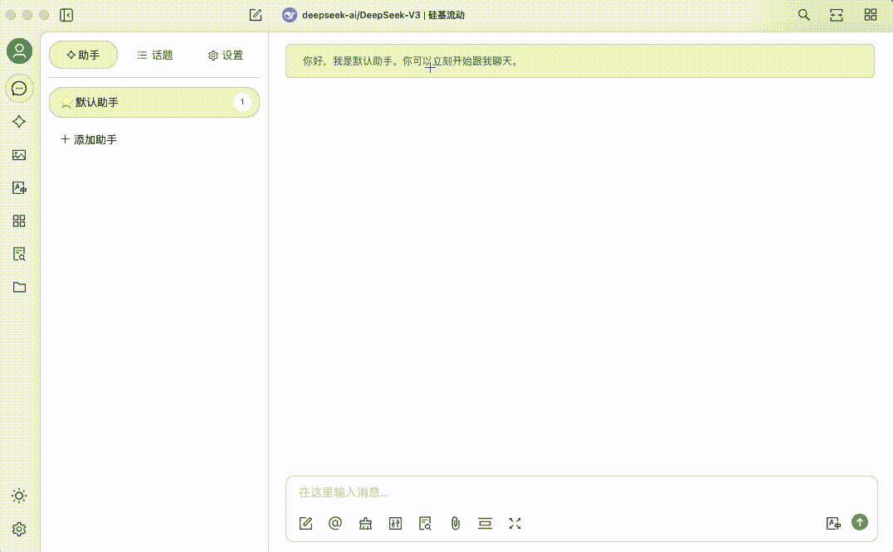

# 手把手接入火山引擎DeepSeek API

> 来源：[https://yigather.feishu.cn/docx/GXuIdhph3oZzuRxWbSlcYhuMn9b](https://yigather.feishu.cn/docx/GXuIdhph3oZzuRxWbSlcYhuMn9b)

> 火山引擎开通了DeepSeek专线，注册即可使用：https://www.volcengine.com

火山引擎边缘大模型网关通过一个 API 接入多家模型服务，利用全球边缘节点就近调用，提升响应速度；支持故障自动切换、重试和超时控制，确保服务可靠性；兼容 OpenAI 接口标准，可快速集成 DeepSeek 等模型，降低接入成本。

DeepSeek 作为大模型新锐，凭借其在算法、架构及系统等核心领域的创新突破，迅速获得业界瞩目。在巨大的热度下，面对海量请求，越来越多用户遇到了请求失败、调用超时、结果无法返回等稳定性问题。

火山引擎边缘大模型网关通过一个 API 接入多家模型服务，利用全球边缘节点就近调用，提升响应速度；支持故障自动切换、重试和超时控制，确保服务可靠性；兼容 OpenAI 接口标准，可快速集成 DeepSeek 等模型，降低接入成本。

目前，火山引擎边缘大模型网关已全面支持 DeepSeek 系列模型，可通过两种方式进行模型使用：

+   一是通过**平台预置模型，**边缘大模型网关新增由火山方舟提供的 DeepSeek R1、DeepSeek V3、DeepSeek-R1-Distill-Qwen-7B/32B，您可直接使用并对其创建网关访问密钥，无需与三方模型提供商交互；

+   二是通过**自有三方模型，**边缘大模型网关新增由 DeepSeek 开放平台提供的 DeepSeek R1、DeepSeek V3 以及火山方舟提供的 DeepSeek R1、DeepSeek V3、DeepSeek-R1-Distill-Qwen-7B/32B，您可以将您在第三方模型平台的密钥纳管至边缘大模型网关，以实现通过边缘大模型网关签发的网关访问密钥进行对应模型的访问与调用。

## 3步快速调用 DeepSeek

火山引擎边缘大模型网关支持通过一个 API 接口访问多家大模型提供商的模型与智能体，在端侧基于遍布全球的边缘计算节点就近调用。利用边缘云基础架构优势，提高模型访问速度，为终端用户提供更快速、可靠的 AI 服务体验。

在接入大模型的同时，通过配置调用顺序、自动重试、请求超时等能力，能够实现模型调用失败自动请求备用模型、单次请求失败自动重试、单次调用响应时间配置。通过产品化的配置，您可以迅速创建出与 OpenAI 的 API 和 SDK 完全兼容的网关访问密钥（API），并通过选配 DeepSeek 模型进行调用，节省大量适配成本，快速完成业务接入。

### 📖三步实现DeepSeek部署，解锁实战教程

#### 调用平台预置 DeepSeek

进入火山引擎，并登录/注册账号：https://www.volcengine.com

在调用API，需要先做API Key配置和模型开通的工作，但别担心，火山方舟提供了极其简单的快速入门，点击体验页面【API接入】，进入在线推理 - 快速入门

第一步，点击【创建API Key】，查看并复制

第二步，开通模型并复制Model Name

[**在获得API Key和开**](https://www.cherry-ai.com/)通服务后可以选择当下热门的[** CherryStudi**](https://www.cherry-ai.com/)o 进行部署。 下载并打开 CherryStudio ，在设置中选择模型服务-豆包，输入刚刚保存的API Key。

API地址这块，如果需要使用联网插件的话，需要将cherry studio默认的地址改为 ark.cn-beijing.volces.com/api/v3/bots ，最后点击【添加模型】

添加模型时，需要模型ID是刚刚保存的Model Name，就是以模型名称开头的长串ID

此时，你已经完成了DeepSeek模型的部署，返回Cherry Studio聊天窗口，让我们测试一下：

可以看到模型的思考过程和输出都非常的快速，没有出现卡顿或者“服务器繁忙，请稍后再试”，一个专属于自己的DeepSeek Chatbox就搭建好了！