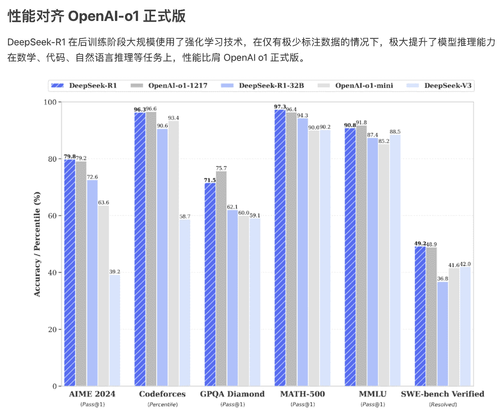
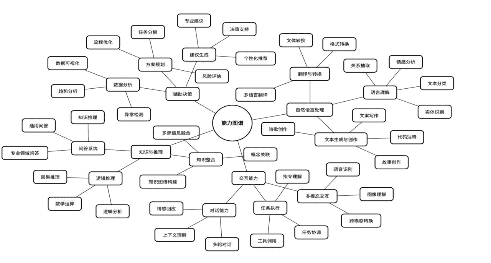
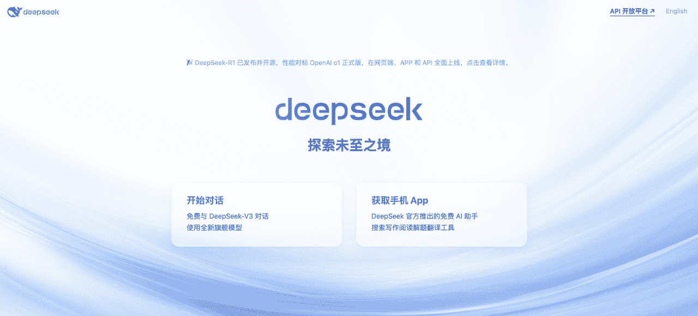
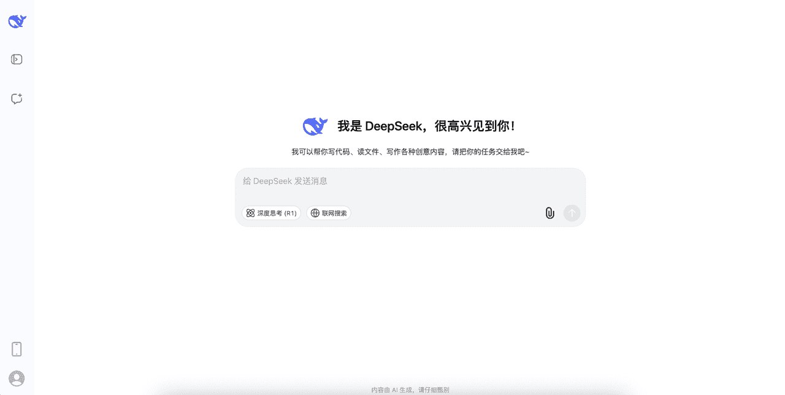
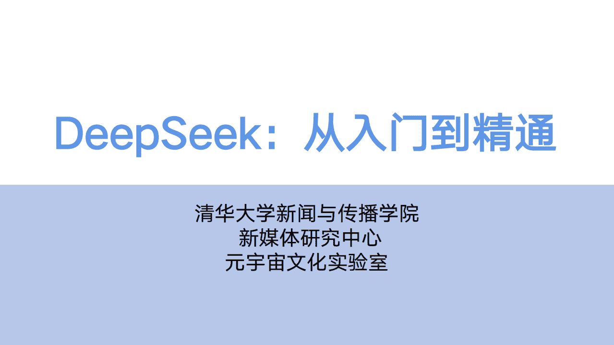
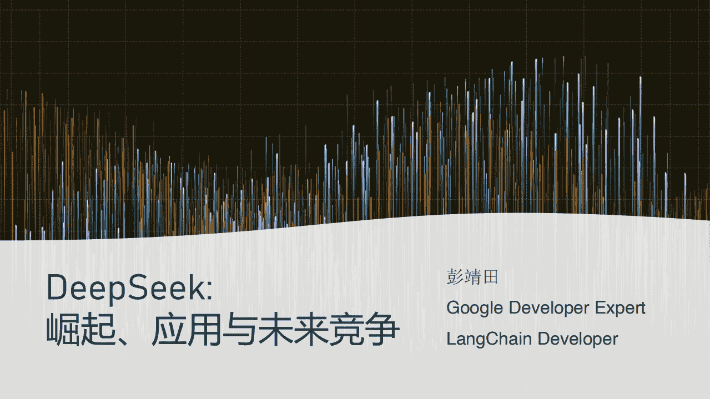
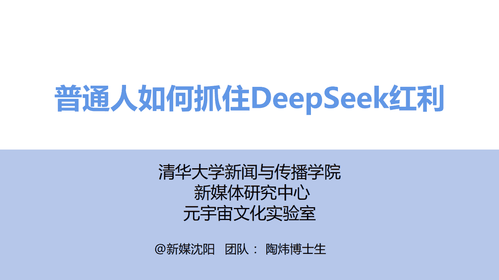
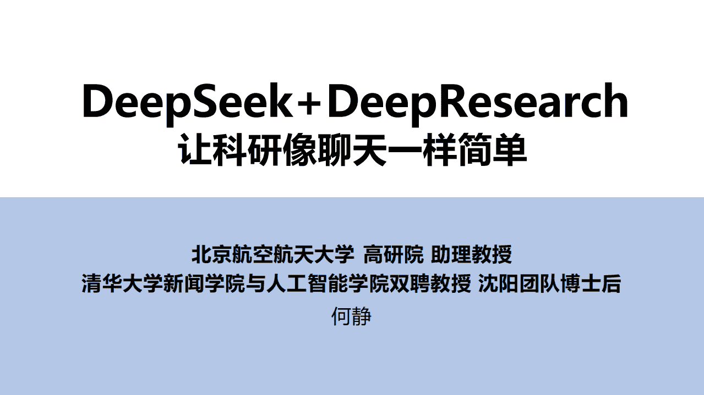
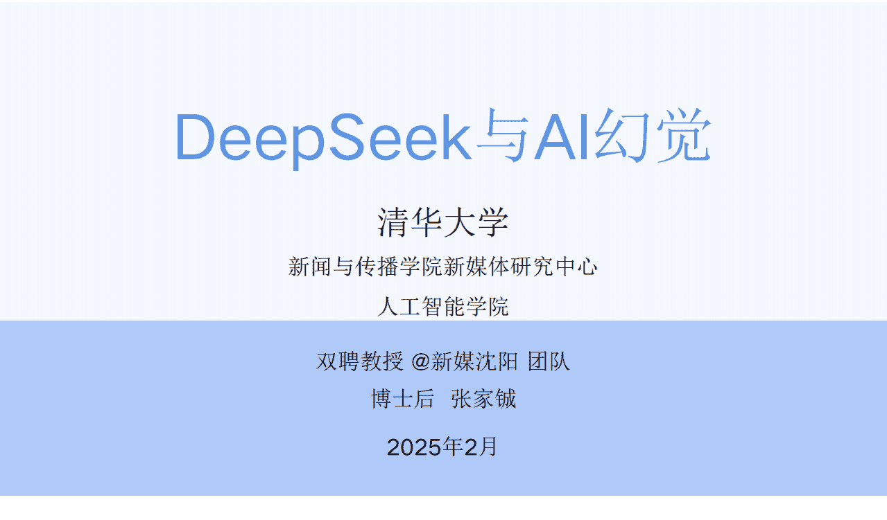

# DeepSeek从入门到精通

> 来源：[https://yigather.feishu.cn/docx/HplfdbAlDo6MRCxxW7bcItAgn7f](https://yigather.feishu.cn/docx/HplfdbAlDo6MRCxxW7bcItAgn7f)

> 从DeepSeek开始，入门AI

> 知识来源：清华大学、五道口实验室、DeepSeek开源Github、谷歌研究员、微信公众号、YiGather.com官方网站

### [**清华大学 - DeepSeek -**](https://yigather.feishu.cn/wiki/Pbk4wTAnSi0gs6kY1hlctK7mnIb?fromScene=spaceOverview#share-WLlAdIYdnodwKlxA5Bkc0oxUnHf) 原版学习PPT（1-5部全）源文件下载

### [DeepSeek全网可用地址](https://yigather.feishu.cn/wiki/UcPDw5SJNiSzsmkU7d8cgW8OnR9)

1.  最快：火山引擎DeepSeek满血版专线：https://www.volcengine.com

1.  YiGather.com DeepSeek私有专线：https://yigather.com/

1.  AskManyAI：https://dazi.co/

1.  腾讯云：[h](https://lke.cloud.tencent.com/webim_exp/#/chat/aNGfzv)ttps://lke.cloud.tencent.com/webim_exp/#/chat/aNGfzv

1.  腾讯元宝平台：https://yuanbao.tencent.com/

1.  火山方舟：[https://www.volcen](https://www.volcengine.com/product/ark)gine.com/product/ark

1.  扣子：https://www.coze.cn

1.  知乎直达：https://zhida.zhihu.com/pro

1.  Openrouter：https://openrouter.ai

# 🎯  愿景和目标

> 以 DeepSeek AI为起点，从0基础，到有深度，掌握 AI 核心认知，实现从"会用工具"到"创造价值"的跨越

> 1️⃣ **小白友好**：用通俗**语言拆解** AI **概念，无**需数学/代码基础也能入门

> 2️⃣ 实战为王：提供可复现的案例（如用 DeepSeek 制作智能助手）

> 3️⃣ 持续进化：每月更新行业前沿动态+配套实践指南

> 💡 意义：让每个人都能用 AI 提升效率，成为智能时代的"超个体"

# ⛳️  知识空间简介**适合人群**

✓ 想转行 AI 但不知从何开始的大学生

✓ 希望用 AI 降本增效的个体创业者

✓ 预算有限但想系统学习的职场新人和领域专业人士

# ⭐️  **DeepSeek是什么？**

•   DeepSeek是一家专注通用人工智能 （AGI） 的中国科技公司， 主攻大模型研发与应用。

•   DeepSeek-R1是其开源的推理模型， 擅长处理复杂任务且可免费商用。

**   **[非技术人员300秒快速理解DeepSeek R1](https://yigather.feishu.cn/wiki/WqQfwqubTi1iMqky8Qbcnfg1n6d)

其实deepseek总结下来，就是这样：

# **A** **I+****国产****+****免费****+****开源+****强大**

# **Deepseek可以做什么？**

直接面向用户或者支持开发者， 提供智能对话 、文本生成 、语义理解 、计算推理 、代码生成补全等应用场景，

支持联网搜索与深度思考模式， 同时支持文件上传， 能够扫描读取各类文件及图片中的文字内容。

# 基本功能

[**DeepSeek文本工作**](https://yigather.feishu.cn/wiki/Suk7wRBrDiw5b9k03FPclwDEncb)**      **[**DeepSeek自然语言处理**](https://yigather.feishu.cn/wiki/QbfvwbcLdiOZirknRPwc0h6inDe)**       **[**DeepSeek AI编程**](https://yigather.feishu.cn/wiki/O91Dw5ziUixQmbk8VPEcYqlBnPd)**     **[**AI绘图辅助**](https://yigather.feishu.cn/wiki/GOxmwUAx5i70YBkwMvFc1nmCnYe)**      **

# 高阶精通

[推理模型](https://yigather.feishu.cn/wiki/Ss5gw9wTBiUEqbkL5YjcbXClnxE)**   **[提示词工程AI秘籍](https://yigather.feishu.cn/wiki/AhhYwc3aEiFAcYkubKnclTxUnO4)**   **[复杂任务功能](https://yigather.feishu.cn/wiki/NlZMwvgJ8imsc6kgkW7cLFaQnNh)**    ** **   **** **

# 模型部署/训练/微调

[DeepSeek-R1满血版模型!671b 本地/云端部署，跟官方一样高级聪明](https://yigather.feishu.cn/wiki/VD9qwk16miNPpuk1zpEc36VwnCb)

[一步步将R1微调成DeepDoctor（资深医生）](https://yigather.feishu.cn/wiki/P4ajw8VLaifzvnkKjxFccJ2znof)

---

# 入门第一步：**如何使用DeepSeek？**

点击链接，访问DeepSeek官网：

备选地址：火山引擎DeepSeek  https://www.volcengine.com

📂 工**具箱速查：**

+   API 调用手册（含 Python/JavaScript 示例代码）

> [手把手接入火山引擎DeepSeek API](https://yigather.feishu.cn/wiki/YHnAw8NUbikoHGkYPeeccsimnJN)

+   模型微调实战：用 Colab 免费训练专属模型

+   提示词工程：让输出准确率提升 80%的秘籍

# ** 知识空间帮助**

🛠️ **保姆级使用指南**：

▸ 访问路径：PC 端优先 → 手机适配教程

▸ 学习路线：按颜色标签选择（蓝色=基础/红色=进阶/绿色=案例）

▸ 提问技巧：附错误截图+已尝试的解决步骤 → 响应提速 50%

📝 社**区公约：**

✓ 禁止私域引流，违者 3次警告后封号

✓ 优质分享可兑换算力奖励（详见积分规则）

✓ 每周三晚 8点直播答疑（支持匿名提问）

# **学习文件下载**

[清华大学104页《DeepSeek：从入门到精通》.pdf](https://internal-api-drive-stream.feishu.cn/space/api/box/stream/download/all/Q49RbgQWYoG9Dmx8MvVcAwzZnyb)

[DeepSeek崛起、应用与未来竞争.pdf](https://internal-api-drive-stream.feishu.cn/space/api/box/stream/download/all/XGhibaZsOo6wx7xOfEBcVjFwnCf)

[2_清华大学第二弹：DeepSeek赋能职场.pdf](https://internal-api-drive-stream.feishu.cn/space/api/box/stream/download/all/RXT2bos0goGIkZxX16fchw05nff)

[清华大学 普通人如何抓住DeepSeek红利.pdf](https://internal-api-drive-stream.feishu.cn/space/api/box/stream/download/all/TpTYbJKePo2jdex0w9QcDYb6nyd)

[04-DeepSeek+DeepRearch：让科研像聊天一样简单.pdf](https://internal-api-drive-stream.feishu.cn/space/api/box/stream/download/all/TuTUbASqaoq8rPxOsADcrirAnTg)

[05-DeepSeek与AI幻觉.pdf](https://internal-api-drive-stream.feishu.cn/space/api/box/stream/download/all/X3PUbRMVgoOT2XxB0YAcrTfdnHh)

> **数据支持：**[**YiGather指数**](https://yigather.com/#agi-index)** 丨** **技术支持：Yi**Gather.com

感兴趣点个赞？

↓