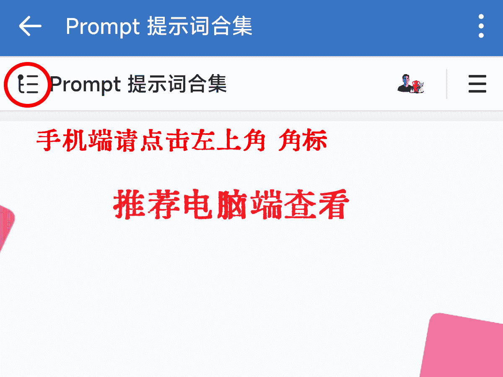

# 用户答疑

> 来源：[https://qianniucity.feishu.cn/docx/Tx0AdVjMiorCs5x3Htlc5M8wnKf](https://qianniucity.feishu.cn/docx/Tx0AdVjMiorCs5x3Htlc5M8wnKf)

> 用户答疑模块是一个专为用户提供解答疑惑与知识汇总的平台，旨在帮助用户更好地理解和应用 AI 技术以及 Model Context Protocol (MCP) 相关内容。

用户可以通过评论区留言或者填写问卷的方式提交问题，我们的团队会根据用户的提问进行详细的研究和分析，并将结果整理成文章形式发布。

> 评论区留言：请浏览至文章最底部

> 问题收集卡：https://qianniucity.feishu.cn/share/base/form/shrcnHSbz5IdQEYS9Be8l3si1Jb

💪该模块不仅为用户提供了一个便捷的交流渠道，还通过系统化的知识输出，提高了用户的学习效率和技术应用能力。我们致力于打造一个互动性强、内容丰富的答疑社区，让每位用户都能在这里找到满意的答案和实用的知识。

## 用户答疑列表