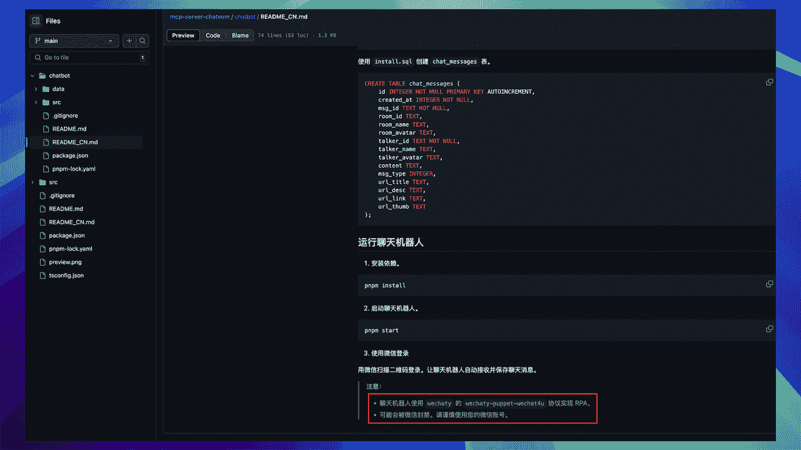
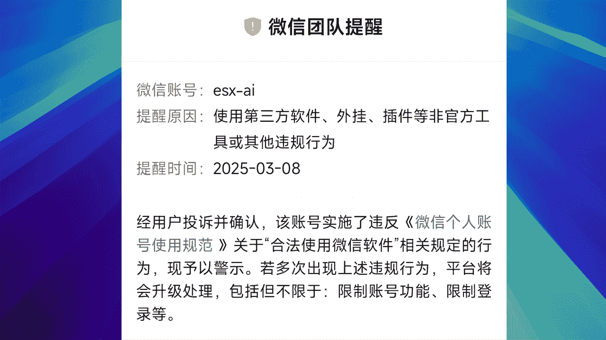
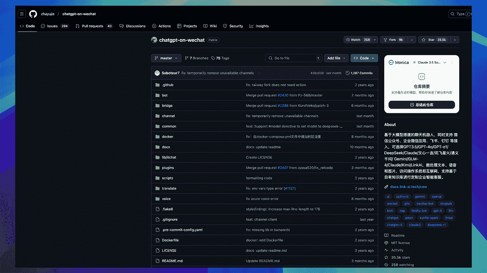
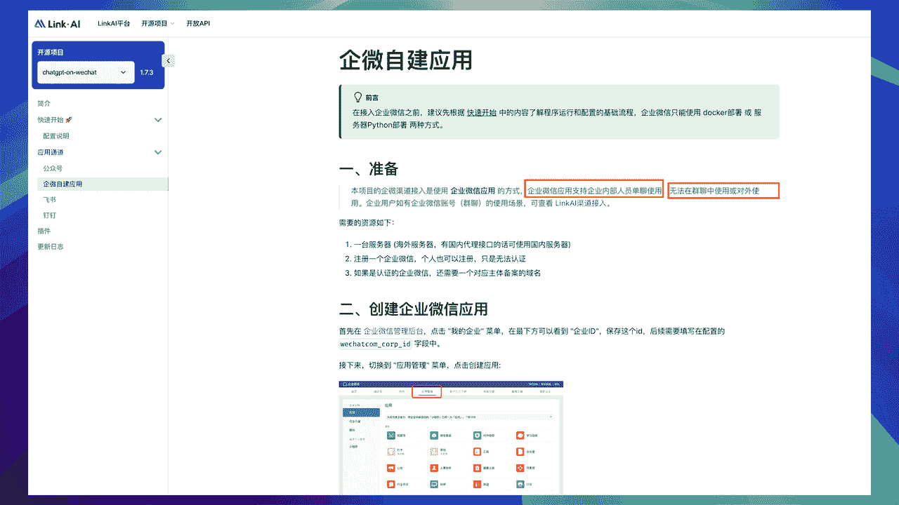
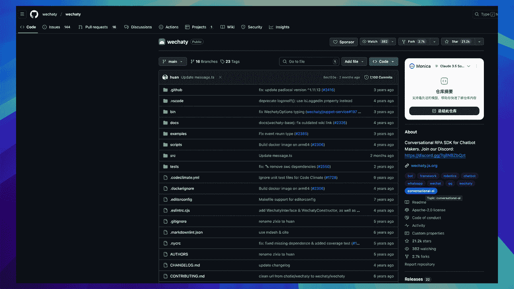
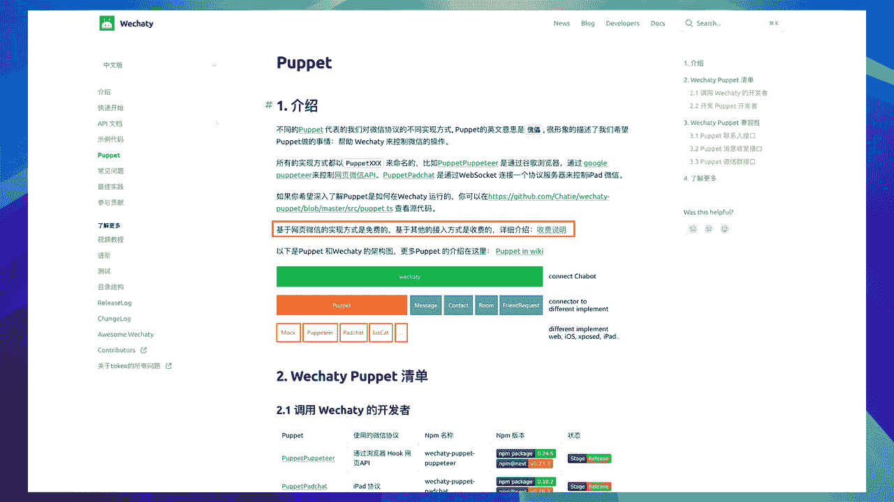

# 为🛰️群添加智能机器人：开源项目推荐与实践

> 来源：[https://qianniucity.feishu.cn/docx/RdO2d6Ateo8UcKxp00ecCHhxnwb](https://qianniucity.feishu.cn/docx/RdO2d6Ateo8UcKxp00ecCHhxnwb)

### 引言

近期，由于撰写了一些与 MCP（Model Context Protocol） 相关的内容，吸引了不少志同道合的朋友关注和讨论。在群聊人数不断增多的情况下，为了更高效地管理内容、提升讨论质量，我萌生了一个想法：为🛰️群添加一个智能机器人，用于总结和整理聊天内容。这不仅可以帮助大家更便捷地获取讨论精华，也能让群内的优质内容被更多人看到。

作为开发者，第一反应自然是寻找开源项目，自行部署一个符合需求的解决方案。经过一番调研，以下几个开源项目值得推荐，或许能为有类似需求的朋友提供参考。

---

### mcp-server-chatsum

**功能特点：**

+   提供参数化查询聊天消息的能力。

+   根据查询提示对聊天消息进行总结。

这是一个基于 MCP 的轻量级聊天机器人应用，专注于对聊天内容进行总结。它适合作为聊天记录管理工具，为群内用户提供高效的内容提炼功能。

**项目地址：**

[https://github.com/chatmcp](https://github.com/chatmcp/mcp-server-chatsum/)/mcp-server-chatsum/

**注意事项：**

需要特别注意的是，直接加载🛰️聊天数据可能存在合规性问题，这种方式容易导致账号被封禁。因此，建议在测试时注册一个新的🛰️账号，避免因操作不当收到警告提醒。

---

### chatgpt-on-wechat

**功能特点：**

+   **多端部署：** 支持🛰️👸号、企业🛰️、飞书、钉钉等多种平台。

+   **基础对话：** 智能回复私聊和群聊消息，支持多轮会话上下文记忆，可接入多种大语言模型（如 GPT-3.5、GPT-4、Claude-3.5 等）。

+   **语音能力：** 支持语音消息识别与回复，兼容多种语音模型（如 Azure、Baidu、Google 等）。

+   **图像能力：** 支持图片生成、识别与修复，集成 Dall-E-3、Stable Diffusion 等模型。

+   **插件扩展：** 支持多角色切换、敏感词过滤、联网搜索等个性化功能。

+   **知识库：** 可通过上传知识库文件定制专属机器人，用于智能客服或私域助手。

chatgpt-on-wechat 功能丰富，支持的平台广泛，是一个高度灵活的解决方案。

**项目地址：**

[https://github.com/zhayuj](https://github.com/zhayujie/chatgpt-on-wechat)ie/chatgpt-on-wechat

**使用文档：**

[https://docs.link-ai.](https://docs.link-ai.tech/cow/quick-start)tech/cow/quick-start

**注意事项：**

虽然该项目功能强大，但明确说明不能在🛰️群聊中使用。因此，在实际应用中需注意平台限制。

---

### **Wechaty**

**功能特点：**

Wechaty 是一个强大的开源聊天机器人开发框架，被称为聊天机器人开发的“瑞士军刀”。它提供了一个通用接口，可以连接包括🛰️在内的多种消息平台。通过 Wechaty，开发者只需编写一次代码，就能在多个平台上运行。其核心优势包括：

+   开源且易用。

+   社区活跃，支持丰富。

+   适合构建复杂的对话式 RPA（机器人流程自动化）应用。

Wechaty 是许多🛰️群管理工具的基础框架，其灵活性和稳定性使其成为开发者的首选。

**项目地址：**

[h](https://github.com/juzibot/Welcome/wiki/Everything-about-Wechaty)ttps://github.com/juzibot/Welcome/wiki/Everything-about-Wechaty

**注意事项：**

要收费

---

### 总结与建议

为🛰️群添加智能机器人无疑是提升群聊效率的一种有效方式。但在选择工具和实现方案时，需综合考虑以下几点：

1.  **合规性：** 确保操作符合平台的使用规范，避免因违规操作导致账号被封禁。

1.  **功能需求：** 根据实际需求选择合适的项目。例如，如果需要多平台支持，可以选择 chatgpt-on-wechat；如果专注于聊天记录总结，可以尝试 Wechaty。

1.  **技术能力：** 部分开源项目需要一定的开发和部署能力，对技术不熟悉的用户可选择功能相对简单或提供详细文档的项目。

1.  **成本预算：** 虽然开源项目通常免费，但部分功能可能需要付费解锁，需根据预算进行权衡。

### 参考链接

https://wechaty.gitbook.io/wechaty/zh

https://github.com/juzibot/Welcome/wiki/Everything-about-Wechaty#

https://docs.link-ai.tech/cow/quick-start/config

https://github.com/wechaty/getting-started

https://github.com/zhayujie/chatgpt-on-wechat