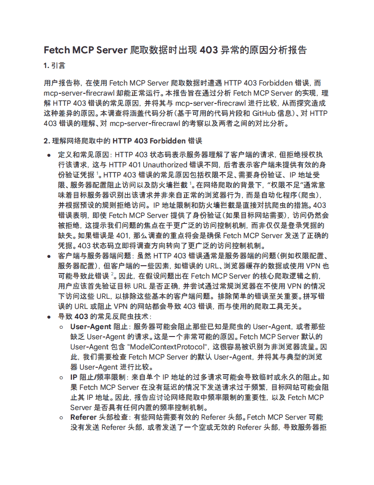

# 为什么 fetch 爬取数据会出现 403 的异常，而 mcp-server-firecrawl 可以正常爬取

> 来源：[https://qianniucity.feishu.cn/docx/Zh7edsAJso8RnxxTQkocQvERnRc](https://qianniucity.feishu.cn/docx/Zh7edsAJso8RnxxTQkocQvERnRc)

## 举个例子

> Fetch 发出的请求就像一个穿着“我是脚本”T 恤的人去敲门，很容易被保安（服务器反爬虫机制）拦住并告知“禁止入内”（403 Forbidden）。而 mcp-server-firecrawl 则像一个伪装得很好的“普通访客”，它模仿真实浏览器的行为（使用无头浏览器、发送完整的请求头、执行 JS 等），从而能够绕过保安的检查，成功获取数据。

## 具体分析｜这通常是由于以下几个原因：

#### **服务器的反爬虫机制：**

+   **User-Agent 检测：** 目标网站（例如图片中提到的 Bloomberg）的服务器会检查请求的 User-Agent 头。浏览器发出的 Fetch 请求，尤其是在 Node.js 等服务器环境中使用时，可能会带有默认的、容易被识别为脚本或爬虫的 User-Agent。服务器检测到非浏览器或可疑的 User-Agent 时，会拒绝访问并返回 403。

+   缺少必要的请求头 （Headers）: 网站可能要求请求包含特定的 HTTP 头信息，例如 Referer， Accept-Language， Cookie 等，以模拟真实用户的浏览行为。简单的 Fetch 请求可能没有包含所有必要的头信息。

+   **IP 地址限制/频率限制：** 服务器可能会限制来自同一 IP 地址的请求频率。过于频繁的 Fetch 请求可能触发限制，导致 403 错误。

+   WAF （Web Application Firewall） 拦截： 许多网站使用 WAF 来防御恶意请求，包括爬虫。WAF 会分析请求的模式、来源、头信息等，如果判定为爬虫行为，就会拦截并返回 403。简单的 Fetch 请求特征比较明显，容易被 WAF 识别。

+   动态内容与 JavaScript: 有些网站的内容是通过 JavaScript 动态加载的。Fetch 通常只能获取到初始的 HTML 源码，无法执行页面中的 JavaScript。如果网站需要执行 JS 才能获取数据，或者其反爬虫逻辑依赖于 JS 环境检测，那么 Fetch 就会失败。

#### **mcp-ser**ver-firecrawl 的高级功能：

+   **模拟浏览器环境：** 像 Firecrawl 这样的高级爬虫工具（或者它所依赖的底层库，如 Puppeteer/Playwright）通常会使用无头浏览器 （Headless Browser）。这意味着它在后台运行一个真实的浏览器引擎（如 Chrome），能够：

+   发送带有**真实浏览器 ****User-Agent** 和其他完整请求头的请求。

+   执行页面上的 JavaScript，加载动态内容。

+   自动**管理 Cookies**。

+   模拟更复杂的**用户交互**。

+   **反-反爬虫策略：** 这类工具可能内置了对抗常见反爬虫技术的策略，例如：

+   自动处理验证码 （CAPTCHA）（可能需要集成第三方服务）。

+   使用代理 IP （Proxy Rotation） 来避免 IP 限制。

+   **模拟鼠标移动、滚动**等更像人类的行为模式。

+   **绕过 WAF 检测**的技术。

## 更详细的报告

[Fetch MCP Server 爬取数据时出现 403 异常的原因分析报告.pdf](https://internal-api-drive-stream.feishu.cn/space/api/box/stream/download/all/AsReb7FCcoR2qzxitHac8KhVnsd)