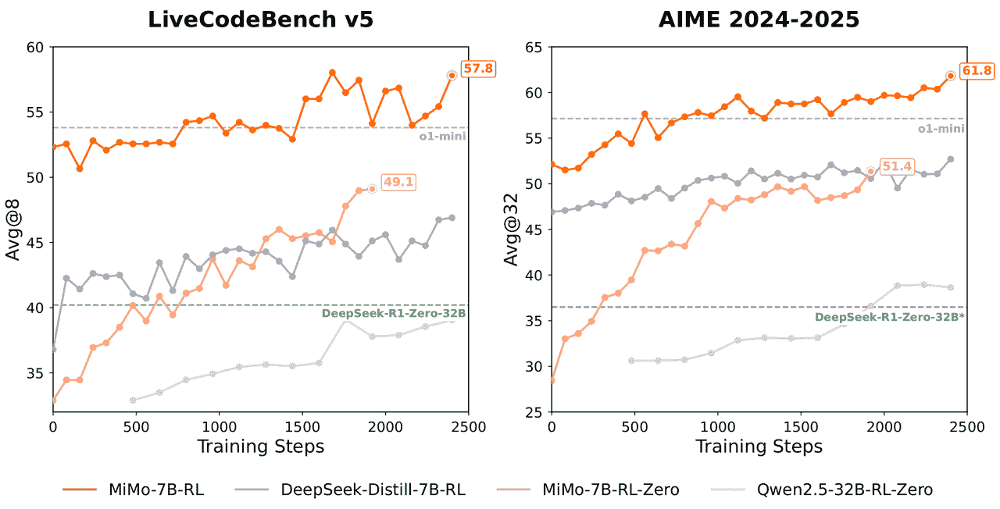
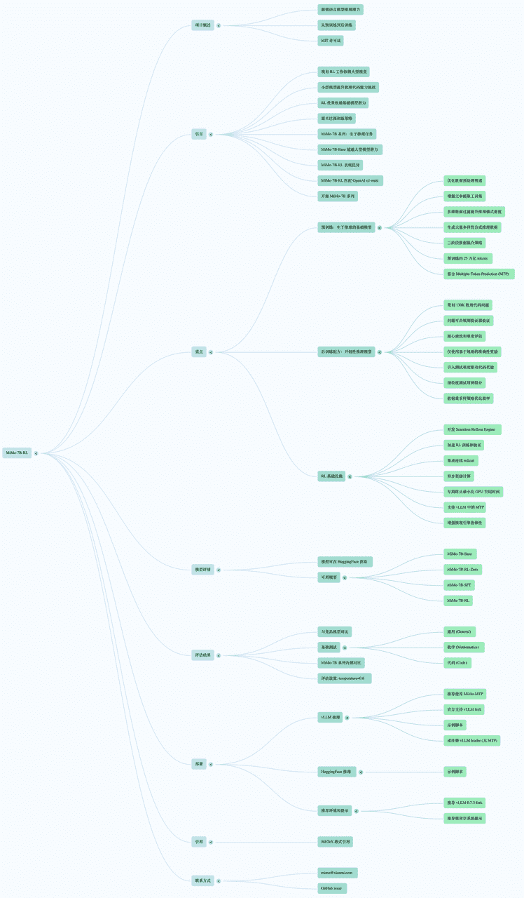

# 小米MiMo-7B模型：推理潜力与强化学习

> 来源：[https://qianniucity.feishu.cn/docx/U7bFdEu56o1Gb0xafKmc9nx2nmc](https://qianniucity.feishu.cn/docx/U7bFdEu56o1Gb0xafKmc9nx2nmc)

[小米MiMo：推理潜力模型.wav](https://internal-api-drive-stream.feishu.cn/space/api/box/stream/download/all/AbvdbI1oco0J2gxbI9AcPU22nVg)

### MiMo-7B-RL 模型是什么？

MiMo-7B-RL 是小米开发的一个 70 亿参数的语言模型系列中的一个特定版本。它特别强调通过强化学习（RL）进行后训练，以解锁和提升模型固有的推理潜力。这个模型是基于 MiMo-7B-SFT 模型进一步训练而成的，在数学和代码推理任务上表现出色，其性能可与 OpenAI 的 o1-mini 模型媲美。

### MiMo 模型系列的开发目标是什么？

MiMo 模型系列的设计目标是为了解决在小型模型上难以同时实现数学和代码能力统一提升的挑战。开发者相信，模型的有效性取决于基础模型固有的推理潜力，因此他们的努力不仅集中在后训练上，还特别关注为推理任务量身定制的预训练策略，以充分释放语言模型的推理能力。

### MiMo-7B-Base 在预训练阶段有哪些突出特点？

MiMo-7B-Base 的预训练阶段采用了多项创新策略：

+   优化数据预处理流程： 增强文本提取工具包，并应用多维度数据过滤，以增加预训练数据中的推理模式密度。

+   生成多样化合成推理数据： 采用多种策略生成了大量的多样化合成推理数据。

+   三阶段数据混合策略： 预训练采用了三阶段数据混合策略，总共使用了约 25 万亿个 token 进行训练。

+   多 token 预测（MTP）： 引入了多 token 预测作为额外的训练目标，这有助于提升模型性能并加速推理。

### MiMo-7B-RL 在后训练阶段采用了哪些技术？

MiMo-7B-RL 的后训练主要通过强化学习实现：

+   构建高质量 RL 训练数据： 收集了 13 万道数学和代码问题作为 RL 训练数据，这些问题都可以通过基于规则的验证器进行验证，并经过仔细的清洗和难度评估，以确保数据质量。

+   基于规则的精度奖励： 仅采用基于规则的精度奖励，以避免潜在的奖励作弊问题。

+   测试难度驱动的代码奖励： 为了缓解困难代码问题的稀疏奖励问题，引入了测试难度驱动的代码奖励，通过为不同难度级别的测试用例分配细粒度的分数，更有效地优化策略。

+   简单问题的数据重采样策略： 对简单问题实施了数据重采样策略，以提高 rollout 采样效率并稳定策略更新，特别是在 RL 训练的后期阶段。

### MiMo 模型系列在数学和代码推理任务上的性能如何？

根据提供的评估结果，MiMo-7B-RL 在数学和代码推理任务上表现出了强大的性能。例如，在 MATH-500 和 AIME 系列数学基准测试以及 LiveCodeBench 系列代码基准测试中，MiMo-7B-RL 的 Pass@1 得分显著高于其基础模型和 SFT 模型，并且在某些基准测试上表现优于或与 OpenAI o1-mini、R1-Distill-Qwen-14B 等模型相当或更优。这验证了其在推理方面的卓越能力。

### 如何部署和使用 MiMo-7B 模型进行推理？

MiMo-7B 模型支持多种推理方式：

+   vLLM 推理： 推荐使用小米官方提供的 vLLM 分支，该分支支持 MiMo 的 MTP 功能，可以利用 vllm.LLM 类加载模型并进行聊天或文本生成。也可以注册一个不加载 MTP 参数的 vLLM 加载器。

+   Hugging Face 推理： 可以使用 Hugging Face 的 transformers 库加载模型，并使用 AutoModelForCausalLM 和 AutoTokenizer 进行文本生成。 推荐使用小米提供的 vLLM 分支，并使用空的 system 提示。

### MiMo-7B 模型系列的许可证是什么？

MiMo-7B 模型库根据 MIT 许可证进行授权。这意味着用户可以相对自由地使用、修改和分发这些模型，只要符合 MIT 许可证的条款。

### MiMo-7B 模型系列包含哪些可用的检查点（Checkpoints）？

MiMo-7B 系列开放了多个检查点供社区使用：

+   MiMo-7B-Base： 具有非凡推理潜力的基础模型。

+   MiMo-7B-RL-Zero： 从基础模型训练得到的 RL 模型。

+   MiMo-7B-SFT： 从基础模型训练得到的 SFT 模型。

+   MiMo-7B-RL： 从 SFT 模型训练得到的 RL 模型，具有与 OpenAI o1-mini 匹敌的优越性能。 所有这些检查点都可以在 Hugging Face 上找到。

### MiMo-7B 系列语言模型

