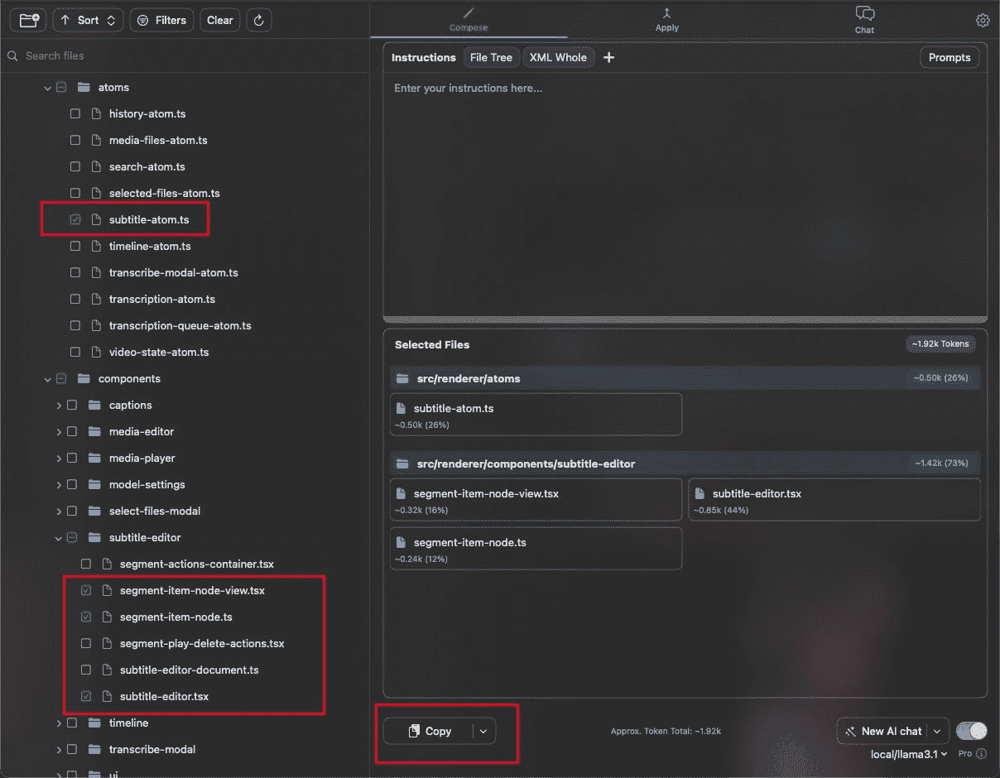
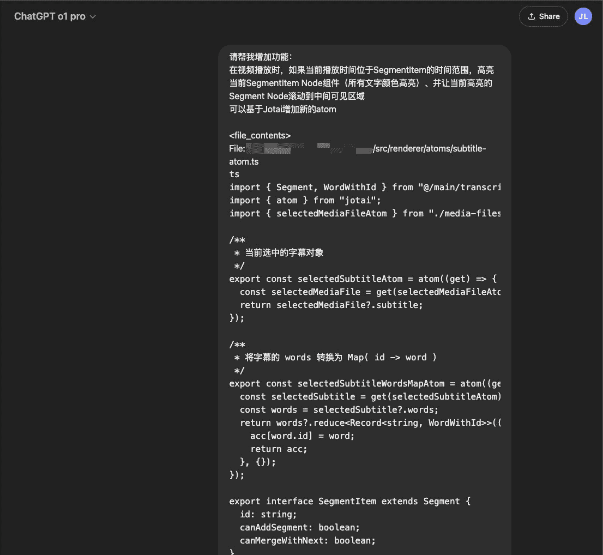
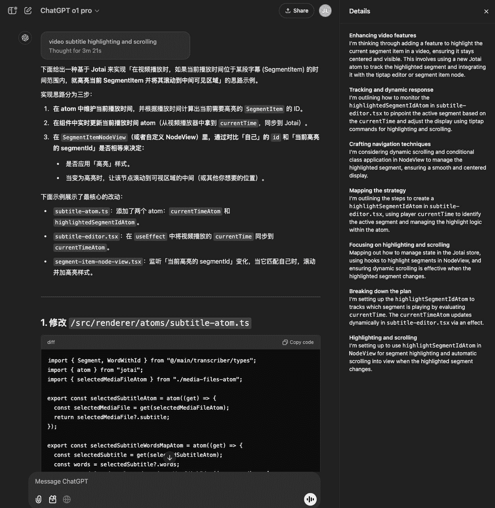
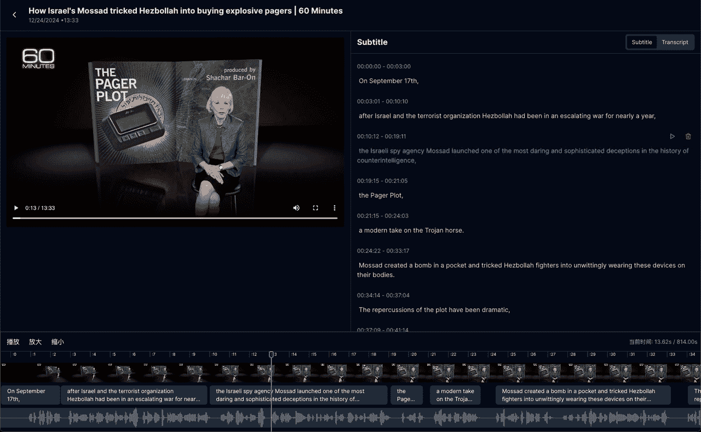

# 低耦合设计怎么写prompt，能举个例子吗？

> 来源：[https://qianniucity.feishu.cn/docx/D5lod1MF2ol80mxy15xcXOAMn0d](https://qianniucity.feishu.cn/docx/D5lod1MF2ol80mxy15xcXOAMn0d)

问：低耦合设计怎么写prompt，能举个例子吗？

答：

举个例子，如果我在开发一个字幕编辑器App，在设计时，我让播放器和字幕编辑模块完全独立开来。比如，当我需要在字幕编辑模块中加入一个功能，使字幕根据当前播放位置高亮并自动滚动，那我只需要将与字幕编辑功能相关的代码提供出来。

所以在编写Prompt时，只需要挑选与字幕编辑模块及对应功能相关的代码（可以参考图1，这里是通过一个名叫RepoPrompt的App实现的），并连同提示词一并提交。即使这个功能依赖于播放器的时间状态，也无需提供播放器代码，只需告知AI存在一个播放器状态接口，我能够直接调用这个状态就可以了。

整理自：https://x.com/dotey/status/1873258728687865939