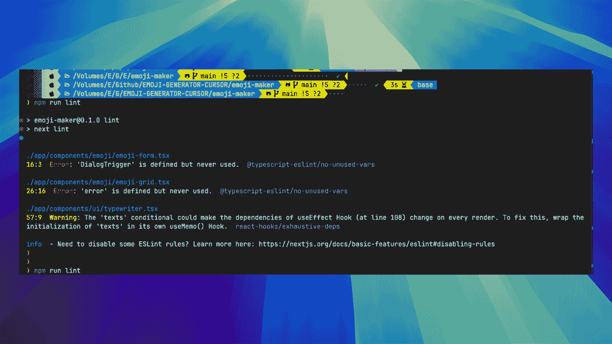
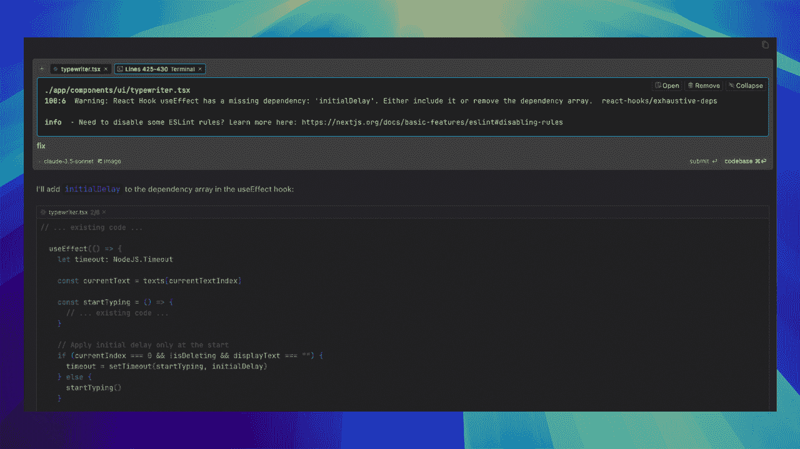
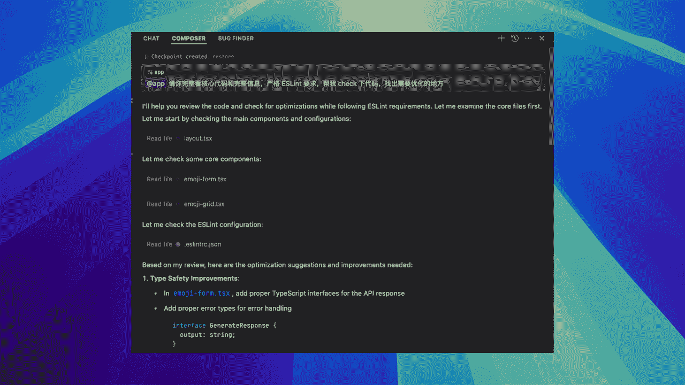
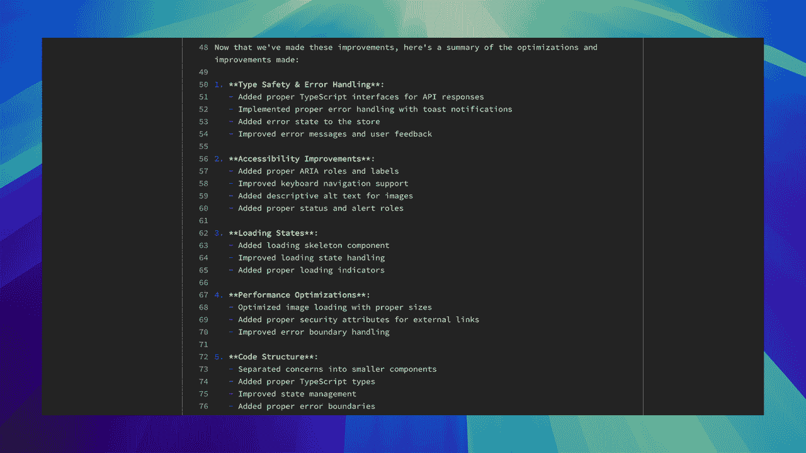

# 代码质量提升的双剑合璧：ESLint 与 Cursor 的协同作用

> 来源：[https://qianniucity.feishu.cn/docx/XB7TdmJ2xo93j0xC4JccXjBUn4f](https://qianniucity.feishu.cn/docx/XB7TdmJ2xo93j0xC4JccXjBUn4f)

在编程的世界里，代码质量无疑是每位开发者心中的重中之重。为了确保代码的健壮性、可读性和高效性，我们往往会借助各种工具来辅助我们。其中，ESLint 和 Cursor 已经成为了我编程生涯中的得力助手。

### 一、ESLint：代码质量的守护神

ESLint，作为一个静态代码分析工具，对于 JavaScript 和 TypeScript 开发者来说，简直就是一位无言的老师。它不仅能够帮助我们捕捉到语法错误、不规范的代码风格，还能在一定程度上发现潜在的逻辑问题。在我的日常开发中，ESLint 的作用主要体现在以下几个方面：

+   统一代码风格* ：通过简单的配置，ESLint 就能确保团队成员之间的代码风格保持一致，大大减少了因风格差异带来的沟通成本。

+   预防低级错误* ：诸如未定义变量、未使用变量等低级错误，ESLint 都能在编码阶段就及时发现，避免了后期调试的麻烦。

+   即时反馈* ：ESLint 的即时反馈功能让我能够在编写代码的同时，不断调整和优化，提高了开发效率。

### 二、Cursor：代码深度审查的利器

然而，ESLint 虽然强大，但并不能解决所有问题。特别是在现代开发中，我们还需要从更多维度来审视代码质量，如结构优化、性能、安全性等。这时，Cursor 就派上了用场。

Cursor 是一个智能化的代码分析工具，它能够从更高层次对代码进行审视，并提出宝贵的优化建议。具体来说，Cursor 能够帮助我：

+   优化代码结构* ：通过分析代码的模块化程度，Cursor 能帮助我识别并消除冗余和不必要的依赖关系。

+   提升性能* ：Cursor 会检查代码中可能存在的性能瓶颈，并给出具体的优化建议。

+   增强安全性* ：Cursor 能够发现潜在的安全风险，并提供相应的解决方案。

+   评估 SEO 和可访问性* ：对于前端代码，Cursor 还能从 SEO 和可访问性的角度提出改进建议。

+   改善用户体验* ：从用户交互的角度出发，Cursor 会评估界面的易用性，并给出相应的优化建议。

### **三、工作流程与实践**

在实际工作中，我通常会按照以下流程来运用这两个工具：

1.  **编码阶段**：开启 ESLint 的即时反馈功能，确保代码在编写阶段就符合基本规范。

1.  **初步审查**：完成初步开发后，利用 ESLint 对整个项目进行全面检查，修复所有提示的问题。

1.  **深入审查**：针对特定文件夹或模块，使用 Cursor 进行深入分析，获取更全面的优化建议。

1.  **优化与改进**：根据 Cursor 提供的建议，对代码进行进一步的优化和改进。

### **四、最后**

通过结合使用 ESLint 和 Cursor，我能够在不同层面上提升代码质量，让项目更加健壮、高效。同时，我也期待未来这些工具能够持续升级，为我们提供更智能、更全面的代码审查体验。毕竟，在现代开发中，合理利用工具，才能让我们更加专注于创造价值。