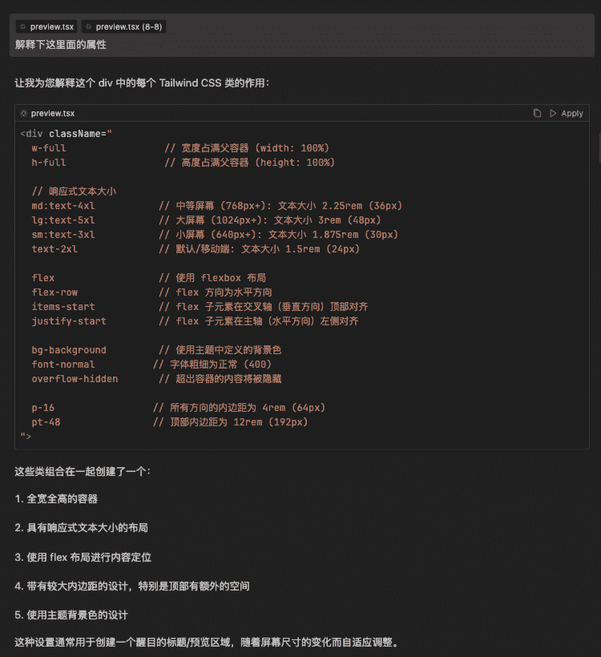

# 指定代码，让 Cursor 告诉我 CSS 样式的作用

> 来源：[https://qianniucity.feishu.cn/docx/TtnadZCdAoJvt1xkxi9cy5lFnlr](https://qianniucity.feishu.cn/docx/TtnadZCdAoJvt1xkxi9cy5lFnlr)

**Q**：解释下这里面的属性

```
&lt;div className=&quot;w-full h-full md:text-4xl lg:text-5xl sm:text-3xl text-2xl flex flex-row items-start justify-start bg-background font-normal overflow-hidden p-16 pt-48&quot;&gt;
```

A：让我为您解释这个 div 中的每个 Tailwind CSS 类的作用：

```
&lt;div className=&quot;
  w-full                 // 宽度占满父容器 (width: 100%)
  h-full                 // 高度占满父容器 (height: 100%)
  
  // 响应式文本大小
  md:text-4xl           // 中等屏幕 (768px+): 文本大小 2.25rem (36px)
  lg:text-5xl           // 大屏幕 (1024px+): 文本大小 3rem (48px)
  sm:text-3xl           // 小屏幕 (640px+): 文本大小 1.875rem (30px)
  text-2xl              // 默认/移动端: 文本大小 1.5rem (24px)
  
  flex                  // 使用 flexbox 布局
  flex-row              // flex 方向为水平方向
  items-start           // flex 子元素在交叉轴（垂直方向）顶部对齐
  justify-start         // flex 子元素在主轴（水平方向）左侧对齐
  
  bg-background         // 使用主题中定义的背景色
  font-normal          // 字体粗细为正常 (400)
  overflow-hidden       // 超出容器的内容将被隐藏
  
  p-16                 // 所有方向的内边距为 4rem (64px)
  pt-48                // 顶部内边距为 12rem (192px)
&quot;&gt;
```

这些类组合在一起创建了一个：

1.  全宽全高的容器

1.  具有响应式文本大小的布局

1.  使用 flex 布局进行内容定位

1.  带有较大内边距的设计，特别是顶部有额外的空间

1.  使用主题背景色的设计

这种设置通常用于创建一个醒目的标题/预览区域，随着屏幕尺寸的变化而自适应调整。

