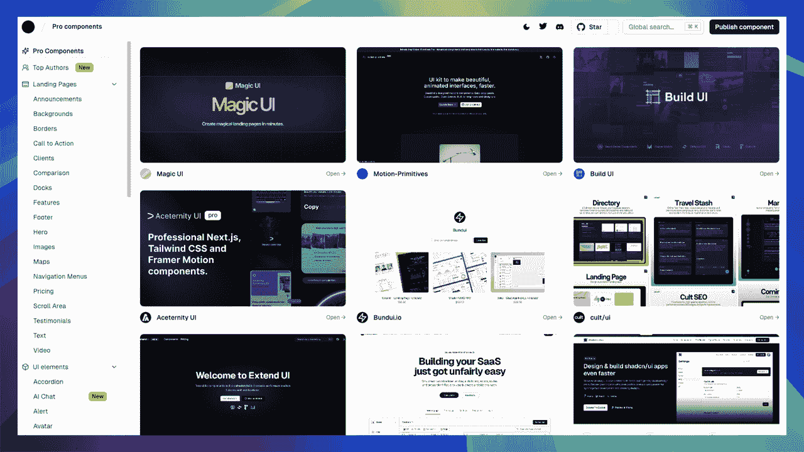
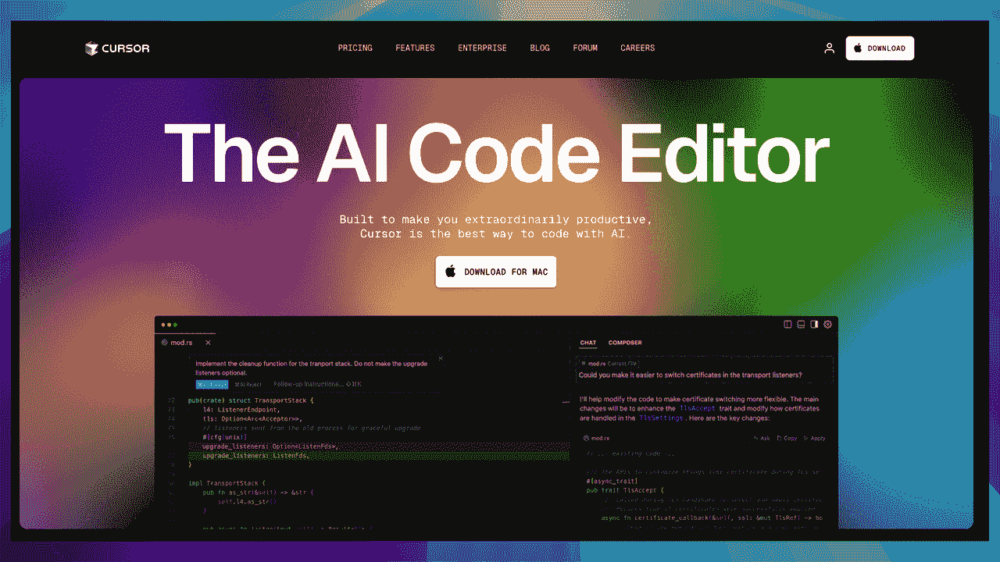
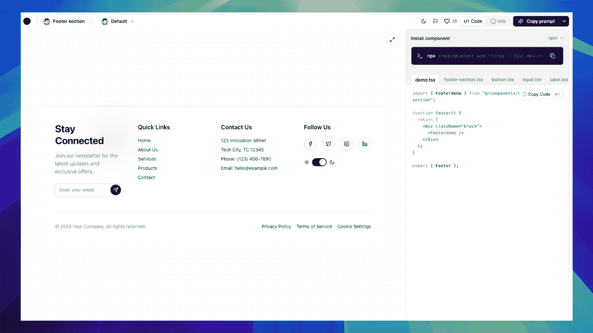
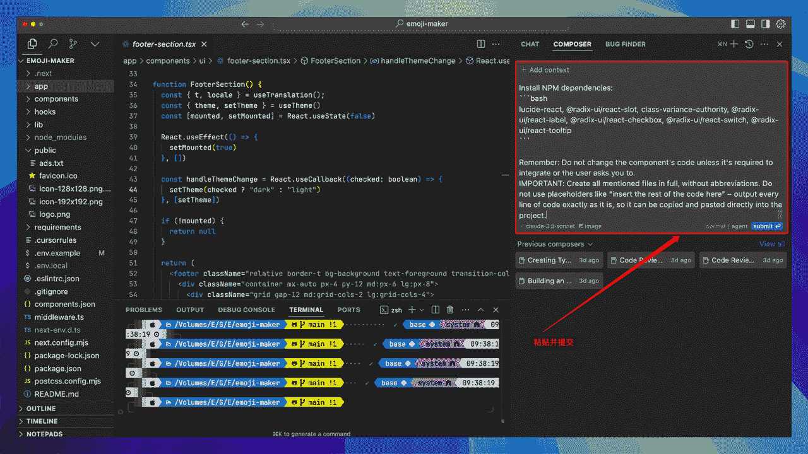

# 🚀两天打造 Emoji 生成网站，21st 与 Cursor 助我飞跃速度与美观！

> 来源：[https://qianniucity.feishu.cn/docx/VFnidsYbToYh6TxrR45c25p1n8f](https://qianniucity.feishu.cn/docx/VFnidsYbToYh6TxrR45c25p1n8f)

今天和大家分享一个我最近完成的项目——一个 emoji 生成网站，并且我已经将它开源啦！在这个项目中，我使用了 21st 和 Cursor，这两者的结合让我在开发过程中实现了速度与美观的双向飞跃。

### 21st 显示组件库的特点和优势

21st 的显示组件库宛如一个功能强大的宝库，它是一个极具灵活性且用途广泛的工具，其核心目标是协助开发者以极快的速度构建出精美且高度优化的用户界面。以下是对 21st 显示组件库特点和优势的详细解读：

+   丰富多样的组件库：21st 提供了包括按钮、背景、导航菜单、页眉、页脚、侧边栏、可展开标签、文本、视频、列表元素、远程连接、手风琴、AI 聊天、新魔法 UI、警告、头像、徽章等在内的多种组件，几乎涵盖了所有常见的 UI 需求。

+   高度模块化的设计：每个组件都是独立的模块，能够单独进行设计和测试，这种模块化设计极大地提升了开发效率。

+   实时且精准的预览与调整：在 21st 平台上，开发者可以实时预览组件的呈现效果，并根据实际需求灵活调整，这种即时反馈机制确保了最终效果的完美无瑕。

### Cursor：开发者不可或缺的超级助手

+   模块化高效开发：充分利用 Cursor 的模块化功能，将网站功能拆分为多个小模块，使管理更加轻松，代码复用率大幅提升。

+   插件生态助力：Cursor 拥有丰富的插件库，能够轻松实现表单处理、数据存储等常见功能，让开发过程更加顺畅。

+   API 集成无忧：Cursor 支持多种 API 集成，与外部服务的对接变得简单快捷，从而使网站功能得以无限扩展。

### 速度与美感的双重飞跃

当 21st 和 Cursor 强强联手，我在短短两天内就成功完成了这个 emoji 生成网站。这不仅让我的开发速度飞速提升，还确保了网站的美观性和用户体验达到极致。

+   速度提升：21st 提供的丰富素材和灵感让我迅速确定设计方案，而 Cursor 高效的开发能力则让我快速将这些设计变为现实。

+   美感提升：21st 的专业设计元素让网站焕发迷人魅力，而 Cursor 的强大开发能力确保这些设计得以完美呈现。

最后，我想说，21st 和 Cursor 的结合让我在开发过程中实现了速度与美观的双向飞跃。如果你也在寻找提升开发效率和设计美感的方法，不妨试试这两个工具吧！

相关链接

+   21st: https://21st.dev/

+   Cursor: https://www.cursor.com/

+   emoji：https://emoji.qianniuspace.com/en

+   Github：https://github.com/qianniucity/emoji-maker