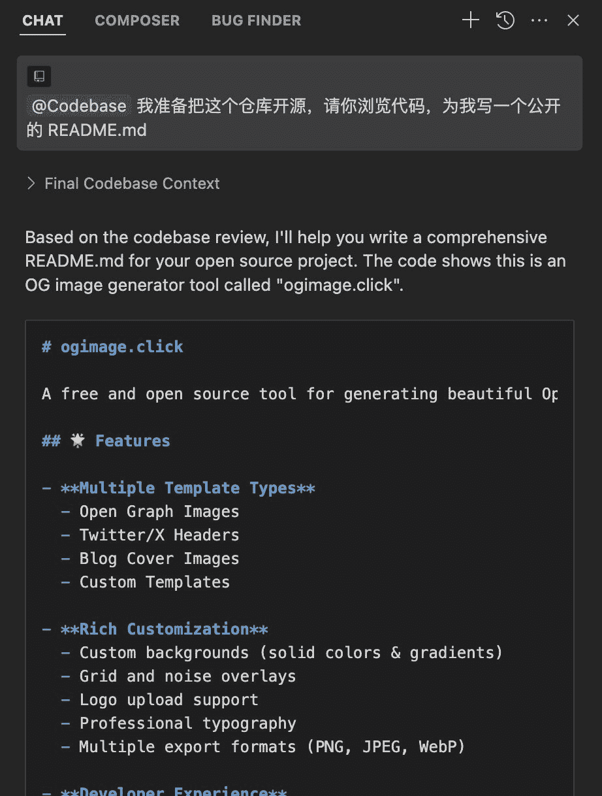
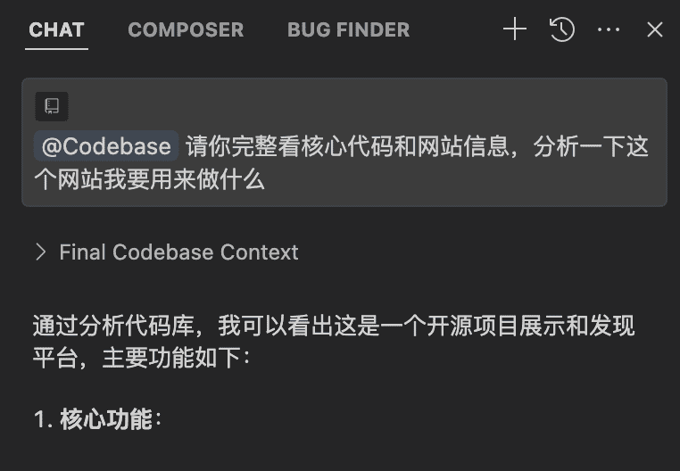
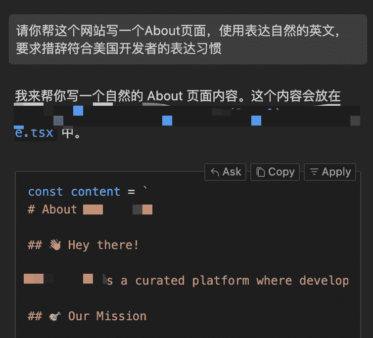
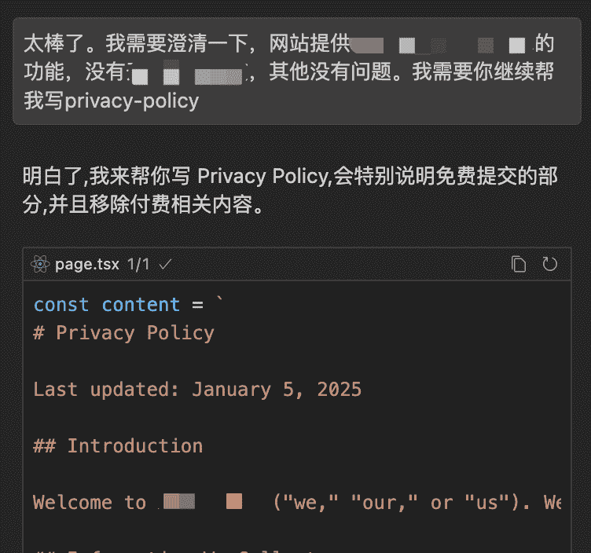

# 快速生成隐私政策、服务条款和关于页面的方法分享

> 来源：[https://qianniucity.feishu.cn/docx/RIqCdWBeCooURMxLXifcggZintd](https://qianniucity.feishu.cn/docx/RIqCdWBeCooURMxLXifcggZintd)

在你进行网站或者应用的开发，首先必须要文档化的隐私政策（Privacy Policy）， service terms （Terms of Service） 和 About Page 等。当然，这类文档的创造是典型的 kill 多数人时间的事，特别是当你需要逐字逐句去写修改的时候，那真是折磨。今天，我想与大家分享一种快速完成这些文档的快速方法，希望它能对大家有所帮助。

### 为什么不使用的传统

之前，我编写页面的时候一般都会用 Claude 或者其他任何我会调出的 AI 工具，告诉我网站然后根据我的描述生成这个页面（也许是文档）。但我有一个明显的缺点：例如我一开始没有将所有内容描述好，AI 生成的内容就可能与实际的内容不一致。这之后，我需要和 AI 进行多轮对话，不断补充修改直到得到一个最终的结果，这个过程虽然比手写「快」，但仍然还是比较繁琐。

### 更高效写法：代码内容生成内容 + 代码

现在，我发现一种更快的写法就是直接通过 Cursor 的@codebase 功能 让 AI 直接去读取代码，通过 AI 为我生成文档。这种不仅效率高，而且生成内容精准。

#### 用法 1：比较简单普通项目直接生成

如果你项目代码相对简单， feature 相对一目了然，可以直接让 AI 读你的代码，生成 xyz 隐私政策，service terms 以及 about us 页面。比如 p1 没什么好说的，直接指令，AI 就能快速正确的给你结果，适合很多小项目或功能上简单应用。

#### 用法 2：复杂的时候先摘要生成

当项目中代码量比较大，并且存在严重部分代码逻辑未被执行记录时，就让 AI 去摘洒整个网站的功能后，再开始生成文档。比如在 p2-p4 的案例中，AI 生成的文档可能考虑到一些没实际被使用的代码逻辑，导致此部分生成文档有偏差。直接要求 AI 重写 / 修正这句话就好，虽然多了一步但整体效率还是比传统高很多。

### 方法优势

1.  准确估计度：直接读取源码，让 AI 从更方面程度理解项目功能，生成更容易符合实际的需求内容

1.  节省开销：不逐字解释或者两轮对话，多快文档人力成本。

1.  范围大：从小项目到复杂的系统性功能，都可以根据流程的调整

### 总结

其实这个方法是利用了 AI 和工具的结合的独有优势，将文档生成这个很繁琐的事情简单和高效化了。同样，如果你已经开始在写隐私政策、服务条款或者关于页面了，那就试试这个方法，可以让你的开发工作更加简单。谢谢你的阅读！

### Prompt

+   @Codebase 我准备把这个仓库开源，请你浏览代码，我为写一个 公开的 README.md

+   @Codebase 请你完整看核心代码和完整信息，分析一下这个网站我要用来做什么

+   请帮这个网站写一个 About 页面，使用表达自然的英文，要求措辞符合美国开发者的表达习惯

+   @Codebase 请你完整看核心代码和完整信息，看下这段代码有哪些优化空间

+   @Codebase 请你完整看核心代码和完整信息，看下这段代码有哪些优化空间

+   @Codebase 请你完整看核心代码和项目的架构，分析下这个网站，如果要做国际化，需要怎么做

+   @Codebase 请你完整看核心代码和完整信息，分析一下这个网站我要用来做什么

+   @Codebase 请你完整看核心代码和完整信息，严格 ESLint 要求，帮我 check 下代码，找出需要优化的地方