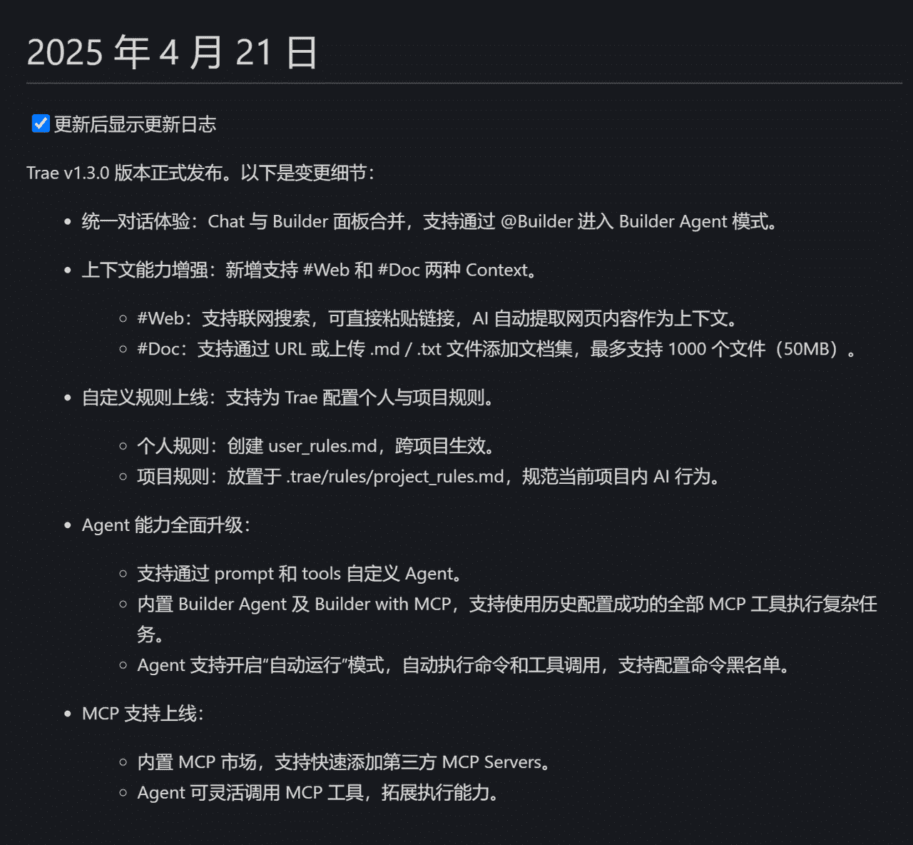
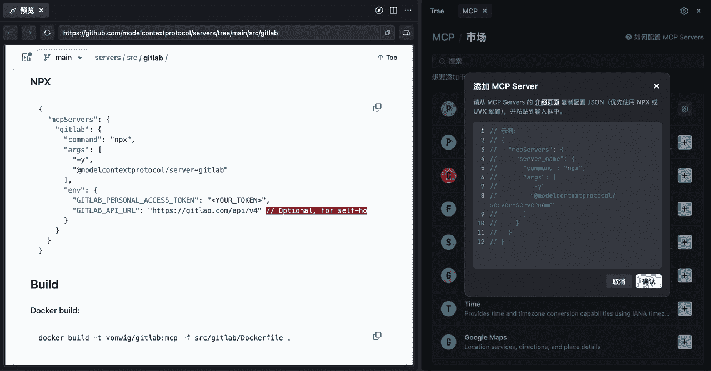
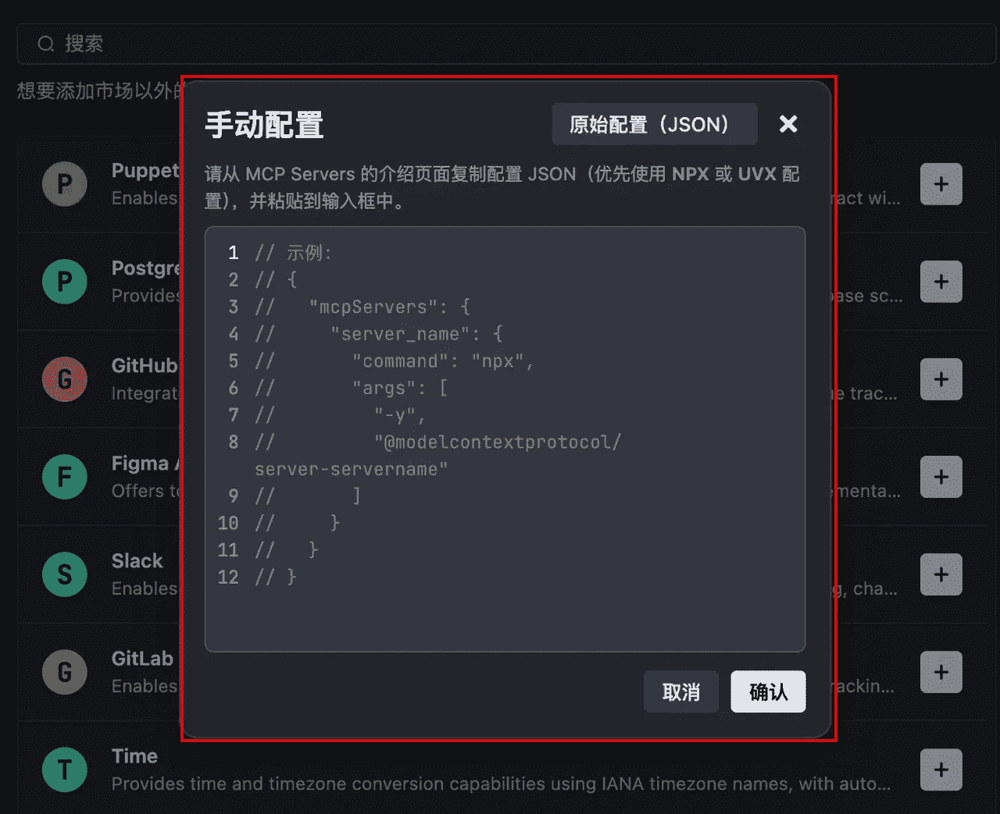
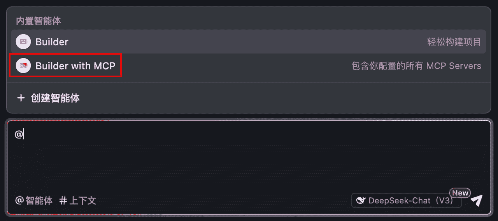

# 字节 Trae 支持 MCP 了

> 来源：[https://qianniucity.feishu.cn/docx/C1JHdqUKioOQSrxQkTGccagFnLb](https://qianniucity.feishu.cn/docx/C1JHdqUKioOQSrxQkTGccagFnLb)

> 字节 Trae IDE 发布重大更新，最新版本增加了对 MCP 的支持， 同时对 Agent 能力做了全面提升。通过连接外部工具和服务来增强大型语言模型的功能性。

## MCP 在 Trae IDE 中的支持方式

Trae IDE 支持两种 MCP 传输类型：

+   stdio 传输

+   SSE 传输

## 配置 MCP Server

你可以直接从市场中添加合适的 MCP Server，或手动配置。

### 方式一：从市场添加

1.  在 AI 对话窗口右上角点击设置图标 > MCP

1.  点击"+ 添加"按钮进入 MCP Server 市场

1.  从列表中选择所需的 MCP Server，点击"+"按钮

1.  配置服务器（对于标记为"轻松配置"的服务器，需要将 JSON 配置内容粘贴并替换真实的 API Key 等信息）

1.  点击确认按钮完成配置

### 方式二：手动配置

1.  在 AI 对话窗口右上角点击设置图标 > MCP

1.  点击"+ 添加"按钮进入 MCP Server 市场

1.  点击"手动配置"

界面上显示 **手动配置** 窗口。

1.  配置 MCP 服务器。

> 优先使用 NPX 或 UVX 配置。

+   若你已在其他 IDE 中配置了 MCP Server，并希望在** Trae IDE **中复用。你可以点击 原始配置（JSON） 按钮，然后将 MCP Server 的 JSON 配置内容粘贴至 Trae IDE 的 mcp.json 文件中。粘贴完成后，MCP 列表中将自动添加相应的 MCP Server。

+   若你希望添加一个全新的 MCP Server，将 J**SO**N 配置内容填入输入框中，然后点击 确认 按钮。该 MCP Server 将被添加至 MCP 列表中。

## 在智能体中使用 MCP Server

### 内置智能体：Builder with MCP

Builder with MCP 是 Trae IDE 的内置智能体，所有已配置的 MCP Server 都将被自动添加至该智能体，且不可编辑。

### 自定义智能体

你可以将 MCP Server 添加到自定义智能体中进行使用，由智能体自动调用 MCP Server 中的工具来完成任务。创建智能体时，你可以为其添加 MCP Server。

## 管理 MCP Server

你可以编辑或删除 MCP Server。

## 注意事项

+   MCP Server 由第三方构建和维护，Trae 不对其行为或返回的数据负责

+   部分 MCP Server 可能因法律法规、网络限制或访问策略在某些地区无法使用

+   用户使用这些服务器时应确保遵守当地法律法规

这一功能使 Trae IDE 能够扩展其能力，通过连接外部工具和服务来增强大型语言模型的功能性。