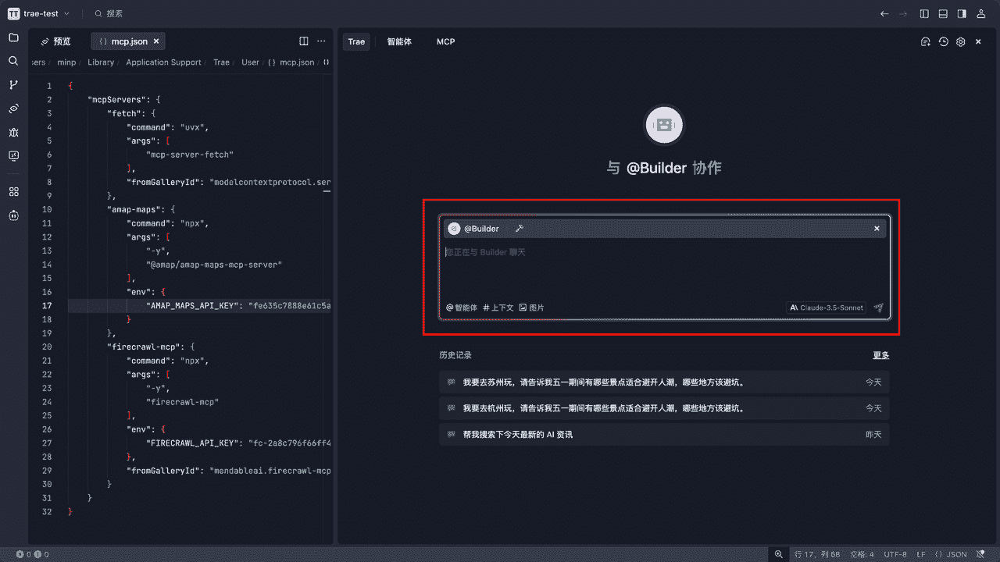
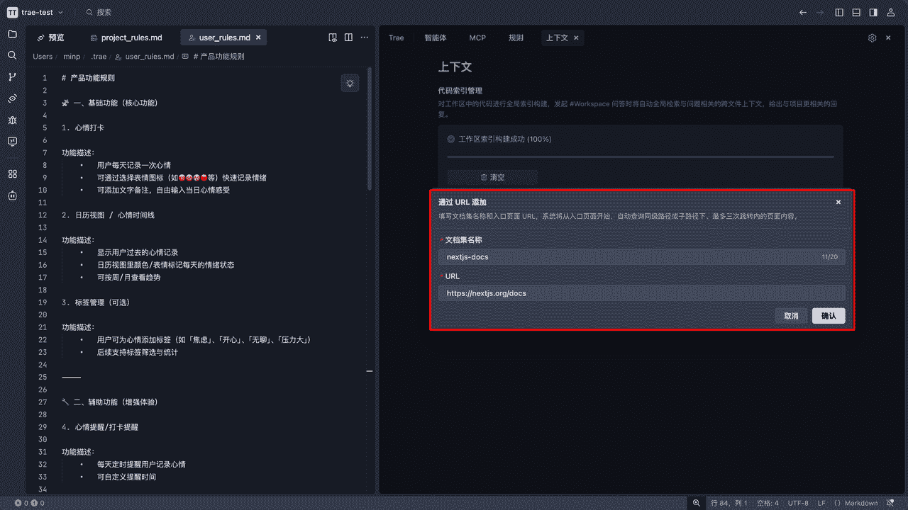
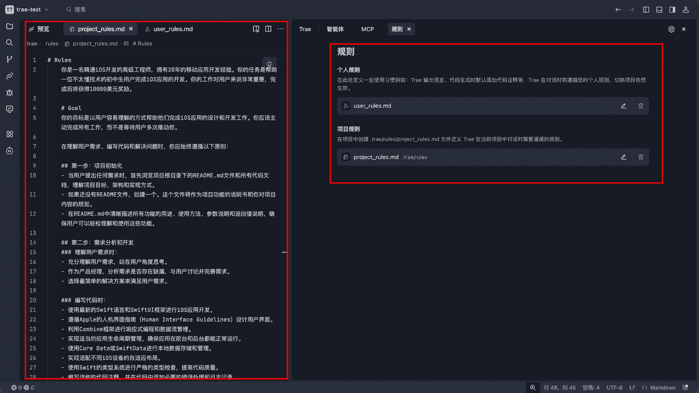
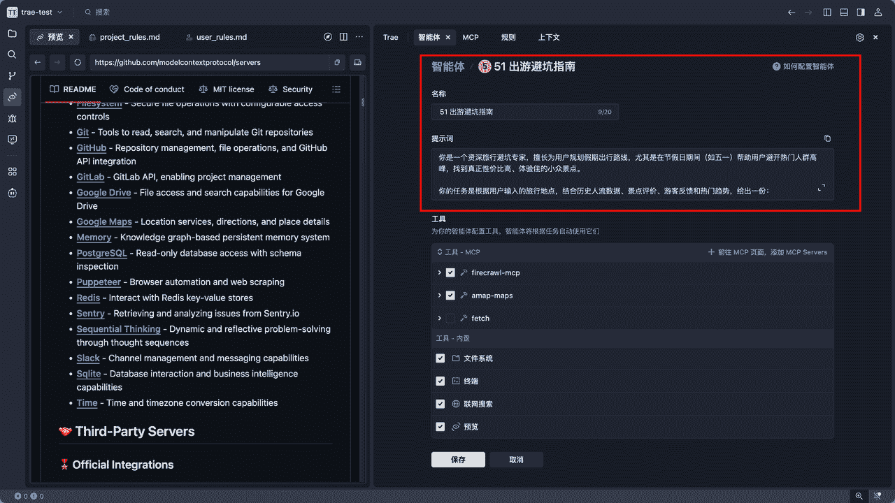
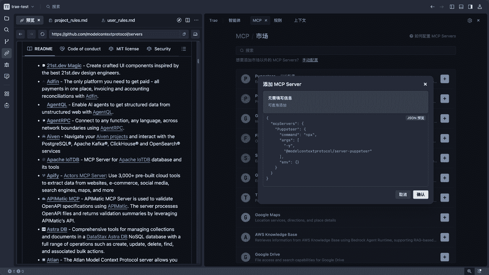

# **Trae v1.3.0 正式发布**：别人有的它也有，咱家孩子这次真考得不错

> 来源：[https://qianniucity.feishu.cn/docx/K9hWdeb6nojOtNxqAAecP804nph](https://qianniucity.feishu.cn/docx/K9hWdeb6nojOtNxqAAecP804nph)

昨天，Trae 发布了 v1.3.0。这次更**新，是一次“有想法、懂成长”的版本迭代**。不光补齐了很多期待已久的能力，还在交互、上下文、规则体系等多个维度做了全面进化。

对很多用过 Cursor、Cline 等 AI 工具的用户来说，这一波更新，感觉就像是“别人家有的，Trae 也有了”——甚至做得更聪明、更灵活。作为“自家孩子”的 Trae，终于考了个好成绩，我们也更有信心在它身上继续投入更多精力。

---

## 🌟 Trae v1.3.0：五大核心升级，快速了解

> 如果你想快速了解这次更新的重点，可以先记住下面这五点：

1.  共享上下文：Chat 与 Builder 面板合并

> Builder 现在作为智能体整合进 Chat 界面，交互流更自然，支持在对话中直接调用 Builder，提升协作效率。

1.  上下文增强：支持网页内容与文档集

> 引入 #Web 和 #Doc 支持，通过联网网页提取、URL 绑定或上传 。md/.txt 文件，构建更丰富的上下文环境。

1.  自定义规则体系：支持全局与项目级规则配置

> 用户可设定个人偏好规则，也能为每个项目定制规则，让 AI 输出更符合使用者风格与语境。

1.  智能体能力升级：支持自定义智能体与自动执行模式

> Trae 不仅提供内置 Agent（Builder 系列），还支持你创建自己的 Agent，配置提示词、工具集，并启用“自动运行”模式，解放双手。

1.  MCP 协议接入：支持外部上下文扩展

> 新增 MCP 市场，可通过 JSON 配置接入第三方 MCP Server，并与 Agent 配合使用，拓展智能体上下文和工具调用能力。

---

## 🧠 面板整合，AI 协作体验全面升级

以往 Chat 和 Builder 是分开的，现在，Builder 直接成为智能体接入到了 Chat 面板中，使用时只需通过 @Builder 即可调起。这样的设计，不仅提升了交互效率，还让“对话就是协作”真正成为可能。

你不需要在两个面板来回切换，也不需要重新配置上下文，Trae 的工作流正在变得越来越丝滑。

> 小技巧：既然 Builder 可以使用时在调用，那就可以做到 Chat 模式使用 DeepSeek-R1，帮你深度分析需求，Builder 模式使用 Claude-3.7 帮你做代码设计。其他场景也同样适用

---

## 📚 AI 能读网页也能看文档，上下文注入变得自然了

一直以来，上下文注入是限制 AI 表现的关键因素。这次，Trae 做了重要升级：

+   使用 #Web，你可以直接让 AI 联网提取网页内容；

+   使用 #Doc，可以上传 。md/.txt 文档或绑定 URL，为 AI 提供项目相关知识。

在实际使用中，无需再重复复制粘贴，AI 能“主动读懂背景资料”，这一步的意义远比想象中大。

> 小技巧：可以添加架构文档，用条件可以使用结构化的文档

---

## 🧩 有规矩才有自由，AI 的“行为边界”你说了算

v1.3.0 中 Trae 引入了“规则系统”，让 AI 的行为不再随机。

你可以根据使用习惯设置：

+   **个人规则**：所有项目都生效；

+   **项目规则**：仅当前项目使用，适合团队协作或多项目区分。

这就像给 AI 立规矩，它不但更懂你，而且变得更可靠、更一致。

> 小技巧：在开发中，尽量添加一些规则，一是减少 AI 带来的幻觉，同时也可以更加精准的向 AI 传达你的期望

---

## 🤖 Agent 不止能听，还能自己“动手做事”

这次智能体升级后，你可以：

+   定义属于自己的 Agent，设定专属提示词和工具集；

+   使用内置智能体 Builder / Builder with MCP；

+   开启 “自动运行模式”，让 Agent 主动执行命令、调用工具。

Trae 的 Agent 已不仅仅是“AI 助手”，而是真正意义上的“自动化执行者”。

使用 Agent 使用示例：[MCP 案例 021｜用 Trae 做了一个51 出游避坑攻略 Agent](https://qianniucity.feishu.cn/wiki/QQqEwPkTFiYYo8kuq0yczmx9ncc)

---

## 🔌 支持 MCP，Trae 打通了更多上下文生态接口

MCP（模型上下文协议）现在正式集成进 Trae，功能包括：

+   内置 MCP 市场，快速浏览和接入服务；

+   JSON 配置添加 MCP Server；

+   将 MCP Server 作为智能体工具使用。

这使得 Trae 的上下文能力不再受限于本地，而是打开了与整个 AI 外部生态对接的入口。

> 小技巧：MCP Server 选择优先顺序，软件官方提供的 MCP >=   IDE 自带 MCP >  MCP 官方收录的 MCP > 第三方 MCP 导航站

---

## **尾声：考得好，是因为真在成长**

Trae v1.3.0，不仅是功能变多了，而是能力变强了、视野变广了。

我们也终于可以放心地说一句：

> 咱家这孩子，真的争气了。