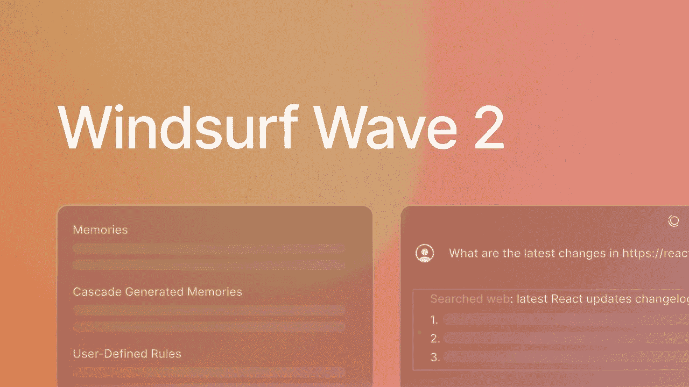
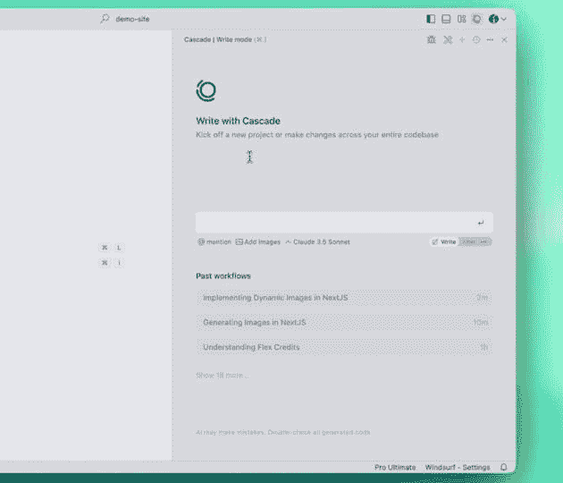
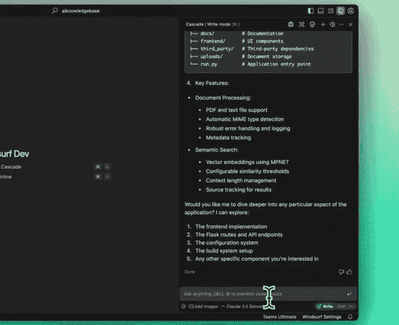
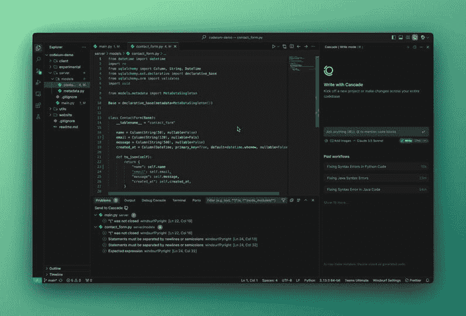

# Windsurf 发布了最新 Wave 2

> 来源：[https://qianniucity.feishu.cn/docx/DXkedmAeUomWYBxx5GYc8prxnWd](https://qianniucity.feishu.cn/docx/DXkedmAeUomWYBxx5GYc8prxnWd)

# 以下是更新的主要内容：

+   网络搜索（Web Search）

+   自动化记忆（Automated Memories）

+   企业级支持（Enterprise Ready）

+   代码执行优化（Code Execution Improvements）

+   问题标签页（Problems Tab）

+   问题解释界面（Explain Problem UI）

# 功能详细总结：

+   网络搜索：Cascade 现在可以自动搜索互联网获取上下文信息，支持使用 @ 命令读取指定 URL 内容，兼容企业 VPN 环境，访问内部网络资源。

+   自动化记忆：系统自动学习和记录用户工作模式，保存到可查看和编辑的记忆库中，提供个性化支持。

+   企业级支持：支持企业级 SaaS 和混合部署，优化大规模复杂代码库，提供 SSO、深度分析、培训支持等。

+   代码执行优化：通过底层 IDE 终端 shell 执行命令，支持虚拟环境（venv）和开发容器（devcontainer），提高执行效率和安全性。

+   问题标签页：新增与 Problems Tab 集成，用户可直接将问题推送给 Cascade，无需手动复制粘贴。

+   问题解释界面：在编辑器中展示问题分析和修复建议，简化问题解决流程。

# 功能使用说明及优化

### 网络搜索功能

Cascade 新增网络搜索能力，支持多种搜索方式：自动触发搜索、URL 内容读取、@web 命令和 @docs 文档搜索。用户可通过状态栏底部的 Windsurf 设置面板开启或关闭此功能。每次网络搜索消耗 1 个 flow action 信用，额外的 URL 页面读取需要额外信用。

[cascade-web-search-screen.mp4](https://internal-api-drive-stream.feishu.cn/space/api/box/stream/download/all/RDLbbWzlxof52PxF2rLcGtkMnee)

### 自动记忆系统

系统现在能够自动生成记忆以保持对话上下文的连续性。用户可以随时提示 Cascade 创建记忆，所有记忆都可以在记忆面板中查看和管理。值得注意的是，记忆的生成不消耗任何 flow action 信用。

[cascade-auto-memories-screen.mp4](https://internal-api-drive-stream.feishu.cn/space/api/box/stream/download/all/🐧V3b2og3olP0zxJc1DcxNzLnCh)

### Dev Container 支持改进

Windows 平台的 Dev Container 支持进入测试阶段，新增了工作区标签优化、容器切换功能、实时 CLI 输出等特性。同时改进了容器配置支持，包括 remoteUser 配置和容器元数据的识别。

[send-problems-cascade.mp4](https://internal-api-drive-stream.feishu.cn/space/api/box/stream/download/all/N5y7bLJNUoY4tkxkEticoej1nNg)

### 系统优化与修复

修复了多个关键问题，包括智能提示选项、差异对比、文档字符串处理等功能的 Bug。同时优化了 SSH 代理转发、Cascade 查找工具的性能，提升了系统稳定性和错误可见性。对规则遵守和自动生成记忆的整体处理也有所改进。