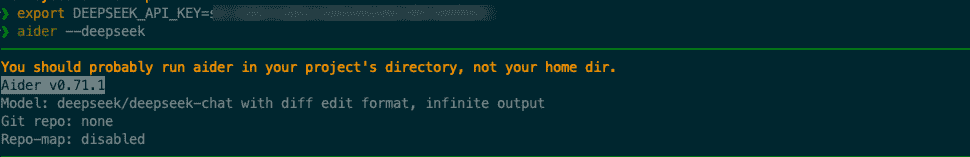
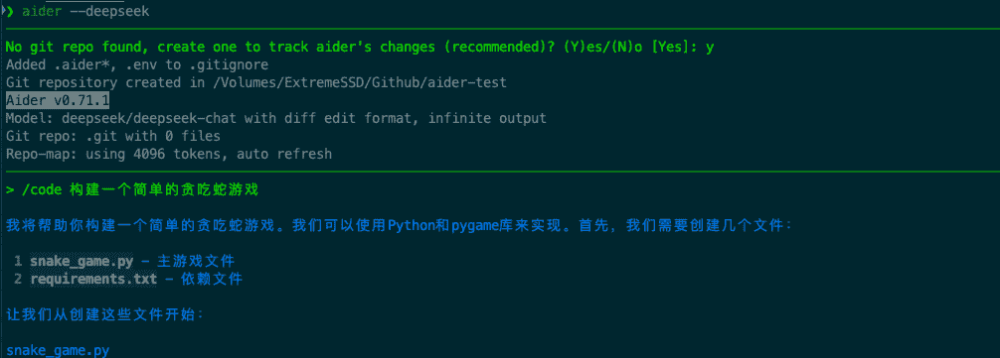
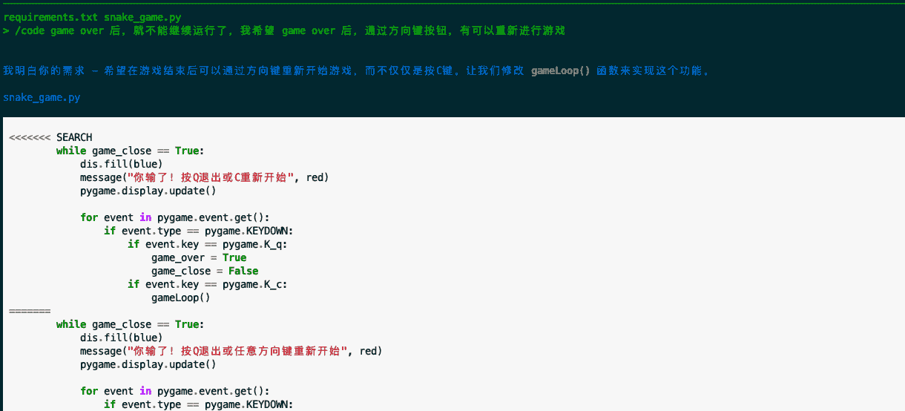
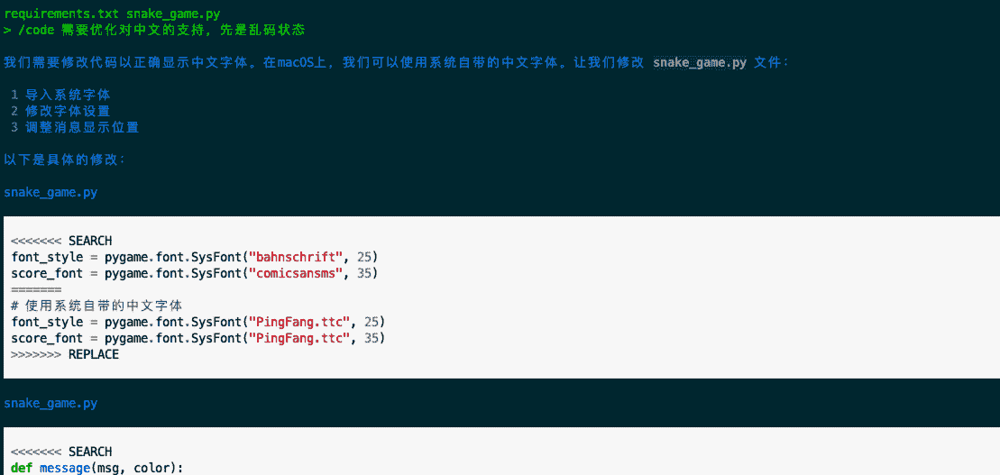
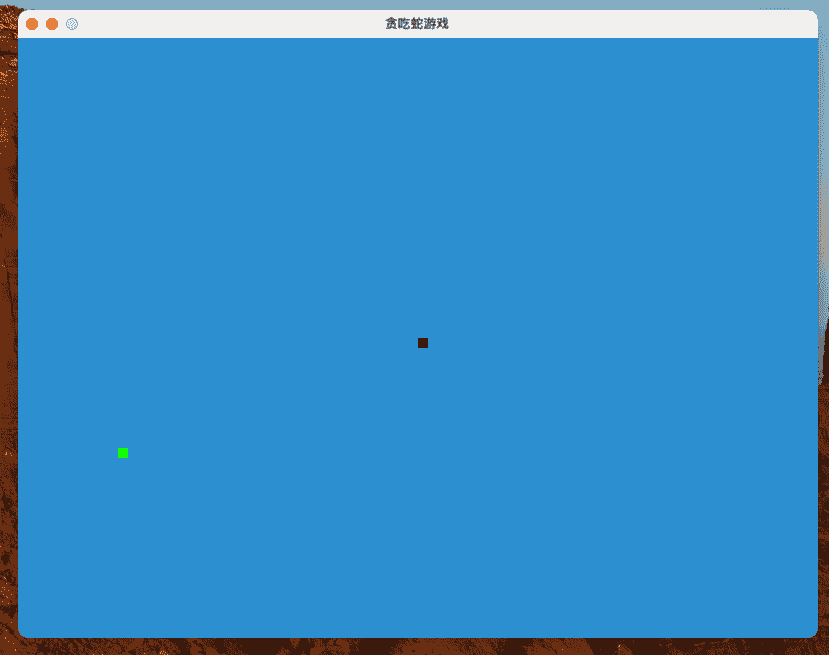

# Aider + Deepseek 安装配置实践

> 来源：[https://qianniucity.feishu.cn/docx/ERc5dynpbodoluxcCdwcfTrUnCd](https://qianniucity.feishu.cn/docx/ERc5dynpbodoluxcCdwcfTrUnCd)

### 安装 Aider

#### Windows

```
powershell -ExecutionPolicy ByPass -c &quot;irm https://aider.chat/install.ps1 | iex&quot;
```

#### Mac & Linux

使用curl下载脚本并使用sh执行：

```
curl -LsSf https://aider.chat/install.sh | sh
```

如果你的系统没有curl，你可以使用wget：

```
wget -qO- https://aider.chat/install.sh | sh
```

### 配置 Deepseek

```
python -m pip install -U aider-chat

export DEEPSEEK_API_KEY=&lt;key&gt; # Mac/Linux
setx   DEEPSEEK_API_KEY &lt;key&gt; # Windows, restart shell after setx

# Use DeepSeek Coder V3
aider --deepseek
```



### 编程实践：

#### 构建贪吃蛇游戏



#### 优化游戏体验



#### 修复 bug



#### 最终效果



#### 优势

+   支持中文prompt

+   支持配置各种第三方 API

+   习惯用 vim 的大牛，不二的选择

### 相关链接

+   Aider 官方文档： https://aider.chat/

+   Deepseek 官网： https://www.deepseek.com/