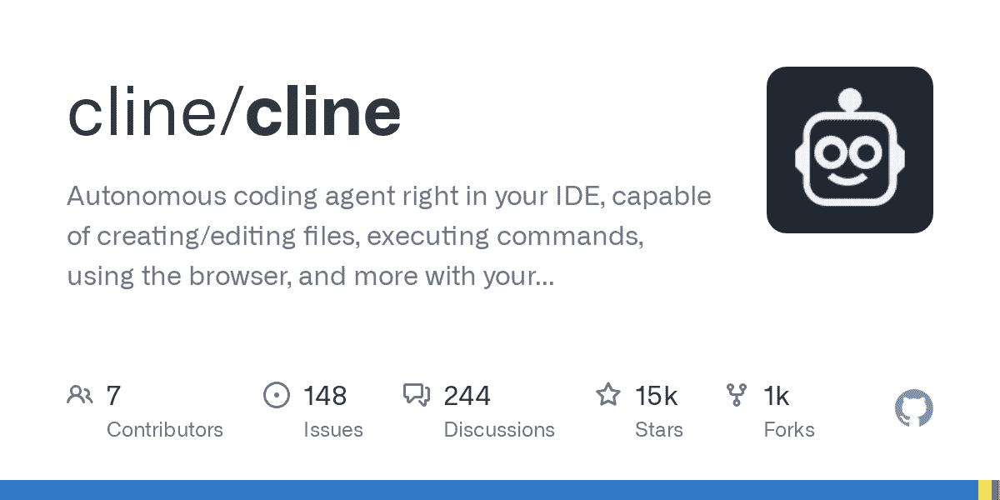

# Cline：AI 编程助手

> 来源：[https://qianniucity.feishu.cn/docx/KMaAd4RkoovreUxeulMcYY8hn2d](https://qianniucity.feishu.cn/docx/KMaAd4RkoovreUxeulMcYY8hn2d)



> **Cline** **是一个开**源的 **AI 编**程助手项目，定位类似于 GitHub Copilot 或 Cursor，但更聚焦于 本地部署 和 数据隐私。它为开发者提供了一个集成的、可控的 AI 编程体验，支持常见代码编辑器（如 VS Code、JetBrains 系列）甚至命令行场景使用。

---

## **✨ 核心亮点**

### **🚀 本地化部署，保障隐私**

Cline 支持本地部署大语言模型，例如搭配 Ollama 运行 LLaMA、Mistral、Code LLaMA 等模型，完全脱离云端，代码不会上传。

### **🧠 多模型支持，按需选择**

支持对接多种 LLM 后端（如 OpenAI API、Ollama、本地 GGUF 模型等），你可以根据项目复杂度和资源情况选择合适模型。

### **👨‍💻 深度集成编辑器**

目前 Cline 提供了适配以下开发工具的插件或代理功能：

+   Visual Studio Code（VS Code）

+   Neovim

+   JetBrains 系列（通过 HTTP 代理方式集成）

+   命令行 Terminal 工具

### **💡 常用编程功能集成**

包括但不限于：

+   **代码补全**（智能补齐函数、变量、逻辑块）

+   **代码解释与重构建议**

+   **代码注释生成**

+   自然语言生成代码（Code from Prompt）

+   **快速查 bug / 错误解释**

---

## **🧰 技术栈 & 部署方式**

Cline 的后端基于 Python FastAPI 构建，前端管理面板使用 React，整体架构简洁轻量，适合个人部署或团队定制。

### 快速部署示例（搭配 Ollama）：

```
docker run -d \
  -p 3100:3100 \
  -e OLLAMA_BASE_URL=http://host.docker.internal:11434 \
  cline-dev/cline:latest
```

## **🔗 应用场景**

+   本地开发时 AI 辅助编程

+   企业代码审查流程自动化

+   用于教育与教学辅助编程理解

+   搭配私有代码库做智能分析和建议生成

---

## **🌐 开源项目地址**

GitHub 地址：👉 https://github.com/Cline-Dev/cline

文档地址：👉 https://cline-dev.github.io

---

## **🧩 与其他编程助手的对比**

如果你正在寻找一款支持本地部署、可控性强、体验接近 GitHub Copilot 的 AI 编程助手，Cline 是当前开源生态中极具潜力的选择之一。尤其适合：

+   担心代码泄露的开发者

+   偏好使用 LLM 自托管环境的工程团队

+   希望个性化定制编程助手的技术爱好者