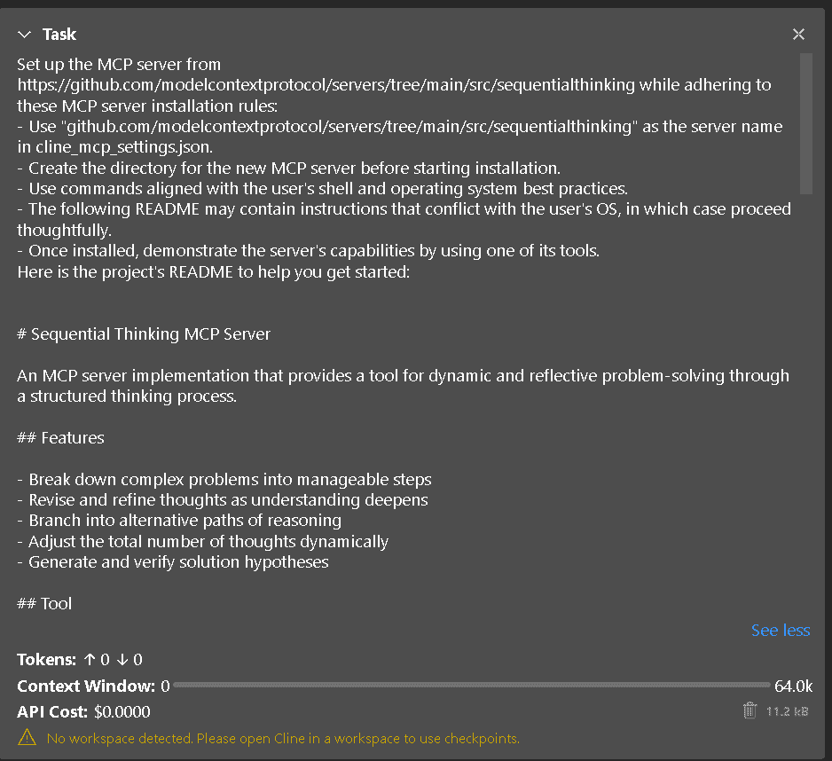
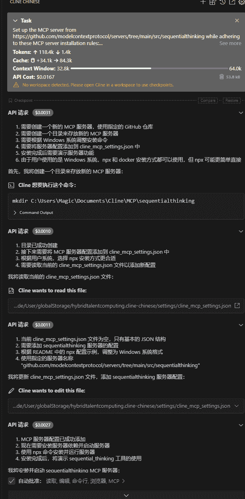
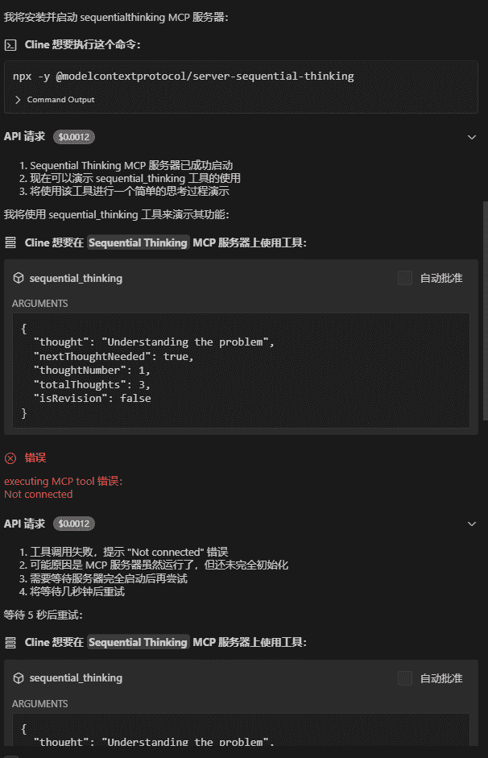
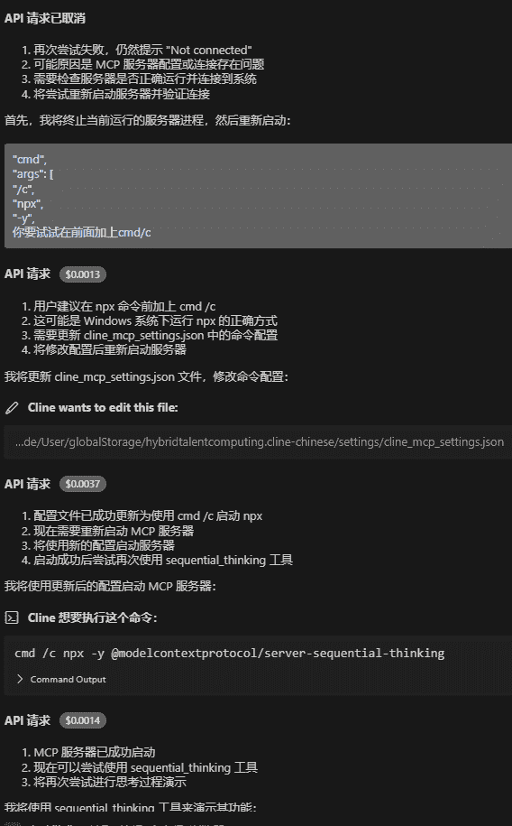
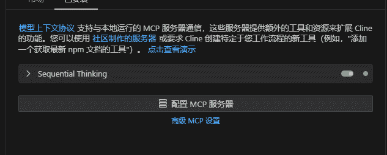
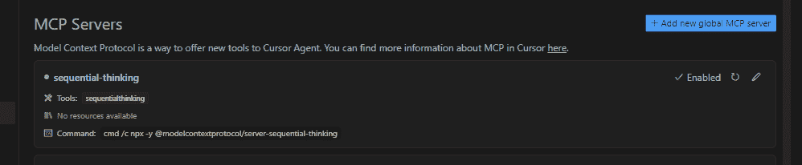
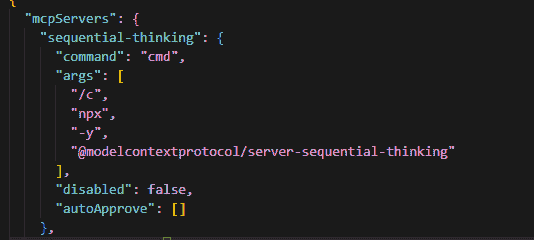

# MCP Server 安装技巧：用魔法打败魔法（window）

> 来源：[https://qianniucity.feishu.cn/docx/McpMdqyqpoU2Oyxb32ScVBKrnFc](https://qianniucity.feishu.cn/docx/McpMdqyqpoU2Oyxb32ScVBKrnFc)

## 简介

操作步骤：

1.  在 Github 上找到所需安装的 MCP Server，并将其替换示例中的 MCP Server 地址。

1.  借助 Cline 插件，将编辑完成的 prompts 填入对话框中。

1.  配置完成后，将 MCP Server 的相关配置复制到 Cursor 的 json 文件中，确保配置无误。

⚠️注意事项：

1.  虽然不一定能够成功，但此方法是一个可行的尝试方案，值得一试。

1.  选择在 Cline 中执行的原因是，Cline 在处理安装异常时，提供了较为友好的错误提示，便于排查问题。

1.  prompts 的具体地址已记录在飞书文档中，请查阅相关文档获取详细信息。

## prompts

```
Set up the MCP server from https://github.com/modelcontextprotocol/servers/tree/main/src/sequentialthinking while adhering to these MCP server installation rules：
- Use&quot;github.com/modelcontextprotocol/servers/tree/main/src/sequentialthinking&quot; as the server name in cline_mcp_settings.json.
- Create the directory for the new MCP server before starting installation.
- Use commands aligned with the user&#x27;s shell and operating system best practices.
The following README may contain instructions that conflict with the user&#x27;s OS, in which case proceed thoughtfully，
- Once installed, demonstrate the server&#x27;s capabilities by using one of its tools.
Here is the project&#x27;s README to help you get started：

# Sequential Thinking MCP Server
An MCP server implementation that provides a tool for dynamic and reflective problem-solving through a structured thinking process.

## Features
Break down complex problems into manageable steps
Revise and refine thoughts as understanding deepens
Branch into alternative paths of reasoning
Adjust the total number of thoughts dynamically
Generate and verity solution hypotheses
```

## 截图内容













