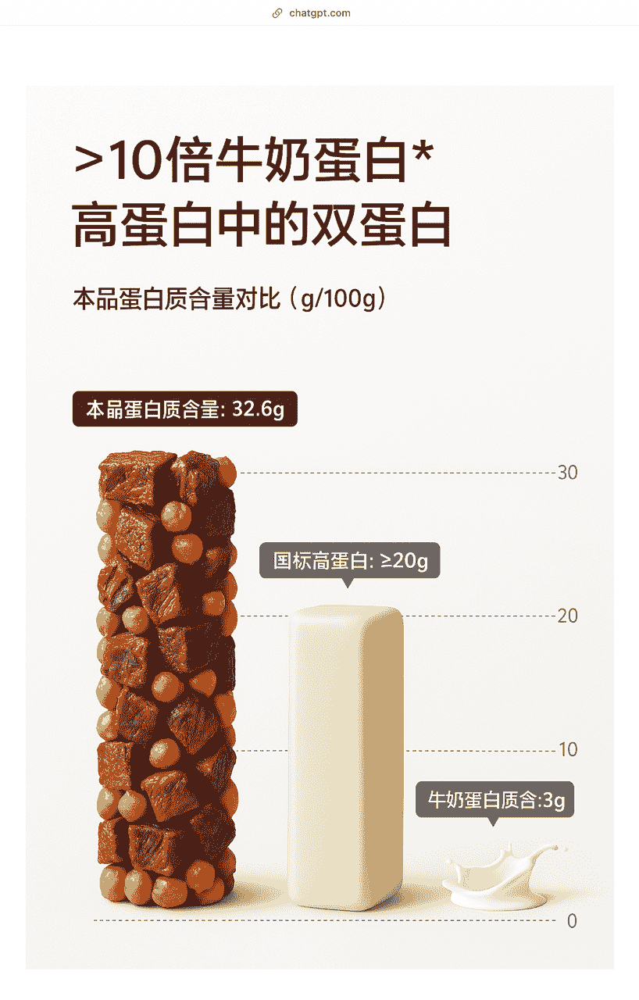
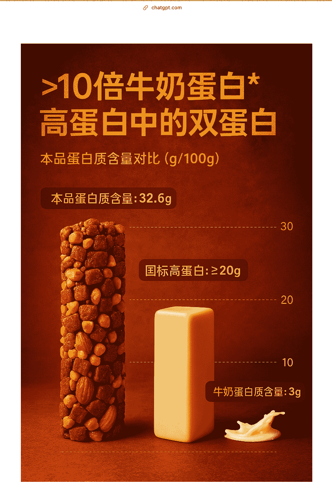

# 生成一张产品营养成分对比图

> 来源：[https://qianniucity.feishu.cn/docx/VZZTdhIlDo7txfx7Vm9cWNwSnmf](https://qianniucity.feishu.cn/docx/VZZTdhIlDo7txfx7Vm9cWNwSnmf)

生成一张产品营养成分对比图。（竖图）用于电商详情页。图片细节如下：

白色背景

图中主要元素是三个柱状对比图，三个柱形分别为：

1.  鹰嘴豆和牛肉方块混杂构成的长方体柱状

1.  奶油构成的长方体柱状

1.  液态溅开的一团牛奶

文本如下：

上方标题：>10倍牛奶蛋白高蛋白中的双蛋白

次标题：本品蛋白质合量对比(g/100g)

三个柱状上方的文字：

本品蛋白质含量:32.6g

国标高蛋白:≥20g

牛奶蛋白质合:3g

图片右侧需要以0、10、20、30的刻度虚线数轴来方便识别柱状体达到的营养含量高度。

浅色背景，食欲感，高清。

确保主要视觉元素排版合理，不要相互遮挡。

