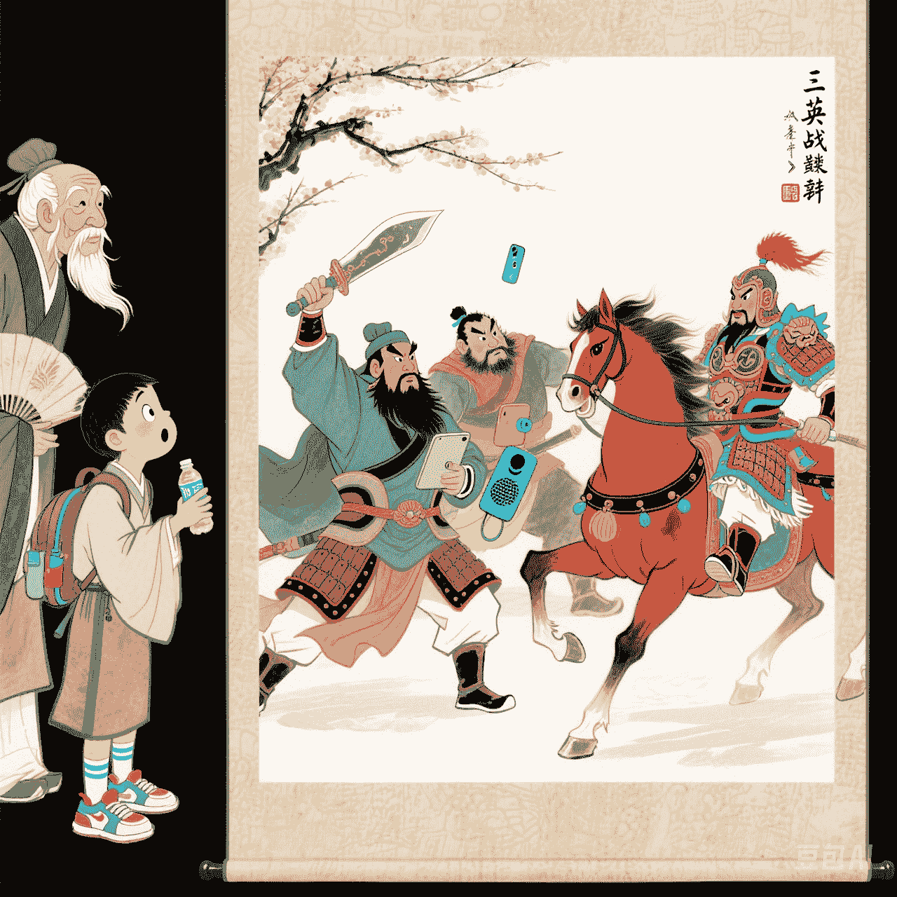
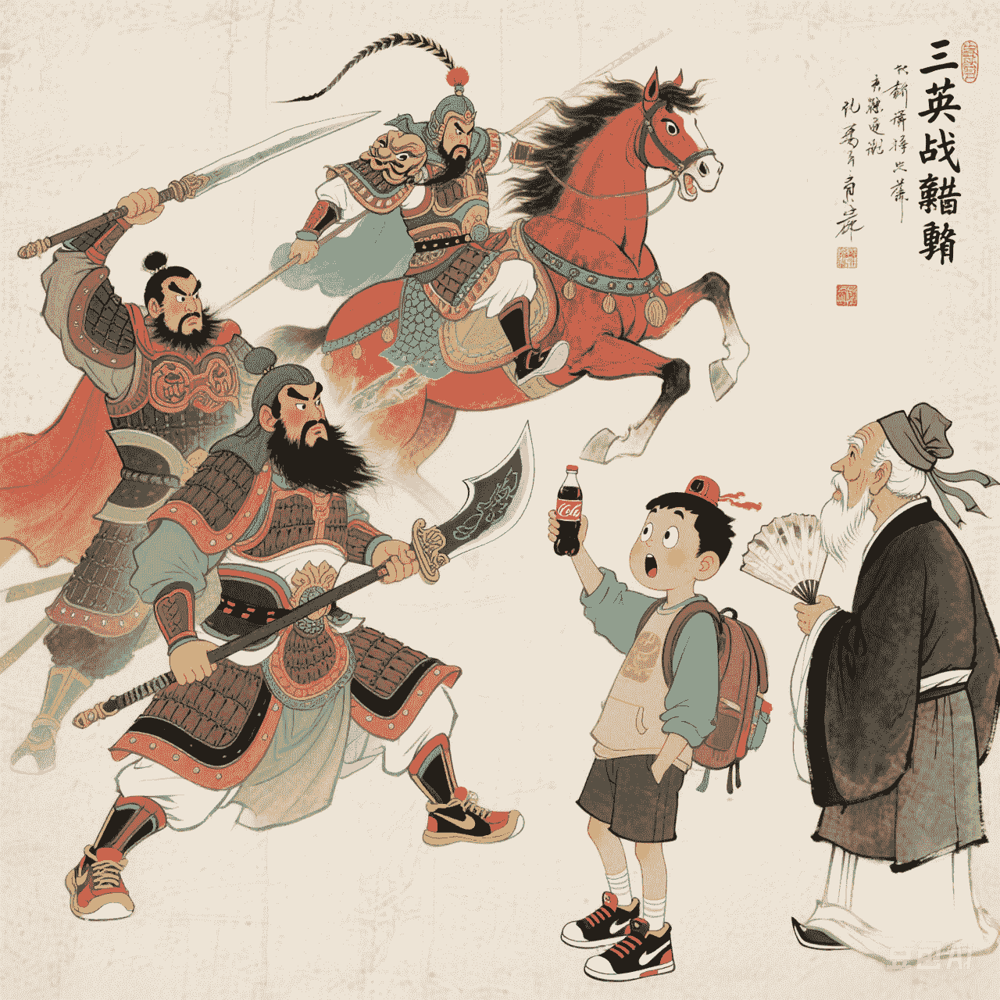
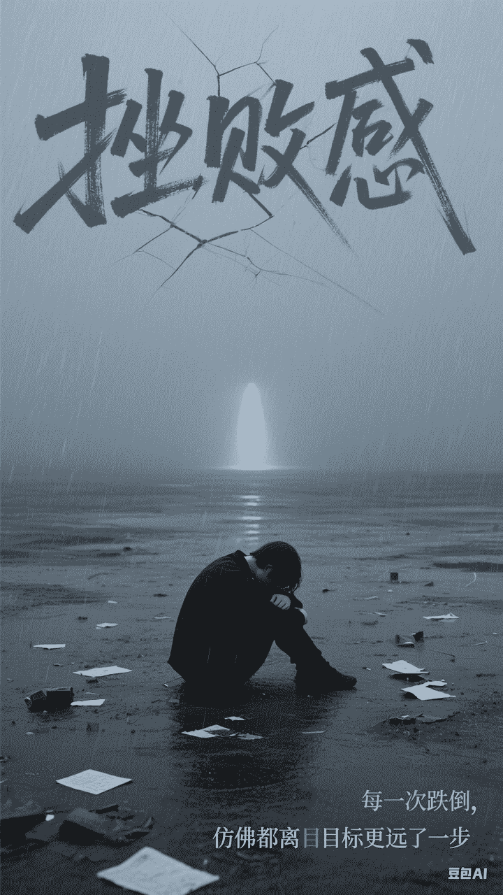
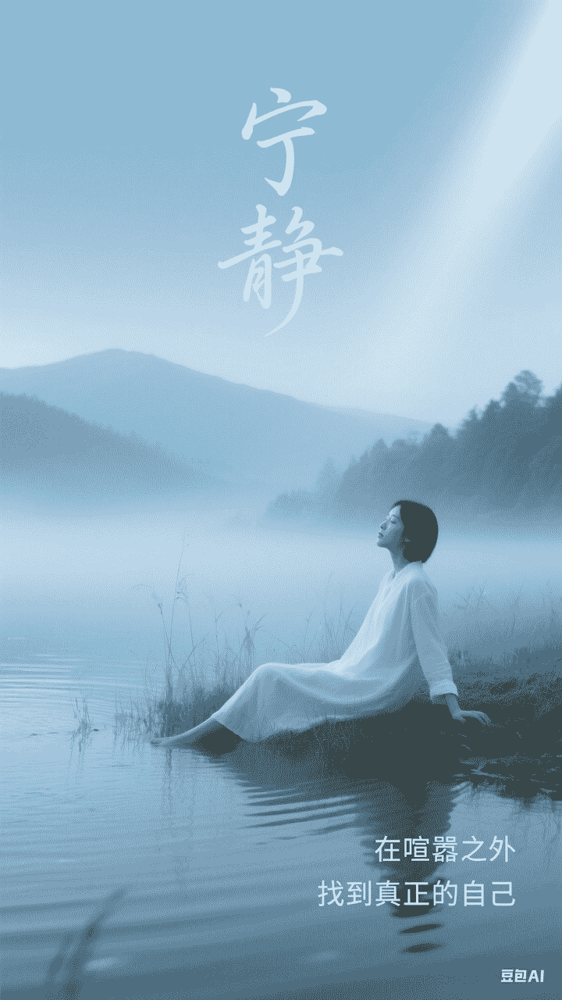

# 文生图模板

> 来源：[https://qianniucity.feishu.cn/docx/BLdOdg4FEoorIOxiAcfcdTUYnoc](https://qianniucity.feishu.cn/docx/BLdOdg4FEoorIOxiAcfcdTUYnoc)

## 混搭趣味插图

> 《三英战吕布》混搭趣味插画：仿古绢本纹理为背景，右侧题跋并钤朱印；画面前景，一位头戴纶巾、羽扇轻摇的谋士模样老者抚须旁观，神情沉稳，身旁少年背着书包、脚蹬运动鞋，手握可乐瓶，满脸惊讶地张望画中情景；画卷中心描绘刘备、关羽、张飞三兄弟身披战甲、手持兵器，正与头戴雉尾冠、身披兽面连环铠的吕布激烈交战，吕布胯下赤兔马鬃毛飞扬、气势如虹；细看之下，张飞竟掏出手机，摆出自拍姿势；关羽则一手执青龙偃月刀，另一只脚上赫然穿着一双亮眼潮鞋；整幅作品采用工整铁线描结合大胆撞色水彩，战甲以赭石、石青设色，现代元素以荧光色加以点缀；画面留白巧妙，传统战争场景与现代诙谐细节错落共存，展现出古今文化在笔墨之间的荒诞碰撞与趣味张力。





### 提示词技巧

1.  将你觉得不错的提示词使用标签进行包裹 <ref>xxxx</ref>

1.  在最后描述你要做的内容

1.  参考的提示词内容尽量和你要做的内容风格一致

### 流程

1.  先生成提示词

1.  再用提示词生成图片

```
&lt;ref&gt; 《天伦图》画中有画国风幽默插画：竖幅宣纸质感背景，左侧题款与朱印；前景一位身着青色宽袖长袍、拄龙头木杖的老学者探头观画；他身旁一个扎双髻的小童，穿橙色夹袄、牛仔裤，手拿粉色棉花糖，好奇侧目；画轴中描绘一位唐代仕女——发髻簪花，水袖飘飞——站在石台上被忽起的劲风吹起裙裾，姿势与玛丽莲‧梦露著名“裙摆飞扬”造型极度相似；老者神情好色，恨不能钻进画中看到裙底风光；整体采用细腻工笔+淡彩设色，丹青墨线勾勒，局部金粉点饰；留出大片素雅空白，营造古卷质感与现代幽默反差。&lt;/ref&gt; 
参考上面的提示词，写一个类似的提示词，针对《三英战吕布》
```

## 3D 风格建筑

> 3D Q 版迷你风格，一个充满科技感与童趣的迷你谷歌总部建筑，整体外观像一个巨大的彩色“Google”字母积木装置，五彩缤纷，识别度极高。建筑共两层，正面巨大的玻璃幕墙透出内部充满创意的办公场景：墙上有项目白板、趣味贴纸、办公桌上摆着迷你笔记本和智能语音助手模型。空间内布置有滑梯、球池、懒人沙发等标志性谷歌元素。街道上有小巧可爱的人偶角色骑着迷你共享单车、手持平板，沉浸在智慧生活中。四周设有绿植雕塑、AI 机器人装饰、太阳能灯柱，营造出一个未来感与自然融合的微缩城市角落。整体采用城市微缩景观风格，细节极致、风格鲜明，光影柔和，呈现出一个充满创造力的午后时光。


### 提示词技巧

1.  将你觉得不错的提示词使用标签进行包裹 <ref>xxxx</ref>

1.  在最后描述你要做的内容

1.  参考的提示词内容尽量和你要做的内容风格一致

### 流程

1.  先生成提示词

1.  再用提示词生成图片

```
&lt;ref&gt; 3D Q版迷你风格，一个充满奇趣的迷你星巴克咖啡馆，外观就像一个巨大的外带咖啡杯，还有盖子和吸管。建筑共两层，大大的玻璃窗清晰地展示出内部温馨而精致的设计：木质的家具、温暖的灯光以及忙碌的咖啡师们。街道上有可爱的小人偶漫步或坐着，四周布置着长凳、街灯和植物盆栽，营造出迷人的城市一角。整体采用城市微缩景观风格，细节丰富、逼真，画面光线柔和、呈现出午后的惬意感受。 
&lt;/ref&gt; 
参考上面的提示词，写一个类似的提示词，针对【DunkinDonuts】，【甜甜圈】造型
```

## 充满情绪价值的图片





### 提示词技巧

1.  将你觉得不错的提示词使用标签进行包裹 <ref>xxxx</ref>

1.  在最后描述你要做的内容

1.  参考的提示词内容尽量和你要做的内容风格一致

### 流程

1.  先生成提示词

1.  再用提示词生成图片

```
&lt;ref&gt;&quot;设计一张主题为**“挫败感”**的海报。整体画面需传递出深刻的情感冲击力，展现失败、无助和孤独的氛围。画面主体为一个模糊的、笼罩在阴影中的人影，坐在空旷、荒凉的环境中，姿态低沉，充满疲惫感。背景以深色调为主（如深灰、深蓝或黑色），营造出压抑的视觉效果。细节元素可以加入散落的纸张、破碎的物品、模糊的雨滴或裂痕，增强失败的象征性。远处可有一束微弱的光线照射，象征着渺茫的希望。
文字设计：

主标题：“挫败感”，字体使用粗重、破碎感的手写风格，颜色为深灰或黑色，放置于画面上方中央，突出主题。
副标题：“每一次跌倒，仿佛都离目标更远了一步”，字体较小，采用简约风格，颜色为暗红或浅灰，放置于画面下方或角落，低调但有存在感。

整体风格：
极简主义设计，情感氛围浓厚，采用强烈的明暗对比，人物和文字为视觉中心，背景元素简洁但有故事性。色彩避免使用明亮或鲜艳的颜色，专注冷色调和低饱和度的配色，突出挫败感的沉重与孤独。&quot;&lt;/ref&gt; 参考这个 Prompt，帮我做一个 宁静 主题的 Prompt
```