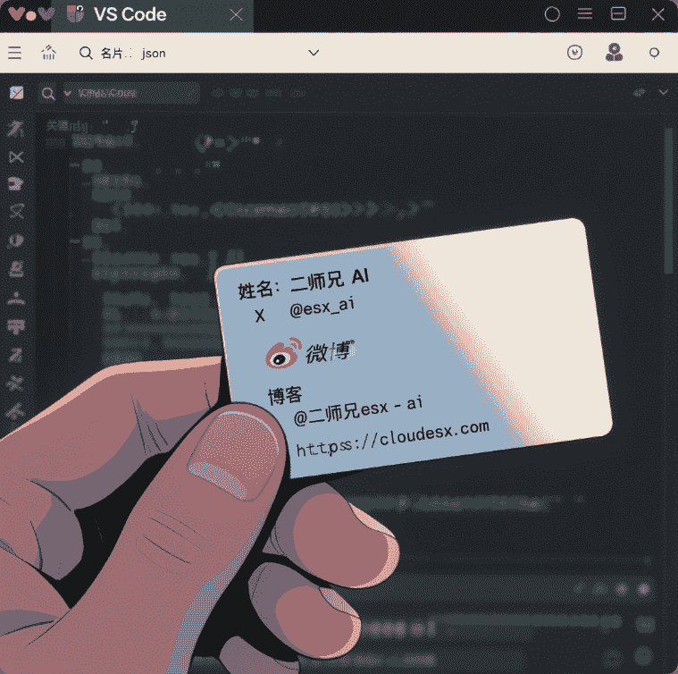

# 画一张程序员名片

> 来源：[https://qianniucity.feishu.cn/docx/XYfqdzBHXoKpnwxy1Wxc3Wnvnrb](https://qianniucity.feishu.cn/docx/XYfqdzBHXoKpnwxy1Wxc3Wnvnrb)

+   请修改中括号【】内信息

+   本图使用 sora.com 生成

```
一张插画特写，展示一只手拿着一张名片。这张名片被设计成在【VS Code】编辑器中打开的【JSON】文件样式。名片上的内容为采用【JSON】语法高亮格式的代码，包含清晰可见的键值对，比如：
- 【&quot;姓名&quot;: &quot;二师兄 AI&quot;】
- 【&quot;X&quot;: &quot;@esx_ai&quot;】
- 【&quot;微博&quot;: &quot;@二师兄esx-ai&quot;】
- 【&quot;博客&quot;: &quot;https://cloudesx.com&quot;】
窗口界面带有标准的工具栏图标和标题栏，标题栏标明文件名【名片.json】，完全模拟【VS Code】的真实暗黑界面风格。背景稍作模糊处理，突出名片本身。
```

