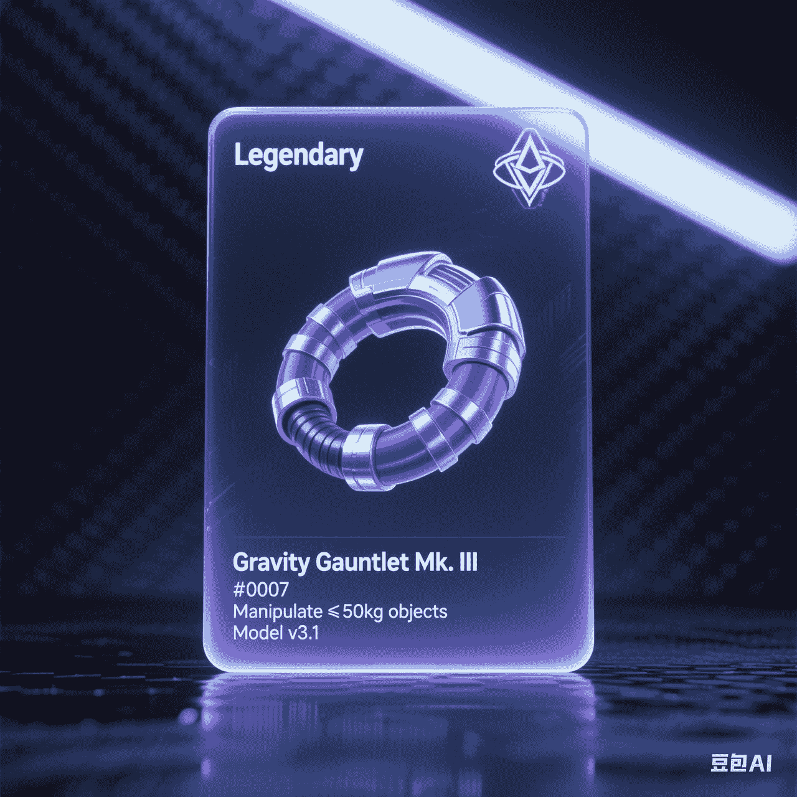

# 未来风格卡牌

> 来源：[https://qianniucity.feishu.cn/docx/IJamdWaYWohPyAxus09cvCjUnQh](https://qianniucity.feishu.cn/docx/IJamdWaYWohPyAxus09cvCjUnQh)

```
{&quot;prompt&quot;: &quot;一张未来风格的物品/道具集换式卡牌，具有黑暗、深沉的霓虹美学和柔和的科幻灯光。卡片呈现一个半透明的圆角矩形，边缘带有轻微柔和的发光效果，看起来像是全息玻璃制成。中央悬浮着物品 &#x27;{{item_name}}&#x27; 的精细 3D 模型，使用引人注目的聚焦灯光照亮，凸显其 {{item_material}} 材质和关键特征，使用 {{colors}} 的平滑渐变色进行照明，但不过于明亮。卡片表面的反射应是微妙的，带有轻微的光泽感，捕捉环境光。背景是深色碳纤维纹理或深邃的渐变色，柔和的环境光晕渗透到边缘。添加从顶部斜向下照射的微妙光线，为场景带来柔和的电影感光晕。对边缘、物品和反射应用轻微的运动模糊，以赋予场景深度感和活力，仿佛它是高端科技动画的静帧截图。卡片下方包含逼真的地面反射，反映出物品、霓虹边缘——略微扩散以营造扎实、未来感的外观。文本元素极简且光线柔和：左上角显示稀有度 **&#x27;{{rarity}}&#x27;**（英文），右上角有一个代表 &#x27;{{origin_icon_desc}}&#x27; 的风格化图标，底部中央显示物品名称 **&#x27;{{item_name}}&#x27;**（英文），旁边是序列号 **&#x27;{{card_number}}&#x27;**、物品效果/属性 **&#x27;{{item_stats}}&#x27;**（英文），以及年份/型号 **&#x27;{{year_or_model}}&#x27;**（英文）。字体应带有微弱的光晕和轻微的模糊效果，所有元素都应感觉高级、优雅且光线柔和——像一张高端赛博朋克收藏品卡片。&quot;,&quot;style&quot;: {&quot;lighting&quot;: &quot;霓虹光晕，柔和反射，聚焦照明&quot;,&quot;font&quot;: &quot;现代无衬线字体，简洁、极简&quot;, // 字体风格描述，保持中文&quot;layout&quot;: &quot;居中，结构类似数字收藏卡&quot;,&quot;materials&quot;: &quot;玻璃，全息塑料，发光金属边缘&quot;},&quot;parameters&quot;: {&quot;item_name&quot;: &quot;Gravity Gauntlet Mk. III&quot;, // 物品名称 (英文)&quot;rarity&quot;: &quot;Legendary&quot;, // 稀有度 (英文)&quot;origin_icon_desc&quot;: &quot;奥术科技徽章&quot;, // 图标的 *描述*，保持中文让 AI 理解画什么图标&quot;item_stats&quot;: &quot;Manipulate ≤50kg objects&quot;, // 物品的关键属性或效果 (英文)&quot;item_material&quot;: &quot;柔性合金与能量核心&quot;, // 物品的 *材质描述*，保持中文让 AI 理解画什么材质&quot;card_number&quot;: &quot;#0007&quot;, // 卡片序列号 (通用格式)&quot;year_or_model&quot;: &quot;Model v3.1&quot;, // 年份或型号 (英文)&quot;colors&quot;: [&quot;紫色&quot;, &quot;银色&quot;, &quot;深蓝&quot;] // *颜色描述*，保持中文让 AI 理解用什么颜色},&quot;medium&quot;: &quot;3D渲染，高分辨率数字艺术&quot;,&quot;size&quot;: &quot;1080px by 1080px&quot;}
```

