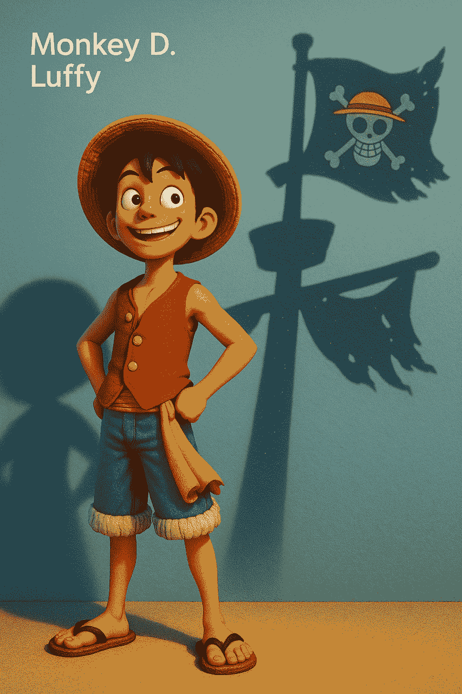

# 风格人物+精神投射

> 来源：[https://qianniucity.feishu.cn/docx/FBWsdDfSuo586Excwsgcz2tsnLd](https://qianniucity.feishu.cn/docx/FBWsdDfSuo586Excwsgcz2tsnLd)

```
A high-resolution vertical Pixar-style 3D character illustration.

Main character:  
Salvador Dalí — depicted as a tall, slim, and slightly exaggerated Pixar-style 3D character.  
Wearing a classic blue shirt, yellow tie, high-waisted plaid trousers with suspenders, and leather shoes.  
His iconic long upturned mustache, slick black hair, sharply arched eyebrows, and slightly eccentric posture.  
Stands with chest out, one hand on hip, head tilted slightly back in his typical theatrical flair.

Background:  
Flat, clean yellow background with subtle surface texture.  
Strong sunlight from top-left casts a distinct and enlarged shadow on the wall behind him.

Key Concept – Shadow as spiritual projection:  
The shadow cast behind him does **not** mirror his body shape.  
Instead, it takes the form of one of his most iconic artworks —  
a surreal melted clock with long dripping arms, inspired by “The Persistence of Memory”.

The melted clock shadow is positioned diagonally, starting from his shoulder,  
stretching wide and low across the yellow wall, surreal and fluid, yet unmistakably symbolic.

This shadow is **Dalí’s legacy made visible** — a symbolic extension of his identity through time, dream, and visual distortion.

Lighting &amp; Rendering:  
Pixar-like rendering with detailed but stylized textures.  
Use subtle filmic grain, soft shadows, and warm color grading.  
Subtle sparkles or light speckles inside the shadow to evoke dreamlike texture.

Typography (top-left corner):  
“Salvador Dalí” in minimalist black sans-serif font, “Dalí” bolded.
```


```
**A high-resoluti****on vertical**** Pixar-style 3D character** illustrati**on.

Mai**n character:
Monkey D. Lu**ffy — depicted as a y**outhful, lean, and dynamically exaggerated Pixar-style 3D character.
Wearing his classic red vest, blue shorts with a yellow sash, and straw sandals. His iconic straw hat is tilted slightly backward.
Big, expressive eyes full of curiosity and determination; broad smile with a missing tooth.
His posture is relaxed but confident — standing tall with arms slightly akimbo, head slightly tilted, and chest puffed with a carefree attitude.

Background:
Flat, clean sky-blue background with subtle texture, evoking the sea breeze and open sky.
Warm sunlight from top-right casts a bold and stretched shadow onto the background wall.

Key Concept – Shadow as spiritual projection:
The shadow does not replicate Luffy’s body shape.
Instead, it transforms into a giant, surreal ship’s mast with a fluttering pirate flag (Straw Hat crew’s jolly roger).
The mast stretches from his back upward and outward, symbolizing his dream of becoming Pirate King and the spirit of freedom.
The pirate flag is larger than life, slightly torn, but vivid — rippling with motion even in stillness, with stylized sparkles around the edges.

The shadow is Luffy’s dream made visible — an emotional, symbolic projection of boundless ambition, friendship, and adventure.

Lighting &amp; Rendering:
Pixar-style rendering with expressive, cartoonishly realistic textures (e.g., subtle cloth fibers, skin pores, wood grain in the shadowed mast).
Use soft golden rim light and warm color grading to emphasize optimism and warmth.
Include faint sparkles or floating particles in the shadow to hint at mystery and magic of the Grand Line.

Typography (top-left corner):
“Monkey D. Luffy” in clean white sans-serif font, “Luffy” bolded.
```



Prompt 思路

```
风格人物+精神投射

不是单纯的Pixar风格，有点Designer Toy 风格

让模型帮我加入了人物戏剧夸张的身形和表情「修长身形，大脚，块状的结构」

以此慢慢的 让模型延展其他人物。
```