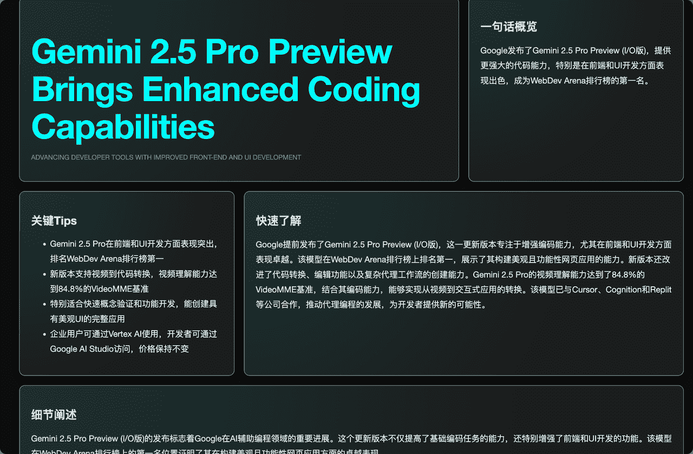

# 网页内容总结成 html

> 来源：[https://qianniucity.feishu.cn/docx/FU3Ld5VRdoCtsExVECmcZbzFnee](https://qianniucity.feishu.cn/docx/FU3Ld5VRdoCtsExVECmcZbzFnee)

演示：https://ys1tcvvu1a.app.yourware.so/



```
{
  &quot;task&quot;: &quot;Generate HTML Web Page: Fixed Style Bento Grid with Specific Content Sections from Article Link&quot;,
  &quot;input_article&quot;: {
    &quot;source_type&quot;: &quot;url&quot;,
    &quot;url&quot;: &quot;[https://www.modelscope.cn/models/Wan-AI/Wan2.1-VACE-1.3B]&quot; // **唯一需要用户填写的字段**
    // 例如: &quot;url&quot;: &quot;https://cline.bot/blog/why-patterns-matter-lessons-from-hyper-growth-startups&quot;
    // 如果 AI 无法直接访问 URL，可能需要提供文本内容，可考虑添加:
    // &quot;fallback_content_if_url_fails&quot;: &quot;[如果AI无法访问URL，可在此处提供文章文本]&quot;
  },
  &quot;output_format&quot;: &quot;HTML Code&quot;,
  &quot;page_specs&quot;: {
    &quot;title&quot;: {
      &quot;source&quot;: &quot;generated_summary_title&quot;, // 页面标题基于生成的快速了解内容
      &quot;fallback_source&quot;: &quot;original_article_title&quot;,
      &quot;prefix&quot;: &quot;Article Insights: &quot; // 标题前缀固定
    },
    &quot;lang&quot;: &quot;auto-detect&quot;, // 尝试根据文章内容自动检测主要语言
    &quot;head_elements_config&quot;: [
      {&quot;tag&quot;: &quot;meta&quot;, &quot;attributes&quot;: {&quot;charset&quot;: &quot;UTF-8&quot;}},
      {&quot;tag&quot;: &quot;meta&quot;, &quot;attributes&quot;: {&quot;name&quot;: &quot;viewport&quot;, &quot;content&quot;: &quot;width=device-width, initial-scale=1.0&quot;}},
      {&quot;tag&quot;: &quot;title&quot;, &quot;content_source&quot;: &quot;page_title&quot;},
      {&quot;tag&quot;: &quot;link&quot;, &quot;attributes&quot;: {&quot;rel&quot;: &quot;stylesheet&quot;, &quot;href&quot;: &quot;https://cdn.jsdelivr.net/npm/tailwindcss@^3.0/dist/tailwind.min.css&quot;}}, // TailwindCSS CDN (v3.0+)
      {&quot;tag&quot;: &quot;link&quot;, &quot;attributes&quot;: {&quot;rel&quot;: &quot;stylesheet&quot;, &quot;href&quot;: &quot;https://cdnjs.cloudflare.com/ajax/libs/font-awesome/6.0.0/css/all.min.css&quot;}}, // Font Awesome CDN (v6.0+)
      // 可选：如果需要嵌入图表组件且有特定 CSS，在此添加
      // {&quot;tag&quot;: &quot;link&quot;, &quot;attributes&quot;: {&quot;rel&quot;: &quot;stylesheet&quot;, &quot;href&quot;: &quot;[Chart Library CSS CDN]&quot;}}
      {&quot;tag&quot;: &quot;style&quot;, &quot;content_source&quot;: &quot;generated_internal_css&quot;} // 指示 AI 在 &lt;head&gt; 中生成 &lt;style&gt; 块，内容基于 design_system
    ],
    &quot;body_structure&quot;: {
      &quot;container_tag&quot;: &quot;div&quot;,
      &quot;container_attributes&quot;: {&quot;class&quot;: &quot;bento-grid-container min-h-screen p-4 md:p-8&quot;},
      &quot;content_blocks&quot;: [ // **定义了固定的内容块及其顺序和内容类型**
        {
          &quot;block_id&quot;: &quot;title-block&quot;,
          &quot;type&quot;: &quot;Page Title&quot;,
          &quot;layout_span_desktop&quot;: &quot;span 2&quot;,
          &quot;layout_span_mobile&quot;: &quot;span 1&quot;,
          &quot;content_source&quot;: &quot;page_title&quot;,
          &quot;content_formatting&quot;: {
             &quot;tag&quot;: &quot;h1&quot;,
             &quot;style_role&quot;: &quot;Emphasis Title&quot;,
             &quot;secondary_text&quot;: {&quot;source&quot;: &quot;auto-generated-brief-english-tagline&quot;, &quot;style_role&quot;: &quot;Subtle Accent Text&quot;}
          }
        },
        {
           &quot;block_id&quot;: &quot;one-sentence-summary-block&quot;,
           &quot;type&quot;: &quot;One Sentence Description&quot;,
           &quot;layout_span_desktop&quot;: &quot;span 1&quot;,
           &quot;layout_span_mobile&quot;: &quot;span 1&quot;,
           &quot;content_source&quot;: &quot;generated_one_sentence_summary&quot;, // AI 生成一句话总结
            &quot;content_spec&quot;: {
               &quot;type&quot;: &quot;single_sentence_summary&quot;,
               &quot;focus&quot;: &quot;Core Topic / Primary Argument&quot;,
               &quot;style&quot;: [&quot;Very Concise&quot;, &quot;Impactful&quot;]
            },
            &quot;content_formatting&quot;: {
               &quot;tag&quot;: &quot;div&quot;, // 或 p, blockquote
               &quot;heading&quot;: {&quot;tag&quot;: &quot;h2&quot;, &quot;content&quot;: &quot;一句话概览&quot;, &quot;style_role&quot;: &quot;Block Title&quot;},
               &quot;paragraph&quot;: {&quot;tag&quot;: &quot;p&quot;, &quot;style_role&quot;: &quot;Primary Text&quot;}
            }
        },
        {
           &quot;block_id&quot;: &quot;tips-block&quot;,
           &quot;type&quot;: &quot;Key Tips / Takeaways&quot;,
           &quot;layout_span_desktop&quot;: &quot;span 1&quot;,
           &quot;layout_span_mobile&quot;: &quot;span 1&quot;,
           &quot;content_source&quot;: &quot;extracted_or_generated_tips&quot;, // 从原文提取或基于原文生成 Tips
            &quot;content_spec&quot;: {
               &quot;type&quot;: &quot;list_of_tips&quot;,
               &quot;focus&quot;: &quot;Actionable Advice / Practical Lessons&quot;,
               &quot;count&quot;: {&quot;min&quot;: 2, &quot;max&quot;: 4}, // 提取 2-4 个 Tips
               &quot;style&quot;: [&quot;Concise&quot;, &quot;Actionable&quot;, &quot;Bulleted List&quot;]
            },
            &quot;content_formatting&quot;: {
               &quot;tag&quot;: &quot;div&quot;,
               &quot;heading&quot;: {&quot;tag&quot;: &quot;h2&quot;, &quot;content&quot;: &quot;关键Tips&quot;, &quot;style_role&quot;: &quot;Block Title&quot;},
               &quot;list&quot;: {&quot;tag&quot;: &quot;ul&quot;, &quot;item_tag&quot;: &quot;li&quot;, &quot;style_role&quot;: &quot;Primary Text&quot;}
            }
        },
        {
           &quot;block_id&quot;: &quot;quick-understanding-block&quot;,
           &quot;type&quot;: &quot;Quick Understanding Summary&quot;,
           &quot;layout_span_desktop&quot;: &quot;span 2&quot;,
           &quot;layout_span_mobile&quot;: &quot;span 1&quot;,
           &quot;content_source&quot;: &quot;generated_quick_summary&quot;, // AI 生成一个比一句话详细的快速了解总结
            &quot;content_spec&quot;: {
               &quot;type&quot;: &quot;paragraph_summary&quot;,
               &quot;focus&quot;: &quot;Core Argument / Main Points Overview&quot;,
               &quot;style&quot;: [&quot;Concise&quot;, &quot;Clear&quot;, &quot;Informative&quot;],
               &quot;length&quot;: &quot;Short Paragraph (approx. 80-120 words)&quot;
            },
            &quot;content_formatting&quot;: {
               &quot;tag&quot;: &quot;div&quot;,
               &quot;heading&quot;: {&quot;tag&quot;: &quot;h2&quot;, &quot;content&quot;: &quot;快速了解&quot;, &quot;style_role&quot;: &quot;Block Title&quot;},
               &quot;paragraph&quot;: {&quot;tag&quot;: &quot;p&quot;, &quot;style_role&quot;: &quot;Primary Text&quot;}
            }
        },
         {
          &quot;block_id&quot;: &quot;detail-description-block&quot;,
          &quot;type&quot;: &quot;Article Detail Description&quot;,
          &quot;layout_span_desktop&quot;: &quot;span 3&quot;, // 细节描述块可能需要更宽的布局
          &quot;layout_span_mobile&quot;: &quot;span 1&quot;,
           &quot;content_source&quot;: &quot;extracted_and_structured_details_with_quotes&quot;, // 提取原文细节，可引用原文
            &quot;content_spec&quot;: {
               &quot;type&quot;: &quot;structured_detail_presentation&quot;,
               &quot;focus&quot;: &quot;Key Arguments, Explanations, or Examples from Article&quot;,
               &quot;style&quot;: [&quot;Descriptive&quot;, &quot;Analytical&quot;, &quot;Can include short quotes&quot;],
               &quot;length&quot;: &quot;Moderate to Long (multiple paragraphs/points)&quot;,
               &quot;include_quotes&quot;: {&quot;max_count&quot;: 2, &quot;style&quot;: &quot;inline or blockquote subtle&quot;}, // 最多引用 2 段原文，风格内联或引用块
               &quot;ignore&quot;: [&quot;Redundant information&quot;, &quot;Minor formatting in original&quot;, &quot;Lengthy disclaimers&quot;]
            },
           &quot;content_formatting&quot;: {
             &quot;tag&quot;: &quot;div&quot;,
             &quot;heading&quot;: {&quot;tag&quot;: &quot;h2&quot;, &quot;content&quot;: &quot;细节阐述&quot;, &quot;style_role&quot;: &quot;Block Title&quot;},
             &quot;content_elements&quot;: [ // 这个块内部可能有多个段落或引用块
               {&quot;tag&quot;: &quot;p&quot;, &quot;content_source&quot;: &quot;generated_detail_paragraph&quot;, &quot;style_role&quot;: &quot;Primary Text&quot;, &quot;attributes&quot;: {&quot;class&quot;: &quot;mb-4&quot;}},
               {&quot;tag&quot;: &quot;blockquote&quot;, &quot;content_source&quot;: &quot;original_quote&quot;, &quot;style_role&quot;: &quot;Quote Text&quot;, &quot;optional&quot;: true, &quot;attributes&quot;: {&quot;class&quot;: &quot;border-l-4 border-accent-vibrant pl-4 italic text-gray-400 my-4&quot;}}, // 引用块样式
               {&quot;tag&quot;: &quot;p&quot;, &quot;content_source&quot;: &quot;generated_detail_paragraph&quot;, &quot;style_role&quot;: &quot;Primary Text&quot;, &quot;attributes&quot;: {&quot;class&quot;: &quot;mb-4&quot;}, &quot;optional&quot;: true} // 可以有多个段落和引用
             ]
           }
        },
         {
            &quot;block_id&quot;: &quot;original-link-block&quot;,
            &quot;type&quot;: &quot;Link to Original Article&quot;,
            &quot;layout_span_desktop&quot;: &quot;span 1&quot;,
            &quot;layout_span_mobile&quot;: &quot;span 1&quot;,
            &quot;content_source&quot;: &quot;input_article.url&quot;,
            &quot;content_formatting&quot;: {
               &quot;tag&quot;: &quot;div&quot;,
               &quot;heading&quot;: {&quot;tag&quot;: &quot;h2&quot;, &quot;content&quot;: &quot;阅读原文&quot;, &quot;style_role&quot;: &quot;Block Title&quot;},
               &quot;link&quot;: {
                  &quot;tag&quot;: &quot;a&quot;,
                  &quot;attributes&quot;: {&quot;href_source&quot;: &quot;content_source&quot;, &quot;target&quot;: &quot;_blank&quot;, &quot;class&quot;: &quot;flex items-center&quot;},
                  &quot;content&quot;: &quot;点击此处阅读完整文章&quot;,
                  &quot;style_role&quot;: &quot;Link&quot;,
                  &quot;icon&quot;: {&quot;library&quot;: &quot;Font Awesome&quot;, &quot;name&quot;: &quot;fas fa-external-link-alt&quot;, &quot;position&quot;: &quot;right&quot;, &quot;style_role&quot;: &quot;Icon&quot;}
               }
            }
         }
         // 块的顺序和类型是固定的，AI需要填充对应内容
      ]
    }
  },
  &quot;design_system&quot;: { // **固定不变的视觉设计系统规范**
    &quot;overall_aesthetic&quot;: &quot;Modern Tech / Bento Grid / High Contrast&quot;,
    &quot;color_palette&quot;: {
      &quot;description&quot;: &quot;High contrast dark theme with a single vibrant accent color.&quot;,
      &quot;roles&quot;: {
        &quot;background_dark&quot;: &quot;#0D0D0D&quot;, // 更深的背景
        &quot;surface_dark&quot;: &quot;#1C1C1C&quot;, // 稍亮的深色表面用于块背景
        &quot;accent_vibrant&quot;: &quot;#00FFFF&quot;, // 鲜艳高亮色 (青色)
        &quot;text_primary_light&quot;: &quot;#F0F0F0&quot;, // 浅色主要文本
        &quot;text_secondary_muted&quot;: &quot;#A0A0A0&quot; // 柔和次要文本
      }
    },
    &quot;typography&quot;: {
      &quot;description&quot;: &quot;Emphasis on large/bold elements contrasted with smaller text. Mix of main language (auto-detected) and English accents. Uses a modern sans-serif font.&quot;,
      &quot;font_family&quot;: &quot;&#x27;Segoe UI&#x27;, Roboto, &#x27;Helvetica Neue&#x27;, Arial, sans-serif&quot;,
      &quot;styles&quot;: {
        &quot;Emphasis Title&quot;: {&quot;tag&quot;: &quot;h1&quot;, &quot;font_size&quot;: &quot;clamp(2.5rem, 6vw, 4.5rem)&quot;, &quot;font_weight&quot;: &quot;extrabold&quot;, &quot;color_role&quot;: &quot;accent_vibrant&quot;, &quot;text_transform&quot;: &quot;none&quot;, &quot;letter_spacing&quot;: &quot;tight&quot;, &quot;line_height&quot;: &quot;1.1&quot;},
        &quot;Subtle Accent Text&quot;: {&quot;tag&quot;: &quot;p, span&quot;, &quot;font_size&quot;: &quot;0.875rem&quot;, &quot;font_weight&quot;: &quot;normal&quot;, &quot;color_role&quot;: &quot;text_secondary_muted&quot;, &quot;language&quot;: &quot;English&quot;, &quot;text_transform&quot;: &quot;uppercase&quot;, &quot;opacity&quot;: &quot;0.8&quot;},
        &quot;Block Title&quot;: {&quot;tag&quot;: &quot;h2&quot;, &quot;font_size&quot;: &quot;1.5rem&quot;, &quot;font_weight&quot;: &quot;bold&quot;, &quot;color_role&quot;: &quot;text_primary_light&quot;, &quot;margin_bottom&quot;: &quot;1rem&quot;},
        &quot;Primary Text&quot;: {&quot;tag&quot;: &quot;p, li&quot;, &quot;font_size&quot;: &quot;1.1rem&quot;, &quot;font_weight&quot;: &quot;normal&quot;, &quot;color_role&quot;: &quot;text_primary_light&quot;, &quot;line_height&quot;: &quot;1.8&quot;},
        &quot;Quote Text&quot;: {&quot;tag&quot;: &quot;blockquote&quot;, &quot;font_size&quot;: &quot;1.1rem&quot;, &quot;font_weight&quot;: &quot;normal&quot;, &quot;color_role&quot;: &quot;text_secondary_muted&quot;, &quot;line_height&quot;: &quot;1.8&quot;, &quot;font_style&quot;: &quot;italic&quot;}, // 引用文本样式
        &quot;Large Visual Element Text&quot;: {&quot;tag&quot;: &quot;div, span&quot;, &quot;font_size&quot;: &quot;clamp(5rem, 12vw, 8rem)&quot;, &quot;font_weight&quot;: &quot;extrabold&quot;, &quot;color_role&quot;: &quot;accent_vibrant&quot;, &quot;opacity&quot;: &quot;0.15&quot;, &quot;position&quot;: &quot;absolute&quot;, &quot;inset&quot;: &quot;0&quot;, &quot;display&quot;: &quot;flex&quot;, &quot;justify_content&quot;: &quot;center&quot;, &quot;align_items&quot;: &quot;center&quot;, &quot;pointer_events&quot;: &quot;none&quot;, &quot;text_align&quot;: &quot;center&quot;, &quot;line_height&quot;: &quot;1&quot;} // 超大视觉元素样式（文本）
      }
    },
    &quot;layout_grid&quot;: {
       &quot;description&quot;: &quot;Responsive CSS Grid layout for the main container.&quot;,
       &quot;gap&quot;: &quot;20px&quot;,
       &quot;responsive_columns&quot;: [
         {&quot;screen&quot;: &quot;default&quot;, &quot;columns&quot;: &quot;1fr&quot;},
         {&quot;screen&quot;: &quot;md&quot;, &quot;columns&quot;: &quot;repeat(2, 1fr)&quot;},
         {&quot;screen&quot;: &quot;lg&quot;, &quot;columns&quot;: &quot;repeat(3, 1fr)&quot;}
       ]
    },
    &quot;block_styling&quot;: {
      &quot;description&quot;: &quot;Styling for individual Bento Grid blocks.&quot;,
      &quot;padding&quot;: &quot;24px&quot;,
      &quot;background_color_role&quot;: &quot;surface_dark&quot;,
      &quot;border_color_role&quot;: &quot;text_secondary_muted&quot;,
      &quot;border_width&quot;: &quot;1px&quot;,
      &quot;rounded_corners&quot;: &quot;12px&quot;,
      &quot;box_shadow&quot;: &quot;rgba(0, 0, 0, 0.25) 0px 10px 30px&quot;, // 更明显的阴影
      &quot;interactive_effects&quot;: [&quot;Subtle hover scale (e.g., scale-103)&quot;, &quot;Slight background lighten on hover (optional)&quot;],
      &quot;overflow&quot;: &quot;hidden&quot;,
      &quot;position&quot;: &quot;relative&quot;
    },
     &quot;color_effects&quot;: {
      &quot;type&quot;: &quot;Transparency Gradient Overlay&quot;,
      &quot;application&quot;: &quot;Backgrounds of specific blocks or the main container.&quot;,
      &quot;color_role&quot;: &quot;accent_vibrant&quot;,
      &quot;style&quot;: &quot;Subtle radial or linear gradient fading to transparent or background_dark, primarily on the top-left or corners.&quot;
    },
     &quot;iconography&quot;: {
       &quot;library_source&quot;: &quot;CDN (Font Awesome)&quot;,
       &quot;style&quot;: &quot;Consistent with theme (e.g., solid or regular), modern&quot;,
       &quot;color_role&quot;: &quot;accent_vibrant&quot;,
       &quot;size&quot;: &quot;Standard&quot;,
       &quot;exclusion&quot;: &quot;Avoid Emojis as primary icons.&quot;
     },
    &quot;animation&quot;: {
      &quot;trigger&quot;: &quot;Scroll into View&quot;,
      &quot;mimic_inspiration&quot;: &quot;Smooth, Modern Scroll Reveal (like Apple)&quot;,
      &quot;types&quot;: [
        &quot;Fade-in&quot;,
        &quot;Subtle Slide-in (translateY from 20px to 0px)&quot;,
        &quot;Scale-up (transform scale from 0.98 to 1)&quot;
      ],
      &quot;application&quot;: &quot;Apply animations to individual &#x27;.bento-block&#x27; elements as they become visible in the viewport.&quot;,
      &quot;duration&quot;: &quot;600ms&quot;,
      &quot;easing&quot;: &quot;cubic-bezier(0.25, 0.1, 0.25, 1.0)&quot;
    }
  },
  &quot;technical_requirements&quot;: { // **固定不变的技术栈**
    &quot;html_version&quot;: &quot;HTML5&quot;,
    &quot;css_framework&quot;: &quot;TailwindCSS 3.0+ (via CDN)&quot;,
    &quot;javascript_usage&quot;: &quot;Required for scroll-triggered animations.&quot;,
    &quot;external_resources&quot;: [&quot;TailwindCSS CDN&quot;, &quot;Font Awesome CDN&quot;], // 简化，不强制要求图表库CDN
    &quot;data_visualization_handling&quot;: &quot;If article contains data, present it textually or with simple formatting within a block. Do not attempt to embed complex chart components unless explicitly easy to style and integrate.&quot; // 简化数据可视化处理
  },
  &quot;constraints&quot;: [ // **固定的生成约束**
    &quot;Strictly adhere to the color palette roles defined in &#x27;design_system.color_palette.roles&#x27;.&quot;,
    &quot;Implement the typography styles as defined, including font sizes, weights, colors, line height, and language mix.&quot;,
    &quot;Ensure the Bento Grid layout is implemented correctly using CSS Grid and TailwindCSS classes, respecting the specified gap and responsive columns for each block&#x27;s defined layout_span.&quot;,
    &quot;Implement scroll-triggered animations using JavaScript as specified.&quot;,
    &quot;Only use icons from Font Awesome via CDN.&quot;,
    &quot;Do not use emojis.&quot;,
    &quot;The generated HTML must be valid, semantic, and well-structured.&quot;,
    &quot;The generated CSS should be included in a &lt;style&gt; tag in the &lt;head&gt;.&quot;,
    &quot;All content for the specified blocks (One Sentence, Tips, Quick Understanding, Detail Description) must be derived *from* or based *on* the original article content, following the &#x27;content_spec&#x27; for each block.&quot;,
    &quot;Ensure the Detail Description block accurately represents key arguments/explanations from the original article and includes up to 2 brief quotes if suitable ones are found.&quot;,
    &quot;The block types and their order must follow the &#x27;content_blocks&#x27; array definition.&quot;,
    &quot;The generated page must render clearly and present the specified content sections in a visually engaging, structured manner using the fixed Bento Grid style.&quot;
  ],
  &quot;instructions_to_ai&quot;: [ // **固定的执行指令**
    &quot;Access and read the article at the provided URL: [Insert URL from input_article.url].&quot;,
    &quot;Analyze the article to understand its core message, identify practical takeaways/tips, extract key arguments/explanations, and find suitable short quotes (max 2).&quot;,
    &quot;Generate content for each defined block type based on its &#x27;content_source&#x27; and &#x27;content_spec&#x27;: a one-sentence summary, 2-4 key tips, a quick understanding paragraph summary (80-120 words), and a detail description block incorporating key arguments and selected quotes from the original article.&quot;,
    &quot;Generate a suitable HTML page title based on the generated &#x27;Quick Understanding Summary&#x27;, using the specified prefix.&quot;,
    &quot;Generate complete and valid HTML5 code. Structure the &lt;body&gt; content using a main container div with the specified class.&quot;,
    &quot;Create the specific sequence of &#x27;.bento-block&#x27; div elements exactly as defined in the &#x27;page_specs.body_structure.content_blocks&#x27; array. Assign the correct classes and layout spans to each block.&quot;,
    &quot;Populate each block with the generated content (title, summaries, tips, link, details) and format the content elements (h1, h2, p, ul, li, blockquote, a, icons) according to their &#x27;content_formatting&#x27; rules and &#x27;style_role&#x27; references.&quot;,
    &quot;Generate the necessary CSS code within a &lt;style&gt; tag in the &lt;head&gt; based *strictly* on the &#x27;design_system&#x27; specifications, mapping color roles to actual hex codes, implementing typography styles, responsive grid layout, block styling, color effects, and icon styling.&quot;,
    &quot;Implement the specified scroll-triggered animations using JavaScript, applying them to the &#x27;.bento-block&#x27; elements as they enter the viewport.&quot;,
    &quot;Ensure the generated HTML, CSS, and JS together create a functional, responsive page that precisely follows the defined Bento Grid layout and fixed visual style, presenting the extracted and generated content clearly.&quot;
  ]
}
```