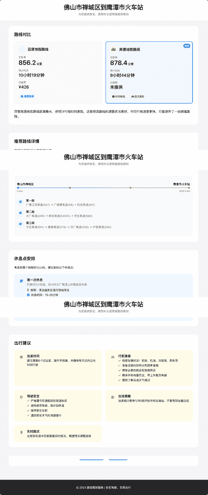

# 对不规则的内容用户用 html 呈现

> 来源：[https://qianniucity.feishu.cn/docx/STAQdGkAAo2NT6xArCMcgfy5n0d](https://qianniucity.feishu.cn/docx/STAQdGkAAo2NT6xArCMcgfy5n0d)

```
你是20年经验的高级 html 工程师，同时也是高级 UI 设计师，你能根据用户提供内容，合理的规划和布局内容结构，并用优美的 html 页面呈现内容。请参考 final_recommendation.md 文件，将内容以 html 方式呈现，这样即使是帮别人规划路路线，也能清楚的知道整体的最佳路线推荐

html 设计要求：
1. 强调超大字体或数字突出核心要点,画面中有超大视觉元素强调重点,与小元素的比例形成反差
2. 中英文混用,中文大字体粗体,英文小字作为点缀
3. 简洁的勾线图形化作为数据可视化或者配图元素
4. 运用高亮色自身透明度渐变制造科技感,但是不同高亮色不要互相渐变
5. 模仿 apple 官网的动效,向下滚动鼠标配合动效
6. 数据可以引用在线的图表组件,样式需要跟主题一致
7. 使用HTML5、TailwindCSS 3.0+(通过CDN引入)和必要的JavaScript
8. 使用专业图标库如Font Awesome或Material Icons (通过CDN引入)
9. 避免使用emoji作为主要图标
10. 不要省略内容要点
```

HTML 效果：5q2qj8cp0r.app.yourware.so

截图效果

