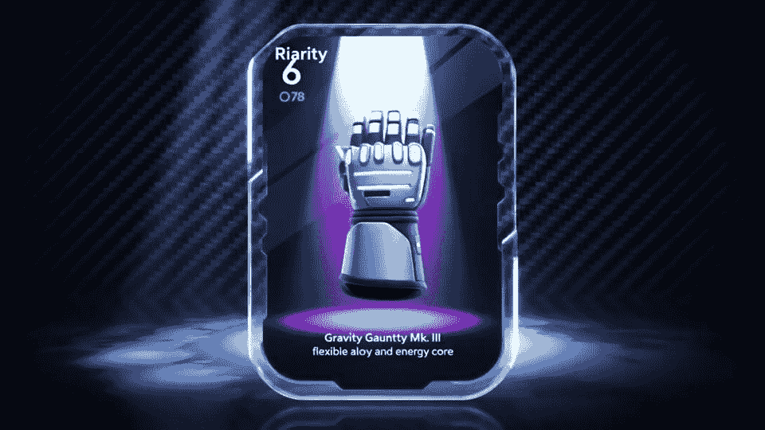

# 文生视频

> 来源：[https://qianniucity.feishu.cn/docx/Su41diBEvondcdxwPdEcmhScn5g](https://qianniucity.feishu.cn/docx/Su41diBEvondcdxwPdEcmhScn5g)



[Futuristic_Trading_Card_Video_Ready.mp4](https://internal-api-drive-stream.feishu.cn/space/api/box/stream/download/all/BrE1bX27IoJ5UIxupORc1R0SnBf)

```
A futuristic item/prop trading card, featuring a dark, deep neon aesthetic and soft sci-fi lighting. The card itself is a translucent, rounded rectangle with slightly soft glowing edges, appearing as if made of holographic glass. 

 Centrally, a detailed 3D model of the item &#x27;Gravity Gauntlet Mk. III&#x27; hovers, illuminated by a striking spotlight that highlights its &#x27;flexible alloy and energy core&#x27; material and key features. The item is lit with smooth gradient colors of purple, silver, and deep blue, but not overly bright. 

 Reflections on the card surface are subtle, with a slight sheen, capturing ambient light. The background is a dark carbon fiber texture or a deep gradient, with a soft ambient glow seeping towards the edges. Subtle light rays shine diagonally downwards from the top, lending a soft, cinematic haze to the scene. 

 Slight motion blur is applied to the card edges, the item, and its reflections to give the scene depth and dynamism, as if it&#x27;s a still frame from a high-tech animation. Below the card, include a realistic ground reflection showing the item and its neon edges, slightly diffused for a solid, futuristic look. 

 Text elements are minimalist and softly lit, using a modern sans-serif font that is clean and minimalist, with a faint glow and slight blur. 
 - Top-left: Rarity &#x27;Legendary&#x27; (English). 
 - Top-right: A stylized icon representing an &#x27;arcane tech sigil/emblem&#x27;. 
 - Bottom-center (stacked or arranged tastefully): 
     - Item name: &#x27;Gravity Gauntlet Mk. III&#x27; (English) 
     - Serial number: &#x27;#0007&#x27; 
     - Item effects/attributes: &#x27;Manipulate ≤50kg objects&#x27; (English) 
     - Year/model: &#x27;Model v3.1&#x27; (English) 

 All elements should feel premium, elegant, and softly lit—like a high-end cyberpunk collectible card. The overall layout is centered and structured like a digital collectible card. The card materials include glass, holographic plastic, and glowing metallic edges. 

 Lighting style: Neon glow, soft reflections, focused illumination. 
 Medium: 3D render, high-resolution digital art. 
 Size/Aspect Ratio: 1080px by 1080px (or 1:1 aspect ratio).
```